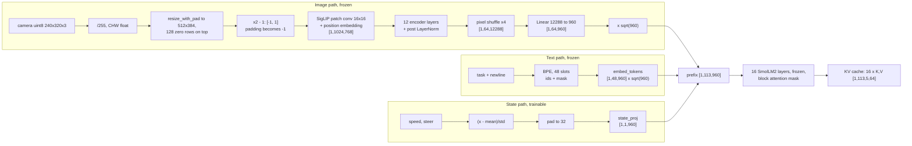
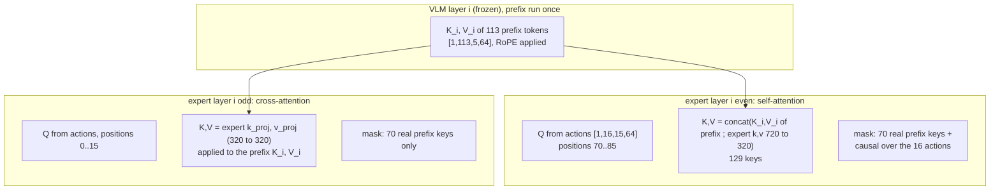
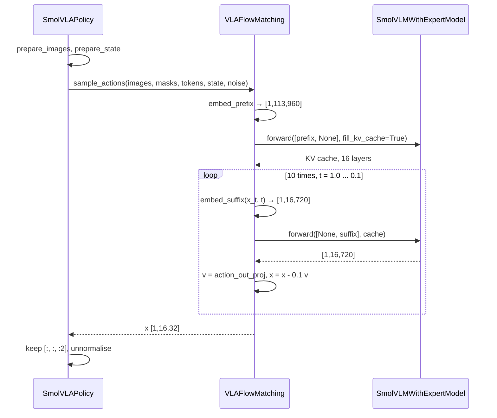
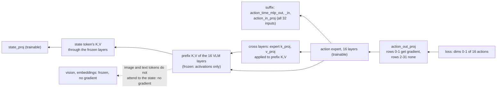
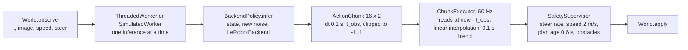

# SmolVLA in vla-drive: architecture analysis

*Tiếng Việt: [SMOLVLA_ARCHITECTURE_ANALYSIS.vi.md](SMOLVLA_ARCHITECTURE_ANALYSIS.vi.md)*

What the fine-tuned SmolVLA of this project (`smolvla-v1`) actually is, and how it turns
a camera frame, a sentence and the car's state into a chunk of steering and throttle.
Everything here was read from the source and the checkpoint the project uses, or measured
by running that checkpoint. Nothing was modified, and nothing was trained.

Investigated on 2026-11-19 on the branch `main` at `7787158`.

## How to read this document

Each claim carries one of these marks:

| Mark | Meaning |
|---|---|
| **[code]** | read in the source, at the file and line given |
| **[config]** | read in the checkpoint's `config.json`, `train_config.json` or processor files |
| **[run]** | measured for this document by running the checkpoint (inference only), or from the training log |
| **[inferred]** | a conclusion drawn from the above, not observed directly |
| **[open]** | not established; see [section 9](#9-unresolved-questions-and-implementation-gaps) |

**Source paths.** Repository files are links. LeRobot files are written `LR:path:line`,
relative to `lerobot/src/lerobot/` of the LeRobot clone at commit `3dd19d043`, the commit
the model was trained with (Lab 15). transformers files are written `TF:path:line`, relative
to `transformers/models/` of transformers 5.5.4.

---

## 0. The answer on one page

```
camera 320x240 RGB ─► /255 ─► resize to 512x384, pad 128 rows on top ─► x2-1 ─► [1,3,512,512]
                                    │ SigLIP, 12 layers, 768 wide, frozen
                                    ▼
                              [1,1024,768] ─► pixel shuffle x4 + Linear(12288→960) ─► [1,64,960] x √960
"drive along the track" + "\n" ─► BPE ─► 5 ids + 43 pad (48) ─► embed ─► [1,48,960] x √960
[speed, steer] ─► (x-μ)/σ ─► pad to 32 ─► state_proj Linear(32→960), trainable ─► [1,1,960]
                                    │ concatenated: 113 tokens
                                    ▼
          16 layers of SmolLM2 (first 16 of 32), frozen, run ONCE per observation
                                    │ keep K,V of each layer: 16 x 2 x [1,113,5,64]
                                    ▼
noise ε [1,16,32] ─► 10 Euler steps, t = 1.0, 0.9, … 0.1:
        action expert (16 layers, 720 wide, trainable) reads x_t, t and the KV cache
        and predicts a velocity v [1,16,32];  x ← x − 0.1·v
                                    ▼
          x[:, :, :2] · σ + μ ─► 16 × [steer, throttle], 0.1 s apart (1.5 s)
                                    ▼
   BackendPolicy (clip to [-1,1]) ─► ChunkExecutor (50 Hz, latency-indexed) ─► SafetySupervisor ─► car
```

The numbers that matter, all verified:

| | |
|---|---|
| Parameters | 450 046 176 in all; **99 880 992 trained** (action expert + 5 projections), 350 165 184 frozen **[run]** |
| Training | 2000 steps × batch 16 = 1.44 epochs of 22 176 frames, AdamW 1e-4 with a cosine schedule auto-shrunk to 66 warm-up steps, 13 min on an RTX 4060 **[run]** |
| Loss | flow matching: MSE between the velocity `ε − a` and the prediction, on the 2 real action dimensions only **[code]** |
| Inference | 1 vision pass + 1 prefix pass + 10 expert passes; 124 ms in PyTorch on an RTX 4060 laptop, 82 ms in FP16 TensorRT on the Jetson Orin Nano **[run]** |
| Driving | 6/6 evaluation drives, 1.44 m/s, 4.8 cm rms from the centreline (the teacher: 1.5 cm) **[run]** |

Seven findings an engineer should know before changing anything (details in the sections):

1. **The language model barely matters here.** It was fine-tuned on one sentence; `stop` and `turn left` hardly change the chunk (§6.6).
2. **Only 2 of the 32 action dimensions are trained.** The other 30 are pure noise in training, but drift during inference: by t = 0.1 their rms is 0.56–0.59 instead of 0.10. Measured effect on steering: none; on throttle, small (§4.6).
3. **The action expert's weights are bfloat16**, and training ran without mixed precision, so AdamW most likely updated bf16 weights directly (§5.4).
4. **RoPE base mismatch.** SmolVLM2's language model was trained with `rope_theta = 100000`; LeRobot's re-implementation of its layers hard-codes `10000` (§2.2.4).
5. **The learning rate schedule is not the configured one.** With 2000 steps instead of 30 000, LeRobot shrank the warm-up to 66 steps and the cosine decay to 2000 (§5.3).
6. **A latent bug in the "unfreeze the VLM" mode**: the names meant to keep the last layer and the final norm frozen match no parameter (§5.2, EXP-03).
7. **There is no CARLA here.** The simulator is the project's own flat kinematic one; CARLA would be another `Platform` (§6.7).

---

## 1. The actual model implementation

### 1.1 What runs, and which versions

| Item | Value | How known |
|---|---|---|
| SmolVLA implementation | LeRobot 0.5.2, commit `3dd19d043` (`LR:policies/smolvla/`) | **[config]** Lab 15 and the clone used to train |
| Policy class | `SmolVLAPolicy` → `VLAFlowMatching` → `SmolVLMWithExpertModel` (`LR:policies/smolvla/modeling_smolvla.py:226`, `:541`; `smolvlm_with_expert.py:72`) | **[code]** |
| PyTorch | 2.11.0+cu128 for training (Lab 15); 2.11.0+cu130 for this inspection | **[config]**/**[run]** |
| transformers | 5.5.4 for this inspection; the training version was not recorded, but the checkpoint's parameter names (`model.text_model.…`) match this version's layout | **[run]** / **[inferred]** |
| Pre-trained policy | `lerobot/smolvla_base` (`pretrained_path` in `config.json`) | **[config]** |
| VLM | `HuggingFaceTB/SmolVLM2-500M-Video-Instruct` (`vlm_model_name`) | **[config]** |
| Fine-tuned checkpoint | `runs/drive/vla/smolvla-v1/checkpoints/last/pretrained_model/` (906 MB `model.safetensors`, 500 tensors) | **[run]** |
| Training command | `lerobot-train --policy.path=lerobot/smolvla_base …` ([Lab 15, step 2](study/15-hands-on-labs.md#step-2-fine-tune-about-13-minutes)) | **[config]** `train_config.json` |
| Inference in the stack | [`LeRobotBackend`](../drive/policy/lerobot_backend.py#L34) behind [`BackendPolicy`](../drive/policy/vla.py#L31) | **[code]** |
| Dataset | `local/vla-drive`, LeRobotDataset v3 written by [`export`](../drive/learn/export.py#L75): 82 episodes, 24 876 frames, 10 fps | **[run]** |

### 1.2 Architecture parameters of this checkpoint

Read from the loaded model, not from defaults **[run]**:

| Part | Parameter | Value |
|---|---|---|
| Vision encoder (SigLIP) | image size, patch | 512 × 512, 16 × 16 → 32 × 32 = 1024 patches |
| | layers, width, heads, MLP | 12, 768, 12, 3072 (GELU-tanh), LayerNorm eps 1e-6 |
| Connector | pixel shuffle, projection | scale 4: 1024 × 768 → 64 × 12 288; `Linear(12288 → 960, bias=False)` |
| Language model (SmolLM2) | layers kept | **16 of 32** (`num_vlm_layers = 16`) |
| | width, heads, KV heads, head dim | 960, 15, 5 (grouped-query, 3 queries per KV head), 64 |
| | MLP, norm | gated SiLU 960 → 2560 → 960, RMSNorm eps 1e-5 |
| | vocabulary | 49 280 (49 152 BPE + 128 added) |
| Action expert | layers, width | **16**, **720** (`expert_width_multiplier = 0.75`) |
| | attention | 15 query heads × 64 (q: 720 → 960), 5 KV heads × 64, o: 960 → 720 |
| | MLP | gated SiLU 720 → 2048 → 720 (`get_intermediate_size(720)`, `LR:…/smolvlm_with_expert.py:65`) |
| | layer pattern | even layers self-attention (k, v: 720 → 320), odd layers cross-attention (k, v: 320 → 320) |
| State projection | `state_proj` | `Linear(32 → 960)` |
| Action projections | in, out | `Linear(32 → 720)`, `Linear(720 → 32)` |
| Time MLP | in, out | `Linear(1440 → 720)`, SiLU, `Linear(720 → 720)` |
| Flow matching | chunk, steps, padding | 16 actions, 10 Euler steps, actions and state padded to 32 |

### 1.3 Where this checkpoint departs from the defaults

`SmolVLAConfig` defaults (`LR:policies/smolvla/configuration_smolvla.py`) against this
checkpoint's `config.json` **[config]**:

| Field | Default | `smolvla-v1` | Why it matters |
|---|---|---|---|
| `chunk_size` / `n_action_steps` | 50 / 50 | **16 / 16** | 1.6 s at 10 fps; 50 would be 5 s |
| `load_vlm_weights` | False | True | the VLM is loaded from the Hub, then overwritten by the checkpoint |
| `pad_language_to` | `longest` | `max_length` | always 48 text slots |
| `prefix_length`, `num_expert_layers` | −1, −1 | 0, 0 | both mean "off" / "as many as the VLM" |
| `input_features` | — | state shape **6**, three cameras **256×256** | stale, inherited from `smolvla_base`; the data has state 2 and one 240×320 camera (§6.8) |

### 1.4 Important source files

| File | Role |
|---|---|
| `LR:policies/smolvla/modeling_smolvla.py` | `SmolVLAPolicy` (batch handling, loss reduction), `VLAFlowMatching` (prefix, suffix, flow matching, sampling) |
| `LR:policies/smolvla/smolvlm_with_expert.py` | the VLM + expert pair, the layer-by-layer forward, attention, RoPE |
| `LR:policies/smolvla/configuration_smolvla.py` | config, optimiser and scheduler presets, `action_delta_indices` |
| `LR:policies/smolvla/processor_smolvla.py` | pre/post-processing pipeline |
| `LR:processor/tokenizer_processor.py`, `newline_task_processor.py`, `normalize_processor.py` | tokenising, the trailing newline, mean/std normalisation |
| `LR:scripts/lerobot_train.py` | the training loop (`update_policy`) |
| `LR:optim/schedulers.py` | the cosine schedule and its auto-scaling |
| `TF:smolvlm/modeling_smolvlm.py` | SigLIP embeddings, encoder, connector |
| [`drive/learn/export.py`](../drive/learn/export.py) | episodes → LeRobotDataset, the choice of the action label |
| [`drive/learn/collect.py`](../drive/learn/collect.py) | teacher demonstrations with disturbed steering |
| [`drive/policy/lerobot_backend.py`](../drive/policy/lerobot_backend.py) | loads the checkpoint, runs the processors and the policy |
| [`drive/policy/vla.py`](../drive/policy/vla.py) | `BackendPolicy`: state, noise, clipping, `ActionChunk` |
| [`drive/control/executor.py`](../drive/control/executor.py), [`drive/loop.py`](../drive/loop.py), [`drive/safety.py`](../drive/safety.py) | how a chunk becomes motor commands |
| [`jetson/smolvla_trt/`](../jetson/smolvla_trt/README.md) | the same model split into three TensorRT engines, in C++ |

---

## 2. The VLM backbone



### 2.1 Vision encoder

**Which encoder.** The SigLIP vision tower of SmolVLM2-500M: patch embedding by a 16 × 16
convolution, a learned position embedding of 1024 positions, 12 transformer layers 768 wide,
a final LayerNorm (`TF:smolvlm/modeling_smolvlm.py:62`, `:308`) **[code]** **[run]**.

**Preprocessing of the camera frame** (order verified by hooks **[run]**):

| Step | Where | Tensor |
|---|---|---|
| frame from the simulator | [`World.image`](../drive/sim/world.py) | `uint8 [240, 320, 3]` RGB |
| to float, CHW | [`LeRobotBackend.infer`](../drive/policy/lerobot_backend.py#L70) | `float32 [3, 240, 320]` in [0, 1] |
| rename `front` → `camera1`, add batch | preprocessor steps 0–1 | `[1, 3, 240, 320]` |
| normalisation | `VISUAL: IDENTITY` (the ImageNet statistics in the stats file are unused) | unchanged |
| `resize_with_pad(512, 512, pad_value=0)` | `LR:…/modeling_smolvla.py:136`, called at `:432` | bilinear to 512 × 384, then 128 rows of 0 on **top** (padding goes left and top) |
| `img * 2.0 - 1.0` | `:435` | `[1, 3, 512, 512]` in [−1, 1]; padding is −1 (measured min −1.0, max 0.85) |

**Visual tokens.** 512 / 16 = 32 × 32 = 1024 patches → SigLIP output `[1, 1024, 768]`.
The connector's pixel shuffle (`TF:smolvlm/modeling_smolvlm.py:424`) folds each 4 × 4 block
of patches into one vector of 16 × 768 = 12 288, and a bias-free `Linear(12288 → 960)`
projects it: **64 image tokens of 960**, an 8 × 8 grid, each token covering 64 × 64 pixels
of the model input, 40 × 40 of the camera **[run]**. With the 4:3 camera, **16 of the 64
tokens (rows 0–1) see only padding**, and rows 2–3 see sky ([chapter 17](study/17-debugging-the-model.md)).

**Scaling.** `embed_prefix` multiplies image tokens by √960 ≈ 31.0
(`LR:…/modeling_smolvla.py:670`) **[code]**.

**Precision.** The vision tower runs in bfloat16 (the pixels are cast at `smolvlm_with_expert.py:197`) **[run]**.

### 2.2 Language model

#### 2.2.1 Tokenising the instruction

1. `NewLineTaskProcessorStep` appends `"\n"` if missing (`LR:processor/newline_task_processor.py:34`) **[code]**.
2. `TokenizerProcessorStep._tokenize_text` (`LR:processor/tokenizer_processor.py:253`) calls the
   SmolVLM2 tokenizer with `max_length=48, padding="max_length", padding_side="right",
   truncation=True` **[config]**.
3. The tokenizer is a GPT-2-style byte-level BPE: digits split one by one, then the GPT-2
   regex, then BPE merges; no BOS/EOS; the pad id is 2 (`<|im_end|>`) **[run]**.

`"drive along the track\n"` → `[29230, 1683, 260, 4320, 198]` + 43 × `2`, mask sum 5 **[run]**.
A Vietnamese sentence becomes byte fragments (`"lái xe theo làn đường\n"` → 18 tokens).

#### 2.2.2 Token embeddings

`embed_language_tokens` (`LR:…/smolvlm_with_expert.py:206`) looks the ids up in the
49 280 × 960 table → `[1, 48, 960]`, then `embed_prefix` multiplies by √960
(`modeling_smolvla.py:696`) **[code]** **[run]**.

#### 2.2.3 How the transformer processes the prefix

LeRobot does **not** call the HuggingFace model's `forward`. It keeps the first 16 decoder
layers (`smolvlm_with_expert.py:100`) and runs them itself in `SmolVLMWithExpertModel.forward`
(`:415`), one layer at a time, using each layer's own submodules:

```
for each of the 16 layers:
    h = input_layernorm(x)                       RMSNorm
    q, k, v = q_proj(h), k_proj(h), v_proj(h)    960→960, 960→320, 960→320; view as heads of 64
    q, k = apply_rope(q, pos), apply_rope(k, pos)
    a = eager_attention_forward(mask, q, k, v)   KV heads repeated 3×, softmax in float32
    x = x + o_proj(a)
    x = x + mlp(post_attention_layernorm(x))     gated SiLU, 960→2560→960
final RMSNorm
```

(`forward_attn_layer`, `:209`; `eager_attention_forward`, `:516`) **[code]**.

#### 2.2.4 Outputs, and the RoPE base

For inference only the **keys and values** of each layer are kept: 16 layers × K, V of
`[1, 113, 5, 64]`, bfloat16 (about 2.3 MB) **[run]**. The prefix's hidden states after the
last layer are computed and **discarded** (`sample_actions` keeps only `past_key_values`,
`modeling_smolvla.py:812`). So is `lm_head`: 47.3 M parameters stored in the checkpoint
and never used **[run]**.

**RoPE mismatch [run] [open].** The VLM's config says `rope_parameters = {"rope_theta": 100000}`.
LeRobot's `apply_rope` (`smolvlm_with_expert.py:39`) uses `max_wavelength=10_000`. The frozen
layers therefore run with rotary frequencies 10 times higher than those they were trained
with. `smolvla_base` was pre-trained with the same code, so the action expert learnt on these
features; what the VLM's representations lose is not measured (§9).

### 2.3 Multimodal fusion

**How.** There is no fusion module. `embed_prefix` (`modeling_smolvla.py:637`) concatenates
image tokens, text tokens and the state token into **one sequence of 113 tokens**
`[1, 113, 960]`, and the language model's self-attention mixes them **[code]** **[run]**:

```
position:  0 … 63        64 … 111                     112
           image (64)     text (5 real + 43 padding)   state (1)
```

**Masks.** `embed_prefix` builds `pad_masks` (image: 1, text: the tokenizer mask, state: 1)
and `att_masks = [0]·112 + [1]`; `make_att_2d_masks` (`:103`) turns them into a 113 × 113
mask where token *i* may attend to *j* when `cumsum(att)[j] ≤ cumsum(att)[i]` and both are
real **[code]**:

| query \ key | image | text (real) | text (pad) | state |
|---|---|---|---|---|
| image | ✓ | ✓ | ✗ | ✗ |
| text (real) | ✓ | ✓ | ✗ | ✗ |
| text (pad) | ✗ | ✗ | ✗ | ✗ |
| state | ✓ | ✓ | ✗ | ✓ |

Measured: an image token sees 69 keys (64 + 5), the state token 70, a padding token **0**
**[run]**. A padding row is fully masked: masked scores are set to `finfo(float32).min`
(`smolvlm_with_expert.py:550`), so its softmax is uniform and its output meaningless but
finite. (In FP16 that constant is −∞ and the row becomes NaN; the TensorRT export replaces it.)

**Positions.** `position_ids = cumsum(pad_masks) − 1`: 0…68 for the 69 real image and text
tokens, 68 repeated for every padding token, **69 for the state** **[run]**.

**Does the expert see the whole VLM context?** It sees every layer's keys and values of all
113 prefix tokens, masked to the 70 real ones, in all 16 layers (§3). It never sees the
VLM's final hidden states.

### 2.4 State projection

| Question | Answer |
|---|---|
| Encoding | `[speed_mps, steer]` → `(x − mean) / (std + 1e-8)` by the preprocessor (`LR:processor/normalize_processor.py:362`), with mean `[1.3073, 0.00031]`, std `[0.2589, 0.3202]` **[config]** |
| Padding | `prepare_state` → `pad_vector(·, 32)` with zeros (`modeling_smolvla.py:484`, `:158`) → `[1, 32]` **[run]** |
| Layer | `state_proj = Linear(32 → 960)` (`:583`), float32 **[run]** |
| Insertion | the **last** prefix token (position 112, RoPE position 69); image and text cannot attend to it, it attends to them **[code]** **[run]** |
| Trainable | yes: `train_state_proj = True` (`:617`); 31 680 parameters **[config]** **[run]** |

So the state reaches the action expert only through the keys and values of token 112 in
each of the 16 frozen layers.

---

## 3. The action expert

### 3.1 Architecture

A second SmolLM2-style decoder built from the VLM's text config with the width cut to 720
(`smolvlm_with_expert.py:106–116`) **[code]**: 16 layers, each RMSNorm → attention →
residual → RMSNorm → gated-SiLU MLP (2048) → residual, and a final RMSNorm. No embedding
table (`:136`), no LM head. 98 245 840 parameters **[run]**.

It is paired **layer by layer** with the VLM: expert layer *i* reads VLM layer *i*'s keys
and values (`get_model_layers`, `:401`; with 16 and 16 layers, `multiple_of = 1`). Every
second layer is a self-attention layer (`self_attn_every_n_layers = 2`, `:123`, `:441`):



| Layer kind | Layers | Queries | Keys / values | Mask |
|---|---|---|---|---|
| self-attention | 0, 2, …, 14 | expert `q_proj` 720 → 960, RoPE at positions 70…85 | prefix K, V **concatenated** with the expert's own `k_proj`, `v_proj` (720 → 320), RoPE at 70…85 (`forward_attn_layer`, `:276–277`) | 70 real prefix keys + causal over the actions: action *k* sees actions 0…*k* |
| cross-attention | 1, 3, …, 15 | expert `q_proj`, RoPE at positions **0…15** (`:378`) | the cached prefix K, V passed through the expert's own `k_proj`, `v_proj` **320 → 320** (`:363–375`), float32 | the 70 real prefix keys only |

Measured: action 0 sees 70 prefix keys and 1 action, action 15 sees 70 and 16 **[run]**.

The cross-attention projections are new layers created by LeRobot (`:125–134`) with input
320 (= 5 KV heads × 64). They are float32 while the rest of the expert is bfloat16, and
they are applied to keys that already carry the VLM's rotary encoding **[run]** **[code]**.

### 3.2 Action tokens and the time embedding: `embed_suffix`

`embed_suffix(noisy_actions, timestep)` (`modeling_smolvla.py:731`) **[code]** **[run]**:

```
x_t           [1,16,32]  ──action_in_proj (32→720)──►  [1,16,720]
t             [1]        ──create_sinusoidal_pos_embedding(t, 720, 0.004, 4.0)──► [1,720] ──expand──► [1,16,720]
concat                                                                             [1,16,1440]
action_time_mlp_in (1440→720) ─► SiLU ─► action_time_mlp_out (720→720)          ─► [1,16,720]
```

The time embedding (`:82`) is `[sin(2πt/p_k), cos(2πt/p_k)]` for 360 periods
`p_k = 0.004 · 1000^{k/359}`, from 4 ms to 4 s; it is computed in float64 on the GPU and
cast to float32. Time enters only here, by **concatenation** with every action token,
not by modulating the norms. There are 16 action tokens, one per future action; their
attention mask is causal (`att_masks += [1]·16`, `:767`).

### 3.3 Execution order and tensor shapes

The four functions the task names, in the order they run, with shapes captured by hooks
on the real checkpoint **[run]**:

**Inference: `SmolVLAPolicy.predict_action_chunk` → `_get_action_chunk` → `VLAFlowMatching.sample_actions`**

| # | Call | In | Out |
|---|---|---|---|
| 1 | `prepare_images` (`:415`) | camera1 `[1,3,240,320]` | 1 image `[1,3,512,512]` |
| 2 | `prepare_state` (`:484`) | `[1,2]` normalised | `[1,32]` |
| 3 | `embed_prefix` (`:637`) → `embed_image` | `[1,3,512,512]` f32 | vision `[1,1024,768]` bf16 → connector `[1,64,960]` bf16 |
| | → `embed_language_tokens` | ids `[1,48]` | `[1,48,960]` bf16 |
| | → `state_proj` | `[1,32]` | `[1,960]` f32 |
| | returns | | embs `[1,113,960]` (f32: the concatenation promotes), pad `[1,113]`, att `[1,113]` |
| 4 | `make_att_2d_masks` | | `[1,113,113]` bool; positions `[1,113]` |
| 5 | `vlm_with_expert.forward(fill_kv_cache=True)` | `[prefix, None]` | 16 × {K, V `[1,113,5,64]` bf16} |
| 6 | 10 × `denoise_step` (`:883`) | x_t `[1,16,32]`, t `[1]` | |
| | → `embed_suffix` | | `[1,16,720]` |
| | → masks | | `[1,16,129]` (prefix 113 + actions 16); positions 70…85 |
| | → `vlm_with_expert.forward(fill_kv_cache=False)` | `[None, suffix]` | `[1,16,720]` bf16 after the expert's final norm |
| | → `action_out_proj` | last 16 tokens, f32 | v_t `[1,16,32]` |
| | `x_t = x_t + dt · v_t` (`:876`), `dt = −0.1` | | `[1,16,32]` |
| 7 | `actions[:, :, :2]` | | `[1,16,2]` |
| 8 | postprocessor: `x · std + mean` (`normalize_processor.py:361`) | | `[1,16,2]` steer, throttle |

**Training: `SmolVLAPolicy.forward` (`:358`) → `VLAFlowMatching.forward` (`:774`)**

Prefix and suffix go through the layers **together** in one call (`use_cache=False,
fill_kv_cache=False`): self-attention layers attend over `[prefix ; suffix]` with the full
129 × 129 block mask, cross-attention layers compute the prefix's self-attention and the
expert's cross-attention in the same layer (`forward_cross_attn_layer`, `:286`, first branch).
The masks and positions are the same as in inference, so the two paths compute the same
function **[code]**. Shapes on a dataset sample **[run]**: actions padded `[1,16,32]` →
per-element losses `[1,16,32]` → sliced to `[1,16,2]`.



---

## 4. Flow matching

### 4.1 Ground-truth actions

For a frame *i*, the target is the **chunk** of the dataset's `action` column at frames
*i*, *i*+1, …, *i*+15: LeRobot reads them through `action_delta_indices = range(16)`
(`configuration_smolvla.py:154`) and marks those past the episode's end in `action_is_pad`
**[code]** **[run]** (`[16, 2]` and `[16]` per sample). They are normalised with
mean `[0.00057, 0.1759]` and std `[0.3645, 0.1171]` **[config]** and padded with zeros to
`a ∈ ℝ^{16×32}` (`prepare_action`, `:490`).

### 4.2 Noise, time and interpolation

All in `VLAFlowMatching.forward` (`:774`) **[code]**:

$$\varepsilon \sim \mathcal N(0, I) \in \mathbb R^{16\times 32} \qquad\text{(sample\_noise, :621)}$$

$$t = 0.999\,\tau + 0.001,\quad \tau \sim \mathrm{Beta}(\alpha{=}1.5,\ \beta{=}1.0) \qquad\text{(sample\_time, :631)}$$

The Beta(1.5, 1) density is ∝ τ^{0.5}: mean 0.6, more training samples near **t = 1, the
noise end**.

$$x_t = t\,\varepsilon + (1-t)\,a \qquad (:785)$$

At t = 1 it is pure noise, at t = 0 the data: the opposite of the convention in some
diffusion texts.

### 4.3 Target velocity and prediction

$$u_t = \frac{d x_t}{dt} = \varepsilon - a \qquad (:786)$$

It does not depend on t: along the straight path from *a* to ε the velocity is constant.
The network predicts

$$v_\theta(x_t, t, o) = W_{out}\ \mathrm{Expert}\big(\mathrm{MLP}([W_{in} x_t\ ;\ \phi(t)]),\ \mathrm{KV}(o)\big)$$

where *o* is the observation (image, text, state), φ the sinusoidal time embedding and
KV(o) the frozen prefix's keys and values.

### 4.4 Loss

`VLAFlowMatching.forward` returns the element-wise `(u_t − v_t)²` `[B,16,32]` (`:809`);
`SmolVLAPolicy.forward` (`:358`) then **[code]**:

1. keeps the **first 2 dimensions** only (`losses[:, :, :original_action_dim]`, `:384`);
2. zeroes the chunk steps past the episode's end (`action_is_pad`);
3. averages over the valid entries:

$$\mathcal L = \frac{1}{2\,N_{valid}} \sum_{b,k:\ \neg pad} \sum_{d=0}^{1} \big(u_{t,b,k,d} - v_{\theta,b,k,d}\big)^2$$

On one dataset sample this gives 0.33 **[run]**, in line with the end of training (§5.5).

### 4.5 Integration at inference

`sample_actions` (`:812`) solves dx/dt = v from t = 1 to t = 0 with 10 explicit Euler steps
**[code]**:

$$x_{1} = \varepsilon,\qquad x_{t-0.1} = x_t - 0.1\, v_\theta(x_t, t, o),\qquad t = 1.0, 0.9, \dots, 0.1$$

If v were exact (v = ε − a), one step would already land on *a*:
x₀ = ε − (ε − a) = a. With a learned field the 10 steps follow a curved path. The prefix is
computed once and reused by all 10 steps (`use_cache=True`).

**Flow matching is not diffusion denoising here.** There is no noise schedule (β_t, ᾱ_t),
the network predicts a **velocity**, not the noise or the clean sample, the sampler is a
deterministic ODE (no noise is added between steps), and the path between noise and data
is a straight line. Randomness enters only through ε: another ε gives another plausible
chunk, which lets the policy represent several modes (two ways round an obstacle) where a
regression would average them (EXP-04).

### 4.6 The 30 padded dimensions **[run]**

In training, the padded dimensions of `a` are 0, so x_t there is exactly t·ε. In inference
the expert's output on those dimensions is never trained in this fine-tune (the loss
ignores it, §4.4), yet x feeds back into the expert at every step. Measured on three
held-out frames, rms(x_pad − t·ε_pad):

| t | 1.0 | 0.7 | 0.4 | 0.1 |
|---|---|---|---|---|
| deviation | 0.00 | 0.21–0.23 | 0.41–0.43 | **0.56–0.59** |
| rms of t·ε (what training shows) | 0.99–1.06 | 0.69–0.74 | 0.39–0.42 | 0.10 |

So in the last steps 30 of the 32 input dimensions are far outside what the expert saw in
training. Does it matter? Re-running 120 held-out samples (3 episodes × 20 frames × 2
noises) with the padded dimensions pinned to t·ε at every step:

| | steer MAE, first 0.4 s | steer MAE, 1.6 s | throttle MAE, first 0.4 s |
|---|---|---|---|
| as LeRobot runs | 0.107 | 0.143 | 0.013 |
| padded dims pinned to t·ε | 0.108 | 0.149 | **0.009** |

Paired difference in steering: +0.001 ± 0.014, pinned better in 48 % of pairs: **no effect
on steering**; throttle error falls by a third. The mismatch is real and harmless for
steering; it does not explain the weave.

---

## 5. Training and fine-tuning

### 5.1 What is frozen

`train_expert_only = True` freezes the whole VLM (vision, connector, embeddings, 16 layers,
norm, `lm_head`) and keeps it in eval mode (`smolvlm_with_expert.py:150–158`, `:182`);
`freeze_vision_encoder = True` does the same to the vision tower; `train_state_proj = True`
leaves `state_proj` trainable (`modeling_smolvla.py:617`) **[code]**. No PEFT/LoRA:
`use_peft = false`, `peft = null` **[config]**.

| Component | Parameters | Trainable | dtype in the checkpoint |
|---|---:|---:|---|
| vision encoder (SigLIP) | 86 433 024 | 0 | bf16 |
| connector | 11 796 480 | 0 | bf16 |
| text embeddings | 47 308 800 | 0 | bf16 |
| 16 text layers | 157 317 120 | 0 | bf16 |
| text final norm | 960 | 0 | bf16 |
| `lm_head` (never used) | 47 308 800 | 0 | bf16 |
| **action expert** | **98 245 840** | **98 245 840** | bf16, except 16 cross-attention k/v tensors in f32 |
| `state_proj` | 31 680 | 31 680 | f32 |
| `action_in_proj` | 23 760 | 23 760 | f32 |
| `action_out_proj` | 23 072 | 23 072 | f32 |
| `action_time_mlp_in` | 1 037 520 | 1 037 520 | f32 |
| `action_time_mlp_out` | 519 120 | 519 120 | f32 |
| **total** | **450 046 176** | **99 880 992** | frozen: **350 165 184** |

Counted from the loaded model and from the safetensors header; both match the training
log's `num_total_params=450046176` and `num_learnable_params=99880992` **[run]**.

### 5.2 The "unfreeze" mode has a latent bug **[run]**

With `train_expert_only = False`, `set_requires_grad` (`smolvlm_with_expert.py:159–176`)
means to keep `lm_head`, the final norm and the last layer frozen, by matching the names
`"text_model.model.norm.weight"` and `"text_model.model.layers.15."`. In this layout the
parameters are named `model.text_model.norm.weight` and `model.text_model.layers.15.…`:
those two patterns **match 0 parameters**. Only `lm_head` would be frozen. The connector,
which `freeze_vision_encoder` does not cover, would become trainable too. This matters for
EXP-03.

### 5.3 Optimiser, schedule, batch **[config]** **[run]**

| | Value |
|---|---|
| Optimiser | AdamW, lr 1e-4, betas (0.9, 0.95), eps 1e-8, weight decay 1e-10 |
| Gradient clipping | max norm 10 |
| Schedule | cosine with warm-up, configured 1000 warm-up / 30 000 decay steps; **auto-scaled** by `CosineDecayWithWarmupSchedulerConfig.build` (`LR:optim/schedulers.py:100`) because 2000 < 30 000: **66 warm-up steps, cosine over 2000 steps to 2.5e-6** (the log: lr 4.0e-5 at step 50, 9.9e-5 at 150, 5.3e-5 at 1000, 2.5e-6 at 2000) |
| Batch | 16, one GPU, no gradient accumulation |
| Steps | 2000 = 32 000 samples = 1.44 epochs of the 22 176 training frames |
| Data | 73 training / 9 evaluation episodes; LeRobot holds out the **last** 9 in export order (`LR:datasets/factory.py:142`): `sim2-031` … `sim2-039`, all teacher drives on the peanut track |
| Augmentation | none (`image_transforms.enable = false`) |
| Seed | 1000 |
| Time | 0.36–0.38 s per update, 13 min in all, 2.9 GB of GPU memory (Lab 15) |

### 5.4 Precision **[run]** **[inferred]**

`lerobot_train.py` builds `Accelerator()` without `mixed_precision` (`:208`), and
`use_amp = false`: no autocast to a lower precision. The VLM is loaded in bfloat16
(`smolvlm_with_expert.py:92`), and the action expert, built from a copy of its config, is
bfloat16 too, apart from the cross-attention k/v projections LeRobot re-creates in float32.
The checkpoint stores the expert's layers as BF16. So AdamW most likely updated **bfloat16
weights directly**. bfloat16 keeps 8 bits of mantissa: an update smaller than about 1/256
of a weight's magnitude rounds away, which can slow or stall learning late in the schedule
when the learning rate is 2.5e-6 **[inferred]**. Verifying it needs a training run that logs
the parameters' dtype (§9).

### 5.5 Loss and gradients during the run **[run]**

| Step | 50 | 500 | 1000 | 1500 | 2000 |
|---|---|---|---|---|---|
| training loss (logged batch) | 1.018 | 0.480 | 0.405 | 0.364 | 0.346 |
| held-out loss (512 samples) | | 0.651 | 0.484 | 0.499 | 0.469 |
| gradient norm | 11.8 | 5.95 | 4.87 | 3.81 | 3.57 |

The held-out loss stops improving after about 1000 steps. Driving, not the loss, is the
measure: 6/6 evaluation drives passed ([chapter 13](study/13-vla-and-smolvla.md)).

### 5.6 How gradients flow



**[code]** **[inferred]**: The loss reaches the expert through `action_out_proj`. From the
expert, gradients reach the suffix MLPs and `action_in_proj`, and the expert's own k/v
projections in the cross layers. They also flow back **through the frozen VLM layers**,
as activation gradients without weight updates, into `state_proj`: the state token is the
prefix's only trainable input. Image and text tokens cannot attend to the state (§2.3), so
their keys and values do not depend on any trainable parameter, and the vision tower needs
no backward pass.

---

## 6. SmolVLA mapped to driving

### 6.1 Observations to inputs **[code]** **[run]**

| Driving signal | Source | SmolVLA input |
|---|---|---|
| front camera, RGB 320 × 240, 110° FOV, 0.18 m high, pitched 15° down | [`CameraParams`](../drive/config.py), [`World.observe`](../drive/sim/world.py) | `observation.images.front` → renamed `camera1` → 512 × 512, 64 tokens |
| speed (m/s), wheel steering position (−1…1, + left) | `Observation.speed`, `.steer` | `observation.state` `[2]` → normalised → padded to 32 |
| task | `LoopConfig.task = "drive along the track"` | 48 tokens |
| pose | only the simulator has it | **not** given to the VLA (only the teacher reads it) |

There are no other vehicle signals: no acceleration, yaw rate, wheel speeds or history.
`n_obs_steps = 1`: one frame, no memory.

### 6.2 Normalisation **[config]**

| | mean | std | applied by |
|---|---|---|---|
| state `[speed, steer]` | `[1.3073, 0.000313]` | `[0.2589, 0.3202]` | preprocessor: `(x − μ)/(σ + 1e-8)` |
| action `[steer, throttle]` | `[0.000569, 0.1759]` | `[0.3645, 0.1171]` | postprocessor: `x·σ + μ` (**no** eps) |
| image | — | — | identity; [−1, 1] in `prepare_images` |

Speeds in the data cluster near 1.33 m/s (std 0.26): a state of 0.3 m/s is −3.9 standard
deviations, which is why the throttle jumps to 0.88 there (§6.6).

### 6.3 Actions

Output dimension 0 is **steer** (+1 full left), dimension 1 **throttle** (+1 full power,
−1 full brake, no reverse), as [`drive/types.py`](../drive/types.py) defines them and
[`export.features`](../drive/learn/export.py#L44) names them. The 30 padded dimensions are
dropped (`_get_action_chunk`, `:299`).

### 6.4 Expert actions or disturbed ones? **[run]**

[`collect`](../drive/learn/collect.py#L120) drives with the teacher's steering plus an
Ornstein–Uhlenbeck disturbance ([`Disturbance`](../drive/learn/collect.py#L31), strength
0.25, correlation 0.5 s) and records, per frame, the **applied** action and the teacher's
clean 16-step plan. [`export`](../drive/learn/export.py#L68) writes `plans[i, 0]`, the
teacher's **intended** first action, by default. Checked on the exported dataset: for
`sim2-003` the `action` column equals the teacher's `plan[0]` exactly (max difference 0.0)
and differs from the applied action by up to 1.0. So SmolVLA learns the **expert's actions
along disturbed trajectories** (DART).

The chunk target is not the teacher's 16-step plan, though: it is the teacher's first action
at each of the next 16 frames (§4.1), which includes its reactions to disturbances that had
not happened yet at frame *i*. The far end of each target chunk is therefore partly
unpredictable from the observation **[inferred]**.

### 6.5 Execution in the control loop **[code]**



- [`BackendPolicy.infer`](../drive/policy/vla.py#L41) sends `[speed, steer]`, draws new
  noise from its own generator on every call, clips the chunk to [−1, 1] and stamps it
  with the observation's time.
- `chunk_dt_s` comes from the dataset's fps through `train_config.json`
  ([`chunk_dt_s`](../drive/policy/lerobot_backend.py#L23)). That file names the training
  laptop's path, so on this machine it falls back to its default, 0.1 s, which happens to
  be right.
- The project calls `predict_action_chunk` on every inference and **does not** use
  LeRobot's `select_action` queue (`n_action_steps`).
- [`ChunkExecutor`](../drive/control/executor.py#L11) plays the chunk at `now − t_obs`. At
  125 ms per inference, a new chunk arrives every ~125 ms and replaces the old one: the car
  plays roughly the actions for 0.125–0.25 s after each observation (chunk indices ~1.3–2.5).
  The rest of the 1.5 s horizon is a reserve for when inference stalls, until the supervisor
  brakes at a plan age of 0.6 s.

### 6.6 What the model responds to **[run]**

On the Jetson ([`jetson/smolvla_trt`](../jetson/smolvla_trt/README.md)), with the noise held
fixed, the mean steering over the first 0.4 s:

| Change | Steer | Throttle |
|---|---:|---:|
| right bend, `drive along the track`, 1.35 m/s | −0.36 | 0.16 |
| task `stop the car now` | −0.30 | 0.16 |
| task `turn left` | −0.31 | 0.16 |
| speed 0.3 m/s | −0.30 | **0.88** |
| left-bend frame | **+0.39** | 0.92 |
| the right bend mirrored left–right | **+0.60** (left) | 0.16 |
| black / white / grey / noise image | −0.18 … −0.35 | 0.17 |

The image sets the steering and the state the throttle; the sentence barely matters.
Mirroring flips the steering, so the model reads the road's geometry rather than recalling
frames. On images it has never seen, it keeps cruising and steers slightly right, with the
same spread across noises (~0.03–0.04) as on images it knows: the noise is no measure of
confidence.

### 6.7 CARLA **[run]**

There is no CARLA code in the repository: the word appears only in comments
([`drive/loop.py`](../drive/loop.py#L24), [`drive/platform.py`](../drive/platform.py)). The
simulator is the project's own: a kinematic bicycle on flat tracks, rendered by a pinhole
camera. A CARLA bridge would be another [`Platform`](../drive/platform.py) (`observe`,
`range_m`, `apply`). It would have to render the same 320 × 240 view from the same height
and pitch, map throttle −1…0 to the brake, and supply a range sensor. The model would need
fine-tuning on CARLA episodes: §6.6 shows what it does on images it does not know.

### 6.8 Differences from the manipulation setting **[config]** **[code]**

| | `smolvla_base` (what the config inherits) | `smolvla-v1` here |
|---|---|---|
| cameras | 3 (`camera1`–`camera3`, 256 × 256 in `input_features`) | 1 front camera, 240 × 320, renamed `camera1`; the two missing cameras are **skipped**, not padded (`empty_cameras = 0`, `prepare_images`, `:448`) |
| state | 6 (in `input_features`) | 2: speed, steering; padded to 32 |
| action | 6 | 2: steer, throttle |
| chunk | 50 by default | 16 × 0.1 s |
| execution | `select_action` pops actions from a queue | a new chunk per inference, read by time, under a safety supervisor |
| language | many tasks | one sentence |
| what moves | an arm in a static scene | the camera itself; the scene flows past at 1.4 m/s |

`input_features` in `config.json` still says state 6 and three 256 × 256 cameras. It is
stale metadata: nothing reads those shapes at inference **[run]**.

---

## 7. Proposed experiments

Each experiment names what already exists, what was measured for this document, and what
is left. "Drive" means [`python -m drive evaluate`](../drive/learn/evaluate.py): three
tracks × two directions in the project's simulator, the stand-in for CARLA.

### EXP-01: backbone inspection

- **Exists:** `tools/probe_vla.py` (shapes probe), `tools/see_vla.py` (attention and
  occlusion per image token), `vla_probe` on the Jetson (token-RMS grid, tokenisation).
- **Measured here:** every shape of §3.3, by wrapping `embed_image`, `embed_prefix`,
  `vlm_with_expert.forward` (appendix A).
- **Left:** how much the KV cache changes with the sentence. Compute
  ‖KV(task A) − KV(task B)‖ per layer for the image tokens, against the change from
  another frame. If the text barely moves the cache, the expert cannot follow it.

### EXP-02: action-expert inspection

- **Measured here:** suffix `[1,16,720]`, time embedding `[1,720]`, v_t `[1,16,32]`;
  `vla_probe` prints rms(v) per step (0.51 at t = 1, rising to 0.93 at t = 0.1 on a bend).
- **Left:** the straightness of the learnt flow. Compare the 10-step result with 1, 2 and 5
  steps (`vla_probe --steps N`) against the teacher's plan. If 2 steps lose little, the
  expert's 43 ms on the Jetson can be cut by 5.

### EXP-03: freeze / unfreeze

| | A (as trained) | B |
|---|---|---|
| VLM | frozen | `--policy.train_expert_only=false` (vision stays frozen by `freeze_vision_encoder`) |
| expert, state_proj | trainable | trainable |

**Before running B**, fix or work around §5.2. As it stands, B also trains the connector,
the last layer and the final norm, and the last layer's query, output and MLP receive no
gradient. Measure: training and held-out loss at equal steps, `torch.cuda.max_memory_allocated`,
seconds per update (`updt_s` in the log), and the drive. This PC's 6 GB will not hold B at
batch 16 in bf16 with AdamW (216 M more trainable parameters: connector 11.8 M, embeddings
47.3 M, 16 layers 157.3 M); plan for a smaller batch,
gradient checkpointing, or LoRA on the VLM. LeRobot's PEFT defaults target only the
expert's q/v and the projections (`_get_default_peft_targets`, `:495`), so the target
modules must be widened.

### EXP-04: flow matching, visualised

A standalone script with SmolVLA's conventions; a bimodal "steering" so the difference from
regression is visible. It runs in seconds on a CPU **[run]**:

```python
import math, torch
from torch import nn
torch.manual_seed(0)

def data(n):                                   # a bend taken left (-0.5) or right (+0.5)
    side = torch.where(torch.rand(n) < 0.5, -0.5, 0.5)
    return torch.stack([side + 0.05 * torch.randn(n), 0.17 + 0.02 * torch.randn(n)], 1)

def time_embedding(t, dim=32, lo=4e-3, hi=4.0):  # create_sinusoidal_pos_embedding
    period = lo * (hi / lo) ** torch.linspace(0, 1, dim // 2)
    angle = t[:, None] * (2 * math.pi / period)[None]
    return torch.cat([angle.sin(), angle.cos()], 1)

v = nn.Sequential(nn.Linear(34, 128), nn.SiLU(), nn.Linear(128, 128), nn.SiLU(), nn.Linear(128, 2))
opt = torch.optim.AdamW(v.parameters(), lr=3e-3)
beta = torch.distributions.Beta(1.5, 1.0)
for step in range(3000):
    a = data(256); eps = torch.randn_like(a)
    t = beta.sample((256,)) * 0.999 + 0.001          # sample_time
    x_t = t[:, None] * eps + (1 - t[:, None]) * a     # x_t = t eps + (1-t) a
    loss = ((eps - a) - v(torch.cat([x_t, time_embedding(t)], 1))).pow(2).mean()   # u_t = eps - a
    opt.zero_grad(); loss.backward(); opt.step()

with torch.no_grad():                                 # sample_actions: 10 Euler steps, t = 1 -> 0
    x = torch.randn(2000, 2)
    for k in range(10):
        t = torch.full((2000,), 1.0 - k / 10)
        x = x - 0.1 * v(torch.cat([x, time_embedding(t)], 1))
print((x[:, 0] < 0).float().mean(), x[:, 0].abs().mean())
```

*Measured:* 46 % of the samples end near the left mode and 54 % near the right; mean
|steer| 0.464 (data 0.5), throttle 0.172 (data 0.17). A regression to the mean would
steer 0.000, straight into the middle. To visualise, save `a`, `eps`, `x_t` at a few `t`,
the predicted `v`, and the 10 Euler iterates, and plot them in the (steer, throttle) plane.

### EXP-05: driving ablations

| Metric | How, in this project |
|---|---|
| steering / throttle MAE | offline, against the teacher's plan on the 9 held-out episodes (`tools/probe_vla.py`'s offline probe, or the loop of §4.6); baseline measured here: **steer 0.107, throttle 0.013** over the first 0.4 s |
| trajectory RMSE | `lateral_rms_m` of `evaluate`: distance from the centreline (no other trajectory ground truth exists) |
| lane keeping | `off_track_pct == 0` per drive |
| collisions | `sim --obstacle S`: `collided`, `min_range_m` |
| completion | `laps` and `mean_speed_mps > 0.3` per drive |

Ablations worth running, each against `smolvla-v1`: blank or shuffled image; text variants
(measured: no effect, §6.6); state zeroed or held at the mean; 1/2/5/10 denoising steps;
latency 0–300 ms (`drive sweep --policy vla`); padded dimensions pinned (measured: no effect
on steering, §4.6); `--action applied` instead of `intended` (Lab 15 challenge); chunk 8
vs 16 vs 32.

---

## 8. Recommendations

1. **To make the sentence matter**, record episodes whose behaviour depends on it (`stop`,
   `slow down`, `keep left`) before touching the architecture. With one sentence there is
   nothing to learn from the text.
2. **Before unfreezing the VLM** (EXP-03), fix the name patterns of §5.2 and decide about
   the connector.
3. **For the weave** (4.8 cm against the teacher's 1.5 cm), test cheap hypotheses first:
   train longer, which costs nothing in architecture; train with float32 or AMP weights for
   the expert (§5.4); build chunk targets from the teacher's plan rather than successive
   first actions (§6.4). The padded dimensions are ruled out (§4.6).
4. **For speed**, measure fewer denoising steps (EXP-02) before anything else. On the
   Jetson the expert is half the time.
5. **For new environments (CARLA, a real camera)**, expect to fine-tune again: §6.6 shows
   confident, wrong output on unfamiliar images, and the supervisor is what stands between
   it and the motors.

---

## 9. Unresolved questions and implementation gaps

| # | Question / gap | Status |
|---|---|---|
| 1 | RoPE base 10 000 in LeRobot against 100 000 in SmolVLM2's config: how much do the frozen VLM features suffer? | **[open]**. It needs a pre-training-scale comparison; inference alone cannot tell, because the expert was trained on the 10 000 features |
| 2 | Was the expert updated in bfloat16? | **[inferred]** from the checkpoint dtype and `Accelerator()` without mixed precision; confirm by logging dtypes in a run |
| 3 | 30 padded action dimensions drift at inference | **[run]** measured; no effect on steering, throttle MAE 0.013 → 0.009 when pinned |
| 4 | `set_requires_grad` name patterns match nothing in the unfreeze mode | **[run]** latent bug; matters only for `train_expert_only=false` |
| 5 | `config.json` `input_features` says state 6 and three 256 × 256 cameras | **[run]** stale metadata, not read at inference |
| 6 | The language has no effect (one training sentence) | **[run]** |
| 7 | The far end of each chunk target includes unpredictable future disturbances | **[inferred]**; compare a model trained on the teacher's plans |
| 8 | 25 % of the image tokens are padding and 25 % sky with a 4:3 camera | **[run]** a quarter of the vision compute sees nothing |
| 9 | Padding rows of the prefix are fully masked (uniform attention, NaN in FP16) | **[code]**; handled in the TensorRT export |
| 10 | `lm_head` (47.3 M parameters) is loaded and never used | **[run]**; 95 MB of GPU memory in bf16 |
| 11 | The held-out set is 9 episodes of one track | **[run]** held-out loss says little about other tracks; drives do |
| 12 | No CARLA, flat kinematic simulator | **[run]** |
| 13 | The noise spread is the same on familiar and unfamiliar images | **[run]** no built-in out-of-distribution signal |

---

## Appendix A: how the shapes and counts were obtained

Run from the repository root with the LeRobot environment (Lab 15), inference only:

```python
import cv2, numpy as np, torch                     # cv2 before torch on this PC
from drive.policy.lerobot_backend import LeRobotBackend
b = LeRobotBackend("runs/drive/vla/smolvla-v1/checkpoints/last/pretrained_model")
m = b.policy.model
# parameter counts
total = sum(p.numel() for p in m.parameters()); trainable = sum(p.numel() for p in m.parameters() if p.requires_grad)
# shapes: wrap a method and record what goes in and out
original = m.embed_prefix
def recorded(*a, **k):
    out = original(*a, **k); print([o.shape for o in out]); return out
m.embed_prefix = recorded
# ... the same for vlm_with_expert.embed_image, .forward, model.embed_suffix, model.denoise_step,
# then one b.infer(BackendObservation(0, [image], state, "drive along the track", noise))
```

The training path was exercised with `policy.forward(batch)` under `torch.no_grad()` on one
sample of the exported dataset (`LeRobotDataset(..., video_backend="pyav")`, since
torchcodec needs FFmpeg libraries this PC lacks).

## Appendix B: important functions

| Function | Location | What it does |
|---|---|---|
| `SmolVLAPolicy.predict_action_chunk` | `LR:…/modeling_smolvla.py:313` | entry point used by `LeRobotBackend` |
| `SmolVLAPolicy.forward` | `:358` | training loss: slicing to 2 dims, `action_is_pad`, mean |
| `SmolVLAPolicy.prepare_images` | `:415` | resize with padding, [−1, 1], skipping absent cameras |
| `VLAFlowMatching.embed_prefix` | `:637` | image × √960, text × √960, state token; masks |
| `VLAFlowMatching.embed_suffix` | `:731` | action and time embedding, fused by an MLP |
| `VLAFlowMatching.forward` | `:774` | x_t, u_t, joint prefix + suffix pass, element-wise loss |
| `VLAFlowMatching.sample_actions` | `:812` | prefix once, 10 Euler steps |
| `VLAFlowMatching.denoise_step` | `:883` | one expert pass against the cache |
| `make_att_2d_masks` | `:103` | block-causal 2-D mask from pad and block ids |
| `create_sinusoidal_pos_embedding` | `:82` | time embedding |
| `SmolVLMWithExpertModel.forward` | `LR:…/smolvlm_with_expert.py:415` | the 16 paired layers |
| `forward_attn_layer` / `forward_cross_attn_layer` | `:209` / `:286` | self / cross attention per layer |
| `eager_attention_forward` | `:516` | grouped-query attention, float32 softmax |
| `apply_rope` | `:39` | rotary embedding, base 10 000 |
| `CosineDecayWithWarmupSchedulerConfig.build` | `LR:optim/schedulers.py:100` | the auto-scaled schedule |
| `update_policy` | `LR:scripts/lerobot_train.py:71` | forward, backward, clip, step |
| `export.frames` | [`drive/learn/export.py:53`](../drive/learn/export.py#L53) | which action becomes the label |
| `LeRobotBackend.infer` | [`drive/policy/lerobot_backend.py:70`](../drive/policy/lerobot_backend.py#L70) | processors around the policy |
| `BackendPolicy.infer` | [`drive/policy/vla.py:41`](../drive/policy/vla.py#L41) | state, noise, clipping |
| `ChunkExecutor.action` | [`drive/control/executor.py:34`](../drive/control/executor.py#L34) | the action for now |
| `DriveLoop.step` | [`drive/loop.py:32`](../drive/loop.py#L32) | one 50 Hz tick |
