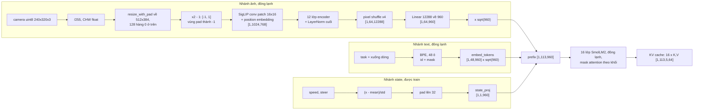
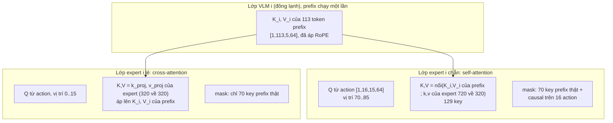
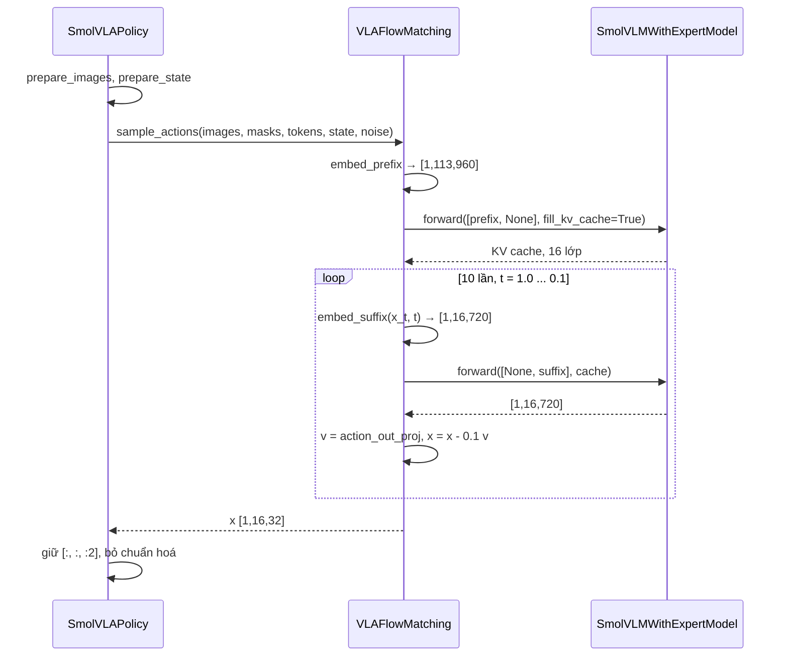
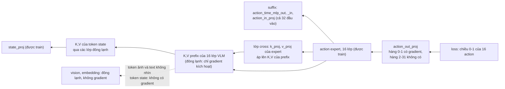
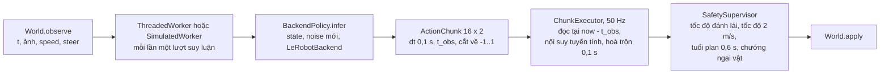

# SmolVLA trong vla-drive: phân tích kiến trúc

*English: [SMOLVLA_ARCHITECTURE_ANALYSIS.md](SMOLVLA_ARCHITECTURE_ANALYSIS.md)*

Tài liệu này giải thích mô hình SmolVLA đã fine-tune của dự án (`smolvla-v1`) thực chất là gì,
và nó biến một khung hình camera, một câu lệnh và trạng thái xe thành một chunk lái và ga như
thế nào. Mọi thông tin đều được đọc từ mã nguồn và checkpoint mà dự án dùng, hoặc đo bằng cách
chạy chính checkpoint đó. Không có gì bị sửa, không có gì được train.

Khảo sát ngày 2026-11-19 trên nhánh `main`, commit `7787158`.

## Cách đọc tài liệu

Mỗi khẳng định có một trong các nhãn sau:

| Nhãn | Ý nghĩa |
|---|---|
| **[code]** | đọc trong mã nguồn, ở file và dòng được ghi |
| **[config]** | đọc trong `config.json`, `train_config.json` hoặc file processor của checkpoint |
| **[run]** | đo cho tài liệu này bằng cách chạy checkpoint (chỉ suy luận), hoặc lấy từ log train |
| **[inferred]** | kết luận rút ra từ các nguồn trên, không quan sát trực tiếp |
| **[open]** | chưa xác lập được; xem mục 9 |

**Đường dẫn mã nguồn.** File trong repo là link. File của LeRobot viết dạng `LR:đường_dẫn:dòng`,
tính từ `lerobot/src/lerobot/` của bản clone LeRobot ở commit `3dd19d043`, tức đúng commit đã
dùng để train (Lab 15). File của transformers viết dạng `TF:đường_dẫn:dòng`, tính từ
`transformers/models/` của transformers 5.5.4.

---

## 0. Câu trả lời trên một trang

```
camera 320x240 RGB ─► /255 ─► resize về 512x384, pad 128 hàng ở trên ─► x2-1 ─► [1,3,512,512]
                                    │ SigLIP, 12 lớp, rộng 768, đông lạnh
                                    ▼
                              [1,1024,768] ─► pixel shuffle x4 + Linear(12288→960) ─► [1,64,960] x √960
"drive along the track" + "\n" ─► BPE ─► 5 id + 43 pad (48) ─► embed ─► [1,48,960] x √960
[speed, steer] ─► (x-μ)/σ ─► pad lên 32 ─► state_proj Linear(32→960), được train ─► [1,1,960]
                                    │ nối lại: 113 token
                                    ▼
          16 lớp SmolLM2 (16 lớp đầu trong 32), đông lạnh, chạy MỘT lần cho mỗi quan sát
                                    │ giữ K,V của mỗi lớp: 16 x 2 x [1,113,5,64]
                                    ▼
noise ε [1,16,32] ─► 10 bước Euler, t = 1.0, 0.9, … 0.1:
        action expert (16 lớp, rộng 720, được train) đọc x_t, t và KV cache
        rồi dự đoán vận tốc v [1,16,32];  x ← x − 0.1·v
                                    ▼
          x[:, :, :2] · σ + μ ─► 16 × [steer, throttle], cách nhau 0,1 s (1,5 s)
                                    ▼
   BackendPolicy (cắt về [-1,1]) ─► ChunkExecutor (50 Hz, đánh chỉ số theo độ trễ) ─► SafetySupervisor ─► xe
```

Những con số quan trọng, tất cả đã được xác minh:

| | |
|---|---|
| Tham số | tổng 450 046 176; **99 880 992 được train** (action expert + 5 lớp chiếu), 350 165 184 đông lạnh **[run]** |
| Train | 2000 bước × batch 16 = 1,44 epoch trên 22 176 frame; AdamW 1e-4 với lịch cosine tự co lại còn 66 bước warm-up; 13 phút trên RTX 4060 **[run]** |
| Loss | flow matching: MSE giữa vận tốc `ε − a` và giá trị dự đoán, chỉ trên 2 chiều action thật **[code]** |
| Suy luận | 1 lượt vision + 1 lượt prefix + 10 lượt expert; 124 ms bằng PyTorch trên laptop RTX 4060, 82 ms bằng TensorRT FP16 trên Jetson Orin Nano **[run]** |
| Lái xe | đạt 6/6 lượt đánh giá, 1,44 m/s, lệch tâm đường 4,8 cm rms (giáo viên: 1,5 cm) **[run]** |

Bảy phát hiện kỹ sư cần biết trước khi thay đổi bất cứ thứ gì (chi tiết ở các mục sau):

1. **Mô hình ngôn ngữ gần như không có tác dụng ở đây.** Model được fine-tune với đúng một câu; `stop` hay `turn left` hầu như không làm chunk thay đổi (§6.6).
2. **Chỉ 2 trong 32 chiều action được train.** 30 chiều còn lại khi train chỉ là noise thuần, nhưng lúc suy luận chúng trôi đi: đến t = 0,1 rms của chúng là 0,56–0,59 thay vì 0,10. Ảnh hưởng đo được lên góc lái: không có; lên ga: nhỏ (§4.6).
3. **Trọng số của action expert là bfloat16**, và quá trình train không dùng mixed precision, nên nhiều khả năng AdamW đã cập nhật trực tiếp trọng số bf16 (§5.4).
4. **Lệch base của RoPE.** Mô hình ngôn ngữ của SmolVLM2 được train với `rope_theta = 100000`; LeRobot tự viết lại các lớp và hard-code `10000` (§2.2.4).
5. **Lịch learning rate không phải lịch được cấu hình.** Vì chỉ train 2000 bước thay vì 30 000, LeRobot co warm-up còn 66 bước và cosine decay còn 2000 bước (§5.3).
6. **Lỗi tiềm ẩn ở chế độ "mở đông lạnh VLM"**: các tên dùng để giữ đông lạnh lớp cuối và norm cuối không khớp tham số nào (§5.2, EXP-03).
7. **Dự án không có CARLA.** Simulator là của chính dự án: phẳng, động học. CARLA sẽ phải là một `Platform` khác (§6.7).

---

## 1. Cài đặt thực tế của mô hình

### 1.1 Cái gì đang chạy, phiên bản nào

| Mục | Giá trị | Nguồn |
|---|---|---|
| Cài đặt SmolVLA | LeRobot 0.5.2, commit `3dd19d043` (`LR:policies/smolvla/`) | **[config]** Lab 15 và bản clone dùng để train |
| Lớp policy | `SmolVLAPolicy` → `VLAFlowMatching` → `SmolVLMWithExpertModel` (`LR:policies/smolvla/modeling_smolvla.py:226`, `:541`; `smolvlm_with_expert.py:72`) | **[code]** |
| PyTorch | 2.11.0+cu128 khi train (Lab 15); 2.11.0+cu130 khi khảo sát | **[config]**/**[run]** |
| transformers | 5.5.4 khi khảo sát; phiên bản lúc train không được ghi lại, nhưng tên tham số trong checkpoint (`model.text_model.…`) khớp với cách bố trí của phiên bản này | **[run]** / **[inferred]** |
| Policy pre-trained | `lerobot/smolvla_base` (`pretrained_path` trong `config.json`) | **[config]** |
| VLM | `HuggingFaceTB/SmolVLM2-500M-Video-Instruct` (`vlm_model_name`) | **[config]** |
| Checkpoint đã fine-tune | `runs/drive/vla/smolvla-v1/checkpoints/last/pretrained_model/` (`model.safetensors` 906 MB, 500 tensor) | **[run]** |
| Lệnh train | `lerobot-train --policy.path=lerobot/smolvla_base …` ([Lab 15, bước 2](study/15-hands-on-labs.md#step-2-fine-tune-about-13-minutes)) | **[config]** `train_config.json` |
| Suy luận trong stack | [`LeRobotBackend`](../drive/policy/lerobot_backend.py#L34) phía sau [`BackendPolicy`](../drive/policy/vla.py#L31) | **[code]** |
| Dataset | `local/vla-drive`, LeRobotDataset v3 do [`export`](../drive/learn/export.py#L75) ghi: 82 episode, 24 876 frame, 10 fps | **[run]** |

### 1.2 Tham số kiến trúc của checkpoint này

Đọc từ model đã load, không lấy theo mặc định **[run]**:

| Khối | Tham số | Giá trị |
|---|---|---|
| Vision encoder (SigLIP) | kích thước ảnh, patch | 512 × 512, 16 × 16 → 32 × 32 = 1024 patch |
| | số lớp, độ rộng, head, MLP | 12, 768, 12, 3072 (GELU-tanh), LayerNorm eps 1e-6 |
| Connector | pixel shuffle, phép chiếu | hệ số 4: 1024 × 768 → 64 × 12 288; `Linear(12288 → 960, bias=False)` |
| Mô hình ngôn ngữ (SmolLM2) | số lớp giữ lại | **16 trên 32** (`num_vlm_layers = 16`) |
| | độ rộng, head, KV head, head dim | 960, 15, 5 (grouped-query, 3 query dùng chung một KV head), 64 |
| | MLP, norm | SiLU có cổng 960 → 2560 → 960, RMSNorm eps 1e-5 |
| | từ vựng | 49 280 (49 152 BPE + 128 token thêm) |
| Action expert | số lớp, độ rộng | **16**, **720** (`expert_width_multiplier = 0.75`) |
| | attention | 15 query head × 64 (q: 720 → 960), 5 KV head × 64, o: 960 → 720 |
| | MLP | SiLU có cổng 720 → 2048 → 720 (`get_intermediate_size(720)`, `LR:…/smolvlm_with_expert.py:65`) |
| | kiểu lớp | lớp chẵn là self-attention (k, v: 720 → 320), lớp lẻ là cross-attention (k, v: 320 → 320) |
| Chiếu state | `state_proj` | `Linear(32 → 960)` |
| Chiếu action | vào, ra | `Linear(32 → 720)`, `Linear(720 → 32)` |
| MLP thời gian | vào, ra | `Linear(1440 → 720)`, SiLU, `Linear(720 → 720)` |
| Flow matching | chunk, số bước, padding | 16 action, 10 bước Euler, action và state pad lên 32 |

### 1.3 Checkpoint này khác giá trị mặc định ở đâu

Mặc định của `SmolVLAConfig` (`LR:policies/smolvla/configuration_smolvla.py`) so với
`config.json` của checkpoint **[config]**:

| Trường | Mặc định | `smolvla-v1` | Vì sao quan trọng |
|---|---|---|---|
| `chunk_size` / `n_action_steps` | 50 / 50 | **16 / 16** | 1,6 s ở 10 fps; nếu để 50 sẽ là 5 s |
| `load_vlm_weights` | False | True | VLM được tải từ Hub, rồi bị checkpoint ghi đè |
| `pad_language_to` | `longest` | `max_length` | luôn có đủ 48 ô text |
| `prefix_length`, `num_expert_layers` | −1, −1 | 0, 0 | cả hai đều nghĩa là "tắt" / "bằng số lớp của VLM" |
| `input_features` | — | state **6 chiều**, ba camera **256×256** | đã lỗi thời, thừa hưởng từ `smolvla_base`; dữ liệu thật có state 2 chiều và một camera 240×320 (§6.8) |

### 1.4 Các file mã nguồn quan trọng

| File | Vai trò |
|---|---|
| `LR:policies/smolvla/modeling_smolvla.py` | `SmolVLAPolicy` (xử lý batch, gộp loss), `VLAFlowMatching` (prefix, suffix, flow matching, lấy mẫu) |
| `LR:policies/smolvla/smolvlm_with_expert.py` | cặp VLM + expert, forward từng lớp, attention, RoPE |
| `LR:policies/smolvla/configuration_smolvla.py` | config, preset optimizer và scheduler, `action_delta_indices` |
| `LR:policies/smolvla/processor_smolvla.py` | pipeline tiền/hậu xử lý |
| `LR:processor/tokenizer_processor.py`, `newline_task_processor.py`, `normalize_processor.py` | tokenize, thêm ký tự xuống dòng, chuẩn hoá mean/std |
| `LR:scripts/lerobot_train.py` | vòng lặp train (`update_policy`) |
| `LR:optim/schedulers.py` | lịch cosine và cơ chế tự co |
| `TF:smolvlm/modeling_smolvlm.py` | embedding, encoder, connector của SigLIP |
| [`drive/learn/export.py`](../drive/learn/export.py) | episode → LeRobotDataset, chọn nhãn action |
| [`drive/learn/collect.py`](../drive/learn/collect.py) | thu dữ liệu giáo viên với tay lái bị nhiễu |
| [`drive/policy/lerobot_backend.py`](../drive/policy/lerobot_backend.py) | load checkpoint, chạy processor và policy |
| [`drive/policy/vla.py`](../drive/policy/vla.py) | `BackendPolicy`: state, noise, cắt giá trị, `ActionChunk` |
| [`drive/control/executor.py`](../drive/control/executor.py), [`drive/loop.py`](../drive/loop.py), [`drive/safety.py`](../drive/safety.py) | chunk trở thành lệnh motor như thế nào |
| [`jetson/smolvla_trt/`](../jetson/smolvla_trt/README.md) | cùng model đó, tách thành ba engine TensorRT, viết bằng C++ |

---

## 2. VLM backbone



### 2.1 Vision encoder

**Encoder nào.** Tháp vision SigLIP của SmolVLM2-500M: embedding patch bằng một convolution
16 × 16, một position embedding học được cho 1024 vị trí, 12 lớp transformer rộng 768, và một
LayerNorm cuối (`TF:smolvlm/modeling_smolvlm.py:62`, `:308`) **[code]** **[run]**.

**Tiền xử lý khung hình** (thứ tự đã xác minh bằng hook **[run]**):

| Bước | Ở đâu | Tensor |
|---|---|---|
| khung hình từ simulator | [`World.image`](../drive/sim/world.py) | `uint8 [240, 320, 3]` RGB |
| sang float, CHW | [`LeRobotBackend.infer`](../drive/policy/lerobot_backend.py#L70) | `float32 [3, 240, 320]` trong [0, 1] |
| đổi tên `front` → `camera1`, thêm chiều batch | bước 0–1 của preprocessor | `[1, 3, 240, 320]` |
| chuẩn hoá | `VISUAL: IDENTITY` (thống kê ImageNet trong file stats không được dùng) | không đổi |
| `resize_with_pad(512, 512, pad_value=0)` | `LR:…/modeling_smolvla.py:136`, gọi ở `:432` | bilinear về 512 × 384, rồi 128 hàng giá trị 0 ở **trên** (pad luôn nằm bên trái và bên trên) |
| `img * 2.0 - 1.0` | `:435` | `[1, 3, 512, 512]` trong [−1, 1]; vùng pad bằng −1 (đo được min −1,0, max 0,85) |

**Token thị giác.** 512 / 16 = 32 × 32 = 1024 patch → SigLIP ra `[1, 1024, 768]`.
Pixel shuffle của connector (`TF:smolvlm/modeling_smolvlm.py:424`) gộp mỗi khối 4 × 4 patch
thành một vector 16 × 768 = 12 288, rồi một `Linear(12288 → 960)` không bias chiếu xuống:
**64 token ảnh, mỗi token 960 chiều**, xếp thành lưới 8 × 8. Mỗi token phủ 64 × 64 pixel của
ảnh đầu vào model, tức 40 × 40 pixel của camera **[run]**. Với camera 4:3, **16 trong 64 token
(hàng 0–1) chỉ thấy vùng pad**, còn hàng 2–3 thấy bầu trời ([chương 17](study/17-debugging-the-model.md)).

**Nhân hệ số.** `embed_prefix` nhân các token ảnh với √960 ≈ 31,0
(`LR:…/modeling_smolvla.py:670`) **[code]**.

**Độ chính xác.** Tháp vision chạy ở bfloat16 (pixel được ép kiểu ở `smolvlm_with_expert.py:197`) **[run]**.

### 2.2 Mô hình ngôn ngữ

#### 2.2.1 Tokenize câu lệnh

1. `NewLineTaskProcessorStep` thêm `"\n"` nếu câu chưa kết thúc bằng nó (`LR:processor/newline_task_processor.py:34`) **[code]**.
2. `TokenizerProcessorStep._tokenize_text` (`LR:processor/tokenizer_processor.py:253`) gọi tokenizer
   SmolVLM2 với `max_length=48, padding="max_length", padding_side="right", truncation=True` **[config]**.
3. Tokenizer là BPE byte-level kiểu GPT-2: tách từng chữ số riêng, rồi áp regex GPT-2, rồi
   merge BPE; không có BOS/EOS; id pad là 2 (`<|im_end|>`) **[run]**.

`"drive along the track\n"` → `[29230, 1683, 260, 4320, 198]` + 43 × `2`, tổng mask là 5 **[run]**.
Câu tiếng Việt bị cắt thành các mảnh byte (`"lái xe theo làn đường\n"` → 18 token).

#### 2.2.2 Embedding token

`embed_language_tokens` (`LR:…/smolvlm_with_expert.py:206`) tra id trong bảng 49 280 × 960
→ `[1, 48, 960]`, rồi `embed_prefix` nhân với √960 (`modeling_smolvla.py:696`) **[code]** **[run]**.

#### 2.2.3 Transformer xử lý prefix ra sao

LeRobot **không** gọi `forward` của model HuggingFace. Nó giữ 16 lớp decoder đầu tiên
(`smolvlm_with_expert.py:100`) và tự chạy chúng trong `SmolVLMWithExpertModel.forward` (`:415`),
từng lớp một, bằng chính các module con của mỗi lớp:

```
với mỗi lớp trong 16 lớp:
    h = input_layernorm(x)                       RMSNorm
    q, k, v = q_proj(h), k_proj(h), v_proj(h)    960→960, 960→320, 960→320; chia thành head 64
    q, k = apply_rope(q, pos), apply_rope(k, pos)
    a = eager_attention_forward(mask, q, k, v)   KV head lặp 3 lần, softmax ở float32
    x = x + o_proj(a)
    x = x + mlp(post_attention_layernorm(x))     SiLU có cổng, 960→2560→960
RMSNorm cuối
```

(`forward_attn_layer`, `:209`; `eager_attention_forward`, `:516`) **[code]**.

#### 2.2.4 Đầu ra, và base của RoPE

Khi suy luận, chỉ **key và value** của mỗi lớp được giữ lại: 16 lớp × K, V có shape
`[1, 113, 5, 64]`, bfloat16 (khoảng 2,3 MB) **[run]**. Hidden state của prefix sau lớp cuối được
tính rồi **bỏ đi** (`sample_actions` chỉ giữ `past_key_values`, `modeling_smolvla.py:812`).
`lm_head` cũng vậy: 47,3 triệu tham số nằm trong checkpoint nhưng không bao giờ được dùng **[run]**.

**Lệch RoPE [run] [open].** Config của VLM ghi `rope_parameters = {"rope_theta": 100000}`, còn
`apply_rope` của LeRobot (`smolvlm_with_expert.py:39`) dùng `max_wavelength=10_000`. Vì vậy các
lớp đông lạnh đang chạy với tần số quay cao gấp 10 lần tần số lúc chúng được train.
`smolvla_base` được pre-train bằng cùng đoạn code này, nên action expert đã học trên các đặc
trưng ấy; còn biểu diễn của VLM mất đi bao nhiêu thì chưa đo (mục 9).

### 2.3 Hợp nhất đa phương thức

**Bằng cách nào.** Không có module hợp nhất riêng. `embed_prefix` (`modeling_smolvla.py:637`)
nối token ảnh, token text và token state thành **một chuỗi 113 token** `[1, 113, 960]`, và
self-attention của mô hình ngôn ngữ trộn chúng với nhau **[code]** **[run]**:

```
vị trí:  0 … 63        64 … 111                      112
         ảnh (64)       text (5 thật + 43 pad)        state (1)
```

**Mask.** `embed_prefix` tạo `pad_masks` (ảnh: 1, text: mask của tokenizer, state: 1) và
`att_masks = [0]·112 + [1]`. `make_att_2d_masks` (`:103`) biến chúng thành mask 113 × 113:
token *i* được nhìn token *j* khi `cumsum(att)[j] ≤ cumsum(att)[i]` và cả hai đều là token thật **[code]**:

| query \ key | ảnh | text (thật) | text (pad) | state |
|---|---|---|---|---|
| ảnh | ✓ | ✓ | ✗ | ✗ |
| text (thật) | ✓ | ✓ | ✗ | ✗ |
| text (pad) | ✗ | ✗ | ✗ | ✗ |
| state | ✓ | ✓ | ✗ | ✓ |

Đo được: một token ảnh thấy 69 key (64 + 5), token state thấy 70, token pad thấy **0** **[run]**.
Hàng của token pad bị che hoàn toàn: các điểm bị che được gán `finfo(float32).min`
(`smolvlm_with_expert.py:550`), nên softmax ra phân phối đều; đầu ra vô nghĩa nhưng vẫn hữu hạn.
(Trong FP16, hằng số này thành −∞ và hàng đó thành NaN; bản export TensorRT đã thay hằng số này.)

**Vị trí.** `position_ids = cumsum(pad_masks) − 1`: 0…68 cho 69 token ảnh và text thật, mọi
token pad đều lặp lại 68, **state ở vị trí 69** **[run]**.

**Expert có thấy toàn bộ ngữ cảnh của VLM không?** Nó thấy key và value của cả 113 token prefix
ở mỗi lớp, che còn 70 token thật, trên cả 16 lớp (mục 3). Nó không bao giờ thấy hidden state
cuối cùng của VLM.

### 2.4 Chiếu state

| Câu hỏi | Trả lời |
|---|---|
| Mã hoá | `[speed_mps, steer]` → `(x − mean) / (std + 1e-8)` trong preprocessor (`LR:processor/normalize_processor.py:362`), với mean `[1.3073, 0.00031]`, std `[0.2589, 0.3202]` **[config]** |
| Padding | `prepare_state` → `pad_vector(·, 32)` bằng số 0 (`modeling_smolvla.py:484`, `:158`) → `[1, 32]` **[run]** |
| Lớp | `state_proj = Linear(32 → 960)` (`:583`), float32 **[run]** |
| Chèn vào đâu | token **cuối cùng** của prefix (vị trí 112, vị trí RoPE 69); ảnh và text không nhìn được nó, còn nó nhìn được ảnh và text **[code]** **[run]** |
| Có được train không | có: `train_state_proj = True` (`:617`); 31 680 tham số **[config]** **[run]** |

Như vậy state chỉ đến được action expert thông qua key và value của token 112 trong mỗi lớp
của 16 lớp đông lạnh.

---

## 3. Action expert

### 3.1 Kiến trúc

Một decoder kiểu SmolLM2 thứ hai, dựng từ text config của VLM nhưng độ rộng cắt còn 720
(`smolvlm_with_expert.py:106–116`) **[code]**. Nó có 16 lớp, mỗi lớp gồm RMSNorm → attention →
residual → RMSNorm → MLP SiLU có cổng (2048) → residual, cộng một RMSNorm cuối. Không có bảng
embedding (`:136`), không có LM head. Tổng 98 245 840 tham số **[run]**.

Expert được ghép **theo từng lớp** với VLM: lớp expert *i* đọc key và value của lớp VLM *i*
(`get_model_layers`, `:401`; với 16 và 16 lớp thì `multiple_of = 1`). Cứ hai lớp thì có một lớp
self-attention (`self_attn_every_n_layers = 2`, `:123`, `:441`):



| Kiểu lớp | Các lớp | Query | Key / value | Mask |
|---|---|---|---|---|
| self-attention | 0, 2, …, 14 | `q_proj` của expert 720 → 960, RoPE ở vị trí 70…85 | K, V của prefix **nối với** `k_proj`, `v_proj` riêng của expert (720 → 320), RoPE ở 70…85 (`forward_attn_layer`, `:276–277`) | 70 key prefix thật + causal giữa các action: action *k* thấy action 0…*k* |
| cross-attention | 1, 3, …, 15 | `q_proj` của expert, RoPE ở vị trí **0…15** (`:378`) | K, V prefix đã cache, đi qua `k_proj`, `v_proj` riêng của expert **320 → 320** (`:363–375`), float32 | chỉ 70 key prefix thật |

Đo được: action 0 thấy 70 key prefix và 1 action, action 15 thấy 70 và 16 **[run]**.

Các phép chiếu của cross-attention là lớp mới do LeRobot tạo ra (`:125–134`) với đầu vào 320
(= 5 KV head × 64). Chúng là float32 trong khi phần còn lại của expert là bfloat16, và chúng được
áp lên các key đã mang mã hoá vị trí quay của VLM **[run]** **[code]**.

### 3.2 Token action và time embedding: `embed_suffix`

`embed_suffix(noisy_actions, timestep)` (`modeling_smolvla.py:731`) **[code]** **[run]**:

```
x_t           [1,16,32]  ──action_in_proj (32→720)──►  [1,16,720]
t             [1]        ──create_sinusoidal_pos_embedding(t, 720, 0.004, 4.0)──► [1,720] ──expand──► [1,16,720]
nối                                                                                [1,16,1440]
action_time_mlp_in (1440→720) ─► SiLU ─► action_time_mlp_out (720→720)          ─► [1,16,720]
```

Time embedding (`:82`) là `[sin(2πt/p_k), cos(2πt/p_k)]` với 360 chu kỳ
`p_k = 0.004 · 1000^{k/359}`, trải từ 4 ms đến 4 s; nó được tính ở float64 trên GPU rồi ép về
float32. Thời gian chỉ đi vào model ở đây, bằng cách **nối** với từng token action, chứ không
điều biến các lớp norm. Có 16 token action, mỗi token ứng với một action tương lai; mask
attention giữa chúng là causal (`att_masks += [1]·16`, `:767`).

### 3.3 Thứ tự thực thi và shape tensor

Bốn hàm mà đề bài nêu, theo thứ tự chạy, với shape bắt bằng hook trên checkpoint thật **[run]**:

**Suy luận: `SmolVLAPolicy.predict_action_chunk` → `_get_action_chunk` → `VLAFlowMatching.sample_actions`**

| # | Lời gọi | Vào | Ra |
|---|---|---|---|
| 1 | `prepare_images` (`:415`) | camera1 `[1,3,240,320]` | 1 ảnh `[1,3,512,512]` |
| 2 | `prepare_state` (`:484`) | `[1,2]` đã chuẩn hoá | `[1,32]` |
| 3 | `embed_prefix` (`:637`) → `embed_image` | `[1,3,512,512]` f32 | vision `[1,1024,768]` bf16 → connector `[1,64,960]` bf16 |
| | → `embed_language_tokens` | id `[1,48]` | `[1,48,960]` bf16 |
| | → `state_proj` | `[1,32]` | `[1,960]` f32 |
| | trả về | | embs `[1,113,960]` (f32 do phép nối nâng kiểu), pad `[1,113]`, att `[1,113]` |
| 4 | `make_att_2d_masks` | | `[1,113,113]` bool; vị trí `[1,113]` |
| 5 | `vlm_with_expert.forward(fill_kv_cache=True)` | `[prefix, None]` | 16 × {K, V `[1,113,5,64]` bf16} |
| 6 | 10 × `denoise_step` (`:883`) | x_t `[1,16,32]`, t `[1]` | |
| | → `embed_suffix` | | `[1,16,720]` |
| | → mask | | `[1,16,129]` (113 prefix + 16 action); vị trí 70…85 |
| | → `vlm_with_expert.forward(fill_kv_cache=False)` | `[None, suffix]` | `[1,16,720]` bf16 sau norm cuối của expert |
| | → `action_out_proj` | 16 token cuối, f32 | v_t `[1,16,32]` |
| | `x_t = x_t + dt · v_t` (`:876`), `dt = −0.1` | | `[1,16,32]` |
| 7 | `actions[:, :, :2]` | | `[1,16,2]` |
| 8 | postprocessor: `x · std + mean` (`normalize_processor.py:361`) | | `[1,16,2]` steer, throttle |

**Train: `SmolVLAPolicy.forward` (`:358`) → `VLAFlowMatching.forward` (`:774`)**

Prefix và suffix đi qua các lớp **cùng nhau** trong một lần gọi (`use_cache=False,
fill_kv_cache=False`). Các lớp self-attention chú ý trên `[prefix ; suffix]` với mask khối đầy
đủ 129 × 129. Các lớp cross-attention tính self-attention của prefix và cross-attention của
expert ngay trong cùng một lớp (`forward_cross_attn_layer`, `:286`, nhánh đầu). Mask và vị trí
giống hệt lúc suy luận, nên hai đường tính cùng một hàm **[code]**. Shape trên một mẫu của
dataset **[run]**: action pad `[1,16,32]` → loss từng phần tử `[1,16,32]` → cắt còn `[1,16,2]`.



---

## 4. Flow matching

### 4.1 Action ground-truth

Với frame *i*, mục tiêu là **chunk** gồm cột `action` của dataset ở các frame *i*, *i*+1, …,
*i*+15. LeRobot đọc chúng qua `action_delta_indices = range(16)` (`configuration_smolvla.py:154`)
và đánh dấu những frame vượt quá cuối episode bằng `action_is_pad` **[code]** **[run]**
(`[16, 2]` và `[16]` cho mỗi mẫu). Chúng được chuẩn hoá với mean `[0.00057, 0.1759]` và
std `[0.3645, 0.1171]` **[config]**, rồi pad thêm số 0 thành `a ∈ ℝ^{16×32}` (`prepare_action`, `:490`).

### 4.2 Noise, thời gian và nội suy

Tất cả nằm trong `VLAFlowMatching.forward` (`:774`) **[code]**:

$$\varepsilon \sim \mathcal N(0, I) \in \mathbb R^{16\times 32} \qquad\text{(sample\_noise, :621)}$$

$$t = 0.999\,\tau + 0.001,\quad \tau \sim \mathrm{Beta}(\alpha{=}1.5,\ \beta{=}1.0) \qquad\text{(sample\_time, :631)}$$

Mật độ Beta(1.5, 1) tỉ lệ với τ^{0.5}: trung bình 0,6, nên có nhiều mẫu train hơn ở gần
**t = 1, phía noise**.

$$x_t = t\,\varepsilon + (1-t)\,a \qquad (:785)$$

Ở t = 1 là noise thuần, ở t = 0 là dữ liệu: ngược với quy ước của một số tài liệu về diffusion.

### 4.3 Vận tốc mục tiêu và dự đoán

$$u_t = \frac{d x_t}{dt} = \varepsilon - a \qquad (:786)$$

Nó không phụ thuộc t: trên đường thẳng từ *a* tới ε, vận tốc không đổi. Mạng dự đoán

$$v_\theta(x_t, t, o) = W_{out}\ \mathrm{Expert}\big(\mathrm{MLP}([W_{in} x_t\ ;\ \phi(t)]),\ \mathrm{KV}(o)\big)$$

với *o* là quan sát (ảnh, text, state), φ là time embedding hình sin, và KV(o) là key, value
của prefix đông lạnh.

### 4.4 Loss

`VLAFlowMatching.forward` trả về `(u_t − v_t)²` theo từng phần tử `[B,16,32]` (`:809`); sau đó
`SmolVLAPolicy.forward` (`:358`) **[code]**:

1. chỉ giữ **2 chiều đầu** (`losses[:, :, :original_action_dim]`, `:384`);
2. đặt về 0 các bước chunk nằm sau cuối episode (`action_is_pad`);
3. lấy trung bình trên các phần tử hợp lệ:

$$\mathcal L = \frac{1}{2\,N_{valid}} \sum_{b,k:\ \neg pad} \sum_{d=0}^{1} \big(u_{t,b,k,d} - v_{\theta,b,k,d}\big)^2$$

Trên một mẫu của dataset, giá trị này là 0,33 **[run]**, khớp với mức loss cuối quá trình train (mục 5.5).

### 4.5 Tích phân lúc suy luận

`sample_actions` (`:812`) giải dx/dt = v từ t = 1 đến t = 0 bằng 10 bước Euler hiện **[code]**:

$$x_{1} = \varepsilon,\qquad x_{t-0.1} = x_t - 0.1\, v_\theta(x_t, t, o),\qquad t = 1.0, 0.9, \dots, 0.1$$

Nếu v chính xác tuyệt đối (v = ε − a), chỉ một bước đã tới đúng *a*: x₀ = ε − (ε − a) = a.
Với trường vận tốc học được, 10 bước đi theo một đường cong. Prefix được tính một lần rồi dùng
lại cho cả 10 bước (`use_cache=True`).

**Flow matching ở đây không phải là khử nhiễu kiểu diffusion.** Không có lịch noise (β_t, ᾱ_t);
mạng dự đoán **vận tốc**, không phải noise hay mẫu sạch; bộ lấy mẫu là một ODE tất định (không
thêm noise giữa các bước); và đường đi từ noise đến dữ liệu là đường thẳng. Tính ngẫu nhiên chỉ
đến từ ε: một ε khác cho ra một chunk hợp lý khác. Nhờ vậy policy biểu diễn được nhiều mode
(hai cách vòng qua chướng ngại vật), trong khi hồi quy sẽ lấy trung bình của chúng (EXP-04).

### 4.6 30 chiều pad **[run]**

Khi train, các chiều pad của `a` bằng 0, nên ở đó x_t đúng bằng t·ε. Khi suy luận, đầu ra của
expert trên các chiều này chưa bao giờ được train trong lần fine-tune này (loss bỏ qua chúng,
mục 4.4), vậy mà x vẫn được đưa ngược vào expert ở mỗi bước. Đo trên ba frame held-out,
rms(x_pad − t·ε_pad):

| t | 1,0 | 0,7 | 0,4 | 0,1 |
|---|---|---|---|---|
| độ lệch | 0,00 | 0,21–0,23 | 0,41–0,43 | **0,56–0,59** |
| rms của t·ε (thứ model thấy khi train) | 0,99–1,06 | 0,69–0,74 | 0,39–0,42 | 0,10 |

Vậy ở các bước cuối, 30 trong 32 chiều đầu vào nằm xa ngoài những gì expert thấy lúc train.
Điều đó có ảnh hưởng không? Chạy lại 120 mẫu held-out (3 episode × 20 frame × 2 noise), mỗi
bước ghim các chiều pad về t·ε:

| | MAE lái, 0,4 s đầu | MAE lái, 1,6 s | MAE ga, 0,4 s đầu |
|---|---|---|---|
| để nguyên như LeRobot chạy | 0,107 | 0,143 | 0,013 |
| ghim chiều pad về t·ε | 0,108 | 0,149 | **0,009** |

Chênh lệch theo cặp ở góc lái: +0,001 ± 0,014; bản ghim tốt hơn ở 48% số cặp, tức là **không
ảnh hưởng đến góc lái**; sai số ga giảm một phần ba. Độ lệch này có thật nhưng vô hại với góc
lái, và không giải thích được việc xe lạng lách.

---

## 5. Train và fine-tune

### 5.1 Cái gì bị đông lạnh

`train_expert_only = True` đông lạnh toàn bộ VLM (vision, connector, embedding, 16 lớp, norm,
`lm_head`) và giữ nó ở chế độ eval (`smolvlm_with_expert.py:150–158`, `:182`).
`freeze_vision_encoder = True` cũng đông lạnh tháp vision. `train_state_proj = True` để
`state_proj` được train (`modeling_smolvla.py:617`) **[code]**. Không dùng PEFT/LoRA:
`use_peft = false`, `peft = null` **[config]**.

| Khối | Tham số | Được train | dtype trong checkpoint |
|---|---:|---:|---|
| vision encoder (SigLIP) | 86 433 024 | 0 | bf16 |
| connector | 11 796 480 | 0 | bf16 |
| embedding text | 47 308 800 | 0 | bf16 |
| 16 lớp text | 157 317 120 | 0 | bf16 |
| norm cuối của text | 960 | 0 | bf16 |
| `lm_head` (không bao giờ dùng) | 47 308 800 | 0 | bf16 |
| **action expert** | **98 245 840** | **98 245 840** | bf16, trừ 16 tensor k/v của cross-attention là f32 |
| `state_proj` | 31 680 | 31 680 | f32 |
| `action_in_proj` | 23 760 | 23 760 | f32 |
| `action_out_proj` | 23 072 | 23 072 | f32 |
| `action_time_mlp_in` | 1 037 520 | 1 037 520 | f32 |
| `action_time_mlp_out` | 519 120 | 519 120 | f32 |
| **tổng** | **450 046 176** | **99 880 992** | đông lạnh: **350 165 184** |

Đếm từ model đã load và từ header safetensors; cả hai khớp với `num_total_params=450046176`
và `num_learnable_params=99880992` trong log train **[run]**.

### 5.2 Chế độ "mở đông lạnh" có một lỗi tiềm ẩn **[run]**

Khi `train_expert_only = False`, `set_requires_grad` (`smolvlm_with_expert.py:159–176`) định
giữ đông lạnh `lm_head`, norm cuối và lớp cuối bằng cách so khớp tên `"text_model.model.norm.weight"`
và `"text_model.model.layers.15."`. Nhưng trong cách bố trí này, tham số có tên
`model.text_model.norm.weight` và `model.text_model.layers.15.…`: hai mẫu trên **không khớp
tham số nào**. Chỉ `lm_head` bị đông lạnh. Connector, vốn không nằm trong phạm vi của
`freeze_vision_encoder`, cũng sẽ thành trainable. Điều này quan trọng với EXP-03.

### 5.3 Optimizer, lịch learning rate, batch **[config]** **[run]**

| | Giá trị |
|---|---|
| Optimizer | AdamW, lr 1e-4, betas (0.9, 0.95), eps 1e-8, weight decay 1e-10 |
| Cắt gradient | norm tối đa 10 |
| Lịch | cosine có warm-up, cấu hình 1000 bước warm-up / 30 000 bước decay; được `CosineDecayWithWarmupSchedulerConfig.build` (`LR:optim/schedulers.py:100`) **tự co lại** vì 2000 < 30 000: **66 bước warm-up, cosine trong 2000 bước về 2,5e-6** (log: lr 4,0e-5 ở bước 50, 9,9e-5 ở bước 150, 5,3e-5 ở bước 1000, 2,5e-6 ở bước 2000) |
| Batch | 16, một GPU, không tích luỹ gradient |
| Số bước | 2000 = 32 000 mẫu = 1,44 epoch trên 22 176 frame train |
| Dữ liệu | 73 episode train / 9 episode đánh giá; LeRobot giữ lại **9 episode cuối** theo thứ tự export (`LR:datasets/factory.py:142`): `sim2-031` … `sim2-039`, đều là các lượt lái của giáo viên trên đường peanut |
| Augmentation | không có (`image_transforms.enable = false`) |
| Seed | 1000 |
| Thời gian | 0,36–0,38 s mỗi lần cập nhật, tổng 13 phút, 2,9 GB bộ nhớ GPU (Lab 15) |

### 5.4 Độ chính xác số học **[run]** **[inferred]**

`lerobot_train.py` tạo `Accelerator()` mà không có `mixed_precision` (`:208`), và
`use_amp = false`: không autocast xuống độ chính xác thấp hơn. VLM được load ở bfloat16
(`smolvlm_with_expert.py:92`). Action expert, dựng từ một bản sao config của VLM, cũng là
bfloat16, trừ các phép chiếu k/v của cross-attention mà LeRobot tạo lại ở float32. Checkpoint
lưu các lớp của expert ở BF16. Vì vậy nhiều khả năng AdamW đã **cập nhật trực tiếp trọng số
bfloat16**. bfloat16 chỉ có 8 bit mantissa: một cập nhật nhỏ hơn khoảng 1/256 độ lớn của trọng
số sẽ bị làm tròn mất. Điều này có thể làm việc học chậm lại hoặc dừng hẳn ở cuối lịch, khi
learning rate chỉ còn 2,5e-6 **[inferred]**. Muốn xác minh cần một lượt train có ghi lại dtype
của tham số (mục 9).

### 5.5 Loss và gradient trong lượt train **[run]**

| Bước | 50 | 500 | 1000 | 1500 | 2000 |
|---|---|---|---|---|---|
| loss train (batch được log) | 1,018 | 0,480 | 0,405 | 0,364 | 0,346 |
| loss held-out (512 mẫu) | | 0,651 | 0,484 | 0,499 | 0,469 |
| norm gradient | 11,8 | 5,95 | 4,87 | 3,81 | 3,57 |

Loss held-out ngừng cải thiện sau khoảng 1000 bước. Thước đo thật sự là lái xe, không phải
loss: đạt 6/6 lượt đánh giá ([chương 13](study/13-vla-and-smolvla.md)).

### 5.6 Gradient chảy như thế nào



**[code]** **[inferred]**: Loss đi vào expert qua `action_out_proj`. Từ expert, gradient tới
các MLP của suffix và `action_in_proj`, và tới các phép chiếu k/v riêng của expert trong các
lớp cross. Gradient cũng chảy ngược **qua các lớp VLM đông lạnh**, dưới dạng gradient kích hoạt
không kèm cập nhật trọng số, tới `state_proj`: token state là đầu vào trainable duy nhất của
prefix. Token ảnh và text không nhìn được token state (mục 2.3), nên key và value của chúng
không phụ thuộc tham số trainable nào, và tháp vision không cần lượt backward.

---

## 6. Ánh xạ SmolVLA sang bài toán lái xe

### 6.1 Từ quan sát đến đầu vào **[code]** **[run]**

| Tín hiệu lái xe | Nguồn | Đầu vào SmolVLA |
|---|---|---|
| camera trước, RGB 320 × 240, FOV 110°, cao 0,18 m, chúc xuống 15° | [`CameraParams`](../drive/config.py), [`World.observe`](../drive/sim/world.py) | `observation.images.front` → đổi tên `camera1` → 512 × 512, 64 token |
| tốc độ (m/s), vị trí bánh lái (−1…1, + là trái) | `Observation.speed`, `.steer` | `observation.state` `[2]` → chuẩn hoá → pad lên 32 |
| câu lệnh | `LoopConfig.task = "drive along the track"` | 48 token |
| pose | chỉ simulator có | **không** đưa vào VLA (chỉ giáo viên đọc) |

Không có tín hiệu xe nào khác: không gia tốc, không tốc độ quay thân xe, không tốc độ bánh,
không lịch sử. `n_obs_steps = 1`: một frame, không có bộ nhớ.

### 6.2 Chuẩn hoá **[config]**

| | mean | std | do ai áp |
|---|---|---|---|
| state `[speed, steer]` | `[1.3073, 0.000313]` | `[0.2589, 0.3202]` | preprocessor: `(x − μ)/(σ + 1e-8)` |
| action `[steer, throttle]` | `[0.000569, 0.1759]` | `[0.3645, 0.1171]` | postprocessor: `x·σ + μ` (**không** có eps) |
| ảnh | — | — | identity; [−1, 1] trong `prepare_images` |

Tốc độ trong dữ liệu tập trung quanh 1,33 m/s (std 0,26): state 0,3 m/s tương ứng −3,9 độ lệch
chuẩn, vì vậy ga nhảy lên 0,88 ở đó (mục 6.6).

### 6.3 Action

Chiều đầu ra 0 là **steer** (+1 là đánh hết lái sang trái), chiều 1 là **throttle** (+1 hết
ga, −1 phanh hết, không có số lùi), đúng như [`drive/types.py`](../drive/types.py) định nghĩa
và [`export.features`](../drive/learn/export.py#L44) đặt tên. 30 chiều pad bị bỏ đi
(`_get_action_chunk`, `:299`).

### 6.4 Action của chuyên gia hay action đã bị nhiễu? **[run]**

[`collect`](../drive/learn/collect.py#L120) lái bằng tay lái của giáo viên cộng một nhiễu
Ornstein–Uhlenbeck ([`Disturbance`](../drive/learn/collect.py#L31), cường độ 0,25, tương quan
0,5 s). Với mỗi frame, nó ghi action **thực sự áp lên xe** và plan sạch 16 bước của giáo viên.
Theo mặc định, [`export`](../drive/learn/export.py#L68) ghi `plans[i, 0]`, tức action đầu tiên
mà giáo viên **muốn** làm. Đã kiểm tra trên dataset đã export: với `sim2-003`, cột `action` khớp
tuyệt đối `plan[0]` của giáo viên (lệch tối đa 0,0) và lệch tới 1,0 so với action thực sự áp lên
xe. Vậy SmolVLA học **action của chuyên gia dọc theo quỹ đạo bị nhiễu** (DART).

Tuy vậy, mục tiêu chunk không phải plan 16 bước của giáo viên: nó là action đầu tiên của giáo
viên tại mỗi frame trong 16 frame tiếp theo (mục 4.1). Mục tiêu này bao gồm cả phản ứng của giáo
viên với những nhiễu chưa xảy ra tại frame *i*. Vì thế phần cuối của mỗi chunk mục tiêu một phần
không thể đoán được từ quan sát **[inferred]**.

### 6.5 Thực thi trong vòng điều khiển **[code]**



- [`BackendPolicy.infer`](../drive/policy/vla.py#L41) gửi `[speed, steer]`, rút noise mới từ bộ
  sinh số ngẫu nhiên của chính nó ở mỗi lần gọi, cắt chunk về [−1, 1] và gắn thời điểm quan sát.
- `chunk_dt_s` lấy từ fps của dataset thông qua `train_config.json`
  ([`chunk_dt_s`](../drive/policy/lerobot_backend.py#L23)). File đó ghi đường dẫn trên laptop
  dùng để train, nên trên máy này nó rơi về giá trị mặc định 0,1 s, tình cờ lại đúng.
- Dự án gọi `predict_action_chunk` ở mỗi lượt suy luận và **không** dùng hàng đợi `select_action`
  của LeRobot (`n_action_steps`).
- [`ChunkExecutor`](../drive/control/executor.py#L11) phát chunk tại `now − t_obs`. Với 125 ms mỗi
  lượt suy luận, cứ khoảng 125 ms lại có một chunk mới thay chunk cũ: xe chỉ thực thi khoảng các
  action từ 0,125 đến 0,25 s sau mỗi lần quan sát (chỉ số chunk khoảng 1,3–2,5). Phần còn lại của
  tầm nhìn 1,5 s là dự phòng khi suy luận bị kẹt, cho đến khi supervisor phanh lúc plan đã cũ 0,6 s.

### 6.6 Model phản ứng với cái gì **[run]**

Trên Jetson ([`jetson/smolvla_trt`](../jetson/smolvla_trt/README.md)), giữ noise cố định, góc lái
trung bình trong 0,4 s đầu:

| Thay đổi | Lái | Ga |
|---|---:|---:|
| cua phải, `drive along the track`, 1,35 m/s | −0,36 | 0,16 |
| câu lệnh `stop the car now` | −0,30 | 0,16 |
| câu lệnh `turn left` | −0,31 | 0,16 |
| tốc độ 0,3 m/s | −0,30 | **0,88** |
| frame cua trái | **+0,39** | 0,92 |
| frame cua phải lật trái–phải | **+0,60** (trái) | 0,16 |
| ảnh đen / trắng / xám / nhiễu | −0,18 … −0,35 | 0,17 |

Ảnh quyết định góc lái, state quyết định ga; câu lệnh hầu như không có tác dụng. Lật ảnh thì góc
lái đổi dấu, nên model đọc hình học của con đường chứ không nhớ thuộc từng frame. Với ảnh chưa
từng thấy, nó vẫn chạy đều và lái hơi lệch phải, với độ tản giữa các noise (khoảng 0,03–0,04)
giống hệt trên ảnh quen thuộc: noise không phải thước đo độ tự tin.

### 6.7 CARLA **[run]**

Repo không có mã CARLA nào: từ này chỉ xuất hiện trong comment ([`drive/loop.py`](../drive/loop.py#L24),
[`drive/platform.py`](../drive/platform.py)). Simulator là của chính dự án: mô hình xe đạp động
học trên đường phẳng, render bằng camera pinhole. Một cầu nối CARLA sẽ là một
[`Platform`](../drive/platform.py) khác (`observe`, `range_m`, `apply`). Nó phải render đúng góc
nhìn 320 × 240 ở cùng độ cao và góc chúc, ánh xạ throttle −1…0 sang phanh, và cung cấp cảm biến
khoảng cách. Model sẽ cần fine-tune lại trên episode CARLA: mục 6.6 cho thấy nó làm gì với ảnh lạ.

### 6.8 Khác biệt so với bài toán gắp đồ (manipulation) **[config]** **[code]**

| | `smolvla_base` (thứ config thừa hưởng) | `smolvla-v1` ở đây |
|---|---|---|
| camera | 3 (`camera1`–`camera3`, 256 × 256 trong `input_features`) | 1 camera trước 240 × 320, đổi tên thành `camera1`; hai camera thiếu bị **bỏ qua**, không pad (`empty_cameras = 0`, `prepare_images`, `:448`) |
| state | 6 (trong `input_features`) | 2: tốc độ, góc lái; pad lên 32 |
| action | 6 | 2: lái, ga |
| chunk | mặc định 50 | 16 × 0,1 s |
| thực thi | `select_action` lấy dần action ra khỏi hàng đợi | chunk mới ở mỗi lượt suy luận, đọc theo thời gian, dưới sự giám sát an toàn |
| ngôn ngữ | nhiều nhiệm vụ | một câu |
| cái gì chuyển động | cánh tay robot trong cảnh tĩnh | chính camera; cảnh trôi qua ở 1,4 m/s |

`input_features` trong `config.json` vẫn ghi state 6 chiều và ba camera 256 × 256. Đó là
metadata lỗi thời: lúc suy luận không có gì đọc các shape này **[run]**.

---

## 7. Các thí nghiệm đề xuất

Mỗi thí nghiệm ghi rõ cái gì đã có sẵn, cái gì đã đo cho tài liệu này, và cái gì còn lại.
"Lái thử" nghĩa là [`python -m drive evaluate`](../drive/learn/evaluate.py): ba đường × hai
chiều trong simulator của dự án, thay cho CARLA.

### EXP-01: khảo sát backbone

- **Đã có:** `tools/probe_vla.py` (probe shape), `tools/see_vla.py` (attention và occlusion trên
  từng token ảnh), `vla_probe` trên Jetson (lưới RMS token, tokenize).
- **Đã đo ở đây:** mọi shape trong mục 3.3, bằng cách bọc `embed_image`, `embed_prefix`,
  `vlm_with_expert.forward` (phụ lục A).
- **Còn lại:** đo xem KV cache thay đổi bao nhiêu theo câu lệnh. Tính ‖KV(câu A) − KV(câu B)‖
  theo từng lớp cho các token ảnh, so với mức thay đổi khi đổi sang frame khác. Nếu text hầu như
  không làm cache thay đổi, expert không thể làm theo text.

### EXP-02: khảo sát action expert

- **Đã đo ở đây:** suffix `[1,16,720]`, time embedding `[1,720]`, v_t `[1,16,32]`; `vla_probe` in
  rms(v) ở từng bước (0,51 tại t = 1, tăng lên 0,93 tại t = 0,1 trên một khúc cua).
- **Còn lại:** độ "thẳng" của flow đã học. So kết quả 10 bước với 1, 2 và 5 bước
  (`vla_probe --steps N`) so với plan của giáo viên. Nếu 2 bước mất ít độ chính xác, có thể cắt
  43 ms của expert trên Jetson xuống 5 lần.

### EXP-03: đông lạnh / mở đông lạnh

| | A (như đã train) | B |
|---|---|---|
| VLM | đông lạnh | `--policy.train_expert_only=false` (vision vẫn đông lạnh nhờ `freeze_vision_encoder`) |
| expert, state_proj | được train | được train |

**Trước khi chạy B**, phải sửa hoặc tìm cách tránh lỗi ở mục 5.2. Như hiện tại, B còn train cả
connector, lớp cuối và norm cuối, trong khi query, output và MLP của lớp cuối không nhận được
gradient nào. Cần đo: loss train và loss held-out ở cùng số bước, `torch.cuda.max_memory_allocated`,
số giây mỗi lần cập nhật (`updt_s` trong log), và kết quả lái thử. GPU 6 GB của PC này sẽ không
đủ cho B ở batch 16 với bf16 và AdamW (thêm 216 triệu tham số trainable: connector 11,8 M,
embedding 47,3 M, 16 lớp 157,3 M). Cần tính đến batch nhỏ hơn, gradient checkpointing, hoặc
LoRA cho VLM. Cấu hình PEFT mặc định của LeRobot chỉ nhắm vào q/v của expert và các lớp chiếu
(`_get_default_peft_targets`, `:495`), nên phải mở rộng danh sách module đích.

### EXP-04: trực quan hoá flow matching

Một script độc lập dùng đúng các quy ước của SmolVLA, với "góc lái" có hai mode để thấy rõ khác
biệt so với hồi quy. Chạy vài giây trên CPU **[run]**:

```python
import math, torch
from torch import nn
torch.manual_seed(0)

def data(n):                                   # a bend taken left (-0.5) or right (+0.5)
    side = torch.where(torch.rand(n) < 0.5, -0.5, 0.5)
    return torch.stack([side + 0.05 * torch.randn(n), 0.17 + 0.02 * torch.randn(n)], 1)

def time_embedding(t, dim=32, lo=4e-3, hi=4.0):  # create_sinusoidal_pos_embedding
    period = lo * (hi / lo) ** torch.linspace(0, 1, dim // 2)
    angle = t[:, None] * (2 * math.pi / period)[None]
    return torch.cat([angle.sin(), angle.cos()], 1)

v = nn.Sequential(nn.Linear(34, 128), nn.SiLU(), nn.Linear(128, 128), nn.SiLU(), nn.Linear(128, 2))
opt = torch.optim.AdamW(v.parameters(), lr=3e-3)
beta = torch.distributions.Beta(1.5, 1.0)
for step in range(3000):
    a = data(256); eps = torch.randn_like(a)
    t = beta.sample((256,)) * 0.999 + 0.001          # sample_time
    x_t = t[:, None] * eps + (1 - t[:, None]) * a     # x_t = t eps + (1-t) a
    loss = ((eps - a) - v(torch.cat([x_t, time_embedding(t)], 1))).pow(2).mean()   # u_t = eps - a
    opt.zero_grad(); loss.backward(); opt.step()

with torch.no_grad():                                 # sample_actions: 10 Euler steps, t = 1 -> 0
    x = torch.randn(2000, 2)
    for k in range(10):
        t = torch.full((2000,), 1.0 - k / 10)
        x = x - 0.1 * v(torch.cat([x, time_embedding(t)], 1))
print((x[:, 0] < 0).float().mean(), x[:, 0].abs().mean())
```

*Đo được:* 46% mẫu kết thúc gần mode trái và 54% gần mode phải; |steer| trung bình 0,464
(dữ liệu: 0,5), ga 0,172 (dữ liệu: 0,17). Một mô hình hồi quy về trung bình sẽ lái 0,000, tức
đâm thẳng vào giữa. Muốn trực quan hoá, lưu `a`, `eps`, `x_t` ở vài giá trị `t`, vận tốc `v` dự
đoán, và 10 bước Euler, rồi vẽ chúng trên mặt phẳng (steer, throttle).

### EXP-05: ablation lái xe

| Chỉ số | Cách đo trong dự án này |
|---|---|
| MAE lái / ga | offline, so với plan của giáo viên trên 9 episode held-out (probe offline của `tools/probe_vla.py`, hoặc vòng lặp ở mục 4.6); mốc cơ sở đo được ở đây: **lái 0,107, ga 0,013** trong 0,4 s đầu |
| RMSE quỹ đạo | `lateral_rms_m` của `evaluate`: khoảng cách tới tâm đường (không có ground-truth quỹ đạo nào khác) |
| giữ làn | `off_track_pct == 0` cho mỗi lượt lái |
| va chạm | `sim --obstacle S`: `collided`, `min_range_m` |
| hoàn thành | `laps` và `mean_speed_mps > 0.3` cho mỗi lượt lái |

Các ablation nên chạy, mỗi cái so với `smolvla-v1`: ảnh trống hoặc ảnh xáo trộn; biến thể câu
lệnh (đã đo: không tác dụng, mục 6.6); state đặt về 0 hoặc giữ ở giá trị trung bình; 1/2/5/10
bước khử nhiễu; độ trễ 0–300 ms (`drive sweep --policy vla`); ghim chiều pad (đã đo: không ảnh
hưởng đến góc lái, mục 4.6); `--action applied` thay vì `intended` (thử thách trong Lab 15);
chunk 8, 16 và 32.

---

## 8. Khuyến nghị

1. **Muốn câu lệnh có tác dụng**, hãy thu các episode có hành vi phụ thuộc vào câu lệnh (`stop`,
   `slow down`, `keep left`) trước khi động vào kiến trúc. Với chỉ một câu, model không có gì để
   học từ text.
2. **Trước khi mở đông lạnh VLM** (EXP-03), sửa các mẫu tên ở mục 5.2 và quyết định có train
   connector hay không.
3. **Với hiện tượng lạng lách** (4,8 cm so với 1,5 cm của giáo viên), thử các giả thuyết rẻ trước:
   train lâu hơn (không tốn gì về kiến trúc); train expert với trọng số float32 hoặc AMP (mục 5.4);
   dựng chunk mục tiêu từ plan của giáo viên thay vì các action đầu tiên liên tiếp (mục 6.4).
   Giả thuyết về các chiều pad đã bị loại (mục 4.6).
4. **Muốn nhanh hơn**, hãy đo việc giảm số bước khử nhiễu (EXP-02) trước tiên. Trên Jetson, expert
   chiếm một nửa thời gian.
5. **Với môi trường mới (CARLA, camera thật)**, hãy chuẩn bị fine-tune lại: mục 6.6 cho thấy model
   tự tin đưa ra kết quả sai trên ảnh lạ, và supervisor là thứ duy nhất đứng giữa nó và motor.

---

## 9. Câu hỏi còn mở và lỗ hổng trong cài đặt

| # | Câu hỏi / lỗ hổng | Trạng thái |
|---|---|---|
| 1 | RoPE base 10 000 trong LeRobot so với 100 000 trong config của SmolVLM2: đặc trưng của VLM đông lạnh bị ảnh hưởng bao nhiêu? | **[open]**. Cần so sánh ở quy mô pre-train; chỉ chạy suy luận thì không trả lời được, vì expert đã được train trên đặc trưng với base 10 000 |
| 2 | Expert có được cập nhật ở bfloat16 không? | **[inferred]** từ dtype trong checkpoint và `Accelerator()` không có mixed precision; xác nhận bằng cách ghi lại dtype trong một lượt train |
| 3 | 30 chiều action pad bị trôi lúc suy luận | **[run]** đã đo; không ảnh hưởng góc lái, MAE ga 0,013 → 0,009 khi ghim |
| 4 | Các mẫu tên trong `set_requires_grad` không khớp gì ở chế độ mở đông lạnh | **[run]** lỗi tiềm ẩn; chỉ ảnh hưởng khi `train_expert_only=false` |
| 5 | `input_features` trong `config.json` ghi state 6 chiều và ba camera 256 × 256 | **[run]** metadata lỗi thời, không được đọc lúc suy luận |
| 6 | Ngôn ngữ không có tác dụng (chỉ một câu khi train) | **[run]** |
| 7 | Phần cuối mỗi chunk mục tiêu chứa các nhiễu tương lai không đoán trước được | **[inferred]**; so với một model train trên plan của giáo viên |
| 8 | Với camera 4:3, 25% token ảnh là vùng pad và 25% là bầu trời | **[run]** một phần tư khối tính vision nhìn vào khoảng trống |
| 9 | Các hàng pad của prefix bị che hoàn toàn (attention đều, NaN trong FP16) | **[code]**; đã xử lý trong bản export TensorRT |
| 10 | `lm_head` (47,3 triệu tham số) được load nhưng không bao giờ dùng | **[run]**; tốn 95 MB bộ nhớ GPU ở bf16 |
| 11 | Tập held-out là 9 episode trên một đường | **[run]** loss held-out nói rất ít về các đường khác; lái thử mới nói được |
| 12 | Không có CARLA, simulator phẳng và động học | **[run]** |
| 13 | Độ tản theo noise giống nhau trên ảnh quen và ảnh lạ | **[run]** không có sẵn tín hiệu phát hiện dữ liệu ngoài phân phối |

---

## Phụ lục A: cách lấy shape và số tham số

Chạy từ thư mục gốc của repo bằng môi trường LeRobot (Lab 15), chỉ suy luận:

```python
import cv2, numpy as np, torch                     # cv2 before torch on this PC
from drive.policy.lerobot_backend import LeRobotBackend
b = LeRobotBackend("runs/drive/vla/smolvla-v1/checkpoints/last/pretrained_model")
m = b.policy.model
# parameter counts
total = sum(p.numel() for p in m.parameters()); trainable = sum(p.numel() for p in m.parameters() if p.requires_grad)
# shapes: wrap a method and record what goes in and out
original = m.embed_prefix
def recorded(*a, **k):
    out = original(*a, **k); print([o.shape for o in out]); return out
m.embed_prefix = recorded
# ... the same for vlm_with_expert.embed_image, .forward, model.embed_suffix, model.denoise_step,
# then one b.infer(BackendObservation(0, [image], state, "drive along the track", noise))
```

Đường đi lúc train được kiểm tra bằng `policy.forward(batch)` trong `torch.no_grad()` trên một
mẫu của dataset đã export (`LeRobotDataset(..., video_backend="pyav")`, vì torchcodec cần thư
viện FFmpeg mà PC này không có).

## Phụ lục B: các hàm quan trọng

| Hàm | Vị trí | Làm gì |
|---|---|---|
| `SmolVLAPolicy.predict_action_chunk` | `LR:…/modeling_smolvla.py:313` | điểm vào mà `LeRobotBackend` dùng |
| `SmolVLAPolicy.forward` | `:358` | loss khi train: cắt còn 2 chiều, `action_is_pad`, lấy trung bình |
| `SmolVLAPolicy.prepare_images` | `:415` | resize kèm pad, [−1, 1], bỏ qua camera thiếu |
| `VLAFlowMatching.embed_prefix` | `:637` | ảnh × √960, text × √960, token state; các mask |
| `VLAFlowMatching.embed_suffix` | `:731` | embedding action và thời gian, hợp nhất bằng MLP |
| `VLAFlowMatching.forward` | `:774` | x_t, u_t, lượt chạy chung prefix + suffix, loss từng phần tử |
| `VLAFlowMatching.sample_actions` | `:812` | prefix một lần, 10 bước Euler |
| `VLAFlowMatching.denoise_step` | `:883` | một lượt expert trên cache |
| `make_att_2d_masks` | `:103` | mask 2 chiều causal theo khối, từ pad và id khối |
| `create_sinusoidal_pos_embedding` | `:82` | time embedding |
| `SmolVLMWithExpertModel.forward` | `LR:…/smolvlm_with_expert.py:415` | 16 lớp được ghép cặp |
| `forward_attn_layer` / `forward_cross_attn_layer` | `:209` / `:286` | self / cross attention từng lớp |
| `eager_attention_forward` | `:516` | grouped-query attention, softmax ở float32 |
| `apply_rope` | `:39` | rotary embedding, base 10 000 |
| `CosineDecayWithWarmupSchedulerConfig.build` | `LR:optim/schedulers.py:100` | lịch learning rate tự co |
| `update_policy` | `LR:scripts/lerobot_train.py:71` | forward, backward, cắt gradient, bước optimizer |
| `export.frames` | [`drive/learn/export.py:53`](../drive/learn/export.py#L53) | action nào trở thành nhãn |
| `LeRobotBackend.infer` | [`drive/policy/lerobot_backend.py:70`](../drive/policy/lerobot_backend.py#L70) | các processor quanh policy |
| `BackendPolicy.infer` | [`drive/policy/vla.py:41`](../drive/policy/vla.py#L41) | state, noise, cắt giá trị |
| `ChunkExecutor.action` | [`drive/control/executor.py:34`](../drive/control/executor.py#L34) | action cho thời điểm hiện tại |
| `DriveLoop.step` | [`drive/loop.py:32`](../drive/loop.py#L32) | một nhịp 50 Hz |
