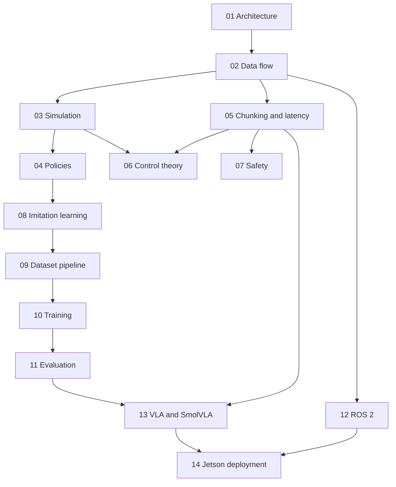

# 00 · Learning roadmap

## What this project is, in one paragraph

A vision-language-action model (VLA) looks at a camera image, takes about a tenth of a
second or more to think, and answers with a *chunk*: several dozen future actions. A
car needs a new motor command fifty times a second. This repository is everything
needed between those two facts: a simulated 1:10 car, a 50 Hz control loop that plays
chunks at the right moment, a safety supervisor that overrules the policy, a pipeline
that turns recorded drives into a trained network, and ROS 2 nodes around all of it.
A 0.3 M-parameter CNN stands in for the VLA throughout. Since 2026-11-17 a SmolVLA
fine-tuned on the project's episodes also drives the simulated car, in PyTorch on a
laptop ([Lab 15](15-hands-on-labs.md#lab-15-fine-tune-smolvla-on-the-driving-data-on-this-laptop));
nothing VLA-related has run on a Jetson or a car.

## Prerequisites

You need the first column. The second is taught in this guide.

| You should already have | This guide teaches |
|---|---|
| Python: classes, dataclasses, type hints, `argparse` | how a control loop is structured |
| NumPy: array shapes, broadcasting, boolean masks, `np.interp` | kinematic vehicle models |
| Reading a `Makefile` and running Docker commands | action chunking and latency compensation |
| School trigonometry and the idea of a derivative | feedback, delay and stability, from first principles |
| | behaviour cloning, covariate shift, DART |
| | what ROS 2 nodes, topics and messages are |
| | what a VLA is and what deploying one involves |

Helpful but optional: OpenCV (`cv2.remap`, `cv2.resize`), PyTorch (`nn.Module`, a
training loop), Python threading (`threading.Condition`).

### Self-check before you start

If you can answer these, you are ready for the beginner path.

1. What is the shape of `np.zeros((300, 16, 2))[:, 0, 0]`?
2. What does `np.interp(0.25, [0.0, 0.5], [10.0, 20.0])` return?
3. A function is called 50 times per second. How many milliseconds between calls?
4. What does `@dataclass(frozen=True)` prevent?

Answers

1. `(300,)`. 2. `15.0`. 3. 20 ms. 4. Assigning to the instance's fields after it is created.

## The dependency graph of the chapters

## Three paths

### Beginner: "I want to see it work and understand the picture" (about 8 hours)

Goal: run the simulator, explain the architecture diagram, and train one network.

| Step | Read | Do |
|---|---|---|
| 1 | [01 Architecture](01-system-architecture.md) | [Lab 1](15-hands-on-labs.md#lab-1-run-the-simulator) |
| 2 | [02 Data flow](02-data-flow-and-lifecycle.md), sections 1–3 | [Lab 4](15-hands-on-labs.md#lab-4-inject-inference-latency) |
| 3 | [07 Safety](07-safety-supervisor.md) | Labs [6](15-hands-on-labs.md#lab-6-test-safety-with-an-obstacle), [7](15-hands-on-labs.md#lab-7-disable-safety-and-analyse-the-result) |
| 4 | [08 Imitation learning](08-imitation-learning.md) | [Lab 8](15-hands-on-labs.md#lab-8-collect-training-episodes) |
| 5 | [09 Dataset pipeline](09-dataset-pipeline.md) | Labs [9](15-hands-on-labs.md#lab-9-validate-and-browse-a-dataset), [10](15-hands-on-labs.md#lab-10-train-a-cnn), [11](15-hands-on-labs.md#lab-11-evaluate-on-different-tracks) |

You may skip every section headed "Mathematical formulation" on this path.

### Intermediate: "I want to modify it" (about 25 hours)

Goal: change a policy, a safety rule or a pipeline stage and predict the effect.

Read chapters 01 to 12 in order, do every lab, and do the "Practical experiment" at
the end of each chapter. Work the numerical examples by hand before reading the
answer. Suggested first modifications, in increasing difficulty:

1. Add a fourth track shape to `SHAPES` in [`drive/sim/track.py`](../../drive/sim/track.py#L21) and evaluate `v1` on it.
2. Add a `validate` warning for a dataset whose steering is unbalanced between left and right.
3. Add a pipeline stage (a module with `add_parser` and `run`, listed in [`drive/learn/__init__.py`](../../drive/learn/__init__.py#L17)) that exports per-episode statistics to CSV.
4. Give `LaneCameraPolicy` a chunk that predicts, rather than repeating one action, and repeat its latency sweep.

### Advanced: "I want to take it to a VLA on a Jetson" (open-ended)

Goal: close the gaps listed in [chapter 14](14-jetson-deployment.md).

Read everything, then treat [chapter 16](16-experiments.md) as a backlog. The
engineering work that remains, in dependency order:

1. Episodes → LeRobotDataset conversion ([chapter 13](13-vla-and-smolvla.md)). **[PROPOSED]**
2. Fine-tune SmolVLA on that dataset and drive it in the simulator through `BackendPolicy`. **[PROPOSED]**
3. Export, and measure latency on the Jetson with [jetson-orin-nano-vla](https://github.com/eetmie/jetson-orin-nano-vla). **[PROPOSED]**
4. A platform node for a real car that publishes the `/drive/*` sensor topics and obeys `/drive/cmd`. **[PROPOSED]**
5. Real-time chunking, for models slower than about 250 ms ([chapter 5](05-action-chunking-and-latency.md)). **[FUTURE]**

## Background knowledge, with where to get it

| Topic | Minimum you need | Used in | Source |
|---|---|---|---|
| NumPy | shapes, slicing, `interp`, `savez` | everywhere | numpy.org user guide |
| OpenCV | `resize`, `remap`, `polylines` | 03, 04, 09 | OpenCV tutorials |
| PyTorch | `nn.Sequential`, autograd, optimisers | 10 | PyTorch "Learn the basics" |
| Kinematics | position, heading, velocity, curvature $\kappa = 1/R$ | 03, 04 | Paden et al. 2016, §III |
| Control | feedback, first-order lag, delay margin | 05, 06 | Åström & Murray, ch. 1–2 and 10 |
| Imitation learning | supervised learning, distribution shift | 08–11 | Ross & Bagnell 2010; DART |
| ROS 2 | nodes, topics, publishers, parameters, launch | 12 | ROS 2 Humble tutorials |
| VLA | VLM backbone + action head, action chunks | 05, 13 | SmolVLA paper; ACT paper |

Full citations with URLs are in [REFERENCES.md](REFERENCES.md).

## How to study a chapter

1. Read "What problem are we solving?" and try to propose your own solution first.
2. Read the theory and work the numerical example on paper.
3. Open the linked source file beside the chapter and follow the walkthrough.
4. Run the practical experiment. Write down what you predicted and what happened.
5. Answer the knowledge check without looking. Record open questions in the
   [study tracker](STUDY-TRACKER.md).
