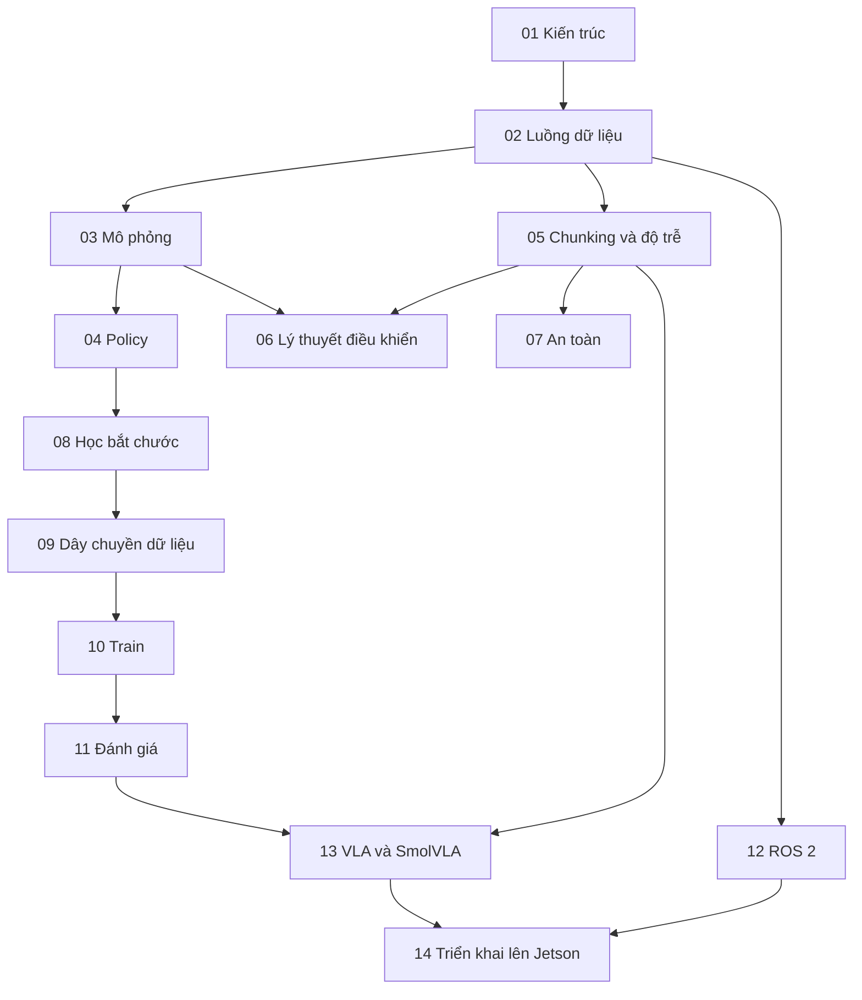

# 00 · Lộ trình học

*Bản tiếng Việt · [English](00-learning-roadmap.md)*

*Bản tiếng Việt · [English](00-learning-roadmap.vi.md)*

## Dự án này là gì, trong một đoạn

Một model thị giác–ngôn ngữ–hành động (vision-language-action model, VLA) nhìn một ảnh
camera, mất khoảng một phần mười giây hoặc hơn để suy nghĩ, rồi trả lời bằng một *chunk*:
vài chục action tương lai. Một chiếc xe cần một lệnh động cơ mới năm mươi lần mỗi giây.
Repository này là mọi thứ cần có nằm giữa hai sự thật đó: một chiếc xe 1:10 mô phỏng, một
vòng điều khiển 50 Hz phát các chunk đúng lúc, một bộ giám sát an toàn (safety supervisor)
có quyền gạt policy, một dây chuyền biến các lần lái đã ghi thành một mạng đã train, và các
node ROS 2 bao quanh tất cả. Một CNN 0,3 triệu tham số đóng vai VLA trong suốt giáo trình.
Từ 2026-11-17, một SmolVLA được fine-tune trên các episode của dự án cũng lái được xe mô
phỏng, bằng PyTorch trên một laptop
([Lab 15](15-hands-on-labs.vi.md#lab-15-fine-tune-smolvla-trên-dữ-liệu-lái-xe-ngay-trên-laptop-này));
chưa có gì liên quan tới VLA chạy trên Jetson hay trên xe thật.

## Kiến thức cần có trước

Bạn cần cột thứ nhất. Cột thứ hai được dạy trong giáo trình này.

| Bạn nên biết sẵn | Giáo trình này dạy |
|---|---|
| Python: class, dataclass, type hint, `argparse` | một vòng điều khiển được tổ chức thế nào |
| NumPy: shape của mảng, broadcasting, mặt nạ boolean, `np.interp` | mô hình động học của xe |
| Đọc một `Makefile` và chạy lệnh Docker | action chunking và bù độ trễ |
| Lượng giác phổ thông và khái niệm đạo hàm | phản hồi, độ trễ và tính ổn định, từ nguyên lý cơ bản |
| | behaviour cloning, covariate shift, DART |
| | node, topic và message của ROS 2 là gì |
| | VLA là gì và triển khai một VLA gồm những việc gì |

Có thì tốt nhưng không bắt buộc: OpenCV (`cv2.remap`, `cv2.resize`), PyTorch (`nn.Module`,
một vòng train), threading trong Python (`threading.Condition`).

### Tự kiểm tra trước khi bắt đầu

Nếu trả lời được các câu sau, bạn sẵn sàng cho lộ trình cơ bản.

1. Shape của `np.zeros((300, 16, 2))[:, 0, 0]` là gì?
2. `np.interp(0.25, [0.0, 0.5], [10.0, 20.0])` trả về gì?
3. Một hàm được gọi 50 lần mỗi giây. Giữa hai lần gọi cách nhau bao nhiêu mili giây?
4. `@dataclass(frozen=True)` ngăn điều gì?

Đáp án

1. `(300,)`. 2. `15.0`. 3. 20 ms. 4. Gán giá trị cho các field của instance sau khi nó đã được tạo.

## Đồ thị phụ thuộc giữa các chương

## Ba lộ trình

### Cơ bản: "Tôi muốn thấy nó chạy và hiểu bức tranh chung" (khoảng 8 giờ)

Mục tiêu: chạy bộ mô phỏng, giải thích được sơ đồ kiến trúc, và train một mạng.

| Bước | Đọc | Làm |
|---|---|---|
| 1 | [01 Kiến trúc](01-system-architecture.vi.md) | [Lab 1](15-hands-on-labs.vi.md#lab-1-chạy-bộ-mô-phỏng) |
| 2 | [02 Luồng dữ liệu](02-data-flow-and-lifecycle.vi.md), mục 1–3 | [Lab 4](15-hands-on-labs.vi.md#lab-4-chèn-độ-trễ-suy-luận) |
| 3 | [07 An toàn](07-safety-supervisor.vi.md) | Lab [6](15-hands-on-labs.vi.md#lab-6-kiểm-tra-an-toàn-với-một-vật-cản), [7](15-hands-on-labs.vi.md#lab-7-tắt-an-toàn-và-phân-tích-kết-quả) |
| 4 | [08 Học bắt chước](08-imitation-learning.vi.md) | [Lab 8](15-hands-on-labs.vi.md#lab-8-thu-thập-các-episode-để-train) |
| 5 | [09 Dây chuyền dữ liệu](09-dataset-pipeline.vi.md) | Lab [9](15-hands-on-labs.vi.md#lab-9-validate-và-xem-một-bộ-dữ-liệu), [10](15-hands-on-labs.vi.md#lab-10-train-một-cnn), [11](15-hands-on-labs.vi.md#lab-11-đánh-giá-trên-các-đường-đua-khác-nhau) |

Trên lộ trình này bạn có thể bỏ qua mọi mục có tiêu đề "Mô hình toán học".

### Trung cấp: "Tôi muốn sửa nó" (khoảng 25 giờ)

Mục tiêu: thay đổi một policy, một luật an toàn hoặc một bước của dây chuyền, và đoán trước
được tác động.

Đọc lần lượt các chương 01 tới 12, làm mọi lab, và làm phần "Thí nghiệm thực hành" ở cuối
mỗi chương. Tự giải các ví dụ số bằng tay trước khi đọc đáp án. Vài thay đổi gợi ý để bắt
đầu, độ khó tăng dần:

1. Thêm một hình dạng đường đua thứ tư vào `SHAPES` trong [`drive/sim/track.py`](../../drive/sim/track.py#L21) và đánh giá `v1` trên đó.
2. Thêm một cảnh báo của `validate` cho bộ dữ liệu có steer lệch giữa trái và phải.
3. Thêm một bước vào dây chuyền (một module có `add_parser` và `run`, liệt kê trong [`drive/learn/__init__.py`](../../drive/learn/__init__.py#L17)) để xuất thống kê từng episode ra CSV.
4. Cho `LaneCameraPolicy` một chunk có dự đoán thay vì lặp lại một action, rồi đo lại độ trễ của nó.

### Nâng cao: "Tôi muốn đưa nó tới một VLA trên Jetson" (không giới hạn)

Mục tiêu: lấp các khoảng trống liệt kê trong [chương 14](14-jetson-deployment.vi.md).

Đọc tất cả, rồi coi [chương 16](16-experiments.vi.md) là một danh sách việc cần làm. Phần việc
kỹ thuật còn lại, theo thứ tự phụ thuộc:

1. Chuyển episode → LeRobotDataset ([chương 13](13-vla-and-smolvla.vi.md)). **[PROPOSED]**
2. Fine-tune SmolVLA trên bộ dữ liệu đó và cho nó lái trong bộ mô phỏng qua `BackendPolicy`. **[PROPOSED]**
3. Xuất model, và đo độ trễ trên Jetson bằng [jetson-orin-nano-vla](https://github.com/eetmie/jetson-orin-nano-vla). **[PROPOSED]**
4. Một node platform cho xe thật, publish các topic cảm biến `/drive/*` và tuân theo `/drive/cmd`. **[PROPOSED]**
5. Real-time chunking, cho các model chậm hơn khoảng 250 ms ([chương 5](05-action-chunking-and-latency.vi.md)). **[FUTURE]**

## Kiến thức nền, và học ở đâu

| Chủ đề | Tối thiểu cần biết | Dùng ở chương | Nguồn |
|---|---|---|---|
| NumPy | shape, slicing, `interp`, `savez` | mọi nơi | user guide của numpy.org |
| OpenCV | `resize`, `remap`, `polylines` | 03, 04, 09 | OpenCV tutorials |
| PyTorch | `nn.Sequential`, autograd, optimiser | 10 | PyTorch "Learn the basics" |
| Động học | vị trí, hướng, vận tốc, độ cong $\kappa = 1/R$ | 03, 04 | Paden và cộng sự 2016, §III |
| Điều khiển | phản hồi, khâu trễ bậc nhất, dự trữ độ trễ | 05, 06 | Åström & Murray, chương 1–2 và 10 |
| Học bắt chước | học có giám sát, lệch phân phối | 08–11 | Ross & Bagnell 2010; DART |
| ROS 2 | node, topic, publisher, parameter, launch | 12 | ROS 2 Humble tutorials |
| VLA | backbone VLM + đầu ra action, action chunk | 05, 13 | bài báo SmolVLA; bài báo ACT |

Trích dẫn đầy đủ kèm URL nằm trong [REFERENCES.vi.md](REFERENCES.vi.md).

## Cách học một chương

1. Đọc mục "Ta đang giải bài toán gì?" và thử tự đề xuất lời giải trước.
2. Đọc phần lý thuyết và giải ví dụ số trên giấy.
3. Mở file mã nguồn được liên kết bên cạnh chương và đi theo phần hướng dẫn đọc code.
4. Chạy thí nghiệm thực hành. Ghi lại bạn đã đoán gì và chuyện gì thực sự xảy ra.
5. Trả lời phần kiểm tra kiến thức mà không nhìn đáp án. Ghi các câu hỏi còn bỏ ngỏ vào
   [bảng theo dõi tiến độ học](STUDY-TRACKER.vi.md).
