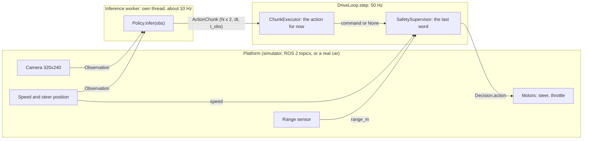

# 01 · System architecture

## What problem are we solving?

Two parts of a self-driving system run on incompatible clocks.

- **The car** needs a steering and throttle command every 20 ms. Leave it without one
  and it travels blind: at 1.5 m/s, 3 cm per tick.
- **The policy** (eventually a VLA) needs 100 ms or more per answer. SmolVLA takes
  about 108 ms on a Jetson Orin Nano; larger models take 270 to 640 ms (figures from
  the [jetson-orin-nano-vla](https://github.com/eetmie/jetson-orin-nano-vla) README).

The architecture exists to join them safely: the policy answers rarely but with a plan
for the near future, and a fast loop plays that plan while a supervisor that trusts
nobody guards the motors.

## Why does it matter?

If you simply call the policy inside the control loop, the loop runs at the policy's
rate: 10 Hz at best, 1.5 Hz at worst. If you run them separately without thought, the
car acts on plans made from a world that has since moved. Most of this repository is a
careful answer to "which action, from which plan, at which instant, and who may veto it".

## The architecture



The same picture as the project draws it ([`README.md`](../../README.md)):

```
camera, speed ─► policy (slow, own thread) ─► chunk of [steer, throttle]
                                                  │
              control loop, 50 Hz: ChunkExecutor ◄┘   the action for *now*
                                        │
              range sensor ───► SafetySupervisor      has the last word
                                        │
                                     motors
```

## The modules and their boundaries

| Module | Responsibility | Must not | Status |
|---|---|---|---|
| [`drive/types.py`](../../drive/types.py) | The three data types that cross module boundaries: `Observation`, `ActionChunk`, `VehicleState` | hold behaviour beyond `ActionChunk.sample` | **[TESTED]** `ChunkTests` |
| [`drive/config.py`](../../drive/config.py) | Every tunable number, as frozen dataclasses | be mutated at run time | used throughout |
| [`drive/platform.py`](../../drive/platform.py) | The `Platform` protocol: `t`, `state`, `observe`, `range_m`, `apply` | know which car is behind it | **[TESTED]** via `World` and `RosPlatform` |
| [`drive/sim/`](../../drive/sim) | A `Platform`: track, kinematic car, rendered camera, range sensor | be used by a policy meant for a real car (only the teacher reads its pose) | **[TESTED]**, **[SIM-ONLY]** |
| [`drive/policy/`](../../drive/policy) | Observation in, `ActionChunk` out | run inside the control loop, or touch the motors | **[TESTED]**; `vla.py` against a stub only |
| [`drive/control/inference.py`](../../drive/control/inference.py) | Run one inference at a time, off the loop | queue observations | **[TESTED]** `WorkerTests` |
| [`drive/control/executor.py`](../../drive/control/executor.py) | Choose the action for *now* from the newest chunk | decide whether that action is safe | **[TESTED]** `ExecutorTests` |
| [`drive/safety.py`](../../drive/safety.py) | Veto or limit the command using its own inputs | trust anything from the policy | **[TESTED]** `SafetyTests` |
| [`drive/loop.py`](../../drive/loop.py) | One control tick, wiring the above together | contain policy or safety logic of its own | **[TESTED]** `DriveTests` |
| [`drive/episode.py`](../../drive/episode.py) | Build a simulated drive from settings, run it, measure it | be used on a real car (its metrics need ground truth) | **[TESTED]**, **[SIM-ONLY]** |
| [`drive/recorder.py`](../../drive/recorder.py) | Sample a drive at 10 Hz into an episode directory | label the data, unless a teacher hands it a plan | **[TESTED]** |
| [`drive/viewer.py`](../../drive/viewer.py) | The HUD window and the video writer | affect the drive | **[TESTED]** (video path) |
| [`drive/learn/`](../../drive/learn) | The data pipeline, one module per stage | import PyTorch at module level (only `model.py` does) | **[TESTED]** |
| [`ros/src/drive_ros/`](../../ros/src/drive_ros) | Four ROS 2 nodes around the above | re-implement the loop | **[TESTED]** `test_drive_ros.py` |
| [`docker/`](../../docker), [`Makefile`](../../Makefile) | One container with ROS 2 Humble and PyTorch 2.5.1 (CUDA 12.1) | | built and used |

### Three design decisions worth noticing

**1. The `Platform` protocol is the only seam.**
[`Platform`](../../drive/platform.py#L14) has five members. `DriveLoop` talks to
nothing else, so the simulator ([`World`](../../drive/sim/world.py#L15)) and the ROS 2
adapter ([`RosPlatform`](../../ros/src/drive_ros/drive_ros/platform.py#L13)) are
interchangeable, and a CARLA bridge or a real car would be a third implementation.
It is a `typing.Protocol`: neither class inherits from it; they only have the right
shape (structural typing).

**2. A policy returns a plan, never a command.**
[`Policy.infer`](../../drive/policy/base.py#L15) returns an
[`ActionChunk`](../../drive/types.py#L41): an `(N, 2)` array, a time step `dt`, and
`t_obs`, the time of the observation it was computed from. Carrying `t_obs` inside the
plan is what makes latency compensation possible ([chapter 5](05-action-chunking-and-latency.md)).

**3. Safety sits after everything and shares nothing with the policy.**
[`SafetySupervisor.filter`](../../drive/safety.py#L33) receives the command, the
measured speed, its own range reading and the plan's age. It does not receive the
image, the chunk or the policy. A wrong, slow or crashed policy cannot argue with it
([chapter 7](07-safety-supervisor.md)).

## The same loop in three deployments

```mermaid
flowchart TB
    subgraph A["A · In-process simulation  (./drive.sh sim)"]
        A1[World] <--> A2[DriveLoop]
        A2 <--> A3["SimulatedWorker or ThreadedWorker"]
    end
    subgraph B["B · ROS 2  (make ros-sim + make ros-drive)"]
        B1[sim node: World] <-- "/drive/* topics" --> B2[RosPlatform]
        B2 <--> B3[DriveLoop in driver node]
        B3 <--> B4[ThreadedWorker]
    end
    subgraph C["C · Real car  [PROPOSED]"]
        C1[car node: camera, encoders, ToF, ESC] <-- "/drive/* topics" --> C2[RosPlatform]
        C2 <--> C3[DriveLoop on the Jetson]
        C3 <--> C4["ThreadedWorker + BackendPolicy (TensorRT)"]
    end
```



| | A | B | C |
|---|---|---|---|
| Clock | simulated, deterministic (or wall clock with `--show`/`--realtime`) | wall clock | wall clock |
| Worker | `SimulatedWorker` (default) or `ThreadedWorker` | `ThreadedWorker` | `ThreadedWorker` |
| Status | **[TESTED]** | **[TESTED]** | **[PROPOSED]** |

`DriveLoop` is byte-for-byte the same class in all three. This is the claim to test
whenever you change it.

## Step-by-step: how a simulated drive is assembled

[`episode.build`](../../drive/episode.py#L76) is the composition root for deployment A:

1. `Track.named(config.track, config.reverse)` builds the centreline.
2. `World(track, obstacles, seed=…)` builds the platform (car, camera, ground map).
3. `make_policy(…)` builds the policy by name ([`drive/policy/__init__.py`](../../drive/policy/__init__.py#L9)).
4. A worker wraps the policy: `ThreadedWorker` if `realtime`, else `SimulatedWorker`
   with the requested latency and jitter.
5. `DriveLoop(world, worker, SafetySupervisor(...) or None, loop_config)`.

[`episode.run`](../../drive/episode.py#L89) then calls `loop.step()` until the
simulated time reaches `duration_s`, feeding each `Tick` to
[`Metrics`](../../drive/episode.py#L37).

For deployment B the composition root is
[`DriveNode.__init__`](../../ros/src/drive_ros/drive_ros/drive_node.py#L28): same
steps, with `RosPlatform(self)` instead of `World`.

## Example with real values

`./drive.sh sim` with all defaults (*measured*):

```
pure-pursuit on peanut, 100.0 ms per inference (300 inferences), latency compensation on, safety on
  1.99 laps in 30.0 s at 1.46 m/s
  off the centerline: rms 1.8 cm, max 3.4 cm, off the road 0.0 % of the time
  safety overrode the policy: stale 0.1 s, steer_rate 0.06 s
```

Read it against the architecture: 30 s at 50 Hz is 1500 control ticks; 300 inferences
is 10 Hz, so each chunk served five ticks before the next replaced it. The supervisor
intervened for 0.1 s (no plan existed until the first inference finished) and for
0.06 s (the first swing of the wheels exceeded the steering-rate limit).

## Common mistakes and misconceptions

- **"The policy drives the car."** It proposes. `DriveLoop` sends
  `decision.action`, not `command`, to the platform ([`loop.py`](../../drive/loop.py#L47)).
- **"The simulator is part of the stack."** It is one `Platform` among several. Code
  that imports `drive.sim` outside the simulator, the teacher policy and the tools
  (viewer, browse) is a design smell.
- **"There is a VLA in here."** There is an adapter for one
  ([`drive/policy/vla.py`](../../drive/policy/vla.py)) and a PyTorch backend for LeRobot
  checkpoints ([`lerobot_backend.py`](../../drive/policy/lerobot_backend.py)); `vla` is
  in [`POLICIES`](../../drive/policy/__init__.py#L6). It needs an environment with
  LeRobot and a fine-tuned checkpoint, which are not part of the repository
  ([Lab 15](15-hands-on-labs.md#lab-15-fine-tune-smolvla-on-the-driving-data-on-this-laptop)).
- **"`task` does something."** The task string travels in every `Observation` and is
  forwarded to a VLA backend, but none of the three working policies reads it.

## Practical experiment

Run `./drive.sh sim --out /tmp/result.json` and open the JSON. Map every key to the
module that produced it (`config` ← `EpisodeConfig`; `laps`, `lateral_rms_m`, … ←
`Metrics.summary`; `inferences`, `latency_ms_mean` ← the worker's `latencies_s`).

## Knowledge check

1. Which five members must a class have to serve as a `Platform`?
2. Why does `ActionChunk` carry `t_obs` rather than the executor recording when the chunk arrived?
3. Name one input the supervisor has that the policy does not, and one the policy has that the supervisor does not.
4. Which class would you replace to drive a CARLA vehicle, and which classes would stay untouched?

<details><summary>Answers</summary>

1. `t`, `state`, `observe(task)`, `range_m()`, `apply(action, dt)`.
2. Arrival time includes the inference latency, which varies. The plan describes the
   future as seen at the observation, so only `t_obs` says which entry corresponds to "now".
3. The supervisor has the range sensor (and the plan's age); the policy has the camera image.
4. Replace the platform (`World` / `RosPlatform`). `DriveLoop`, the workers, the executor,
   the supervisor and every policy except the map-reading teacher stay as they are.
</details>

## Further reading

- [`drive/__init__.py`](../../drive/__init__.py): the package's own five-line map.
- Paden et al. 2016, *A Survey of Motion Planning and Control Techniques for Self-driving
  Urban Vehicles*: where this stack sits in a conventional autonomy architecture.
- Zhao et al. 2023 (ACT): the paper that popularised action chunking for learned policies.
