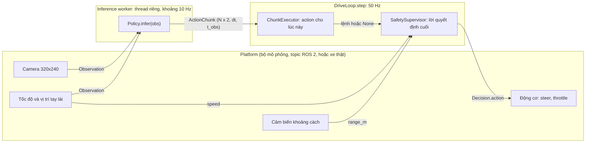

# 01 · Kiến trúc hệ thống

*Bản tiếng Việt · [English](01-system-architecture.md)*

*Bản tiếng Việt · [English](01-system-architecture.vi.md)*

## Ta đang giải bài toán gì?

Hai phần của một hệ thống tự lái chạy theo hai nhịp đồng hồ không khớp nhau.

- **Chiếc xe** cần một lệnh lái và ga sau mỗi 20 ms. Bỏ nó một nhịp không có lệnh là nó
  chạy mù: ở 1,5 m/s, mỗi nhịp đi 3 cm.
- **Policy** (cuối cùng sẽ là một VLA) cần 100 ms hoặc hơn cho mỗi câu trả lời. SmolVLA
  mất khoảng 108 ms trên Jetson Orin Nano; các model lớn hơn mất 270 tới 640 ms (số liệu từ
  README của [jetson-orin-nano-vla](https://github.com/eetmie/jetson-orin-nano-vla)).

Kiến trúc tồn tại để nối hai thứ đó một cách an toàn: policy ít khi trả lời nhưng mỗi lần
trả lời là một kế hoạch cho tương lai gần, và một vòng lặp nhanh phát kế hoạch đó, trong khi
một bộ giám sát không tin ai canh giữ động cơ.

## Vì sao điều đó quan trọng?

Nếu bạn gọi thẳng policy bên trong vòng điều khiển, vòng điều khiển chạy theo tốc độ của
policy: tốt nhất 10 Hz, tệ nhất 1,5 Hz. Nếu bạn cho chúng chạy riêng mà không suy nghĩ kỹ,
xe sẽ hành động theo kế hoạch được lập từ một thế giới đã thay đổi từ lâu. Phần lớn
repository này là một câu trả lời cẩn thận cho câu hỏi "action nào, từ kế hoạch nào, ở thời
điểm nào, và ai được quyền phủ quyết nó".

## Kiến trúc



Cùng bức tranh đó theo cách dự án vẽ ([`README.vi.md`](../../README.vi.md)):

```
camera, speed ─► policy (slow, own thread) ─► chunk of [steer, throttle]
                                                  │
              control loop, 50 Hz: ChunkExecutor ◄┘   the action for *now*
                                        │
              range sensor ───► SafetySupervisor      has the last word
                                        │
                                     motors
```

## Các module và ranh giới của chúng

| Module | Trách nhiệm | Không được | Trạng thái |
|---|---|---|---|
| [`drive/types.py`](../../drive/types.py) | Ba kiểu dữ liệu đi qua ranh giới giữa các module: `Observation`, `ActionChunk`, `VehicleState` | chứa hành vi nào ngoài `ActionChunk.sample` | **[TESTED]** `ChunkTests` |
| [`drive/config.py`](../../drive/config.py) | Mọi con số có thể chỉnh, dưới dạng frozen dataclass | bị thay đổi lúc đang chạy | dùng khắp nơi |
| [`drive/platform.py`](../../drive/platform.py) | Protocol `Platform`: `t`, `state`, `observe`, `range_m`, `apply` | biết chiếc xe nào đứng sau nó | **[TESTED]** qua `World` và `RosPlatform` |
| [`drive/sim/`](../../drive/sim) | Một `Platform`: đường đua, xe động học, camera được render, cảm biến khoảng cách | bị một policy dành cho xe thật dùng (chỉ teacher đọc pose của nó) | **[TESTED]**, **[SIM-ONLY]** |
| [`drive/policy/`](../../drive/policy) | Observation vào, `ActionChunk` ra | chạy bên trong vòng điều khiển, hoặc chạm vào động cơ | **[TESTED]**; `vla.py` chỉ test với một stub |
| [`drive/control/inference.py`](../../drive/control/inference.py) | Chạy mỗi lần một lượt suy luận, tách khỏi vòng lặp | xếp hàng các observation | **[TESTED]** `WorkerTests` |
| [`drive/control/executor.py`](../../drive/control/executor.py) | Chọn action cho *lúc này* từ chunk mới nhất | quyết định action đó có an toàn không | **[TESTED]** `ExecutorTests` |
| [`drive/safety.py`](../../drive/safety.py) | Phủ quyết hoặc giới hạn lệnh bằng đầu vào của riêng nó | tin bất cứ thứ gì từ policy | **[TESTED]** `SafetyTests` |
| [`drive/loop.py`](../../drive/loop.py) | Một nhịp điều khiển, nối các thành phần trên lại với nhau | chứa logic policy hay logic an toàn của riêng nó | **[TESTED]** `DriveTests` |
| [`drive/episode.py`](../../drive/episode.py) | Dựng một lần lái mô phỏng từ thiết lập, chạy nó, đo nó | được dùng trên xe thật (các metric của nó cần dữ liệu thật tuyệt đối) | **[TESTED]**, **[SIM-ONLY]** |
| [`drive/recorder.py`](../../drive/recorder.py) | Lấy mẫu một lần lái ở 10 Hz vào một thư mục episode | gán nhãn dữ liệu, trừ khi teacher đưa cho nó một kế hoạch | **[TESTED]** |
| [`drive/viewer.py`](../../drive/viewer.py) | Cửa sổ HUD và bộ ghi video | ảnh hưởng tới lần lái | **[TESTED]** (đường ghi video) |
| [`drive/learn/`](../../drive/learn) | Dây chuyền dữ liệu, mỗi bước một module | import PyTorch ở cấp module (chỉ `model.py` làm vậy) | **[TESTED]** |
| [`ros/src/drive_ros/`](../../ros/src/drive_ros) | Bốn node ROS 2 bao quanh các phần trên | viết lại vòng điều khiển | **[TESTED]** `test_drive_ros.py` |
| [`docker/`](../../docker), [`Makefile`](../../Makefile) | Một container có ROS 2 Humble và PyTorch 2.5.1 (CUDA 12.1) | | đã build và dùng |

### Ba quyết định thiết kế đáng để ý

**1. Protocol `Platform` là đường nối duy nhất.**
[`Platform`](../../drive/platform.py#L14) có năm thành viên. `DriveLoop` không nói chuyện
với thứ gì khác, nên bộ mô phỏng ([`World`](../../drive/sim/world.py#L15)) và adapter ROS 2
([`RosPlatform`](../../ros/src/drive_ros/drive_ros/platform.py#L13)) hoán đổi được cho nhau,
và một cầu nối CARLA hay một chiếc xe thật sẽ là hiện thực thứ ba. Nó là một
`typing.Protocol`: không class nào kế thừa nó; chúng chỉ có đúng "hình dạng" (structural
typing).

**2. Policy trả về một kế hoạch, không bao giờ trả về một lệnh.**
[`Policy.infer`](../../drive/policy/base.py#L15) trả về một
[`ActionChunk`](../../drive/types.py#L41): một mảng `(N, 2)`, một bước thời gian `dt`, và
`t_obs`, thời điểm của observation đã dùng để tính ra nó. Việc mang `t_obs` trong kế hoạch
là điều làm cho bù độ trễ khả thi ([chương 5](05-action-chunking-and-latency.vi.md)).

**3. An toàn đứng sau mọi thứ và không dùng chung gì với policy.**
[`SafetySupervisor.filter`](../../drive/safety.py#L33) nhận lệnh, tốc độ đo được, số đo
khoảng cách của riêng nó và tuổi của kế hoạch. Nó không nhận ảnh, chunk hay policy. Một
policy sai, chậm hay đã sập không thể cãi lại nó ([chương 7](07-safety-supervisor.vi.md)).

## Cùng một vòng lặp trong ba cách triển khai

```mermaid
flowchart TB
    subgraph A["A · Mô phỏng trong cùng tiến trình  (./drive.sh sim)"]
        A1[World] <--> A2[DriveLoop]
        A2 <--> A3["SimulatedWorker hoặc ThreadedWorker"]
    end
    subgraph B["B · ROS 2  (make ros-sim + make ros-drive)"]
        B1[node sim: World] <-- "topic /drive/*" --> B2[RosPlatform]
        B2 <--> B3[DriveLoop trong node driver]
        B3 <--> B4[ThreadedWorker]
    end
    subgraph C["C · Xe thật  [PROPOSED]"]
        C1[node xe: camera, encoder, ToF, ESC] <-- "topic /drive/*" --> C2[RosPlatform]
        C2 <--> C3[DriveLoop trên Jetson]
        C3 <--> C4["ThreadedWorker + BackendPolicy (TensorRT)"]
    end
```



| | A | B | C |
|---|---|---|---|
| Đồng hồ | mô phỏng, tất định (hoặc đồng hồ thật khi có `--show`/`--realtime`) | đồng hồ thật | đồng hồ thật |
| Worker | `SimulatedWorker` (mặc định) hoặc `ThreadedWorker` | `ThreadedWorker` | `ThreadedWorker` |
| Trạng thái | **[TESTED]** | **[TESTED]** | **[PROPOSED]** |

`DriveLoop` là cùng một class, giống từng byte, trong cả ba. Đây là điều phải kiểm lại mỗi
khi bạn sửa nó.

## Từng bước: một lần lái mô phỏng được lắp ráp thế nào

[`episode.build`](../../drive/episode.py#L76) là nơi lắp ráp (composition root) cho cách triển
khai A:

1. `Track.named(config.track, config.reverse)` dựng đường tâm.
2. `World(track, obstacles, seed=…)` dựng platform (xe, camera, bản đồ mặt đất).
3. `make_policy(…)` dựng policy theo tên ([`drive/policy/__init__.py`](../../drive/policy/__init__.py#L9)).
4. Một worker bọc policy: `ThreadedWorker` nếu `realtime`, nếu không thì `SimulatedWorker`
   với độ trễ và độ dao động (jitter) được yêu cầu.
5. `DriveLoop(world, worker, SafetySupervisor(...) or None, loop_config)`.

Sau đó [`episode.run`](../../drive/episode.py#L89) gọi `loop.step()` cho tới khi thời gian
mô phỏng đạt `duration_s`, đưa từng `Tick` cho [`Metrics`](../../drive/episode.py#L37).

Với cách triển khai B, nơi lắp ráp là
[`DriveNode.__init__`](../../ros/src/drive_ros/drive_ros/drive_node.py#L28): cùng các bước,
với `RosPlatform(self)` thay cho `World`.

## Ví dụ với giá trị thật

`./drive.sh sim` với mọi giá trị mặc định (*measured*):

```
pure-pursuit on peanut, 100.0 ms per inference (300 inferences), latency compensation on, safety on
  1.99 laps in 30.0 s at 1.46 m/s
  off the centerline: rms 1.8 cm, max 3.4 cm, off the road 0.0 % of the time
  safety overrode the policy: stale 0.1 s, steer_rate 0.06 s
```

Đọc nó đối chiếu với kiến trúc: 30 s ở 50 Hz là 1500 nhịp điều khiển; 300 lượt suy luận là
10 Hz, nên mỗi chunk phục vụ năm nhịp trước khi chunk tiếp theo thay chỗ. Supervisor can
thiệp trong 0,1 s (chưa có kế hoạch nào cho tới khi lượt suy luận đầu tiên xong) và trong
0,06 s (lần đánh lái đầu tiên của bánh xe vượt giới hạn tốc độ đánh lái).

## Những lỗi và hiểu lầm thường gặp

- **"Policy lái xe."** Nó chỉ đề xuất. `DriveLoop` gửi `decision.action`, không phải
  `command`, tới platform ([`loop.py`](../../drive/loop.py#L47)).
- **"Bộ mô phỏng là một phần của hệ thống."** Nó chỉ là một `Platform` trong số nhiều cái.
  Code import `drive.sim` bên ngoài bộ mô phỏng, policy teacher và các công cụ (viewer,
  browse) là dấu hiệu thiết kế có vấn đề.
- **"Trong này có một VLA."** Có một adapter cho VLA
  ([`drive/policy/vla.py`](../../drive/policy/vla.py)) và một backend PyTorch cho checkpoint
  LeRobot ([`lerobot_backend.py`](../../drive/policy/lerobot_backend.py)); `vla` nằm trong
  [`POLICIES`](../../drive/policy/__init__.py#L6). Nó cần một môi trường có LeRobot và một
  checkpoint đã fine-tune, thứ không nằm trong repository
  ([Lab 15](15-hands-on-labs.vi.md#lab-15-fine-tune-smolvla-trên-dữ-liệu-lái-xe-ngay-trên-laptop-này)).
- **"`task` có tác dụng gì đó."** Chuỗi task đi theo mọi `Observation` và được chuyển tiếp
  cho backend VLA, nhưng không policy nào trong ba policy đang chạy đọc nó.

## Thí nghiệm thực hành

Chạy `./drive.sh sim --out /tmp/result.json` và mở file JSON. Ánh xạ mỗi khoá tới module đã
tạo ra nó (`config` ← `EpisodeConfig`; `laps`, `lateral_rms_m`, … ← `Metrics.summary`;
`inferences`, `latency_ms_mean` ← `latencies_s` của worker).

## Kiểm tra kiến thức

1. Một class phải có năm thành viên nào để đóng vai một `Platform`?
2. Vì sao `ActionChunk` mang `t_obs` thay vì để executor ghi lại lúc chunk tới nơi?
3. Kể một đầu vào supervisor có mà policy không có, và một đầu vào policy có mà supervisor không có.
4. Để lái một chiếc xe trong CARLA, bạn sẽ thay class nào, và những class nào giữ nguyên?

<details><summary>Đáp án</summary>

1. `t`, `state`, `observe(task)`, `range_m()`, `apply(action, dt)`.
2. Thời điểm tới nơi đã gồm độ trễ suy luận, thứ thay đổi theo từng lượt. Kế hoạch mô tả
   tương lai như nhìn thấy tại lúc có observation, nên chỉ `t_obs` cho biết mục nào ứng với "lúc này".
3. Supervisor có cảm biến khoảng cách (và tuổi của kế hoạch); policy có ảnh camera.
4. Thay platform (`World` / `RosPlatform`). `DriveLoop`, các worker, executor, supervisor và
   mọi policy trừ teacher đọc bản đồ đều giữ nguyên.
</details>

## Đọc thêm

- [`drive/__init__.py`](../../drive/__init__.py): bản đồ năm dòng của chính package.
- Paden và cộng sự 2016, *A Survey of Motion Planning and Control Techniques for Self-driving
  Urban Vehicles*: hệ thống này nằm ở đâu trong một kiến trúc tự hành thông thường.
- Zhao và cộng sự 2023 (ACT): bài báo phổ biến action chunking cho các policy học được.
