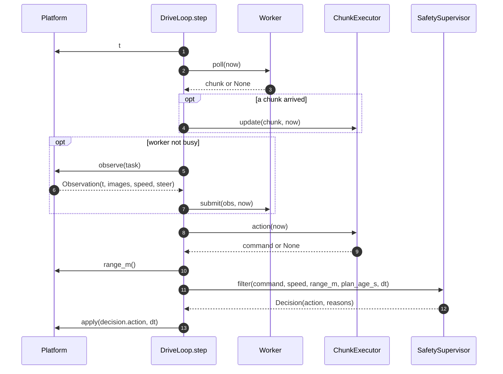
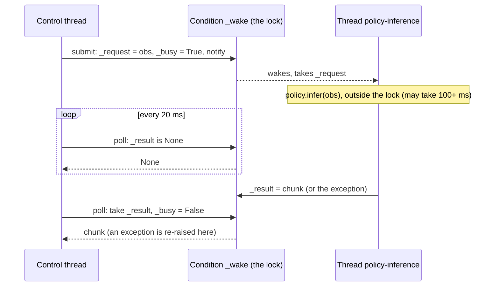

# 02 · Data flow and execution lifecycle

*[Tiếng Việt](02-data-flow-and-lifecycle.vi.md)*

## What problem are we solving?

Knowing the boxes of the architecture is not enough to debug it. You need to know, for
any instant, which data exists, who owns it, how old it is, and which thread is
touching it. This chapter traces one control tick line by line and one observation end
to end.

## The three data types

Defined in [`drive/types.py`](../../drive/types.py).

| Type | Fields | Made by | Read by | Mutable? |
|---|---|---|---|---|
| [`Observation`](../../drive/types.py#L27) | `t`, `images` (list of `uint8 H×W×3` RGB), `speed`, `steer`, `task`, `pose` (simulator only) | `Platform.observe` | the policy, on the worker | by convention never changed after creation |
| [`ActionChunk`](../../drive/types.py#L41) | `actions` `(N, 2)`, `dt`, `t_obs` | `Policy.infer` | `ChunkExecutor` | frozen dataclass |
| [`VehicleState`](../../drive/types.py#L18) | `x`, `y`, `yaw`, `speed`, `steer` | the platform | the loop reads `.speed` only | frozen dataclass |

`ActionChunk.actions[i]` is meant for time `t_obs + i * dt`. That one sentence is the
contract between a policy and the control loop.

## One control tick

The whole of [`DriveLoop.step`](../../drive/loop.py#L32), annotated:

```python
def step(self) -> Tick:
    platform, now = self.platform, self.platform.t          # (1) read the platform's clock
    chunk = self.worker.poll(now)                            # (2) did an inference finish?
    if chunk is not None:
        self.executor.update(chunk, now)                     # (3) adopt the new plan
    if not self.worker.busy:
        self.worker.submit(platform.observe(self.config.task), now)   # (4) start the next inference

    command = self.executor.action(now)                      # (5) the plan's action for now, or None
    distance = platform.range_m()                            # (6) the supervisor's own sensor
    if self.safety is not None:
        decision = self.safety.filter(command, speed=platform.state.speed, range_m=distance,
                                      plan_age_s=self.executor.age_s(now), dt=self.config.dt)   # (7)
    else:
        decision = Decision(np.zeros(2) if command is None else np.clip(command, -1.0, 1.0), ())
    platform.apply(decision.action, self.config.dt)          # (8) to the motors; time advances
    return Tick(now, command, decision, distance, chunk is not None)
```

Two details matter:

- **Poll before submit (2 → 4).** When an inference finishes, the same tick both
  adopts its chunk and starts the next inference. The policy therefore runs back to
  back with no idle tick, and never has more than one request outstanding.
- **Observe only when the worker is free (4).** `platform.observe` renders the camera
  in the simulator, which is the expensive part. It is called at the inference rate,
  not at 50 Hz.



## The two clocks and the two rates

| | Control loop | Policy |
|---|---|---|
| Rate | `LoopConfig.control_hz = 50` → `dt = 0.02 s` ([`config.py`](../../drive/config.py#L55)) | whatever the model takes; back to back |
| Where | the caller's thread (`episode.run`, or a ROS timer) | `SimulatedWorker`: inline; `ThreadedWorker`: thread `policy-inference` |
| Time base | `platform.t` | the `t` stamped into the observation |

With latency $L$ the policy runs at $1/L$ Hz (rounded up to a whole number of ticks).
At $L = 100$ ms that is 10 Hz: five control ticks per chunk.

## A timeline with real numbers

Defaults: 50 Hz, 100 ms latency, teacher chunk with `dt = 1/30 s`.

| tick | `now` (s) | worker | executor | command | supervisor |
|---:|---:|---|---|---|---|
| 0 | 0.00 | `submit(obs@0.00)` | no chunk | `None` | brake, reason `stale` |
| 1–4 | 0.02–0.08 | busy | no chunk | `None` | brake, `stale` |
| 5 | 0.10 | `poll` → chunk A (`t_obs=0.00`); `submit(obs@0.10)` | A; elapsed 0.10 s → index 3.0 | `A[3]` | passes (rate-limited at first) |
| 6 | 0.12 | busy | elapsed 0.12 → index 3.6 | `0.4·A[3] + 0.6·A[4]` | passes |
| 9 | 0.18 | busy | elapsed 0.18 → index 5.4 | interpolated | passes |
| 10 | 0.20 | `poll` → chunk B (`t_obs=0.10`); `submit(obs@0.20)` | B, fading in over A for 0.10 s | blend of A and B | passes |

Ticks 0 to 4 explain the `stale 0.1 s` in every result: five ticks × 0.02 s with no
plan. The age of the plan in use runs from 0.10 s (just arrived) to 0.18 s (about to
be replaced), then drops back. In general it sweeps $[L, 2L)$.

## Observation timestamps and action timestamps

- **Observation timestamp** `obs.t`: when the sensors were read.
  - Simulator: `World.t` at the call ([`World.observe`](../../drive/sim/world.py#L42)).
  - ROS 2: the *image message's header stamp*, converted to the driver's clock
    ([`RosPlatform.on_image`](../../ros/src/drive_ros/drive_ros/platform.py#L38)). The
    time the frame spent in transit and waiting therefore counts as latency, which is
    correct: the car moved during it.
- **Chunk timestamp** `chunk.t_obs`: copied from `obs.t` by every policy (for example
  [`CnnPolicy.infer`](../../drive/policy/cnn.py#L26)).
- **Action timestamp**: implicit, $t_{\text{obs}} + i \cdot dt$.
- **Now**: `platform.t` at the top of the tick.

The executor turns these into one number, `elapsed = now - origin`, and samples the
chunk there ([chapter 5](05-action-chunking-and-latency.md)).

## Threading and synchronisation

### `SimulatedWorker`: no threads at all **[TESTED]**

[`SimulatedWorker.submit`](../../drive/control/inference.py#L30) calls `policy.infer`
immediately and stores `(ready_time, chunk)`. `poll` hands the chunk over once
`now >= ready_time`. The latency is a rule about *when the result becomes visible*,
measured on the simulator's clock. Consequences: runs are deterministic and repeat
exactly (`DriveTests.test_runs_are_reproducible`), and they run as fast as the PC
allows.

### `ThreadedWorker`: one background thread **[TESTED]**

[`ThreadedWorker`](../../drive/control/inference.py#L44) is what runs on a car.



Shared state is four fields (`_request`, `_result`, `_busy`, `_closed`), all written
under one `threading.Condition`. Points to notice:

- **Inference runs outside the lock**, so `poll` never waits for the model. The
  control thread's worst-case delay from the worker is a few microseconds.
- **One slot, not a queue.** A queue would let observations pile up and be answered
  late. The loop only submits when `busy` is false, so the slot is never overwritten.
- **Errors cross the thread boundary.** `_run` catches `BaseException` and stores it;
  `poll` re-raises it in the control thread
  (`WorkerTests.test_threaded_worker_raises_policy_errors_in_the_loop`). A policy that
  crashes stops the drive loudly instead of leaving a dead thread and a car that
  coasts on its last plan.
- **`extra_latency_s`** sleeps after each inference, to feel a slow model on a fast PC.
- **Daemon thread**, and `close()` joins it with a 5 s timeout.

### ROS 2

The driver node uses rclpy's default single-threaded executor, so subscription
callbacks and the 50 Hz timer never run concurrently; `RosPlatform`'s fields need no
lock. Only the inference thread is separate ([chapter 12](12-ros2-integration.md)).

## Data ownership

| Datum | Owner | Lifetime |
|---|---|---|
| Camera image | created by `World.image()` / `msg_to_image`; referenced by one `Observation` | until the inference that uses it returns |
| `Observation` | handed from the loop to the worker; the loop keeps no reference | one inference |
| `ActionChunk` | created by the policy; the executor keeps the current and the previous one | until two newer chunks have arrived |
| `Decision` | created by the supervisor each tick | one tick (also kept in the `Tick` for metrics and the HUD) |

Nothing is mutated after it is handed over, so no copy and no lock is needed around
the data itself. In ROS 2, `on_image` replaces `self.image` with a new array for every
message rather than writing into the old one, which is what keeps an observation that
the worker is still reading intact.

## Stale action handling, in three layers

1. **Skip** ([`ChunkExecutor.update`](../../drive/control/executor.py#L28)): with
   latency compensation the chunk's origin is `t_obs`, so actions meant for the time
   spent computing are never played.
2. **Run out** ([`ActionChunk.sample`](../../drive/types.py#L58)): past the last
   action, `sample` returns `None`, and so does `executor.action`.
3. **Refuse** ([`SafetySupervisor.filter`](../../drive/safety.py#L38)): `None`, or a
   plan older than `max_plan_age_s` (0.6 s), is answered with a full brake and the
   reason `stale`.

## Common mistakes and misconceptions

- **"Latency delays the command by L."** With compensation, the *timing* of each
  action is right; what is old is the *information* the action was computed from.
- **"50 Hz means the policy's output is refreshed 50 times a second."** The command
  changes 50 times a second because the executor moves along the chunk; the plan
  changes at the inference rate.
- **"`SimulatedWorker` simulates a thread."** It simulates only the delay. Threading
  bugs (races, a blocked loop) can appear only with `ThreadedWorker`: run with
  `--realtime` before trusting a change on a car.
- **"`now` in `submit(obs, now)` is the observation time."** `ThreadedWorker` ignores
  `now` altogether; the observation's own `t` is what ends up in the chunk.

## Practical experiment

```bash
./drive.sh sim --duration-s 5 --latency-ms 100            # deterministic, as fast as possible
./drive.sh sim --duration-s 5 --latency-ms 100 --realtime # wall clock, real thread
```

Compare `inferences` and `latency_ms_mean`. In the first, latency is exactly 100 ms
and there are exactly 50 inferences. In the second, the mean is the 100 ms of
`extra_latency_s` plus the policy's real compute time, and the count is lower. Why is
the count lower, and what does that tell you about how the two workers define latency?

## Knowledge check

1. With 200 ms latency, between which two values does the plan's age swing?
2. Why does `step` call `poll` before `submit`?
3. What does the control thread see if the policy raises an exception inside `ThreadedWorker`?
4. In ROS 2, why is `obs.t` taken from the image header and not from the node's clock at `observe`?
5. Why is there no lock around `Observation.images`?

<details><summary>Answers</summary>

1. 0.2 s and 0.4 s.
2. So the tick in which a result arrives also starts the next inference; otherwise one tick is wasted per inference.
3. The exception, re-raised by the next `poll`.
4. The frame may be tens of milliseconds old when it is used; the stamp says when the world looked like that.
5. Nobody writes to an image after creating it; a new array is made for each frame.
</details>

## Further reading

- Python docs, `threading.Condition`.
- [Chapter 5](05-action-chunking-and-latency.md) for what the executor does with these timestamps.
- LeRobot's asynchronous inference documentation, for the same idea split across a robot client and a policy server.
