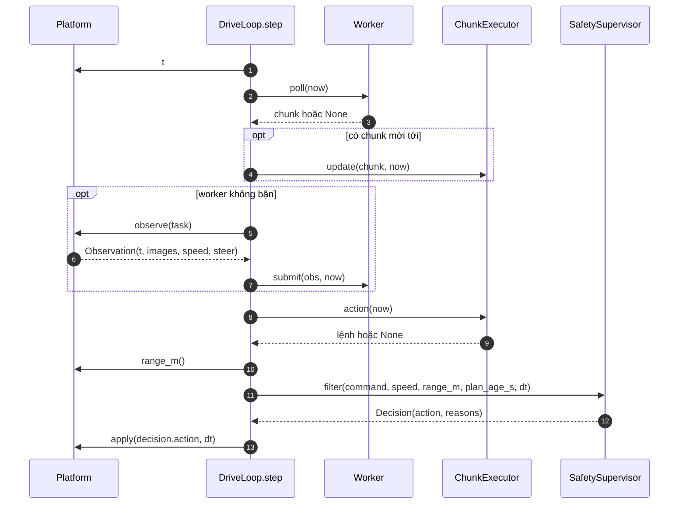
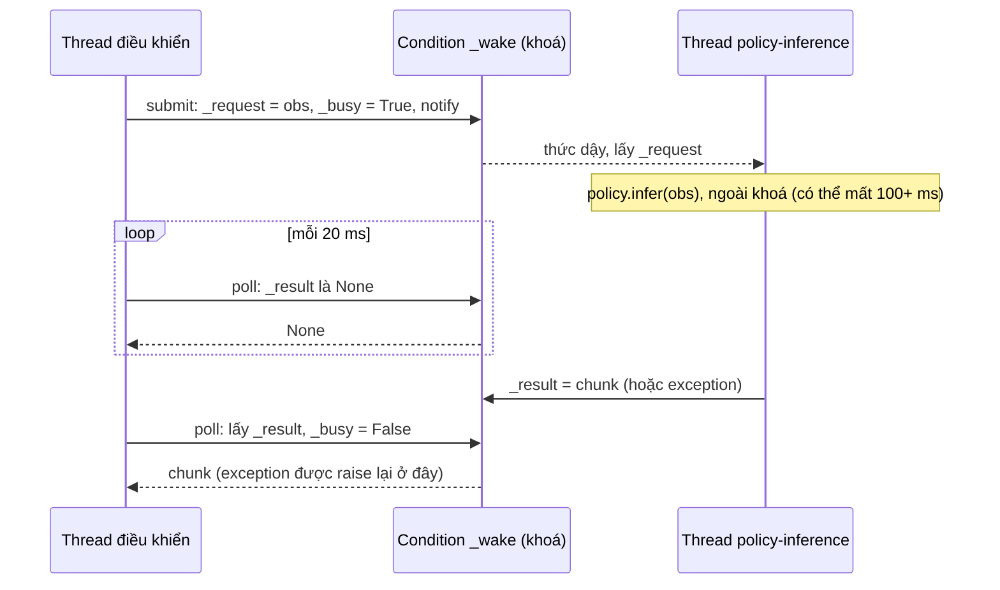

# 02 · Luồng dữ liệu và vòng đời thực thi

*Bản tiếng Việt · [English](02-data-flow-and-lifecycle.md)*

*Bản tiếng Việt · [English](02-data-flow-and-lifecycle.vi.md)*

## Ta đang giải bài toán gì?

Biết các ô trong sơ đồ kiến trúc chưa đủ để debug nó. Bạn cần biết, ở bất kỳ thời điểm
nào, dữ liệu nào đang tồn tại, ai sở hữu nó, nó cũ bao nhiêu, và thread nào đang chạm vào
nó. Chương này lần theo từng dòng của một nhịp điều khiển, và lần theo một observation từ
đầu tới cuối.

## Ba kiểu dữ liệu

Định nghĩa trong [`drive/types.py`](../../drive/types.py).

| Kiểu | Các field | Ai tạo | Ai đọc | Thay đổi được? |
|---|---|---|---|---|
| [`Observation`](../../drive/types.py#L27) | `t`, `images` (list các ảnh RGB `uint8 H×W×3`), `speed`, `steer`, `task`, `pose` (chỉ trong bộ mô phỏng) | `Platform.observe` | policy, trên worker | theo quy ước không bao giờ đổi sau khi tạo |
| [`ActionChunk`](../../drive/types.py#L41) | `actions` `(N, 2)`, `dt`, `t_obs` | `Policy.infer` | `ChunkExecutor` | frozen dataclass |
| [`VehicleState`](../../drive/types.py#L18) | `x`, `y`, `yaw`, `speed`, `steer` | platform | vòng lặp chỉ đọc `.speed` | frozen dataclass |

`ActionChunk.actions[i]` dành cho thời điểm `t_obs + i * dt`. Chỉ một câu đó là hợp đồng
giữa một policy và vòng điều khiển.

## Một nhịp điều khiển

Toàn bộ [`DriveLoop.step`](../../drive/loop.py#L32), có chú thích:

```python
def step(self) -> Tick:
    platform, now = self.platform, self.platform.t          # (1) đọc đồng hồ của platform
    chunk = self.worker.poll(now)                            # (2) có lượt suy luận nào vừa xong?
    if chunk is not None:
        self.executor.update(chunk, now)                     # (3) nhận kế hoạch mới
    if not self.worker.busy:
        self.worker.submit(platform.observe(self.config.task), now)   # (4) bắt đầu lượt suy luận tiếp theo

    command = self.executor.action(now)                      # (5) action của kế hoạch cho lúc này, hoặc None
    distance = platform.range_m()                            # (6) cảm biến riêng của supervisor
    if self.safety is not None:
        decision = self.safety.filter(command, speed=platform.state.speed, range_m=distance,
                                      plan_age_s=self.executor.age_s(now), dt=self.config.dt)   # (7)
    else:
        decision = Decision(np.zeros(2) if command is None else np.clip(command, -1.0, 1.0), ())
    platform.apply(decision.action, self.config.dt)          # (8) tới động cơ; thời gian trôi tiếp
    return Tick(now, command, decision, distance, chunk is not None)
```

Hai chi tiết quan trọng:

- **Poll trước rồi mới submit (2 → 4).** Khi một lượt suy luận xong, cùng một nhịp vừa nhận
  chunk của nó vừa bắt đầu lượt suy luận tiếp theo. Vì vậy policy chạy liên tục lượt này
  nối lượt kia, không có nhịp nào rảnh, và không bao giờ có hơn một yêu cầu đang chờ.
- **Chỉ observe khi worker rảnh (4).** Trong bộ mô phỏng, `platform.observe` render ảnh
  camera, đó là phần tốn kém. Nó được gọi theo tần số suy luận, không phải 50 Hz.



## Hai đồng hồ và hai tần số

| | Vòng điều khiển | Policy |
|---|---|---|
| Tần số | `LoopConfig.control_hz = 50` → `dt = 0.02 s` ([`config.py`](../../drive/config.py#L55)) | bao lâu tuỳ model; chạy liên tục lượt nối lượt |
| Chạy ở đâu | thread của bên gọi (`episode.run`, hoặc một timer ROS) | `SimulatedWorker`: chạy ngay tại chỗ; `ThreadedWorker`: thread `policy-inference` |
| Mốc thời gian | `platform.t` | `t` được đóng dấu vào observation |

Với độ trễ $L$, policy chạy ở $1/L$ Hz (làm tròn lên thành số nguyên nhịp điều khiển).
Với $L = 100$ ms, đó là 10 Hz: năm nhịp điều khiển cho mỗi chunk.

## Một dòng thời gian với số liệu thật

Mặc định: 50 Hz, độ trễ 100 ms, chunk của teacher với `dt = 1/30 s`.

| nhịp | `now` (s) | worker | executor | lệnh | supervisor |
|---:|---:|---|---|---|---|
| 0 | 0.00 | `submit(obs@0.00)` | chưa có chunk | `None` | phanh, lý do `stale` |
| 1–4 | 0.02–0.08 | bận | chưa có chunk | `None` | phanh, `stale` |
| 5 | 0.10 | `poll` → chunk A (`t_obs=0.00`); `submit(obs@0.10)` | A; đã trôi 0.10 s → chỉ số 3.0 | `A[3]` | cho qua (lúc đầu bị giới hạn tốc độ đổi) |
| 6 | 0.12 | bận | đã trôi 0.12 → chỉ số 3.6 | `0.4·A[3] + 0.6·A[4]` | cho qua |
| 9 | 0.18 | bận | đã trôi 0.18 → chỉ số 5.4 | nội suy | cho qua |
| 10 | 0.20 | `poll` → chunk B (`t_obs=0.10`); `submit(obs@0.20)` | B, chuyển dần từ A sang trong 0.10 s | trộn A và B | cho qua |

Các nhịp 0 tới 4 giải thích con số `stale 0.1 s` trong mọi kết quả: năm nhịp × 0,02 s
không có kế hoạch. Tuổi của kế hoạch đang dùng chạy từ 0,10 s (vừa tới) lên 0,18 s (sắp bị
thay), rồi tụt lại. Tổng quát, nó quét trong khoảng $[L, 2L)$.

## Mốc thời gian của observation và của action

- **Mốc thời gian observation** `obs.t`: lúc cảm biến được đọc.
  - Bộ mô phỏng: `World.t` tại lúc gọi ([`World.observe`](../../drive/sim/world.py#L42)).
  - ROS 2: *stamp trong header của message ảnh*, đổi sang đồng hồ của driver
    ([`RosPlatform.on_image`](../../ros/src/drive_ros/drive_ros/platform.py#L38)). Vì vậy
    thời gian khung hình nằm trên đường truyền và nằm chờ cũng được tính vào độ trễ, và như
    thế là đúng: xe đã di chuyển trong lúc đó.
- **Mốc thời gian chunk** `chunk.t_obs`: mọi policy chép nó từ `obs.t` (ví dụ
  [`CnnPolicy.infer`](../../drive/policy/cnn.py#L26)).
- **Mốc thời gian action**: ngầm định, $t_{\text{obs}} + i \cdot dt$.
- **Now** (lúc này): `platform.t` ở đầu nhịp.

Executor gộp các mốc này thành một con số, `elapsed = now - origin`, rồi lấy mẫu chunk tại
đó ([chương 5](05-action-chunking-and-latency.vi.md)).

## Threading và đồng bộ

### `SimulatedWorker`: không có thread nào **[TESTED]**

[`SimulatedWorker.submit`](../../drive/control/inference.py#L30) gọi `policy.infer` ngay lập
tức và lưu `(ready_time, chunk)`. `poll` trao chunk ra khi `now >= ready_time`. Độ trễ là
một luật về *khi nào kết quả trở nên nhìn thấy được*, đo trên đồng hồ của bộ mô phỏng. Hệ
quả: các lần chạy là tất định và lặp lại chính xác (`DriveTests.test_runs_are_reproducible`),
và chúng chạy nhanh nhất mà PC cho phép.

### `ThreadedWorker`: một thread nền **[TESTED]**

[`ThreadedWorker`](../../drive/control/inference.py#L44) là thứ chạy trên xe.



Trạng thái dùng chung gồm bốn field (`_request`, `_result`, `_busy`, `_closed`), tất cả được
ghi dưới cùng một `threading.Condition`. Những điểm cần để ý:

- **Suy luận chạy ngoài khoá**, nên `poll` không bao giờ phải chờ model. Độ trễ xấu nhất mà
  thread điều khiển phải chịu từ worker là vài micro giây.
- **Một ô, không phải một hàng đợi.** Một hàng đợi sẽ để các observation dồn lại và được trả
  lời muộn. Vòng lặp chỉ submit khi `busy` là false, nên ô không bao giờ bị ghi đè.
- **Lỗi đi qua ranh giới thread.** `_run` bắt `BaseException` và lưu lại; `poll` raise lại
  nó trong thread điều khiển
  (`WorkerTests.test_threaded_worker_raises_policy_errors_in_the_loop`). Một policy bị sập
  sẽ dừng lần lái một cách ồn ào, thay vì để lại một thread chết và một chiếc xe tiếp tục
  trôi theo kế hoạch cuối cùng của nó.
- **`extra_latency_s`** ngủ sau mỗi lượt suy luận, để cảm nhận một model chậm trên một PC nhanh.
- **Daemon thread**, và `close()` join nó với timeout 5 s.

### ROS 2

Node driver dùng executor đơn luồng mặc định của rclpy, nên các callback subscription và
timer 50 Hz không bao giờ chạy đồng thời; các field của `RosPlatform` không cần khoá. Chỉ
thread suy luận là tách riêng ([chương 12](12-ros2-integration.vi.md)).

## Quyền sở hữu dữ liệu

| Dữ liệu | Chủ sở hữu | Vòng đời |
|---|---|---|
| Ảnh camera | được tạo bởi `World.image()` / `msg_to_image`; được một `Observation` tham chiếu | cho tới khi lượt suy luận dùng nó trả về |
| `Observation` | vòng lặp trao cho worker; vòng lặp không giữ tham chiếu nào | một lượt suy luận |
| `ActionChunk` | do policy tạo; executor giữ chunk hiện tại và chunk trước đó | cho tới khi có hai chunk mới hơn tới |
| `Decision` | do supervisor tạo ở mỗi nhịp | một nhịp (cũng được giữ trong `Tick` cho metric và HUD) |

Không có gì bị thay đổi sau khi đã trao đi, nên không cần copy và không cần khoá quanh bản
thân dữ liệu. Trong ROS 2, `on_image` thay `self.image` bằng một mảng mới cho mỗi message
thay vì ghi vào mảng cũ, và chính điều đó giữ nguyên vẹn observation mà worker vẫn đang đọc.

## Xử lý action quá cũ, theo ba lớp

1. **Bỏ qua** ([`ChunkExecutor.update`](../../drive/control/executor.py#L28)): khi bù độ
   trễ, gốc thời gian của chunk là `t_obs`, nên các action dành cho khoảng thời gian đã mất
   vào tính toán không bao giờ được phát.
2. **Hết** ([`ActionChunk.sample`](../../drive/types.py#L58)): qua khỏi action cuối cùng,
   `sample` trả về `None`, và `executor.action` cũng vậy.
3. **Từ chối** ([`SafetySupervisor.filter`](../../drive/safety.py#L38)): `None`, hoặc một
   kế hoạch cũ hơn `max_plan_age_s` (0,6 s), được đáp lại bằng phanh hết cỡ và lý do `stale`.

## Những lỗi và hiểu lầm thường gặp

- **"Độ trễ làm lệnh bị chậm đi L."** Khi có bù, *thời điểm* của mỗi action là đúng; thứ đã
  cũ là *thông tin* dùng để tính ra action đó.
- **"50 Hz nghĩa là output của policy được làm mới 50 lần mỗi giây."** Lệnh đổi 50 lần mỗi
  giây vì executor di chuyển dọc chunk; kế hoạch chỉ đổi theo tần số suy luận.
- **"`SimulatedWorker` mô phỏng một thread."** Nó chỉ mô phỏng độ trễ. Lỗi threading (race,
  vòng lặp bị chặn) chỉ xuất hiện với `ThreadedWorker`: chạy với `--realtime` trước khi tin
  một thay đổi trên xe.
- **"`now` trong `submit(obs, now)` là thời điểm observation."** `ThreadedWorker` bỏ qua
  hẳn `now`; chính `t` của observation mới là thứ đi vào chunk.

## Thí nghiệm thực hành

```bash
./drive.sh sim --duration-s 5 --latency-ms 100            # tất định, nhanh nhất có thể
./drive.sh sim --duration-s 5 --latency-ms 100 --realtime # đồng hồ thật, thread thật
```

So sánh `inferences` và `latency_ms_mean`. Ở lần đầu, độ trễ đúng 100 ms và có đúng 50 lượt
suy luận. Ở lần thứ hai, giá trị trung bình là 100 ms của `extra_latency_s` cộng với thời
gian tính toán thật của policy, và số lượt ít hơn. Vì sao số lượt ít hơn, và điều đó cho bạn
biết gì về cách hai worker định nghĩa độ trễ?

## Kiểm tra kiến thức

1. Với độ trễ 200 ms, tuổi của kế hoạch dao động giữa hai giá trị nào?
2. Vì sao `step` gọi `poll` trước `submit`?
3. Thread điều khiển thấy gì nếu policy raise một exception bên trong `ThreadedWorker`?
4. Trong ROS 2, vì sao `obs.t` lấy từ header của ảnh mà không lấy từ đồng hồ của node lúc `observe`?
5. Vì sao không có khoá quanh `Observation.images`?

<details><summary>Đáp án</summary>

1. 0,2 s và 0,4 s.
2. Để nhịp nhận được kết quả cũng bắt đầu luôn lượt suy luận tiếp theo; nếu không, mỗi lượt suy luận phí một nhịp.
3. Chính exception đó, được raise lại ở lần `poll` tiếp theo.
4. Khung hình có thể đã cũ hàng chục mili giây khi được dùng; stamp cho biết thế giới trông như vậy vào lúc nào.
5. Không ai ghi vào một ảnh sau khi tạo nó; mỗi khung hình là một mảng mới.
</details>

## Đọc thêm

- Tài liệu Python, `threading.Condition`.
- [Chương 5](05-action-chunking-and-latency.vi.md): executor làm gì với các mốc thời gian này.
- Tài liệu về suy luận bất đồng bộ (asynchronous inference) của LeRobot: cùng ý tưởng nhưng tách thành một robot client và một policy server.
