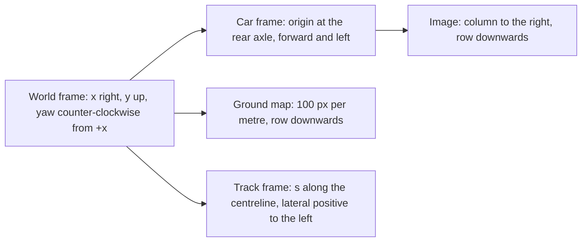

# 03 · Vehicle simulation

Everything in this chapter is **[SIM-ONLY]** by definition, and **[TESTED]** by
`TrackTests`, `VehicleTests` and `WorldTests` in [`tests/test_drive.py`](../../tests/test_drive.py).

## What problem are we solving?

To study a control loop you need a car, a road, a camera and something to hit, and you
need them to be cheap, fast and repeatable. The simulator in
[`drive/sim/`](../../drive/sim) is about 270 lines and gives all four. A 30 s drive
runs in roughly a second, and the same seed gives the same result to the last digit.

## Why does it matter?

Every number in this project comes from this model. Knowing exactly what it computes
tells you which conclusions transfer to a real car (how the loop reacts to latency)
and which do not (the centimetres).

## Coordinate systems



| Frame | Axes | Used by |
|---|---|---|
| World | $x, y$ in metres; yaw $\psi$ in radians, counter-clockwise from $+x$ | `VehicleState`, `Track.xy` |
| Car | `forward_m`, `left_m` from the rear axle | pure pursuit, the camera's ground map, the range sensor |
| Track (Frenet) | $s$: arc length along the centreline; lateral: signed distance, **positive to the left** of travel | metrics, the teacher |
| Image | `(row, column)`, row 0 at the top | the camera |
| Ground map | `(column, row)` pixels, `y` flipped | rendering, the HUD |

World → car, for a point $(x_p, y_p)$ and a car at $(x, y, \psi)$:

$$
\begin{aligned}
\text{forward} &= \cos\psi\,(x_p - x) + \sin\psi\,(y_p - y) \\
\text{left} &= -\sin\psi\,(x_p - x) + \cos\psi\,(y_p - y)
\end{aligned}
$$

This is the body of [`World._obstacles_in_car_frame`](../../drive/sim/world.py#L46).

## The kinematic bicycle model

### Intuition

Collapse the two front wheels into one and the two rear wheels into one: a bicycle. If
the tyres never slip sideways, the rear wheel can only move along the car's heading and
the front wheel along its own direction. Then the car moves on a circle whose radius
depends only on the wheelbase $L$ and the front wheel angle $\delta$:

$$R = \frac{L}{\tan\delta}, \qquad \kappa = \frac{1}{R} = \frac{\tan\delta}{L}$$

and the heading changes at $\dot\psi = v\,\kappa$.

### The equations as implemented

[`step_vehicle`](../../drive/sim/vehicle.py#L10), nine lines, advances the state by `dt`:

$$
\begin{aligned}
c &= \text{clip}(a_{\text{steer}}, -1, 1), \quad u = \text{clip}(a_{\text{throttle}}, -1, 1) \\
\sigma' &= \sigma + (c - \sigma)\left(1 - e^{-dt/\tau}\right) && \text{servo lag} \\
a &= u \cdot \begin{cases} a_{\max} & u \ge 0 \\ b_{\max} & u < 0 \end{cases} \\
v' &= \text{clip}\big(v + (a - k_d\, v)\,dt,\; 0,\; v_{\max}\big) && \text{no reverse} \\
\psi' &= \psi + \frac{v'}{L}\tan(\sigma'\,\delta_{\max})\,dt \\
x' &= x + v'\cos\psi'\,dt, \qquad y' = y + v'\sin\psi'\,dt
\end{aligned}
$$

| Symbol | Meaning | Value ([`VehicleParams`](../../drive/config.py#L8)) |
|---|---|---|
| $L$ | wheelbase | 0.26 m |
| $\delta_{\max}$ | wheel angle at full lock | 0.42 rad (24°) |
| $\sigma$ | steering position, normalised to $[-1, 1]$ | state |
| $\tau$ | servo time constant | 0.08 s |
| $a_{\max}$, $b_{\max}$ | acceleration at full throttle, deceleration at full brake | 2.5, 6.0 m/s² |
| $k_d$ | drag | 0.3 s⁻¹ |
| $v_{\max}$ | top speed | 3.0 m/s |

Notes on the design:

- **Steering is a state, not an input.** The command $c$ is where the wheels are asked
  to go; $\sigma$ is where they are. The lag term is the exact solution of the
  first-order system $\dot\sigma = (c - \sigma)/\tau$ over one step with $c$ held, so
  it is correct for any `dt`.
- **Semi-implicit Euler.** Position is advanced with the *new* speed and heading.
  Cheap, and good enough at `dt = 0.02`.
- **Brakes are stronger than the motor** (6.0 against 2.5 m/s²) and speed is floored
  at zero: braking stops the car and holds it; it never reverses
  (`VehicleTests.test_brake_stops_without_reversing`).
- **The reference point is the rear axle.** `(x, y)` is the middle of the rear axle,
  which is why pure pursuit "arcs the rear axle through a point".

### A step by hand

State: $x = y = \psi = 0$, $v = 1.0$, $\sigma = 0$. Action `[0.5, 0.2]`, `dt = 0.02`.

| Quantity | Calculation | Result |
|---|---|---|
| $\sigma'$ | $0 + 0.5\,(1 - e^{-0.02/0.08}) = 0.5 \times 0.2212$ | 0.1106 |
| $a$ | $0.2 \times 2.5$ | 0.5 m/s² |
| $v'$ | $1.0 + (0.5 - 0.3 \times 1.0) \times 0.02$ | 1.004 m/s |
| $\psi'$ | $\frac{1.004}{0.26}\tan(0.1106 \times 0.42) \times 0.02$ | 0.00359 rad |
| $x'$ | $1.004 \cos(0.00359) \times 0.02$ | 0.02008 m |
| $y'$ | $1.004 \sin(0.00359) \times 0.02$ | 0.00007 m |

Check it:

```bash
python3 -c "
from drive.sim import step_vehicle
from drive.config import VehicleParams
from drive.types import VehicleState
print(step_vehicle(VehicleState(0,0,0,1.0,0.0), [0.5, 0.2], VehicleParams(), 0.02))"
```

### Useful derived numbers

- **Tightest turn**: $R_{\min} = L / \tan\delta_{\max} = 0.26 / 0.4466 = 0.58$ m.
- **Servo**: 22 % of the remaining distance per 20 ms tick; 63 % after 80 ms; 95 % after 240 ms.
- **Stopping from 1.5 m/s at full brake**: $v^2 / (2 b_{\max}) = 2.25 / 12 = 0.19$ m (slightly less with drag).

## Track geometry

[`Track`](../../drive/sim/track.py#L29) is a closed centreline resampled every 2 cm.

- **Shapes** ([`SHAPES`](../../drive/sim/track.py#L21)) are parametric curves of an angle $t \in [0, 2\pi)$:

| Name | $x(t),\ y(t)$ | Length | Tightest radius |
|---|---|---:|---:|
| `peanut` | $4.6\cos t,\ \ 2.2\sin t + 1.1\sin^3 t \cos 2t$ | 22.02 m | 1.05 m |
| `oval` | $4.0\cos t,\ \ 2.4\sin t$ | 20.42 m | 1.44 m |
| `trefoil` | $r\cos t,\ r\sin t$ with $r = 3.6 + 0.6\cos 3t$ | 23.98 m | 1.83 m |

  (*measured* from `Track.named(...)`; `TrackShapeTests` requires every radius to exceed 1 m.)
- **Direction**: counter-clockwise; `reverse=True` reverses the point order, which
  swaps left and right bends.
- **Heading and curvature** are central differences:
  $\theta_i = \text{atan2}(p_{i+1} - p_{i-1})$ and
  $\kappa_i = \text{wrap}(\theta_{i+1} - \theta_{i-1}) / (2\,ds)$, positive for a left turn.
- **Road width** is 0.9 m: the car is *off the road* when $|\text{lateral}| > 0.45$ m.

Two methods do most of the work:

- [`Track.at(s)`](../../drive/sim/track.py#L61) → `(x, y, heading)` at arc length `s` (wraps; accepts arrays).
- [`Track.project(x, y)`](../../drive/sim/track.py#L69) → `(s, lateral, heading)` of the
  nearest centreline point. With unit tangent $\mathbf t = (\cos\theta, \sin\theta)$
  and offset $\mathbf d$ from that point:
  $s = i\,ds + \mathbf t \cdot \mathbf d$ and $\text{lateral} = t_x d_y - t_y d_x$ (the
  2-D cross product, so left is positive).

`project` is a brute-force nearest-point search over about 1100 points. That is fine
for one car and wrong on a track that crosses itself, which none of the three do.

## Camera rendering

A 3-D renderer is not needed, because the world is a flat picture.

1. [`GroundMap`](../../drive/sim/render.py#L15) paints the world once, from above, at
   100 px/m: mottled grass (so the image is not one flat colour a policy could key
   on), a white band 10 cm wider than the road, grey asphalt over it (leaving a 5 cm
   white line each side), yellow centre dashes 30 cm long, and orange discs for cones.
2. [`Camera.__init__`](../../drive/sim/render.py#L56) computes, once, where on the
   ground every pixel looks, in the car frame: the arrays `forward_m` and `left_m`.
3. [`Camera.render`](../../drive/sim/render.py#L84) rotates and translates those two
   arrays by the car's pose and looks the colours up in the ground map with
   `cv2.remap`. Pixels above the horizon, or looking farther than 12 m, become sky.

### The pinhole geometry

[`CameraParams`](../../drive/config.py#L23): 320×240, horizontal field of view 110°,
mounted $h = 0.18$ m high, 0.10 m ahead of the rear axle, pitched $\phi = 15°$ down.

$$f = \frac{W/2}{\tan(\text{hfov}/2)} = \frac{160}{\tan 55°} = 112.0\ \text{px}$$

For pixel $(u, v)$, with normalised ray coordinates
$\ell = -(u - W/2)/f$ (left) and $q = -(v - H/2)/f$ (up):

$$
\text{down} = \sin\phi - q\cos\phi, \qquad
\text{reach} = \frac{h}{\text{down}}, \qquad
\begin{aligned}
\text{forward} &= 0.10 + \text{reach}\,(\cos\phi + q\sin\phi) \\
\text{left} &= \text{reach}\cdot\ell
\end{aligned}
$$

A ray hits the ground only if it descends ($\text{down} > 0$), i.e. $q < \tan\phi$,
i.e. row $v > 120 - 112 \tan 15° = 90$. **Row 90 is the horizon.**

Worked values:

| Pixel | Looks at |
|---|---|
| bottom centre (row 239.5, column 160) | 0.196 m ahead, on the centreline |
| the inverse: a point 1.0 m ahead and 0.2 m left | column 135.5, row 112.8 |

The inverse is [`Camera.project`](../../drive/sim/render.py#L71), used to draw a
planned path onto the image; `BrowseTests.test_projection_inverts_the_cameras_ground_map`
checks the two agree to 0.01 px.

`forward_m` / `left_m` are an **inverse perspective map**. On a real car you would get
the same two arrays from a camera calibration, which is why
[`LaneCameraPolicy`](../../drive/policy/lane_camera.py#L30) could, in principle, run
on one.

## Range sensor

[`World.range_m`](../../drive/sim/world.py#L53) models a forward time-of-flight
sensor ([`RangeSensorParams`](../../drive/config.py#L34): half-angle 15°, range 4 m)
mounted at the front bumper, $L + 0.07 = 0.33$ m ahead of the rear axle.

For each obstacle (a disc of radius $r$, default 0.12 m) at car-frame position
$(f, \ell)$, with $f' = f - 0.33$ and $d = \sqrt{f'^2 + \ell^2}$:

- inside the disc ($d \le r$): range 0;
- behind the bumper ($f' \le 0$): ignored;
- within the cone, $|\text{atan2}(\ell, f')| \le 15° + \arcsin(r/d)$: range $d - r$;
- otherwise, or nothing seen: 4.0 m.

Example: a cone on the car's axis, 2.0 m ahead of the rear axle:
$f' = 1.67$, range $= 1.67 - 0.12 = 1.55$ m.

[`World.collided`](../../drive/sim/world.py#L68) is separate ground truth for the
metrics: true while the car's rectangle (0.40 × 0.19 m) overlaps a disc.

Cones are painted on the ground map, so the camera sees a flat orange patch, not an
object with height.

## `World`: the platform

[`World`](../../drive/sim/world.py#L15) implements `Platform`:

| Member | Does |
|---|---|
| `t` | simulated seconds; advanced only by `apply` |
| `state` | the true `VehicleState` |
| `observe(task)` | renders the camera and returns an `Observation`, **including `pose`** |
| `range_m()` | the sensor above |
| `apply(action, dt)` | `step_vehicle`, then `t += dt` |
| `place(s, lateral_m, yaw_offset_rad, speed)` | puts the car on the track, optionally off-centre and askew (used by `collect`) |

`pose` is the simulator leaking ground truth on purpose, so that a teacher can exist.
[`Observation`](../../drive/types.py#L27) documents it: "policies that read it are
teachers for collecting data, not something a real car can run".

## Limitations against a real car

| The model assumes | A real 1:10 car |
|---|---|
| No tyre slip: the car goes exactly where the wheels point | Understeer and oversteer once the tyres near their grip limit; the limit depends on the surface |
| Steering is a clean first-order lag | Servo dead band, backlash, saturation of its speed, asymmetric linkages |
| Throttle maps linearly to acceleration | Motor and ESC curves, battery sag, a dead zone at low throttle, cogging |
| Brake is a strong, linear deceleration | Many ESCs brake weakly or switch to reverse on a second pull |
| Perfect speed and steering measurement | Encoder noise and quantisation; steering position is often not measured at all |
| Flat ground, no pitch or roll | Camera pitches under braking, which moves the horizon |
| Camera: no noise, blur, exposure change, lens distortion or latency | All of them |
| Obstacles are flat discs; the range sensor is exact | Height, reflectivity, multipath, minimum range, 20–50 Hz updates |
| One car, nothing moves | — |

The project says the same about itself ([`docs/driving.md`](../driving.md)): "Treat its
numbers as how the loop behaves, not as how a car will."

## Common mistakes and misconceptions

- **"Steer 0.5 means 0.5 rad."** It is half of full lock: $0.5 \times 0.42 = 0.21$ rad
  at the wheel, and only after the servo has caught up.
- **"`state.steer` is what was commanded."** It is where the wheels are; it lags.
- **"Lateral offset is positive to the right."** Positive is left of the direction of
  travel (`TrackTests.test_lateral_is_positive_to_the_left`), and it flips meaning
  with `--reverse` because the direction of travel flips.
- **"Throttle −1 reverses."** It brakes to a stop.
- **"The camera sees the cone as an obstacle."** It sees orange paint.

## Practical experiment

Measure the turning circle. Hold full left lock at a constant throttle and fit the radius:

```bash
python3 -c "
import numpy as np
from drive.sim import step_vehicle
from drive.config import VehicleParams
from drive.types import VehicleState
s, pts = VehicleState(0,0,0,1.0,0.0), []
for _ in range(1000):
    s = step_vehicle(s, [1.0, 0.13], VehicleParams(), 0.02); pts.append((s.x, s.y))
p = np.array(pts[200:]); print('radius', np.ptp(p[:,0])/2, 'speed', s.speed)"
```

Predict the radius first (it is derived above). Then change `max_steer_rad` to 0.30
with `VehicleParams(max_steer_rad=0.30)` and predict again.

## Knowledge check

1. At 2 m/s with the wheels at half lock, what is the yaw rate?
2. Which rows of the image can contain road?
3. Why is the grass mottled?
4. A cone is 0.5 m to the left of the car's axis and 1.0 m ahead of the bumper. Does the range sensor see it?
5. Name two effects absent from this model that would make a real car leave the road at a speed the simulator handles.

<details><summary>Answers</summary>

1. $\dot\psi = \frac{v}{L}\tan(0.5 \times 0.42) = \frac{2}{0.26} \times 0.2131 = 1.64$ rad/s.
2. Rows 91 to 239 (below the horizon at row 90).
3. So a learned policy cannot rely on a perfectly uniform colour that no real scene has.
4. $d = 1.118$, bearing $= 26.6°$, cone edge allowance $\arcsin(0.12/1.118) = 6.2°$; $26.6° > 21.2°$, so no.
5. Tyre slip (understeer), and delay or noise in the camera image; also servo and ESC non-linearity.
</details>

## Further reading

- Kong et al. 2015, *Kinematic and Dynamic Vehicle Models for Autonomous Driving Control Design*.
- Paden et al. 2016, §III (vehicle models).
- Rajamani, *Vehicle Dynamics and Control*, ch. 2, for what a dynamic model adds.
- PythonRobotics, for small runnable implementations of the same model.
