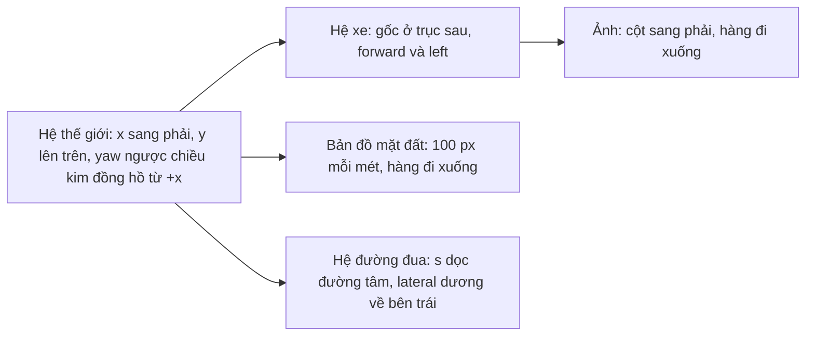

# 03 · Mô phỏng xe

*Bản tiếng Việt · [English](03-vehicle-simulation.md)*

*Bản tiếng Việt · [English](03-vehicle-simulation.vi.md)*

Mọi thứ trong chương này theo định nghĩa đều là **[SIM-ONLY]**, và đều **[TESTED]** bởi
`TrackTests`, `VehicleTests` và `WorldTests` trong [`tests/test_drive.py`](../../tests/test_drive.py).

## Ta đang giải bài toán gì?

Để học về một vòng điều khiển, bạn cần một chiếc xe, một con đường, một camera và một thứ
gì đó để đâm vào, và bạn cần chúng rẻ, nhanh và lặp lại được. Bộ mô phỏng trong
[`drive/sim/`](../../drive/sim) dài khoảng 270 dòng và cho đủ cả bốn. Một lần lái 30 s chạy
trong chừng một giây, và cùng một seed cho cùng một kết quả tới chữ số cuối cùng.

## Vì sao điều đó quan trọng?

Mọi con số trong dự án này đều đến từ mô hình này. Biết chính xác nó tính gì cho bạn biết
kết luận nào chuyển được sang xe thật (vòng lặp phản ứng với độ trễ thế nào) và kết luận nào
thì không (những con số centimet).

## Các hệ toạ độ



| Hệ | Các trục | Dùng bởi |
|---|---|---|
| Thế giới | $x, y$ tính bằng mét; yaw $\psi$ tính bằng radian, ngược chiều kim đồng hồ từ $+x$ | `VehicleState`, `Track.xy` |
| Xe | `forward_m`, `left_m` tính từ trục sau | pure pursuit, bản đồ mặt đất của camera, cảm biến khoảng cách |
| Đường đua (Frenet) | $s$: độ dài cung dọc đường tâm; lateral: khoảng cách có dấu, **dương về bên trái** hướng đi | metric, teacher |
| Ảnh | `(row, column)`, hàng 0 ở trên cùng | camera |
| Bản đồ mặt đất | pixel `(column, row)`, `y` bị lật | render, HUD |

Từ hệ thế giới sang hệ xe, với một điểm $(x_p, y_p)$ và xe tại $(x, y, \psi)$:

$$
\begin{aligned}
\text{forward} &= \cos\psi\,(x_p - x) + \sin\psi\,(y_p - y) \\
\text{left} &= -\sin\psi\,(x_p - x) + \cos\psi\,(y_p - y)
\end{aligned}
$$

Đó là thân hàm [`World._obstacles_in_car_frame`](../../drive/sim/world.py#L46).

## Mô hình xe đạp động học

### Trực giác

Gộp hai bánh trước thành một và hai bánh sau thành một: ta có một chiếc xe đạp. Nếu lốp
không bao giờ trượt ngang, bánh sau chỉ có thể đi theo hướng của xe và bánh trước chỉ đi
theo hướng của chính nó. Khi đó xe chạy trên một đường tròn có bán kính chỉ phụ thuộc vào
chiều dài cơ sở $L$ và góc bánh trước $\delta$:

$$R = \frac{L}{\tan\delta}, \qquad \kappa = \frac{1}{R} = \frac{\tan\delta}{L}$$

và hướng xe thay đổi với tốc độ $\dot\psi = v\,\kappa$.

### Các phương trình như được hiện thực

[`step_vehicle`](../../drive/sim/vehicle.py#L10), chín dòng, đẩy trạng thái đi một bước `dt`:

$$
\begin{aligned}
c &= \text{clip}(a_{\text{steer}}, -1, 1), \quad u = \text{clip}(a_{\text{throttle}}, -1, 1) \\
\sigma' &= \sigma + (c - \sigma)\left(1 - e^{-dt/\tau}\right) && \text{trễ servo} \\
a &= u \cdot \begin{cases} a_{\max} & u \ge 0 \\ b_{\max} & u < 0 \end{cases} \\
v' &= \text{clip}\big(v + (a - k_d\, v)\,dt,\; 0,\; v_{\max}\big) && \text{không lùi} \\
\psi' &= \psi + \frac{v'}{L}\tan(\sigma'\,\delta_{\max})\,dt \\
x' &= x + v'\cos\psi'\,dt, \qquad y' = y + v'\sin\psi'\,dt
\end{aligned}
$$

| Ký hiệu | Nghĩa | Giá trị ([`VehicleParams`](../../drive/config.py#L8)) |
|---|---|---|
| $L$ | chiều dài cơ sở | 0.26 m |
| $\delta_{\max}$ | góc bánh khi đánh lái hết cỡ | 0.42 rad (24°) |
| $\sigma$ | vị trí tay lái, chuẩn hoá về $[-1, 1]$ | trạng thái |
| $\tau$ | hằng số thời gian của servo | 0.08 s |
| $a_{\max}$, $b_{\max}$ | gia tốc khi hết ga, giảm tốc khi phanh hết cỡ | 2.5, 6.0 m/s² |
| $k_d$ | lực cản | 0.3 s⁻¹ |
| $v_{\max}$ | tốc độ tối đa | 3.0 m/s |

Ghi chú về thiết kế:

- **Tay lái là một trạng thái, không phải một đầu vào.** Lệnh $c$ là nơi bánh xe được yêu
  cầu đi tới; $\sigma$ là nơi bánh xe đang ở. Số hạng trễ là nghiệm chính xác của hệ bậc
  nhất $\dot\sigma = (c - \sigma)/\tau$ trong một bước với $c$ giữ không đổi, nên nó đúng
  với mọi `dt`.
- **Euler bán ẩn.** Vị trí được đẩy đi bằng tốc độ và hướng *mới*. Rẻ, và đủ tốt với
  `dt = 0.02`.
- **Phanh mạnh hơn động cơ** (6,0 so với 2,5 m/s²) và tốc độ bị chặn dưới ở 0: phanh làm
  xe dừng và giữ yên; xe không bao giờ lùi (`VehicleTests.test_brake_stops_without_reversing`).
- **Điểm tham chiếu là trục sau.** `(x, y)` là điểm giữa trục sau, đó là lý do pure pursuit
  "vẽ cung cho trục sau đi qua một điểm".

### Tự tính một bước bằng tay

Trạng thái: $x = y = \psi = 0$, $v = 1.0$, $\sigma = 0$. Action `[0.5, 0.2]`, `dt = 0.02`.

| Đại lượng | Cách tính | Kết quả |
|---|---|---|
| $\sigma'$ | $0 + 0.5\,(1 - e^{-0.02/0.08}) = 0.5 \times 0.2212$ | 0.1106 |
| $a$ | $0.2 \times 2.5$ | 0.5 m/s² |
| $v'$ | $1.0 + (0.5 - 0.3 \times 1.0) \times 0.02$ | 1.004 m/s |
| $\psi'$ | $\frac{1.004}{0.26}\tan(0.1106 \times 0.42) \times 0.02$ | 0.00359 rad |
| $x'$ | $1.004 \cos(0.00359) \times 0.02$ | 0.02008 m |
| $y'$ | $1.004 \sin(0.00359) \times 0.02$ | 0.00007 m |

Kiểm tra lại:

```bash
python3 -c "
from drive.sim import step_vehicle
from drive.config import VehicleParams
from drive.types import VehicleState
print(step_vehicle(VehicleState(0,0,0,1.0,0.0), [0.5, 0.2], VehicleParams(), 0.02))"
```

### Vài con số suy ra hữu ích

- **Vòng quay hẹp nhất**: $R_{\min} = L / \tan\delta_{\max} = 0.26 / 0.4466 = 0.58$ m.
- **Servo**: mỗi nhịp 20 ms đi được 22 % quãng còn lại; 63 % sau 80 ms; 95 % sau 240 ms.
- **Dừng từ 1,5 m/s khi phanh hết cỡ**: $v^2 / (2 b_{\max}) = 2.25 / 12 = 0.19$ m (ngắn hơn một chút nhờ lực cản).

## Hình học đường đua

[`Track`](../../drive/sim/track.py#L29) là một đường tâm khép kín, được lấy mẫu lại mỗi 2 cm.

- **Hình dạng** ([`SHAPES`](../../drive/sim/track.py#L21)) là các đường cong tham số theo một góc $t \in [0, 2\pi)$:

| Tên | $x(t),\ y(t)$ | Chiều dài | Bán kính hẹp nhất |
|---|---|---:|---:|
| `peanut` | $4.6\cos t,\ \ 2.2\sin t + 1.1\sin^3 t \cos 2t$ | 22.02 m | 1.05 m |
| `oval` | $4.0\cos t,\ \ 2.4\sin t$ | 20.42 m | 1.44 m |
| `trefoil` | $r\cos t,\ r\sin t$ với $r = 3.6 + 0.6\cos 3t$ | 23.98 m | 1.83 m |

  (*measured* từ `Track.named(...)`; `TrackShapeTests` yêu cầu mọi bán kính lớn hơn 1 m.)
- **Chiều chạy**: ngược chiều kim đồng hồ; `reverse=True` đảo thứ tự các điểm, nên các khúc
  cua trái và phải đổi chỗ cho nhau.
- **Hướng và độ cong** là các sai phân trung tâm:
  $\theta_i = \text{atan2}(p_{i+1} - p_{i-1})$ và
  $\kappa_i = \text{wrap}(\theta_{i+1} - \theta_{i-1}) / (2\,ds)$, dương khi cua trái.
- **Bề rộng đường** là 0,9 m: xe *ra khỏi đường* khi $|\text{lateral}| > 0.45$ m.

Hai phương thức làm phần lớn công việc:

- [`Track.at(s)`](../../drive/sim/track.py#L61) → `(x, y, heading)` tại độ dài cung `s` (tự quay vòng; nhận cả mảng).
- [`Track.project(x, y)`](../../drive/sim/track.py#L69) → `(s, lateral, heading)` của điểm
  gần nhất trên đường tâm. Với vector tiếp tuyến đơn vị $\mathbf t = (\cos\theta, \sin\theta)$
  và độ lệch $\mathbf d$ từ điểm đó:
  $s = i\,ds + \mathbf t \cdot \mathbf d$ và $\text{lateral} = t_x d_y - t_y d_x$ (tích có
  hướng 2-D, nên bên trái là dương).

`project` là một phép tìm điểm gần nhất kiểu vét cạn trên khoảng 1100 điểm. Như vậy là ổn
với một xe, và sai với một đường đua tự cắt chính nó, điều mà cả ba đường đua đều không có.

## Render camera

Không cần một bộ render 3-D, vì thế giới là một bức tranh phẳng.

1. [`GroundMap`](../../drive/sim/render.py#L15) vẽ thế giới một lần, nhìn từ trên xuống, ở
   100 px/m: cỏ lốm đốm (để ảnh không phải một màu phẳng mà policy có thể bám vào), một dải
   trắng rộng hơn mặt đường 10 cm, nhựa đường xám phủ lên trên (để lại một vạch trắng 5 cm
   mỗi bên), vạch đứt màu vàng ở giữa dài 30 cm, và các đĩa màu cam cho cọc tiêu.
2. [`Camera.__init__`](../../drive/sim/render.py#L56) tính, một lần, mỗi pixel nhìn vào đâu
   trên mặt đất, trong hệ xe: hai mảng `forward_m` và `left_m`.
3. [`Camera.render`](../../drive/sim/render.py#L84) xoay và tịnh tiến hai mảng đó theo pose
   của xe rồi tra màu trong bản đồ mặt đất bằng `cv2.remap`. Các pixel phía trên đường chân
   trời, hoặc nhìn xa hơn 12 m, thành bầu trời.

### Hình học camera lỗ kim

[`CameraParams`](../../drive/config.py#L23): 320×240, góc nhìn ngang 110°, gắn ở độ cao
$h = 0.18$ m, phía trước trục sau 0,10 m, chúc xuống $\phi = 15°$.

$$f = \frac{W/2}{\tan(\text{hfov}/2)} = \frac{160}{\tan 55°} = 112.0\ \text{px}$$

Với pixel $(u, v)$, toạ độ tia đã chuẩn hoá là $\ell = -(u - W/2)/f$ (sang trái) và
$q = -(v - H/2)/f$ (lên trên):

$$
\text{down} = \sin\phi - q\cos\phi, \qquad
\text{reach} = \frac{h}{\text{down}}, \qquad
\begin{aligned}
\text{forward} &= 0.10 + \text{reach}\,(\cos\phi + q\sin\phi) \\
\text{left} &= \text{reach}\cdot\ell
\end{aligned}
$$

Một tia chỉ chạm đất nếu nó đi xuống ($\text{down} > 0$), tức $q < \tan\phi$, tức hàng
$v > 120 - 112 \tan 15° = 90$. **Hàng 90 là đường chân trời.**

Vài giá trị đã tính:

| Pixel | Nhìn vào |
|---|---|
| giữa đáy ảnh (hàng 239.5, cột 160) | điểm cách 0,196 m phía trước, trên đường tâm |
| phép ngược: một điểm 1,0 m phía trước và 0,2 m bên trái | cột 135.5, hàng 112.8 |

Phép ngược là [`Camera.project`](../../drive/sim/render.py#L71), dùng để vẽ một quỹ đạo dự
định lên ảnh; `BrowseTests.test_projection_inverts_the_cameras_ground_map` kiểm tra hai
chiều khớp nhau tới 0,01 px.

`forward_m` / `left_m` là một **bản đồ phối cảnh ngược** (inverse perspective map). Trên xe
thật, bạn sẽ có cùng hai mảng đó từ việc hiệu chuẩn camera, đó là lý do
[`LaneCameraPolicy`](../../drive/policy/lane_camera.py#L30), về nguyên tắc, có thể chạy trên
xe thật.

## Cảm biến khoảng cách

[`World.range_m`](../../drive/sim/world.py#L53) mô hình hoá một cảm biến time-of-flight hướng
về phía trước ([`RangeSensorParams`](../../drive/config.py#L34): nửa góc 15°, tầm 4 m) gắn ở
cản trước, cách trục sau $L + 0.07 = 0.33$ m.

Với mỗi vật cản (một đĩa bán kính $r$, mặc định 0,12 m) tại vị trí $(f, \ell)$ trong hệ xe,
với $f' = f - 0.33$ và $d = \sqrt{f'^2 + \ell^2}$:

- nằm trong đĩa ($d \le r$): khoảng cách 0;
- phía sau cản ($f' \le 0$): bỏ qua;
- nằm trong nón, $|\text{atan2}(\ell, f')| \le 15° + \arcsin(r/d)$: khoảng cách $d - r$;
- còn lại, hoặc không thấy gì: 4,0 m.

Ví dụ: một cọc tiêu nằm trên trục xe, cách trục sau 2,0 m:
$f' = 1.67$, khoảng cách $= 1.67 - 0.12 = 1.55$ m.

[`World.collided`](../../drive/sim/world.py#L68) là dữ liệu thật tuyệt đối (ground truth)
riêng cho metric: true khi hình chữ nhật của xe (0,40 × 0,19 m) chồng lên một đĩa.

Cọc tiêu được vẽ lên bản đồ mặt đất, nên camera thấy một mảng cam phẳng, không phải một vật
có chiều cao.

## `World`: platform

[`World`](../../drive/sim/world.py#L15) hiện thực `Platform`:

| Thành viên | Làm gì |
|---|---|
| `t` | số giây mô phỏng; chỉ tăng khi gọi `apply` |
| `state` | `VehicleState` thật |
| `observe(task)` | render camera và trả về một `Observation`, **có cả `pose`** |
| `range_m()` | cảm biến ở trên |
| `apply(action, dt)` | `step_vehicle`, rồi `t += dt` |
| `place(s, lateral_m, yaw_offset_rad, speed)` | đặt xe lên đường đua, có thể lệch tâm và lệch hướng (dùng bởi `collect`) |

`pose` là bộ mô phỏng cố ý làm lộ dữ liệu thật tuyệt đối, để có thể có một teacher.
[`Observation`](../../drive/types.py#L27) ghi rõ điều đó: "policies that read it are
teachers for collecting data, not something a real car can run" (policy đọc nó là teacher
để thu dữ liệu, không phải thứ một chiếc xe thật chạy được).

## Giới hạn so với một chiếc xe thật

| Mô hình giả định | Một chiếc xe 1:10 thật |
|---|---|
| Lốp không trượt: xe đi chính xác theo hướng bánh xe chỉ | Thiếu lái (understeer) và thừa lái (oversteer) khi lốp gần tới giới hạn bám; giới hạn đó phụ thuộc mặt đường |
| Tay lái là một khâu trễ bậc nhất sạch sẽ | Vùng chết của servo, độ rơ, bão hoà tốc độ, cơ cấu lái bất đối xứng |
| Ga ánh xạ tuyến tính sang gia tốc | Đường đặc tính của động cơ và ESC, sụt áp pin, vùng chết ở ga thấp, hiện tượng giật (cogging) |
| Phanh là một mức giảm tốc mạnh và tuyến tính | Nhiều ESC phanh yếu hoặc chuyển sang lùi ở lần kéo thứ hai |
| Đo tốc độ và tay lái hoàn hảo | Nhiễu và lượng tử hoá của encoder; vị trí tay lái thường hoàn toàn không được đo |
| Mặt đất phẳng, không chúc và không nghiêng | Camera chúc xuống khi phanh, làm đường chân trời dịch đi |
| Camera: không nhiễu, không mờ, không đổi phơi sáng, không méo ống kính, không trễ | Có đủ tất cả |
| Vật cản là đĩa phẳng; cảm biến khoảng cách chính xác tuyệt đối | Chiều cao, độ phản xạ, đa đường, tầm tối thiểu, cập nhật 20–50 Hz |
| Một xe, không có gì di chuyển | — |

Chính dự án cũng nói như vậy về bản thân ([`docs/driving.vi.md`](../driving.vi.md)): "Treat its
numbers as how the loop behaves, not as how a car will." (Hãy coi các con số của nó là cách
vòng lặp hành xử, không phải cách một chiếc xe sẽ hành xử.)

## Những lỗi và hiểu lầm thường gặp

- **"Steer 0,5 nghĩa là 0,5 rad."** Đó là một nửa góc lái tối đa: $0.5 \times 0.42 = 0.21$
  rad ở bánh xe, và chỉ sau khi servo đã đuổi kịp.
- **"`state.steer` là giá trị đã ra lệnh."** Đó là vị trí bánh xe đang ở; nó trễ.
- **"Độ lệch ngang dương khi lệch sang phải."** Dương là bên trái của hướng đi
  (`TrackTests.test_lateral_is_positive_to_the_left`), và nghĩa của nó đảo lại với
  `--reverse` vì hướng đi đảo lại.
- **"Throttle −1 là lùi."** Nó phanh cho tới khi dừng.
- **"Camera thấy cọc tiêu là một vật cản."** Nó thấy một mảng sơn màu cam.

## Thí nghiệm thực hành

Đo vòng quay. Giữ tay lái hết cỡ sang trái với ga không đổi và tính bán kính:

```bash
python3 -c "
import numpy as np
from drive.sim import step_vehicle
from drive.config import VehicleParams
from drive.types import VehicleState
s, pts = VehicleState(0,0,0,1.0,0.0), []
for _ in range(1000):
    s = step_vehicle(s, [1.0, 0.13], VehicleParams(), 0.02); pts.append((s.x, s.y))
p = np.array(pts[200:]); print('radius', np.ptp(p[:,0])/2, 'speed', s.speed)"
```

Hãy đoán bán kính trước (nó đã được suy ra ở trên). Sau đó đổi `max_steer_rad` thành 0,30
bằng `VehicleParams(max_steer_rad=0.30)` rồi đoán lại.

## Kiểm tra kiến thức

1. Ở 2 m/s với bánh xe đánh nửa góc tối đa, tốc độ quay (yaw rate) là bao nhiêu?
2. Những hàng nào của ảnh có thể chứa mặt đường?
3. Vì sao cỏ lại lốm đốm?
4. Một cọc tiêu nằm cách trục xe 0,5 m về bên trái và cách cản trước 1,0 m. Cảm biến khoảng cách có thấy nó không?
5. Kể hai hiệu ứng không có trong mô hình này mà sẽ làm một chiếc xe thật văng khỏi đường ở tốc độ bộ mô phỏng vẫn xử lý được.

<details><summary>Đáp án</summary>

1. $\dot\psi = \frac{v}{L}\tan(0.5 \times 0.42) = \frac{2}{0.26} \times 0.2131 = 1.64$ rad/s.
2. Các hàng 91 tới 239 (dưới đường chân trời ở hàng 90).
3. Để một policy học được không thể dựa vào một màu đồng nhất hoàn hảo mà không cảnh thật nào có.
4. $d = 1.118$, góc phương vị $= 26.6°$, phần cộng thêm cho mép cọc $\arcsin(0.12/1.118) = 6.2°$; $26.6° > 21.2°$, nên không thấy.
5. Lốp trượt (thiếu lái), và độ trễ hoặc nhiễu trong ảnh camera; ngoài ra còn tính phi tuyến của servo và ESC.
</details>

## Đọc thêm

- Kong và cộng sự 2015, *Kinematic and Dynamic Vehicle Models for Autonomous Driving Control Design*.
- Paden và cộng sự 2016, §III (mô hình xe).
- Rajamani, *Vehicle Dynamics and Control*, chương 2, về những gì một mô hình động lực học thêm vào.
- PythonRobotics, có các hiện thực nhỏ chạy được của cùng mô hình này.
