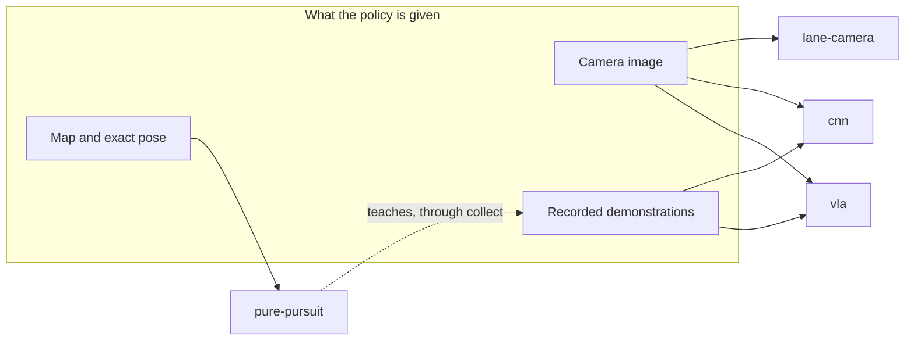

# 04 · Driving policies

*[Tiếng Việt](04-driving-policies.vi.md)*

## What problem are we solving?

A policy answers one question: *given what the car senses now, what should it do for
the next second or so?* The repository contains four answers. They share an interface
and differ in what they know.

```python
class Policy:
    def infer(self, obs: Observation) -> ActionChunk: ...
```

([`drive/policy/base.py`](../../drive/policy/base.py#L6)). `infer` may be slow and is
called from the inference worker, never from the control loop.

## The four at a glance

| | `pure-pursuit` | `lane-camera` | `cnn` | `vla` (`BackendPolicy`) |
|---|---|---|---|---|
| Knows | the map and the car's exact pose | one camera image and a camera calibration | one image, speed, steer | images, state, a task sentence |
| How | geometry | classical vision + geometry | a trained network | a VLA behind a backend |
| Chunk | 50 × 1/30 s = 1.63 s, a real prediction | 15 × 1/30 s = 0.47 s, **one action repeated** | 16 × 0.1 s = 1.5 s, predicted | the checkpoint's `chunk_size` (16 × 0.1 s in Lab 15) |
| Runs on a real car? | no (needs ground-truth pose) | in principle | in principle | that is the aim |
| Selectable in the CLI | yes | yes | yes, with `--checkpoint` | yes, with `--checkpoint`, in an environment with LeRobot |
| Status | **[TESTED]** | **[TESTED]** | **[TESTED]** | adapter **[TESTED]** with a stub; PyTorch SmolVLA **ran** in the simulator (Lab 15); TensorRT **[UNTESTED]** |
| Role | teacher, and the reference for the loop | a no-learning baseline | the stand-in for a VLA | the destination |

Built by name in [`make_policy`](../../drive/policy/__init__.py#L9).

---

## 1. Pure pursuit: the teacher

### Idea

Pick a point on the path a short distance ahead. There is exactly one circle that
passes through the rear axle, is tangent to the car's heading, and passes through that
point. Steer along it. Repeat.

### Mathematics

Let the target be at $(x_f, y_\ell)$ in the car frame (forward, left), at distance
$d = \sqrt{x_f^2 + y_\ell^2}$. The circle through the origin, tangent to the forward
axis, through the target has curvature

$$\kappa = \frac{2\,y_\ell}{d^2}$$

(From the chord: the centre is at $(0, R)$, so $x_f^2 + (y_\ell - R)^2 = R^2$, giving
$R = d^2 / 2y_\ell$.) The bicycle model turns curvature into a wheel angle,
$\delta = \arctan(L\kappa)$, and the command is that angle as a fraction of full lock:

$$\text{steer} = \text{clip}\!\left(\frac{1}{\delta_{\max}}\arctan\frac{2 L\, y_\ell}{d^2},\ -1,\ 1\right)$$

This is [`pursuit_steer`](../../drive/policy/pure_pursuit.py#L19); the code's
`atan2(2 L y / d, d)` is the same expression.

**Example.** Target 1.0 m ahead and 0.3 m left: $d^2 = 1.09$,
$\kappa = 0.6/1.09 = 0.550$ m⁻¹ (radius 1.82 m),
$\delta = \arctan(0.26 \times 0.550) = 0.142$ rad, steer $= 0.142/0.42 = 0.34$.

### Implementation

[`PurePursuitPolicy.act`](../../drive/policy/pure_pursuit.py#L38) computes one action from a state:

1. `s = track.project(x, y)`: where along the track the car is.
2. **Lookahead** grows with speed: $\ell = \text{clip}(0.4 + 0.35\,v,\ 0.5,\ 1.4)$ m. At
   1.5 m/s that is 0.925 m.
3. Target `track.at(s + lookahead)`, converted to the car frame, into `pursuit_steer`.
4. **Speed**: slow for the sharpest bend in the next 1.5 m so lateral acceleration stays
   under $a_{\text{lat}} = 2.0$ m/s²:
   $v^* = \min\!\big(v_{\text{target}},\ \sqrt{a_{\text{lat}} / |\kappa|_{\max}}\big)$.
   On the peanut's 1.05 m bend, $v^* = \sqrt{2.0 \times 1.05} = 1.45$ m/s.
5. **Throttle**: a proportional controller with a feed-forward term for drag,
   $u = \text{clip}\big(2\,(v^* - v) + 0.1\,v^*,\ -1,\ 1\big)$ ([chapter 6](06-control-theory.md)).

[`PurePursuitPolicy.infer`](../../drive/policy/pure_pursuit.py#L51) turns that into a
chunk by **rolling the car model forward**: 50 times, compute `act(state)`, then
`state = step_vehicle(state, action, vehicle, 1/30)`. The chunk is therefore the
sequence of actions the teacher *would* take if the car behaved exactly as the model
says. It is a genuine prediction, which is what makes it survive latency.

`infer` raises `ValueError` if `obs.pose` is `None`: "pure pursuit needs the
simulator's pose; a real car has none".

### Strengths, limits, use

- **Strong**: smooth, tuned by two numbers, and a ground-truth plan to learn from.
- **Limits**: cuts corners by design (the chord is inside the arc; that is the
  1.5–1.8 cm rms it shows on a clean run), and needs a map and a pose.
- **Use it** to study the control loop with a good plan, and as the teacher in
  `collect`. Default target speed 1.5 m/s.

---

## 2. Lane camera: classical vision

### Idea

Find the road in the image, find its middle a little way ahead, and aim there with the
same pursuit formula. No map, no pose, no learning.

### Implementation

[`LaneCameraPolicy`](../../drive/policy/lane_camera.py#L30):

1. [`road_mask`](../../drive/policy/lane_camera.py#L18): a pixel is road if green does
   not dominate, $G - \max(R, B) < 20$. Asphalt and paint pass; grass does not.
2. At construction, find the image **rows** whose centre pixel looks 1.1, 0.9, 0.7 and
   0.5 m ahead, using the camera's `forward_m` array.
3. [`target`](../../drive/policy/lane_camera.py#L44): on the farthest of those rows
   that shows road, find the horizontal runs of road pixels at least 12 px wide
   ([`runs`](../../drive/policy/lane_camera.py#L24)); choose the run whose middle is
   closest to the column chosen last time (another part of the track may be in view);
   look up that pixel's `(forward_m, left_m)`.
4. [`infer`](../../drive/policy/lane_camera.py#L56): `pursuit_steer` at that point;
   speed $= v_{\text{target}}\,(1 - 0.5\,|\text{steer}|)$ with $v_{\text{target}} = 1.0$
   m/s; the same throttle law as the teacher. If no road is found: keep the last
   steering and crawl at 0.3 m/s.
5. The chunk is that **one action repeated 15 times** (`np.tile`).

### What it teaches

It cannot predict, so its chunk says "keep doing this". Compare, *measured*:

| | 100 ms | 300 ms (watchdog raised to 1500 ms) |
|---|---|---|
| `pure-pursuit` | 1.8 cm rms at 1.46 m/s | 20.2 cm rms at 1.44 m/s |
| `lane-camera` | 7.3 cm rms at 0.86 m/s | braked for 12.2 of 30 s (`stale`), 0.18 m/s |

At 300 ms the lane follower does not weave; it starves. Its chunk lasts 0.47 s, the
plan in use is up to 0.6 s old, and for the difference the executor has nothing to
give ([chapter 5](05-action-chunking-and-latency.md), "chunk exhaustion").

- **Strong**: needs only a calibrated camera; explainable; no data.
- **Limits**: a colour threshold tuned to this simulator's grass; no anticipation;
  lower speed and five times the tracking error of the teacher.
- **Use it** as the baseline a learned policy must beat, and to see chunk exhaustion.

---

## 3. CNN: the learned stand-in

### Idea

Learn the mapping from (image, speed, steer) to the teacher's plan by supervised
regression ([chapters 8](08-imitation-learning.md)–[10](10-model-training.md)).

### Implementation

[`CnnPolicy`](../../drive/policy/cnn.py#L13):

- loads a checkpoint with [`model.load`](../../drive/learn/model.py#L42); PyTorch is
  imported lazily, so the rest of the stack runs without it;
- [`infer`](../../drive/policy/cnn.py#L26): shrink the first camera image to 96×128
  with the **same function used in training** ([`shrink`](../../drive/learn/dataset.py#L15)),
  run the network, wrap the `(16, 2)` output as `ActionChunk(actions, plan_dt, obs.t)`.

Inference runs on the CPU by default (`device="cpu"`); the network is 0.3 M
parameters. In the simulator its latency is whatever `--latency-ms` says, because
`SimulatedWorker` imposes it.

`make_policy` refuses a target speed for it: "the cnn policy drives at the speeds it
was shown".

- **Strong**: sees only what a real car has; generalises to tracks it was not trained
  on (*repo*: `v1`, trained on the peanut only, passes 6/6 drives on three tracks).
- **Limits**: slower than its teacher (0.84 against 1.47 m/s) for a reason worth
  understanding ([chapter 11](11-model-evaluation.md)); knows only this simulator's
  look; no language.
- **Use it** to exercise the whole learning loop in minutes.

---

## 4. `BackendPolicy`: the VLA adapter

### Idea

Wrap a loaded VLA inference backend so that it looks like any other policy.

### Implementation

[`BackendPolicy`](../../drive/policy/vla.py#L31), 47 lines in total:

```python
result = self.backend.infer(BackendObservation(
    index=self.index, images=obs.images,
    state=np.array([obs.speed, obs.steer], np.float32),
    task=obs.task, noise=self.rng.standard_normal(self.noise_shape).astype(np.float32)))
actions = np.asarray(result.chunk, dtype=np.float64)[:, :ACTION_DIM]
return ActionChunk(np.clip(actions, -1.0, 1.0), self.chunk_dt, obs.t)
```

- [`BackendObservation`](../../drive/policy/vla.py#L21) mirrors the fields of
  `bench.obs.Observation` in jetson-orin-nano-vla (`index`, `images`, `state`, `task`,
  `noise`). That repository is deliberately not a dependency: a backend is "anything
  with `infer(observation)` returning an object whose `.chunk` is the
  `(chunk_size, action_width)` array".
- **`noise`** is where the flow-matching action head starts denoising. The policy
  draws it from a seeded generator, shape `(1, chunk_size, noise_width)`.
- The backend's chunk may be wider than two (SmolVLA pads actions to 32); only the
  first two columns are kept, and they are clipped to $[-1, 1]$.
- `chunk_dt_s` must be supplied by you: the time between the model's actions, which is
  the frame period of the data it was fine-tuned on.

### What is and is not verified

- **[TESTED]** `PolicyTests.test_backend_policy_adapts_a_vla_backend`
  ([`tests/test_drive.py`](../../tests/test_drive.py#L367)): with a fake backend
  returning a `(50, 32)` array, the adapter produces a `(50, 2)` chunk, clips an
  out-of-range throttle, passes the state and task through, numbers the observations
  and draws different noise each time.
- **Ran** with a real model: [`LeRobotBackend`](../../drive/policy/lerobot_backend.py)
  loads a LeRobot checkpoint (weights, config, the pre/post-processors with the
  dataset's normalisation) and returns its chunk; `make_policy("vla", checkpoint=…)`
  wraps it in `BackendPolicy` with the checkpoint's `chunk_size` and `max_action_dim`
  and a `chunk_dt_s` read from the dataset's fps. A SmolVLA fine-tuned on this
  project's episodes drove the simulator with it
  ([Lab 15](15-hands-on-labs.md#lab-15-fine-tune-smolvla-on-the-driving-data-on-this-laptop)).
  That path has no automated test: it needs LeRobot, a GPU and a 0.9 GB checkpoint.
- **[UNTESTED]** A TensorRT backend from jetson-orin-nano-vla behind it, and anything on a Jetson.

---

## Map-based, image-based, learned



| Question | Map-based | Image-based, hand-written | Learned |
|---|---|---|---|
| What must exist beforehand? | an accurate map and localisation | a calibration and a rule that separates road from not-road | demonstrations |
| How does it fail? | when the pose is wrong | when the rule's assumption breaks (lighting, colours) | off the distribution it was trained on |
| Can it anticipate? | yes, it knows the road ahead | no | yes, as far as the image shows |
| How is it improved? | better map, better tuning | a new rule | more, or more varied, data |

The project uses the first to manufacture data for the third, and keeps the second as
an honest baseline.

## Common mistakes and misconceptions

- **"The teacher sees the camera."** It ignores the image entirely.
- **"A longer chunk is always safer."** A long chunk of a *bad prediction* is worse
  than a short one. The lane follower's chunk is short because repeating one action
  for longer would be a lie.
- **"`cnn` can be told how fast to go."** No: speed is not an input it was trained to obey.
- **"`BackendPolicy` runs SmolVLA."** It forwards to an object you must supply.

## Practical experiment

```bash
./drive.sh sim --policy pure-pursuit --track trefoil
./drive.sh sim --policy lane-camera  --track trefoil
./drive.sh sim --policy lane-camera  --track trefoil --speed 1.5
```

Which fails first as you raise the lane follower's speed, tracking or the watchdog?
Explain using its speed law and its chunk length.

## Knowledge check

1. A target 0.8 m ahead and 0.2 m right: what steer does pure pursuit command?
2. Why does `PurePursuitPolicy.infer` call `step_vehicle`?
3. Why does the lane follower pick the run nearest to the last chosen column?
4. What are the three things `BackendPolicy` does to a backend's output?
5. Which policy would still work if the grass were painted grey?

<details><summary>Answers</summary>

1. $d^2 = 0.68$, $\kappa = 2(-0.2)/0.68 = -0.588$, $\delta = \arctan(0.26 \times -0.588) = -0.152$, steer $= -0.36$.
2. To predict where its own actions take the car, so that action $i$ is right for time $t_{\text{obs}} + i\,dt$.
3. Another stretch of track can be visible across the infield; the nearest run is the road the car is on.
4. Keeps the first two columns, clips them to $[-1, 1]$, and stamps the chunk with `chunk_dt` and the observation's time.
5. `pure-pursuit` (it does not look). `lane-camera` would fail outright; `cnn` would have to be retrained.
</details>

## Further reading

- Coulter 1992, *Implementation of the Pure Pursuit Path Tracking Algorithm*.
- Bojarski et al. 2016, *End to End Learning for Self-Driving Cars* (PilotNet).
- [Chapter 13](13-vla-and-smolvla.md) for what sits behind a VLA backend.
