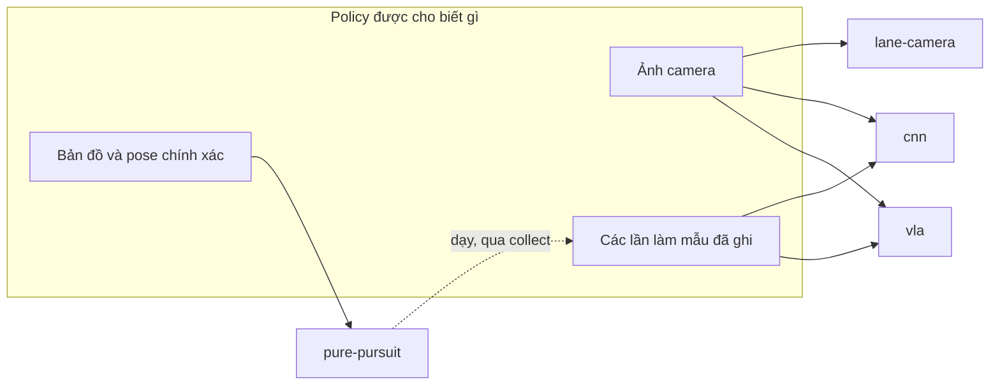

# 04 · Các policy lái xe

*Bản tiếng Việt · [English](04-driving-policies.md)*

*Bản tiếng Việt · [English](04-driving-policies.vi.md)*

## Ta đang giải bài toán gì?

Một policy trả lời một câu hỏi: *với những gì xe cảm nhận được lúc này, nó nên làm gì trong
khoảng một giây tới?* Repository có bốn câu trả lời. Chúng dùng chung một interface và khác
nhau ở chỗ chúng biết những gì.

```python
class Policy:
    def infer(self, obs: Observation) -> ActionChunk: ...
```

([`drive/policy/base.py`](../../drive/policy/base.py#L6)). `infer` có thể chậm và được gọi từ
inference worker, không bao giờ từ vòng điều khiển.

## Bốn policy trong một bảng

| | `pure-pursuit` | `lane-camera` | `cnn` | `vla` (`BackendPolicy`) |
|---|---|---|---|---|
| Biết gì | bản đồ và pose chính xác của xe | một ảnh camera và thông số hiệu chuẩn camera | một ảnh, tốc độ, steer | các ảnh, trạng thái, một câu mô tả nhiệm vụ |
| Cách làm | hình học | thị giác cổ điển + hình học | một mạng đã train | một VLA sau một backend |
| Chunk | 50 × 1/30 s = 1,63 s, một dự đoán thật | 15 × 1/30 s = 0,47 s, **lặp lại một action** | 16 × 0,1 s = 1,5 s, có dự đoán | `chunk_size` của checkpoint (16 × 0,1 s trong Lab 15) |
| Chạy trên xe thật? | không (cần pose thật tuyệt đối) | về nguyên tắc | về nguyên tắc | đó là mục tiêu |
| Chọn được trong CLI | có | có | có, với `--checkpoint` | có, với `--checkpoint`, trong môi trường có LeRobot |
| Trạng thái | **[TESTED]** | **[TESTED]** | **[TESTED]** | adapter **[TESTED]** với một stub; SmolVLA bằng PyTorch **đã chạy** trong bộ mô phỏng (Lab 15); TensorRT **[UNTESTED]** |
| Vai trò | teacher, và mốc chuẩn cho vòng lặp | baseline không học | bản thay thế cho VLA | đích đến |

Được dựng theo tên trong [`make_policy`](../../drive/policy/__init__.py#L9).

---

## 1. Pure pursuit: teacher

### Ý tưởng

Chọn một điểm trên quỹ đạo, cách phía trước một quãng ngắn. Có đúng một đường tròn đi qua
trục sau, tiếp tuyến với hướng của xe, và đi qua điểm đó. Lái theo đường tròn đó. Lặp lại.

### Toán học

Giả sử mục tiêu ở $(x_f, y_\ell)$ trong hệ xe (phía trước, bên trái), cách một khoảng
$d = \sqrt{x_f^2 + y_\ell^2}$. Đường tròn đi qua gốc toạ độ, tiếp tuyến với trục phía
trước, đi qua mục tiêu có độ cong

$$\kappa = \frac{2\,y_\ell}{d^2}$$

(Từ dây cung: tâm ở $(0, R)$, nên $x_f^2 + (y_\ell - R)^2 = R^2$, suy ra
$R = d^2 / 2y_\ell$.) Mô hình xe đạp biến độ cong thành góc bánh, $\delta = \arctan(L\kappa)$,
và lệnh là góc đó tính theo tỷ lệ của góc lái tối đa:

$$\text{steer} = \text{clip}\!\left(\frac{1}{\delta_{\max}}\arctan\frac{2 L\, y_\ell}{d^2},\ -1,\ 1\right)$$

Đó là [`pursuit_steer`](../../drive/policy/pure_pursuit.py#L19); biểu thức
`atan2(2 L y / d, d)` trong code là cùng một biểu thức.

**Ví dụ.** Mục tiêu 1,0 m phía trước và 0,3 m bên trái: $d^2 = 1.09$,
$\kappa = 0.6/1.09 = 0.550$ m⁻¹ (bán kính 1,82 m),
$\delta = \arctan(0.26 \times 0.550) = 0.142$ rad, steer $= 0.142/0.42 = 0.34$.

### Hiện thực

[`PurePursuitPolicy.act`](../../drive/policy/pure_pursuit.py#L38) tính một action từ một trạng thái:

1. `s = track.project(x, y)`: xe đang ở đâu dọc đường đua.
2. **Khoảng nhìn trước** tăng theo tốc độ: $\ell = \text{clip}(0.4 + 0.35\,v,\ 0.5,\ 1.4)$ m.
   Ở 1,5 m/s đó là 0,925 m.
3. Mục tiêu `track.at(s + lookahead)`, đổi sang hệ xe, đưa vào `pursuit_steer`.
4. **Tốc độ**: chậm lại theo khúc cua gắt nhất trong 1,5 m tới, để gia tốc ngang không vượt
   $a_{\text{lat}} = 2.0$ m/s²:
   $v^* = \min\!\big(v_{\text{target}},\ \sqrt{a_{\text{lat}} / |\kappa|_{\max}}\big)$.
   Ở khúc cua 1,05 m của đường peanut, $v^* = \sqrt{2.0 \times 1.05} = 1.45$ m/s.
5. **Ga**: một bộ điều khiển tỷ lệ cộng một thành phần truyền thẳng cho lực cản,
   $u = \text{clip}\big(2\,(v^* - v) + 0.1\,v^*,\ -1,\ 1\big)$ ([chương 6](06-control-theory.vi.md)).

[`PurePursuitPolicy.infer`](../../drive/policy/pure_pursuit.py#L51) biến điều đó thành một
chunk bằng cách **cho mô hình xe chạy tới trước**: 50 lần, tính `act(state)`, rồi
`state = step_vehicle(state, action, vehicle, 1/30)`. Vì vậy chunk là chuỗi action mà
teacher *sẽ* làm nếu xe hành xử đúng như mô hình nói. Đó là một dự đoán thật, và chính điều
đó giúp nó sống sót qua độ trễ.

`infer` raise `ValueError` nếu `obs.pose` là `None`: "pure pursuit needs the simulator's
pose; a real car has none" (pure pursuit cần pose của bộ mô phỏng; xe thật không có).

### Điểm mạnh, giới hạn, cách dùng

- **Mạnh**: mượt, chỉnh bằng hai con số, và cho một kế hoạch thật tuyệt đối để học theo.
- **Giới hạn**: cắt góc cua theo thiết kế (dây cung nằm bên trong cung tròn; đó là 1,5–1,8 cm
  rms nó cho thấy trong một lần chạy sạch), và cần bản đồ cùng pose.
- **Dùng nó** để học về vòng điều khiển với một kế hoạch tốt, và làm teacher trong `collect`.
  Tốc độ mục tiêu mặc định 1,5 m/s.

---

## 2. Lane camera: thị giác cổ điển

### Ý tưởng

Tìm mặt đường trong ảnh, tìm điểm giữa của nó ở phía trước một chút, và nhắm tới đó bằng
cùng công thức pursuit. Không bản đồ, không pose, không học.

### Hiện thực

[`LaneCameraPolicy`](../../drive/policy/lane_camera.py#L30):

1. [`road_mask`](../../drive/policy/lane_camera.py#L18): một pixel là mặt đường nếu màu xanh
   lá không trội, $G - \max(R, B) < 20$. Nhựa đường và vạch sơn qua được; cỏ thì không.
2. Lúc khởi tạo, tìm các **hàng** ảnh mà pixel ở giữa nhìn vào điểm cách 1,1, 0,9, 0,7 và
   0,5 m phía trước, dùng mảng `forward_m` của camera.
3. [`target`](../../drive/policy/lane_camera.py#L44): trên hàng xa nhất trong các hàng đó có
   thấy mặt đường, tìm các đoạn pixel mặt đường liên tiếp theo chiều ngang rộng ít nhất
   12 px ([`runs`](../../drive/policy/lane_camera.py#L24)); chọn đoạn có điểm giữa gần cột
   đã chọn lần trước nhất (có thể đang thấy một phần khác của đường đua); tra
   `(forward_m, left_m)` của pixel đó.
4. [`infer`](../../drive/policy/lane_camera.py#L56): `pursuit_steer` tại điểm đó;
   tốc độ $= v_{\text{target}}\,(1 - 0.5\,|\text{steer}|)$ với $v_{\text{target}} = 1.0$
   m/s; cùng luật ga như teacher. Nếu không tìm thấy mặt đường: giữ steer cũ và bò ở 0,3 m/s.
5. Chunk là **một action đó lặp lại 15 lần** (`np.tile`).

### Nó dạy điều gì

Nó không dự đoán được, nên chunk của nó nói "cứ tiếp tục làm thế này". So sánh, *measured*:

| | 100 ms | 300 ms (watchdog nâng lên 1500 ms) |
|---|---|---|
| `pure-pursuit` | 1,8 cm rms ở 1,46 m/s | 20,2 cm rms ở 1,44 m/s |
| `lane-camera` | 7,3 cm rms ở 0,86 m/s | phanh 12,2 trên 30 s (`stale`), 0,18 m/s |

Ở 300 ms, policy bám làn không lạng lách; nó bị "đói". Chunk của nó kéo dài 0,47 s, kế
hoạch đang dùng có thể cũ tới 0,6 s, và trong phần chênh lệch đó executor không có gì để đưa
ra ([chương 5](05-action-chunking-and-latency.vi.md), "cạn chunk").

- **Mạnh**: chỉ cần một camera đã hiệu chuẩn; giải thích được; không cần dữ liệu.
- **Giới hạn**: ngưỡng màu được chỉnh cho cỏ của bộ mô phỏng này; không biết đón trước; tốc
  độ thấp hơn và sai số bám gấp năm lần teacher.
- **Dùng nó** làm baseline mà một policy học được phải vượt, và để thấy hiện tượng cạn chunk.

---

## 3. CNN: bản thay thế học được

### Ý tưởng

Học ánh xạ từ (ảnh, tốc độ, steer) sang kế hoạch của teacher bằng hồi quy có giám sát
([chương 8](08-imitation-learning.vi.md)–[10](10-model-training.vi.md)).

### Hiện thực

[`CnnPolicy`](../../drive/policy/cnn.py#L13):

- nạp một checkpoint bằng [`model.load`](../../drive/learn/model.py#L42); PyTorch được import
  muộn, nên phần còn lại của hệ thống chạy được khi không có nó;
- [`infer`](../../drive/policy/cnn.py#L26): thu nhỏ ảnh camera đầu tiên về 96×128 bằng
  **cùng hàm đã dùng khi train** ([`shrink`](../../drive/learn/dataset.py#L15)), chạy mạng,
  bọc output `(16, 2)` thành `ActionChunk(actions, plan_dt, obs.t)`.

Mặc định suy luận chạy trên CPU (`device="cpu"`); mạng có 0,3 triệu tham số. Trong bộ mô
phỏng, độ trễ của nó là bao nhiêu tuỳ `--latency-ms`, vì `SimulatedWorker` áp độ trễ đó.

`make_policy` từ chối tốc độ mục tiêu cho nó: "the cnn policy drives at the speeds it was
shown" (policy cnn lái ở các tốc độ nó đã được cho xem).

- **Mạnh**: chỉ thấy những gì một xe thật có; tổng quát hoá sang đường đua chưa từng train
  (*repo*: `v1`, chỉ train trên peanut, qua 6/6 lần lái trên ba đường đua).
- **Giới hạn**: chậm hơn teacher (0,84 so với 1,47 m/s) vì một lý do đáng tìm hiểu
  ([chương 11](11-model-evaluation.vi.md)); chỉ biết vẻ ngoài của bộ mô phỏng này; không có ngôn ngữ.
- **Dùng nó** để chạy cả vòng học trong vài phút.

---

## 4. `BackendPolicy`: adapter cho VLA

### Ý tưởng

Bọc một backend suy luận VLA đã nạp để nó trông giống mọi policy khác.

### Hiện thực

[`BackendPolicy`](../../drive/policy/vla.py#L31), tổng cộng 47 dòng:

```python
result = self.backend.infer(BackendObservation(
    index=self.index, images=obs.images,
    state=np.array([obs.speed, obs.steer], np.float32),
    task=obs.task, noise=self.rng.standard_normal(self.noise_shape).astype(np.float32)))
actions = np.asarray(result.chunk, dtype=np.float64)[:, :ACTION_DIM]
return ActionChunk(np.clip(actions, -1.0, 1.0), self.chunk_dt, obs.t)
```

- [`BackendObservation`](../../drive/policy/vla.py#L21) phản chiếu các field của
  `bench.obs.Observation` trong jetson-orin-nano-vla (`index`, `images`, `state`, `task`,
  `noise`). Repository đó cố ý không phải là một dependency: backend là "anything with
  `infer(observation)` returning an object whose `.chunk` is the
  `(chunk_size, action_width)` array" (bất cứ thứ gì có `infer(observation)` trả về một
  object mà `.chunk` là mảng `(chunk_size, action_width)`).
- **`noise`** là điểm mà đầu ra action dùng flow matching bắt đầu khử nhiễu. Policy rút nó từ
  một bộ sinh số có seed, shape `(1, chunk_size, noise_width)`.
- Chunk của backend có thể rộng hơn hai cột (SmolVLA đệm action lên 32); chỉ hai cột đầu được
  giữ, và chúng bị cắt về $[-1, 1]$.
- `chunk_dt_s` do bạn cung cấp: khoảng thời gian giữa các action của model, chính là chu kỳ
  khung hình của dữ liệu đã dùng để fine-tune nó.

### Cái gì đã và chưa được kiểm chứng

- **[TESTED]** `PolicyTests.test_backend_policy_adapts_a_vla_backend`
  ([`tests/test_drive.py`](../../tests/test_drive.py#L367)): với một backend giả trả về mảng
  `(50, 32)`, adapter tạo ra chunk `(50, 2)`, cắt một giá trị ga vượt ngưỡng, chuyển tiếp
  state và task, đánh số các observation và rút nhiễu khác nhau mỗi lần.
- **Đã chạy** với một model thật: [`LeRobotBackend`](../../drive/policy/lerobot_backend.py)
  nạp một checkpoint LeRobot (trọng số, cấu hình, các bộ tiền/hậu xử lý với phần chuẩn hoá của
  bộ dữ liệu) và trả về chunk của nó; `make_policy("vla", checkpoint=…)` bọc nó trong
  `BackendPolicy` với `chunk_size` và `max_action_dim` của checkpoint, và `chunk_dt_s` đọc từ
  fps của bộ dữ liệu. Một SmolVLA fine-tune trên các episode của dự án này đã lái bộ mô phỏng
  bằng nó ([Lab 15](15-hands-on-labs.vi.md#lab-15-fine-tune-smolvla-trên-dữ-liệu-lái-xe-ngay-trên-laptop-này)).
  Đường đó chưa có test tự động: nó cần LeRobot, một GPU và một checkpoint 0,9 GB.
- **[UNTESTED]** Một backend TensorRT từ jetson-orin-nano-vla đứng sau nó, và mọi thứ trên Jetson.

---

## Dựa trên bản đồ, dựa trên ảnh, học được



| Câu hỏi | Dựa trên bản đồ | Dựa trên ảnh, viết tay | Học được |
|---|---|---|---|
| Cần có sẵn gì? | một bản đồ chính xác và định vị | thông số hiệu chuẩn và một luật tách mặt đường với phần còn lại | các lần làm mẫu |
| Hỏng thế nào? | khi pose sai | khi giả định của luật không còn đúng (ánh sáng, màu sắc) | khi ra khỏi phân phối nó được train |
| Có đón trước được không? | có, nó biết con đường phía trước | không | có, trong phạm vi ảnh cho thấy |
| Cải thiện bằng cách nào? | bản đồ tốt hơn, chỉnh tốt hơn | một luật mới | thêm dữ liệu, hoặc dữ liệu đa dạng hơn |

Dự án dùng loại thứ nhất để sản xuất dữ liệu cho loại thứ ba, và giữ loại thứ hai làm một
baseline trung thực.

## Những lỗi và hiểu lầm thường gặp

- **"Teacher nhìn camera."** Nó hoàn toàn bỏ qua ảnh.
- **"Chunk càng dài càng an toàn."** Một chunk dài của một *dự đoán tồi* còn tệ hơn một
  chunk ngắn. Chunk của policy bám làn ngắn vì lặp lại một action lâu hơn sẽ là nói dối.
- **"Có thể bảo `cnn` chạy nhanh bao nhiêu."** Không: tốc độ không phải là đầu vào nó được
  train để tuân theo.
- **"`BackendPolicy` chạy SmolVLA."** Nó chuyển tiếp tới một object mà bạn phải cung cấp.

## Thí nghiệm thực hành

```bash
./drive.sh sim --policy pure-pursuit --track trefoil
./drive.sh sim --policy lane-camera  --track trefoil
./drive.sh sim --policy lane-camera  --track trefoil --speed 1.5
```

Khi tăng tốc độ của policy bám làn, cái gì hỏng trước, khả năng bám đường hay watchdog? Giải
thích dựa trên luật tốc độ và độ dài chunk của nó.

## Kiểm tra kiến thức

1. Mục tiêu 0,8 m phía trước và 0,2 m bên phải: pure pursuit ra lệnh steer bao nhiêu?
2. Vì sao `PurePursuitPolicy.infer` gọi `step_vehicle`?
3. Vì sao policy bám làn chọn đoạn gần cột đã chọn lần trước nhất?
4. `BackendPolicy` làm ba việc gì với output của một backend?
5. Policy nào vẫn chạy được nếu cỏ bị sơn màu xám?

<details><summary>Đáp án</summary>

1. $d^2 = 0.68$, $\kappa = 2(-0.2)/0.68 = -0.588$, $\delta = \arctan(0.26 \times -0.588) = -0.152$, steer $= -0.36$.
2. Để dự đoán các action của chính nó đưa xe tới đâu, sao cho action $i$ đúng với thời điểm $t_{\text{obs}} + i\,dt$.
3. Một đoạn đường khác có thể nhìn thấy qua phần sân ở giữa; đoạn gần nhất là con đường xe đang đi.
4. Giữ hai cột đầu, cắt chúng về $[-1, 1]$, và đóng dấu chunk bằng `chunk_dt` và thời điểm của observation.
5. `pure-pursuit` (nó không nhìn). `lane-camera` sẽ hỏng hẳn; `cnn` sẽ phải train lại.
</details>

## Đọc thêm

- Coulter 1992, *Implementation of the Pure Pursuit Path Tracking Algorithm*.
- Bojarski và cộng sự 2016, *End to End Learning for Self-Driving Cars* (PilotNet).
- [Chương 13](13-vla-and-smolvla.vi.md): thứ gì nằm sau một backend VLA.
