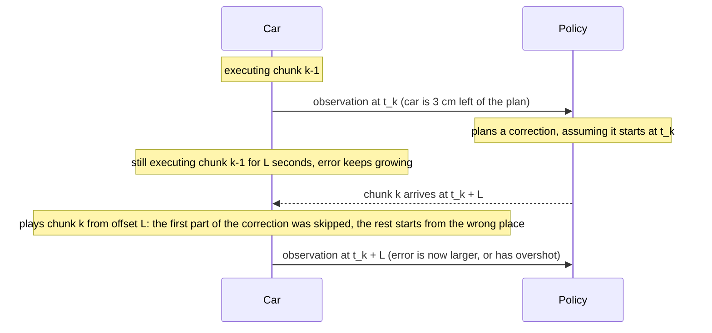

# 05 · Action chunking and latency compensation

*[Tiếng Việt](05-action-chunking-and-latency.vi.md)*

This is the chapter the project is built around. Everything in it is implemented in
two small files, [`drive/types.py`](../../drive/types.py) and
[`drive/control/executor.py`](../../drive/control/executor.py), and **[TESTED]** by
`ChunkTests` and `ExecutorTests`. The measurements are **[SIM-ONLY]**.

## What problem are we solving?

A policy takes $L$ seconds to answer. By the time its answer arrives, the car has
moved $v \cdot L$: at 1.5 m/s and 200 ms that is 30 cm, a third of the road's width.
An answer of the form "steer 0.3 *now*" is therefore an answer to a question that is
no longer being asked.

## Why is a VLA slow, and why does it return many actions?

- **Slow**, because one inference runs a vision encoder and a language-model backbone
  over hundreds of tokens, and then an action head several times (a flow-matching head
  integrates an ODE over a number of denoising steps). On an 8 GB Jetson Orin Nano the
  jetson-orin-nano-vla README reports p50 latencies from 108 ms (SmolVLA, 450 M
  parameters) to 643 ms (π0.5 base, 3.3 B).
- **Many actions**, for two reasons that reinforce each other:
  1. *Amortisation.* If thinking costs 100 ms, it is wasteful to get 20 ms of driving
     out of it. A chunk of 50 actions covers the time until the next answer, and more.
  2. *Better imitation.* Predicting a sequence makes the policy commit to a coherent
     short plan instead of re-deciding at every step, which reduces the compounding of
     small errors. This is the argument of the ACT paper (Zhao et al. 2023), where the
     term "action chunking" comes from.

## What a chunk represents

[`ActionChunk`](../../drive/types.py#L41):

$$\text{chunk} = \big(A \in \mathbb{R}^{N \times 2},\ dt,\ t_{\text{obs}}\big), \qquad A_i \text{ is meant for time } t_{\text{obs}} + i\,dt$$

It is a function of time, defined by linear interpolation between its rows
([`ActionChunk.sample`](../../drive/types.py#L58)). For an elapsed time $e$ since the
chunk's first action:

$$
p = \frac{\max(e, 0)}{dt}, \qquad
a(e) = \begin{cases}
\text{None} & p > N - 1 \\
(1 - w)\,A_i + w\,A_{i+1}, \quad i = \lfloor p \rfloor,\ w = p - i & \text{otherwise}
\end{cases}
$$

The chunk's **horizon** is $H = (N - 1)\,dt$. Past it there is no action, and `sample`
says so by returning `None` rather than repeating the last row. That choice is
deliberate: a missing plan must be visible to the supervisor, not papered over.

| Policy | $N$ | $dt$ | Horizon $H$ |
|---|---:|---:|---:|
| `pure-pursuit` | 50 | 1/30 s | 1.63 s |
| `lane-camera` | 15 | 1/30 s | 0.47 s |
| `cnn` | 16 | 0.1 s | 1.50 s |

## The executor: which action, now?

[`ChunkExecutor`](../../drive/control/executor.py#L11) holds the newest chunk and
answers `action(now)` every tick.

```python
def update(self, chunk, now):                       # a new chunk has arrived
    if self.chunk is not None:
        self._previous = (self.chunk, self._origin)
    self.chunk, self._swapped = chunk, now
    self._origin = chunk.t_obs if self.latency_compensation else now

def action(self, now):
    action = self.chunk.sample(now - self._origin)
    ...                                              # fade in over the previous chunk
```

The single line that decides everything is the choice of **origin**: the instant at
which `actions[0]` is considered to be played.

| Mode | Origin | Elapsed at arrival | Effect |
|---|---|---|---|
| Latency compensation **on** (default) | $t_{\text{obs}}$ | $L$ | the first $L/dt$ actions are skipped: they were meant for the time spent computing |
| Latency compensation **off** | arrival time | $0$ | every action is played $L$ late |

### Timeline

```
                 t_obs                 t_obs + L               t_obs + 2L
time  ───────────┼─────────────────────┼───────────────────────┼──────────►
                 │   model computing   │  chunk in use         │ next chunk arrives
chunk's actions  a0  a1  a2  a3  a4  a5  a6  a7  a8  a9  a10 a11 a12 ...
meant for        ▲                     ▲
                 t_obs                 t_obs + L

compensated      (skipped: a0 … )      plays a[L/dt] … a[2L/dt]     each action on time
not compensated                        plays a0 … a[L/dt]           each action L late
```

### Numerical example

Teacher chunk, $dt = 1/30$ s, observation at $t_{\text{obs}} = 4.00$ s, latency
$L = 100$ ms, so it arrives at 4.10 s. Control ticks every 20 ms.

| `now` | compensated: elapsed → position | plays | uncompensated: elapsed → position | plays |
|---:|---|---|---|---|
| 4.10 | 0.10 → 3.0 | $A_3$ | 0.00 → 0.0 | $A_0$ |
| 4.12 | 0.12 → 3.6 | $0.4A_3 + 0.6A_4$ | 0.02 → 0.6 | $0.4A_0 + 0.6A_1$ |
| 4.14 | 0.14 → 4.2 | $0.8A_4 + 0.2A_5$ | 0.04 → 1.2 | $0.8A_1 + 0.2A_2$ |
| 4.18 | 0.18 → 5.4 | $0.6A_5 + 0.4A_6$ | 0.08 → 2.4 | $0.6A_2 + 0.4A_3$ |

At 4.20 s the next chunk (observed at 4.10 s) arrives and the pattern repeats. Of the
teacher's 50 actions, a 100 ms model uses rows 3 to 6; the other 46 are insurance.

`ExecutorTests.test_latency_compensation_skips_stale_actions` and
`test_without_compensation_plays_from_the_start` check exactly these two columns.

### Blending between chunks

Two consecutive chunks rarely agree exactly, so switching would step the command. For
`blend_s = 0.10` s after a swap the executor outputs

$$a = (1 - f)\,a_{\text{old}}(t) + f\,a_{\text{new}}(t), \qquad f = \frac{t - t_{\text{swap}}}{0.10}$$

where the old chunk is still sampled on its own origin. If the old chunk has run out,
the new one is used alone (`test_fade_survives_an_exhausted_previous_chunk`).

## Plan age

$$\text{age}(t) = t - t_{\text{obs}}$$

([`ChunkExecutor.age_s`](../../drive/control/executor.py#L56); infinite when there is
no chunk.) With the policy running back to back, a chunk arrives $L$ after its
observation and is replaced $L$ later:

$$\boxed{\ \text{age} \in [L,\ 2L)\ }$$

Age is the honest measure of how out of date the car's decisions are. Compensation
fixes the *timing* of the actions; it cannot make the *information* any younger.

## Chunk exhaustion

A chunk can supply actions only while the elapsed time is within its horizon $H$.

| Mode | Largest elapsed before the next chunk | Condition to never run out |
|---|---|---|
| compensated | $2L$ | $L \le H/2$ |
| not compensated | $L$ | $L \le H$ |

| Policy | $H$ | Runs out (compensated) above |
|---|---:|---:|
| `pure-pursuit` | 1.63 s | 817 ms |
| `cnn` | 1.50 s | 750 ms |
| `lane-camera` | 0.47 s | 233 ms |

*Measured:* `./drive.sh sim --policy lane-camera --latency-ms 300 --max-plan-age-ms 1500`
brakes for 12.2 of 30 s with the reason `stale`, although the watchdog was raised out
of the way. The chunk is 0.47 s long and the plan is up to 0.6 s old; for the last
part of every cycle `sample` returns `None`.

**Design rule:** a chunk must be at least twice as long as the worst latency it will
be used with.

## The stale-plan watchdog

Even a chunk that has not run out may be too old to trust. The supervisor brakes when

$$\text{command is None} \quad \text{or} \quad \text{age} > A_{\max} = 0.6\ \text{s}$$

where $A_{\max}$ is `max_plan_age_s`
([`SafetySupervisor.filter`](../../drive/safety.py#L38),
[`SafetyLimits`](../../drive/config.py#L42)). Because age reaches $2L$:

$$\boxed{\ A_{\max} > 2L\ }$$

*Measured,* default 600 ms limit:

| Latency | Age range | Braked as `stale` | Result |
|---:|---|---:|---|
| 250 ms | 0.25–0.50 s | 0.3 s (start-up only) | drives, 1.97 laps |
| 400 ms | 0.40–0.80 s | 13.9 of 30 s | crawls, 0.14 laps |
| 650 ms | 0.65–1.30 s | 30.0 of 30 s | never moves |

At 400 ms the plan is too old for the ticks at ages 0.62 to 0.78 s: 9 ticks of every
20, which is the 46 % measured. `DriveTests.test_watchdog_stops_a_model_too_slow_for_it`
pins the 650 ms case.

Raising the limit is, in the words of [`docs/driving.md`](../driving.md), "a decision
about how far the car may travel on old information, not a tuning knob". At 1.5 m/s,
0.6 s is 0.9 m: one road width.

## The experiments

`./drive.sh sweep --max-plan-age-ms 1500 --latencies 0,50,100,200,250,300,400`: the
teacher at 1.5 m/s, 30 s on the peanut track, watchdog raised so that only tracking is
measured. *Measured; the 0, 100, 200, 250 and 400 ms rows equal those in
`docs/driving.md`.*

| Latency | Compensated: rms / max | Not compensated: rms / max |
|---:|---:|---:|
| 0 ms | 1.8 / 3.5 cm | 1.6 / 3.0 cm |
| 50 ms | 1.8 / 3.5 cm | 1.0 / 2.4 cm |
| 100 ms | 1.8 / 3.4 cm | 0.7 / 2.2 cm |
| 200 ms | 2.0 / 3.6 cm | 3.8 / 8.8 cm |
| 250 ms | 3.1 / 6.6 cm | 10.0 / 23.3 cm |
| 300 ms | 20.2 / 31.0 cm | 27.2 / 54.4 cm |
| 400 ms | 65.2 / 123.9 cm (off the road 49 % of the time) | 49.0 / 89.0 cm |

The road is 90 cm wide; the car has left it when the offset exceeds 45 cm.

### Reading the table

**0–200 ms, compensated: flat.** 1.8 to 2.0 cm rms. The teacher's plan is a good
prediction, and reading it at the right time makes the latency invisible.

**50–100 ms, not compensated: better than compensated.** This looks like a
contradiction and is not. Pure pursuit cuts corners: aiming along a chord turns in
slightly early. Playing its actions a little late turns in slightly later, and the two
errors happen to cancel. `docs/driving.md` says as much: "the uncompensated numbers
are lower only because the delay happens to cancel pure pursuit's corner cutting." It
is a property of this teacher at this speed, not a reason to turn compensation off; at
200 ms the same delay doubles the error and at 250 ms triples it.

**250 ms and beyond: compensation is no longer enough.** The error grows from 3 cm to
20 cm between 250 and 300 ms, and by 400 ms the car is off the road half the time.

## Why the loop becomes unstable

Compensation rests on an assumption: *between the observation and the chunk's arrival,
the car does what this chunk says it would.* It does not. During that interval the car
is executing the tail of the **previous** chunk.



When the car is on the plan, the two chunks agree on the overlap and nothing is lost.
They disagree exactly when the car is *off* the plan, which is when a correction is
needed. So:

1. every correction is based on information $L$ to $2L$ old;
2. the part of the correction meant for the first $L$ seconds is never executed;
3. the rest is executed open-loop for another $L$ seconds, from a state the plan did
   not expect.

This is a feedback loop with dead time. Small dead time only delays the correction a
little. Once the dead time is comparable to the time the steering loop needs to remove
an error, each correction arrives after the error has changed sign, and it pushes the
wrong way: the car weaves with growing amplitude. [Chapter 6](06-control-theory.md)
derives a rough threshold, $\tau^* \approx 0.52\,\ell/v$ with $\ell$ the lookahead,
which gives 0.32 s at 1.5 m/s.

### It depends on speed

*Measured* (`./drive.sh sweep --speed S --max-plan-age-ms 1500 …`), compensated rms:

| Speed | 100 ms | 250 ms | 400 ms | 650 ms |
|---:|---:|---:|---:|---:|
| 0.6 m/s | 0.7 cm | 0.8 cm | 1.6 cm | 35.1 cm |
| 1.0 m/s | 1.1 cm | 1.6 cm | 27.7 cm | not run |
| 1.5 m/s | 1.8 cm | 3.1 cm | 65.2 cm | not run |

What breaks the loop is not time but **distance travelled on old information**,
$v \cdot L$. In these three sweeps the last stable and first unstable points bracket
$v \cdot L$ between 0.375 and 0.39 m. That is a pattern in three coarse sweeps of one
teacher on one track, to be tested ([experiment E2](16-experiments.md)), not a law.

## What a slower model needs

| Option | Idea | Status here |
|---|---|---|
| Drive slower | keep $v \cdot L$ under the threshold: a 400 ms model at 0.6 m/s holds 1.6 cm | available now: `--speed` |
| A longer chunk | removes exhaustion only; does nothing for stability | available per policy |
| A faster model | smaller network, fewer denoising steps, TensorRT, FP16 | the purpose of jetson-orin-nano-vla; **[PROPOSED]** for driving |
| **Real-time chunking** | generate each new chunk *conditioned on the actions already committed* for the next $L$ seconds, so the new plan continues the old one instead of contradicting it (Black, Galliker and Levine 2025) | **[FUTURE]**; `docs/driving.md`: "That is not built here." |
| Temporal ensembling | average overlapping chunks (ACT) | **[FUTURE]**; the 0.1 s blend is a far simpler relative |
| State prediction | feed the model the state predicted for $t + L$ instead of the state at $t$ | **[FUTURE]** |

## Current implementation against possible improvements

| | Implemented | Not implemented |
|---|---|---|
| Time-indexed chunks with interpolation | yes | |
| Skipping stale actions | yes | |
| Linear cross-fade for 0.1 s | yes | temporal ensembling |
| Watchdog on plan age and on a missing plan | yes | |
| Jitter tolerance (the origin is `t_obs`, so variable latency needs no special case) | yes: `--jitter-ms 40` still gives 1.8 cm rms (*measured*) | |
| Conditioning a plan on committed actions | | real-time chunking |
| Adapting speed to the measured latency | | a natural extension of the supervisor |

## Common mistakes and misconceptions

- **"Compensation removes the latency."** It removes the *timing* error. The
  information is still $L$ to $2L$ old.
- **"Uncompensated is better at 100 ms, so compensation is unnecessary for fast
  models."** That result is the teacher's corner-cutting bias cancelling a delay. It
  reverses by 200 ms and would differ for another policy.
- **"A watchdog of 600 ms allows a 600 ms model."** It allows a 300 ms one.
- **"A longer chunk makes a slow model safe."** It prevents `None`; it does not
  prevent instability.
- **"Age starts at zero when a chunk arrives."** It starts at $L$.

## Practical experiment

1. Reproduce the table: `./drive.sh sweep --max-plan-age-ms 1500 --latencies 0,100,200,250,300,400`.
2. Watch it fail: `make sim ARGS='--latency-ms 300 --max-plan-age-ms 1500'`, then 400.
   In the HUD, the cyan line is the plan; watch it swing from side to side. In the
   debug panel under it, the grey band is the part of each chunk skipped by latency
   compensation: it widens with the latency, and the white "now" line sweeps from its
   edge to twice its width before the next chunk replaces it.
3. Predict, then test: at 1.0 m/s, is 300 ms stable?
   `./drive.sh sweep --speed 1.0 --max-plan-age-ms 1500 --latencies 300`

## Knowledge check

1. A chunk has 16 actions 0.1 s apart, observed at $t = 10.0$. Latency is 150 ms. Which
   interpolated position is played at $t = 10.23$, with and without compensation?
2. What is the largest latency a 16 × 0.1 s chunk supports without ever running out, with compensation?
3. With 250 ms latency and the default watchdog, is the car ever braked as stale after start-up?
4. Why does the instability depend on speed?
5. What does real-time chunking change about what the policy is asked to produce?

<details><summary>Answers</summary>

1. Compensated: elapsed 0.23 → position 2.3. Not compensated: the chunk arrived at 10.15, elapsed 0.08 → position 0.8.
2. $H = 1.5$ s, so $L \le 0.75$ s.
3. No: age stays within 0.25–0.50 s, under 0.6 s.
4. The error that accumulates on old information is a distance, $v \cdot L$, and the steering loop's own time scale shrinks as speed rises ($\ell/v$).
5. It must produce a chunk whose first $L$ seconds match the actions the car is already committed to, and plan freely only after that.
</details>

## Further reading

- Zhao et al. 2023, *Learning Fine-Grained Bimanual Manipulation with Low-Cost Hardware* (ACT): action chunking and temporal ensembling.
- Black, Galliker and Levine 2025, *Real-Time Execution of Action Chunking Flow Policies*.
- Shukor et al. 2025, *SmolVLA*, for its asynchronous inference stack.
- [Chapter 6](06-control-theory.md) for the delay analysis.
