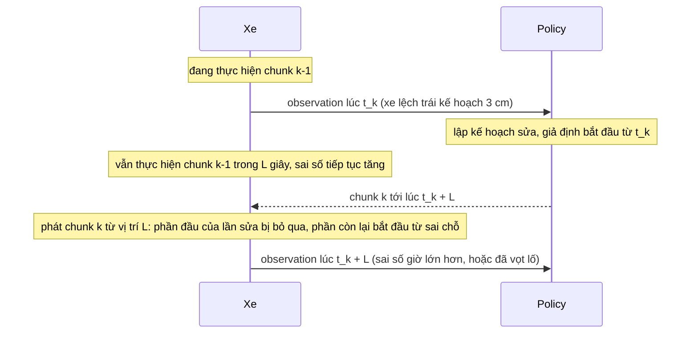

# 05 · Action chunking và bù độ trễ

*Bản tiếng Việt · [English](05-action-chunking-and-latency.md)*

*Bản tiếng Việt · [English](05-action-chunking-and-latency.vi.md)*

Đây là chương mà cả dự án xoay quanh. Mọi thứ trong chương được hiện thực trong hai file
nhỏ, [`drive/types.py`](../../drive/types.py) và
[`drive/control/executor.py`](../../drive/control/executor.py), và **[TESTED]** bởi
`ChunkTests` và `ExecutorTests`. Các số đo là **[SIM-ONLY]**.

## Ta đang giải bài toán gì?

Một policy mất $L$ giây để trả lời. Tới lúc câu trả lời tới nơi, xe đã đi được $v \cdot L$:
ở 1,5 m/s và 200 ms, đó là 30 cm, một phần ba bề rộng mặt đường. Vì vậy một câu trả lời kiểu
"steer 0,3 *ngay bây giờ*" là câu trả lời cho một câu hỏi không còn được hỏi nữa.

## Vì sao VLA chậm, và vì sao nó trả về nhiều action?

- **Chậm**, vì một lượt suy luận chạy một bộ mã hoá thị giác và một backbone mô hình ngôn
  ngữ trên hàng trăm token, rồi chạy đầu ra action nhiều lần (một đầu ra flow matching tích
  phân một phương trình vi phân thường qua một số bước khử nhiễu). Trên Jetson Orin Nano
  8 GB, README của jetson-orin-nano-vla báo độ trễ p50 từ 108 ms (SmolVLA, 450 triệu tham
  số) tới 643 ms (π0.5 base, 3,3 tỷ).
- **Nhiều action**, vì hai lý do bổ trợ cho nhau:
  1. *Chia đều chi phí.* Nếu suy nghĩ tốn 100 ms, thì chỉ lấy ra 20 ms lái là phí. Một chunk
     50 action phủ được khoảng thời gian tới câu trả lời tiếp theo, và còn dư.
  2. *Bắt chước tốt hơn.* Dự đoán một chuỗi buộc policy cam kết với một kế hoạch ngắn nhất
     quán thay vì quyết định lại ở mỗi bước, điều làm giảm việc các sai số nhỏ tích luỹ.
     Đây là lập luận của bài báo ACT (Zhao và cộng sự, 2023), nơi thuật ngữ "action
     chunking" ra đời.

## Một chunk biểu diễn điều gì

[`ActionChunk`](../../drive/types.py#L41):

$$\text{chunk} = \big(A \in \mathbb{R}^{N \times 2},\ dt,\ t_{\text{obs}}\big), \qquad A_i \text{ dành cho thời điểm } t_{\text{obs}} + i\,dt$$

Nó là một hàm theo thời gian, định nghĩa bằng nội suy tuyến tính giữa các hàng
([`ActionChunk.sample`](../../drive/types.py#L58)). Với thời gian đã trôi $e$ kể từ action
đầu tiên của chunk:

$$
p = \frac{\max(e, 0)}{dt}, \qquad
a(e) = \begin{cases}
\text{None} & p > N - 1 \\
(1 - w)\,A_i + w\,A_{i+1}, \quad i = \lfloor p \rfloor,\ w = p - i & \text{trường hợp còn lại}
\end{cases}
$$

**Horizon** của chunk là $H = (N - 1)\,dt$. Qua khỏi đó không còn action nào, và `sample`
nói rõ điều đó bằng cách trả về `None` thay vì lặp lại hàng cuối. Lựa chọn này có chủ ý: một
kế hoạch bị thiếu phải được supervisor nhìn thấy, không được che đi.

| Policy | $N$ | $dt$ | Horizon $H$ |
|---|---:|---:|---:|
| `pure-pursuit` | 50 | 1/30 s | 1.63 s |
| `lane-camera` | 15 | 1/30 s | 0.47 s |
| `cnn` | 16 | 0.1 s | 1.50 s |

## Executor: action nào, cho lúc này?

[`ChunkExecutor`](../../drive/control/executor.py#L11) giữ chunk mới nhất và trả lời
`action(now)` ở mỗi nhịp.

```python
def update(self, chunk, now):                       # một chunk mới vừa tới
    if self.chunk is not None:
        self._previous = (self.chunk, self._origin)
    self.chunk, self._swapped = chunk, now
    self._origin = chunk.t_obs if self.latency_compensation else now

def action(self, now):
    action = self.chunk.sample(now - self._origin)
    ...                                              # chuyển dần từ chunk trước sang
```

Dòng duy nhất quyết định mọi thứ là việc chọn **gốc thời gian (origin)**: thời điểm mà
`actions[0]` được coi là được phát.

| Chế độ | Gốc thời gian | Thời gian đã trôi lúc chunk tới | Tác dụng |
|---|---|---|---|
| Bù độ trễ **bật** (mặc định) | $t_{\text{obs}}$ | $L$ | $L/dt$ action đầu bị bỏ qua: chúng dành cho khoảng thời gian đã mất vào tính toán |
| Bù độ trễ **tắt** | thời điểm tới | $0$ | mọi action được phát trễ $L$ |

### Dòng thời gian

```
                 t_obs                 t_obs + L               t_obs + 2L
thời gian ───────┼─────────────────────┼───────────────────────┼──────────►
                 │   model đang tính   │  chunk đang dùng      │ chunk sau tới
action của chunk a0  a1  a2  a3  a4  a5  a6  a7  a8  a9  a10 a11 a12 ...
dành cho         ▲                     ▲
                 t_obs                 t_obs + L

có bù            (bỏ qua: a0 … )       phát a[L/dt] … a[2L/dt]      mỗi action đúng giờ
không bù                               phát a0 … a[L/dt]            mỗi action trễ L
```

### Ví dụ số

Chunk của teacher, $dt = 1/30$ s, observation tại $t_{\text{obs}} = 4.00$ s, độ trễ
$L = 100$ ms, nên chunk tới lúc 4,10 s. Nhịp điều khiển mỗi 20 ms.

| `now` | có bù: đã trôi → vị trí | phát | không bù: đã trôi → vị trí | phát |
|---:|---|---|---|---|
| 4.10 | 0.10 → 3.0 | $A_3$ | 0.00 → 0.0 | $A_0$ |
| 4.12 | 0.12 → 3.6 | $0.4A_3 + 0.6A_4$ | 0.02 → 0.6 | $0.4A_0 + 0.6A_1$ |
| 4.14 | 0.14 → 4.2 | $0.8A_4 + 0.2A_5$ | 0.04 → 1.2 | $0.8A_1 + 0.2A_2$ |
| 4.18 | 0.18 → 5.4 | $0.6A_5 + 0.4A_6$ | 0.08 → 2.4 | $0.6A_2 + 0.4A_3$ |

Lúc 4,20 s, chunk tiếp theo (observation lúc 4,10 s) tới và khuôn mẫu lặp lại. Trong 50
action của teacher, một model 100 ms dùng các hàng 3 tới 6; 46 hàng còn lại là bảo hiểm.

`ExecutorTests.test_latency_compensation_skips_stale_actions` và
`test_without_compensation_plays_from_the_start` kiểm tra đúng hai cột này.

### Trộn giữa các chunk

Hai chunk liên tiếp hiếm khi khớp hoàn toàn, nên chuyển thẳng sẽ làm lệnh nhảy bậc. Trong
`blend_s = 0.10` s sau một lần đổi chunk, executor xuất ra

$$a = (1 - f)\,a_{\text{old}}(t) + f\,a_{\text{new}}(t), \qquad f = \frac{t - t_{\text{swap}}}{0.10}$$

trong đó chunk cũ vẫn được lấy mẫu theo gốc thời gian của chính nó. Nếu chunk cũ đã hết,
chỉ dùng chunk mới (`test_fade_survives_an_exhausted_previous_chunk`).

## Tuổi kế hoạch

$$\text{age}(t) = t - t_{\text{obs}}$$

([`ChunkExecutor.age_s`](../../drive/control/executor.py#L56); vô cùng khi chưa có chunk.)
Khi policy chạy liên tục lượt nối lượt, một chunk tới $L$ sau observation của nó và bị thay
thế $L$ sau đó nữa:

$$\boxed{\ \text{age} \in [L,\ 2L)\ }$$

Tuổi là thước đo trung thực cho việc các quyết định của xe đã lỗi thời bao nhiêu. Bù độ trễ
sửa *thời điểm* của các action; nó không làm *thông tin* trẻ lại được.

## Cạn chunk

Một chunk chỉ cung cấp được action khi thời gian đã trôi còn nằm trong horizon $H$ của nó.

| Chế độ | Thời gian đã trôi lớn nhất trước chunk tiếp theo | Điều kiện để không bao giờ cạn |
|---|---|---|
| có bù | $2L$ | $L \le H/2$ |
| không bù | $L$ | $L \le H$ |

| Policy | $H$ | Bắt đầu cạn (có bù) khi độ trễ trên |
|---|---:|---:|
| `pure-pursuit` | 1.63 s | 817 ms |
| `cnn` | 1.50 s | 750 ms |
| `lane-camera` | 0.47 s | 233 ms |

*Measured:* `./drive.sh sim --policy lane-camera --latency-ms 300 --max-plan-age-ms 1500`
phanh 12,2 trên 30 s với lý do `stale`, dù watchdog đã được nâng lên cho khỏi vướng. Chunk
dài 0,47 s và kế hoạch cũ tới 0,6 s; ở phần cuối của mỗi chu kỳ, `sample` trả về `None`.

**Luật thiết kế:** một chunk phải dài ít nhất gấp đôi độ trễ xấu nhất mà nó sẽ được dùng cùng.

## Watchdog kế hoạch quá cũ

Ngay cả một chunk chưa cạn cũng có thể quá cũ để tin. Supervisor phanh khi

$$\text{lệnh là None} \quad \text{hoặc} \quad \text{age} > A_{\max} = 0.6\ \text{s}$$

trong đó $A_{\max}$ là `max_plan_age_s`
([`SafetySupervisor.filter`](../../drive/safety.py#L38),
[`SafetyLimits`](../../drive/config.py#L42)). Vì tuổi đạt tới $2L$:

$$\boxed{\ A_{\max} > 2L\ }$$

*Measured,* giới hạn mặc định 600 ms:

| Độ trễ | Khoảng tuổi | Bị phanh vì `stale` | Kết quả |
|---:|---|---:|---|
| 250 ms | 0.25–0.50 s | 0,3 s (chỉ lúc khởi động) | lái được, 1,97 vòng |
| 400 ms | 0.40–0.80 s | 13,9 trên 30 s | bò, 0,14 vòng |
| 650 ms | 0.65–1.30 s | 30,0 trên 30 s | không bao giờ chạy |

Ở 400 ms, kế hoạch quá cũ với các nhịp có tuổi từ 0,62 tới 0,78 s: 9 nhịp trên mỗi 20, chính
là 46 % đo được. `DriveTests.test_watchdog_stops_a_model_too_slow_for_it` cố định trường hợp
650 ms.

Nâng giới hạn lên, theo lời [`docs/driving.vi.md`](../driving.vi.md), là "a decision about how far
the car may travel on old information, not a tuning knob" (một quyết định về việc xe được đi
bao xa dựa trên thông tin cũ, không phải một núm chỉnh). Ở 1,5 m/s, 0,6 s là 0,9 m: một bề
rộng mặt đường.

## Các thí nghiệm

`./drive.sh sweep --max-plan-age-ms 1500 --latencies 0,50,100,200,250,300,400`: teacher ở
1,5 m/s, 30 s trên đường peanut, watchdog nâng lên để chỉ đo khả năng bám đường. *Measured;
các hàng 0, 100, 200, 250 và 400 ms bằng đúng các hàng trong `docs/driving.md`.*

| Độ trễ | Có bù: rms / max | Không bù: rms / max |
|---:|---:|---:|
| 0 ms | 1.8 / 3.5 cm | 1.6 / 3.0 cm |
| 50 ms | 1.8 / 3.5 cm | 1.0 / 2.4 cm |
| 100 ms | 1.8 / 3.4 cm | 0.7 / 2.2 cm |
| 200 ms | 2.0 / 3.6 cm | 3.8 / 8.8 cm |
| 250 ms | 3.1 / 6.6 cm | 10.0 / 23.3 cm |
| 300 ms | 20.2 / 31.0 cm | 27.2 / 54.4 cm |
| 400 ms | 65.2 / 123.9 cm (ra khỏi đường 49 % thời gian) | 49.0 / 89.0 cm |

Mặt đường rộng 90 cm; xe đã ra khỏi đường khi độ lệch vượt 45 cm.

### Đọc bảng

**0–200 ms, có bù: phẳng.** 1,8 tới 2,0 cm rms. Kế hoạch của teacher là một dự đoán tốt, và
đọc nó đúng lúc làm độ trễ trở nên vô hình.

**50–100 ms, không bù: tốt hơn có bù.** Nhìn như mâu thuẫn nhưng không phải. Pure pursuit cắt
góc cua: nhắm theo dây cung khiến nó vào cua hơi sớm. Phát các action của nó trễ một chút làm
nó vào cua muộn hơn một chút, và hai sai số tình cờ triệt tiêu nhau. `docs/driving.md` cũng
nói vậy: "the uncompensated numbers are lower only because the delay happens to cancel pure
pursuit's corner cutting" (các con số không bù thấp hơn chỉ vì độ trễ tình cờ triệt tiêu
việc cắt góc của pure pursuit). Đó là đặc tính của teacher này ở tốc độ này, không phải lý
do để tắt bù; ở 200 ms, cùng độ trễ đó làm sai số tăng gấp đôi, và ở 250 ms tăng gấp ba.

**Từ 250 ms trở lên: bù độ trễ không còn đủ.** Sai số tăng từ 3 cm lên 20 cm giữa 250 và
300 ms, và tới 400 ms xe ra khỏi đường một nửa thời gian.

## Vì sao vòng lặp mất ổn định

Bù độ trễ dựa trên một giả định: *giữa lúc có observation và lúc chunk tới nơi, xe làm đúng
những gì chunk này nói nó sẽ làm.* Thực tế không phải vậy. Trong khoảng đó, xe đang thực
hiện phần đuôi của chunk **trước**.



Khi xe đi đúng kế hoạch, hai chunk khớp nhau trên phần chồng lấn và không mất gì. Chúng chỉ
lệch nhau đúng khi xe *ra khỏi* kế hoạch, cũng chính là lúc cần sửa. Vì vậy:

1. mọi lần sửa đều dựa trên thông tin cũ từ $L$ tới $2L$;
2. phần sửa dành cho $L$ giây đầu tiên không bao giờ được thực hiện;
3. phần còn lại được thực hiện vòng hở thêm $L$ giây nữa, từ một trạng thái mà kế hoạch
   không lường trước.

Đây là một vòng phản hồi có thời gian chết. Thời gian chết nhỏ chỉ làm lần sửa đến muộn một
chút. Một khi thời gian chết tương đương với thời gian vòng lái cần để xoá một sai số, mỗi
lần sửa đến sau khi sai số đã đổi dấu, và nó đẩy sai hướng: xe lạng lách với biên độ ngày
càng lớn. [Chương 6](06-control-theory.vi.md) suy ra một ngưỡng thô,
$\tau^* \approx 0.52\,\ell/v$ với $\ell$ là khoảng nhìn trước, cho ra 0,32 s ở 1,5 m/s.

### Nó phụ thuộc tốc độ

*Measured* (`./drive.sh sweep --speed S --max-plan-age-ms 1500 …`), rms khi có bù:

| Tốc độ | 100 ms | 250 ms | 400 ms | 650 ms |
|---:|---:|---:|---:|---:|
| 0.6 m/s | 0.7 cm | 0.8 cm | 1.6 cm | 35.1 cm |
| 1.0 m/s | 1.1 cm | 1.6 cm | 27.7 cm | không chạy |
| 1.5 m/s | 1.8 cm | 3.1 cm | 65.2 cm | không chạy |

Thứ làm hỏng vòng lặp không phải thời gian mà là **quãng đường đi trên thông tin cũ**,
$v \cdot L$. Trong ba lần quét này, điểm ổn định cuối cùng và điểm mất ổn định đầu tiên kẹp
$v \cdot L$ trong khoảng 0,375 tới 0,39 m. Đó là một khuôn mẫu từ ba lần quét thô của một
teacher trên một đường đua, cần được kiểm chứng ([thí nghiệm E2](16-experiments.vi.md)), không
phải một định luật.

## Một model chậm hơn cần gì

| Phương án | Ý tưởng | Trạng thái ở đây |
|---|---|---|
| Lái chậm hơn | giữ $v \cdot L$ dưới ngưỡng: một model 400 ms ở 0,6 m/s giữ được 1,6 cm | có sẵn: `--speed` |
| Chunk dài hơn | chỉ xoá được hiện tượng cạn chunk; không giúp gì cho tính ổn định | có theo từng policy |
| Model nhanh hơn | mạng nhỏ hơn, ít bước khử nhiễu hơn, TensorRT, FP16 | mục đích của jetson-orin-nano-vla; **[PROPOSED]** cho lái xe |
| **Real-time chunking** | sinh mỗi chunk mới *có điều kiện theo các action đã cam kết* cho $L$ giây tới, để kế hoạch mới nối tiếp kế hoạch cũ thay vì mâu thuẫn với nó (Black, Galliker và Levine, 2025) | **[FUTURE]**; `docs/driving.md`: "That is not built here." |
| Temporal ensembling | lấy trung bình các chunk chồng lấn (ACT) | **[FUTURE]**; trộn 0,1 s là một họ hàng đơn giản hơn nhiều |
| Dự đoán trạng thái | đưa cho model trạng thái dự đoán tại $t + L$ thay vì trạng thái tại $t$ | **[FUTURE]** |

## Hiện thực hiện tại so với các cải tiến có thể làm

| | Đã hiện thực | Chưa hiện thực |
|---|---|---|
| Chunk đánh chỉ số theo thời gian, có nội suy | có | |
| Bỏ qua các action đã cũ | có | |
| Cross-fade tuyến tính trong 0,1 s | có | temporal ensembling |
| Watchdog theo tuổi kế hoạch và khi thiếu kế hoạch | có | |
| Chịu được jitter (gốc thời gian là `t_obs`, nên độ trễ thay đổi không cần xử lý riêng) | có: `--jitter-ms 40` vẫn cho 1,8 cm rms (*measured*) | |
| Đặt điều kiện kế hoạch theo các action đã cam kết | | real-time chunking |
| Điều chỉnh tốc độ theo độ trễ đo được | | một mở rộng tự nhiên của supervisor |

## Những lỗi và hiểu lầm thường gặp

- **"Bù độ trễ xoá được độ trễ."** Nó xoá sai số về *thời điểm*. Thông tin vẫn cũ từ $L$ tới $2L$.
- **"Ở 100 ms không bù lại tốt hơn, nên model nhanh không cần bù."** Kết quả đó là thiên
  lệch cắt góc của teacher triệt tiêu một độ trễ. Nó đảo ngược từ 200 ms và sẽ khác với một
  policy khác.
- **"Watchdog 600 ms cho phép một model 600 ms."** Nó cho phép một model 300 ms.
- **"Chunk dài hơn làm model chậm trở nên an toàn."** Nó ngăn được `None`; nó không ngăn
  được mất ổn định.
- **"Tuổi bắt đầu từ 0 khi chunk tới."** Nó bắt đầu từ $L$.

## Thí nghiệm thực hành

1. Tái tạo bảng: `./drive.sh sweep --max-plan-age-ms 1500 --latencies 0,100,200,250,300,400`.
2. Xem nó hỏng: `make sim ARGS='--latency-ms 300 --max-plan-age-ms 1500'`, rồi 400. Trong
   HUD, đường màu lục lam (cyan) là kế hoạch; xem nó lắc từ bên này sang bên kia. Trong bảng
   debug bên dưới, dải xám là phần của mỗi chunk bị bỏ qua do bù độ trễ: nó rộng ra theo độ
   trễ, và vạch trắng "now" quét từ mép dải tới gấp đôi bề rộng dải trước khi chunk tiếp
   theo thay chỗ.
3. Đoán trước, rồi kiểm tra: ở 1,0 m/s, 300 ms có ổn định không?
   `./drive.sh sweep --speed 1.0 --max-plan-age-ms 1500 --latencies 300`

## Kiểm tra kiến thức

1. Một chunk có 16 action cách nhau 0,1 s, observation tại $t = 10.0$. Độ trễ 150 ms. Vị trí
   nội suy nào được phát tại $t = 10.23$, khi có bù và khi không bù?
2. Độ trễ lớn nhất mà một chunk 16 × 0,1 s chịu được mà không bao giờ cạn, khi có bù, là bao nhiêu?
3. Với độ trễ 250 ms và watchdog mặc định, sau lúc khởi động xe có bao giờ bị phanh vì stale không?
4. Vì sao sự mất ổn định phụ thuộc tốc độ?
5. Real-time chunking thay đổi điều gì trong thứ policy được yêu cầu tạo ra?

<details><summary>Đáp án</summary>

1. Có bù: đã trôi 0,23 → vị trí 2.3. Không bù: chunk tới lúc 10,15, đã trôi 0,08 → vị trí 0.8.
2. $H = 1.5$ s, nên $L \le 0.75$ s.
3. Không: tuổi luôn nằm trong 0,25–0,50 s, dưới 0,6 s.
4. Sai số tích luỹ trên thông tin cũ là một quãng đường, $v \cdot L$, và thang thời gian riêng của vòng lái co lại khi tốc độ tăng ($\ell/v$).
5. Nó phải tạo ra một chunk mà $L$ giây đầu khớp với các action xe đã cam kết, và chỉ tự do lập kế hoạch sau đó.
</details>

## Đọc thêm

- Zhao và cộng sự 2023, *Learning Fine-Grained Bimanual Manipulation with Low-Cost Hardware* (ACT): action chunking và temporal ensembling.
- Black, Galliker và Levine 2025, *Real-Time Execution of Action Chunking Flow Policies*.
- Shukor và cộng sự 2025, *SmolVLA*, về hệ thống suy luận bất đồng bộ của nó.
- [Chương 6](06-control-theory.vi.md): phân tích độ trễ.
