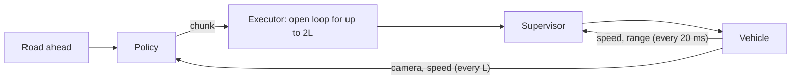

# 06 · Control theory

*[Tiếng Việt](06-control-theory.vi.md)*

Only the control theory this project needs, each idea tied to the line that embodies it.

## What problem are we solving?

Chapters 3 to 5 described parts. Control theory explains how they behave *together*:
why the car converges to the centreline instead of oscillating, how fast, and why a
delay that looks harmless can destroy that.

## 1. Open loop and closed loop

- **Open loop**: decide the inputs in advance and apply them without looking.
- **Closed loop (feedback)**: measure, compare with what is wanted, correct, repeat.

This stack is both, at different time scales.

| Time scale | What happens | Loop |
|---|---|---|
| within one chunk (up to $2L$) | the executor plays stored actions; nothing it does depends on where the car is | **open** |
| every inference ($L$) | a new observation produces a new plan | **closed**, at $1/L$ Hz |
| every tick (20 ms) | the supervisor compares speed with the range reading | **closed**, at 50 Hz |
| inside the teacher's rollout | throttle from the speed error, steering from the path error | closed, but *in prediction* |



The lesson of chapter 5 in these terms: **action chunking trades feedback rate for
inference time.** The outer loop closes only every $L$ seconds.

## 2. Sampling and discrete time

The controller does not act continuously. [`LoopConfig`](../../drive/config.py#L55)
sets `control_hz = 50`, so $dt = 20$ ms, and
[`Platform.apply(action, dt)`](../../drive/platform.py#L24) *holds* the action for one
period (a zero-order hold).

How fast is fast enough? A rule of thumb is to sample 10 to 20 times faster than the
fastest dynamics you intend to control. The fastest element here is the steering
servo, $\tau = 0.08$ s: 20 ms is a quarter of its time constant. The steering loop
itself is much slower (section 4), so 50 Hz is comfortable. The *plan* rate
($1/L$, 10 Hz at 100 ms) is the one that is marginal.

### Discretising a first-order lag exactly

The servo obeys $\dot\sigma = (c - \sigma)/\tau$. With $c$ held for one period, the
solution is exact:

$$\sigma_{k+1} = \sigma_k + (c - \sigma_k)\,\alpha, \qquad \alpha = 1 - e^{-dt/\tau} = 1 - e^{-0.25} = 0.221$$

This is line 13 of [`step_vehicle`](../../drive/sim/vehicle.py#L10). The naive Euler
version would use $\alpha = dt/\tau = 0.25$, which is 13 % too large here and unstable
for $dt > 2\tau$.

| After | Fraction of a step reached |
|---|---|
| 20 ms (1 tick) | 22 % |
| 80 ms ($\tau$) | 63 % |
| 240 ms ($3\tau$) | 95 % |

**Servo lag** is why a policy is given `state.steer` (where the wheels *are*) as an
input: without it, the same image would call for different commands depending on what
the wheels are already doing.

## 3. Throttle: proportional control with feed-forward

Both hand-written policies use
([`pure_pursuit.py`](../../drive/policy/pure_pursuit.py#L38),
[`lane_camera.py`](../../drive/policy/lane_camera.py#L56)):

$$u = \text{clip}\big(\underbrace{2\,(v^* - v)}_{\text{feedback}} + \underbrace{0.1\,v^*}_{\text{feed-forward}},\ -1,\ 1\big)$$

The plant, for $u \ge 0$, is $\dot v = 2.5\,u - 0.3\,v$. Substituting:

$$\dot v = -5.3\,v + 5.25\,v^*$$

- **A first-order closed loop** with time constant $1/5.3 = 0.19$ s.
- **Steady state** ($\dot v = 0$): $v = \frac{5.25}{5.3}v^* = 0.991\,v^*$. For
  $v^* = 1.5$ that is 1.486 m/s; the clean runs report a mean of 1.46–1.47 m/s, a
  little lower because the teacher slows for bends.
- **Why the feed-forward term?** Holding a speed against drag needs
  $u = 0.3\,v / 2.5 = 0.12\,v$ even with zero error. Pure proportional control can only
  produce that throttle by *having* an error: it would settle at
  $v = \frac{5}{5.3}v^* = 0.943\,v^*$, 6 % slow. The feed-forward term supplies most of
  the needed throttle directly and leaves feedback to fix what remains (1 %).
- **Saturation.** From rest with $v^* = 1.5$, $u$ is clipped to 1 until
  $2(1.5 - v) + 0.15 < 1$, i.e. $v > 1.075$ m/s. Until then the car accelerates at
  $2.5 - 0.3v$, open loop.

An integral term would remove the last 1 %. It is absent because nothing here needs it
and because integrators bring wind-up problems under saturation.

## 4. Steering: pure pursuit is a PD controller

### Derivation

Follow a straight path. Let $e$ be the lateral error (positive left) and $\theta$ the
heading error. For small angles the look-ahead point, $\ell$ ahead on the path, is at
$y_\ell \approx -(e + \ell\,\theta)$ in the car frame, at distance $d \approx \ell$.
Pure pursuit commands curvature $\kappa = 2y_\ell/d^2$ ([chapter 4](04-driving-policies.md)), and
the kinematics are $\dot e = v\,\theta$, $\dot\theta = v\,\kappa$. Therefore

$$\ddot e = v\,\dot\theta = -\frac{2v^2}{\ell^2}\,e - \frac{2v}{\ell}\,\dot e$$

That is a mass on a spring with a damper: proportional action on the error, derivative
action through the heading. In standard form $\ddot e + 2\zeta\omega_n\dot e + \omega_n^2 e = 0$:

$$\omega_n = \sqrt{2}\,\frac{v}{\ell}, \qquad \zeta = \frac{1}{\sqrt 2} \approx 0.71$$

- **Damping is always 0.71**, whatever the speed or look-ahead: a well-behaved
  response with about 4 % overshoot. This is why pure pursuit is so forgiving to tune.
- **The look-ahead sets the speed of response.** Short $\ell$: fast, twitchy. Long
  $\ell$: slow, smooth, and more corner cutting.
- The code's look-ahead $\ell = \text{clip}(0.4 + 0.35v, 0.5, 1.4)$ grows with speed,
  so that $\omega_n$ does not grow in proportion to $v$.

| $v$ | $\ell$ | $\omega_n$ | Period $2\pi/\omega_n$ |
|---:|---:|---:|---:|
| 0.6 m/s | 0.61 m | 1.39 rad/s | 4.5 s |
| 1.0 m/s | 0.75 m | 1.89 rad/s | 3.3 s |
| 1.5 m/s | 0.925 m | 2.29 rad/s | 2.7 s |

*(Derived for this guide from the code's constants; not stated in the repository.)*

### Tracking error

The metric used throughout is the root mean square of the lateral offset
([`Metrics.summary`](../../drive/episode.py#L60)):

$$e_{\text{rms}} = \sqrt{\frac{1}{n}\sum_{k=1}^{n} e_k^2}, \qquad e_{\max} = \max_k |e_k|$$

RMS punishes large excursions more than a mean of absolute values would, which is
what you want for a road with edges. On a clean run it is 1.8 cm: not noise, but the
teacher's systematic corner cutting.

## 5. Stability and overshoot

A loop is **stable** if a disturbance dies out, **unstable** if it grows. In between,
the response may **overshoot**: cross the target before settling.

You can see all three in the latency sweep ([chapter 5](05-action-chunking-and-latency.md)):

| Latency at 1.5 m/s | rms / max | Regime |
|---:|---:|---|
| 0–200 ms | 1.8–2.0 / 3.5 cm | stable, well damped |
| 250 ms | 3.1 / 6.6 cm | stable, visibly oscillatory |
| 300 ms | 20.2 / 31.0 cm | sustained weaving, still on the road |
| 400 ms | 65.2 / 123.9 cm | unstable: leaves the road |

## 6. Delay in a feedback loop

### Why delay is special

A pure delay $\tau$ does not change the size of a signal; it shifts it in time. A
sinusoid of angular frequency $\omega$ is shifted by a phase of $\omega\tau$ radians.
A feedback loop is stable only while its total phase lag, at the frequency where its
gain is 1 (the *crossover* frequency $\omega_c$), stays short of 180°. The spare phase
is the **phase margin** $\varphi_m$, and the delay that uses it all up is the
**delay margin**:

$$\tau^* = \frac{\varphi_m}{\omega_c}$$

Intuition: push a swing. Push in phase and it grows; a correction delayed by half a
period is a push in phase with the error.

### An estimate for this stack

Treat the steering loop of section 4 as a PD controller on a double integrator with a
delay, $L(s) = \omega_n^2\,(1 + \tfrac{\ell}{v}s)\,e^{-\tau s}/s^2$. Solving
$|L(j\omega_c)| = 1$:

$$\omega_c = \omega_n\sqrt{1 + \sqrt 2} = 1.55\,\omega_n, \qquad
\varphi_m = \arctan\!\Big(\frac{\ell}{v}\,\omega_c\Big) = \arctan(2.20) = 65.5°$$

$$\boxed{\ \tau^* = \frac{\varphi_m}{\omega_c} \approx 0.52\,\frac{\ell}{v}\ }$$

The servo adds its own lag, $\arctan(\omega_c \times 0.08)$, which eats part of the
margin:

| $v$ | $\omega_c$ | $\tau^*$ (ideal) | Servo phase | $\tau^*$ with servo | Measured: last stable → first unstable latency |
|---:|---:|---:|---:|---:|---|
| 0.6 m/s | 2.16 rad/s | 0.53 s | 9.8° | 0.45 s | 400 → 650 ms |
| 1.0 m/s | 2.93 rad/s | 0.39 s | 13.2° | 0.31 s | 250 → 400 ms |
| 1.5 m/s | 3.56 rad/s | 0.32 s | 15.9° | 0.24 s | 250 → 300 ms |

**How to read this.** The estimate reproduces the trend (the tolerable delay shrinks
roughly as $\ell/v$) and the order of magnitude. It should not be trusted further,
because:

- it is linear, for small errors on a straight road, and the track is neither;
- the loop's real dead time is not exactly the latency $L$: the information is $L$ to
  $2L$ old, but the teacher's rollout predicts across part of it;
- it ignores the steering-rate limit, the 0.1 s blend and the sampling of the plan.

*This analysis was made for this guide. The repository states only the observation:
"Past about 250 ms at 1.5 m/s the loop is unstable … It is speed-dependent."*

### Two ways out, in control terms

1. **Lower the crossover frequency**: drive slower, or look further ahead. Both make
   $\ell/v$ larger. Available now (`--speed`).
2. **Remove the dead time from the loop**: make each new plan consistent with what the
   car is already committed to, so the delay sits outside the feedback path. That is
   real-time chunking: **[FUTURE]**.

## 7. Limits as non-linearities

Three elements clip signals and so are not linear:

| Element | Where | Effect |
|---|---|---|
| Actuator saturation, $\pm 1$ | [`step_vehicle`](../../drive/sim/vehicle.py#L10), the supervisor | the loop is open while saturated |
| Steering-rate limit, 8 /s (0.16 per tick) | [`SafetySupervisor.filter`](../../drive/safety.py#L33) | a low-pass that adds lag for large, fast commands |
| Speed and obstacle rules | same | override the throttle entirely |

A rate limit protects the hardware and the passengers, but it is lag, and lag erodes
phase margin. A controller that is stable in simulation with no rate limit can
oscillate with one. On a clean run the limit is active for 0.06 s (the first swing
from zero); if you see `steer_rate` accumulate in a result, the policy is asking for
something the supervisor will not give it, and the loop is no longer the one you analysed.

## Common mistakes and misconceptions

- **"More gain is always more accurate."** More gain raises $\omega_c$ and shrinks the
  delay margin.
- **"A delay just makes everything happen a bit later."** In open loop, yes. In a
  feedback loop it changes whether the loop is stable at all.
- **"The 50 Hz loop is the bandwidth of the system."** It is the rate at which
  commands are *issued*. The rate at which the car *reacts to the world* is the plan rate.
- **"Feed-forward is cheating."** It is knowledge of the plant used directly, leaving
  less for feedback to do.
- **"Pure pursuit is not a feedback controller because it is geometric."** Its
  geometry is a PD law.

## Practical experiment

Test the estimate $\tau^* \propto \ell/v$:

```bash
for s in 0.6 0.8 1.0 1.2 1.5; do
  echo "speed $s"; ./drive.sh sweep --speed $s --max-plan-age-ms 1500 --latencies 200,250,300,350,400,500
done
```

For each speed, note the first latency at which rms exceeds, say, 10 cm. Plot it
against $\ell/v$ with $\ell = \text{clip}(0.4 + 0.35v, 0.5, 1.4)$. Is it a straight
line through the origin? What is its slope, and how does it compare with 0.52 and with
the servo-corrected values above?

## Knowledge check

1. In which sense is playing a chunk open-loop, and what closes the loop?
2. Compute the steady-state speed for $v^* = 1.0$ m/s with and without the feed-forward term.
3. What is the damping ratio of pure pursuit at 0.6 m/s? At 1.5 m/s?
4. A loop has a phase margin of 60° and a crossover frequency of 3 rad/s. What delay makes it unstable?
5. Why can a steering-rate limit cause oscillation?

<details><summary>Answers</summary>

1. Within a chunk, actions do not depend on the car's state; each new observation, every $L$ seconds, closes the loop.
2. With: $0.991$ m/s. Without: $5/5.3 = 0.943$ m/s.
3. 0.71 in both cases; it does not depend on speed or look-ahead.
4. $\tau^* = (60 \times \pi/180)/3 = 0.35$ s.
5. It delays large corrections, which is extra phase lag at exactly the moment the loop needs to act quickly.
</details>

## Further reading

- Åström and Murray, *Feedback Systems*, chapters 1–2 (what feedback is), 10 (frequency-domain stability, delay margins).
- Coulter 1992, for pure pursuit's geometry; Paden et al. 2016, §V, for its place among path-tracking controllers.
- Tedrake, *Underactuated Robotics*, for a more advanced treatment.
