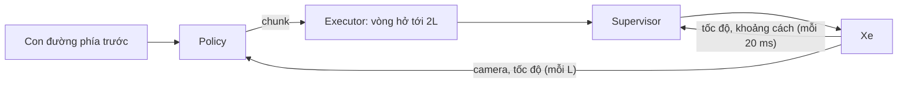

# 06 · Lý thuyết điều khiển

*Bản tiếng Việt · [English](06-control-theory.md)*

*Bản tiếng Việt · [English](06-control-theory.vi.md)*

Chỉ phần lý thuyết điều khiển mà dự án này cần, mỗi ý gắn với dòng code thể hiện nó.

## Ta đang giải bài toán gì?

Các chương 3 tới 5 mô tả từng bộ phận. Lý thuyết điều khiển giải thích chúng hành xử thế nào
khi *đi cùng nhau*: vì sao xe hội tụ về đường tâm thay vì dao động, nhanh tới đâu, và vì sao
một độ trễ trông vô hại lại có thể phá hỏng tất cả.

## 1. Vòng hở và vòng kín

- **Vòng hở**: quyết định đầu vào từ trước và áp dụng chúng mà không nhìn kết quả.
- **Vòng kín (phản hồi)**: đo, so với điều mong muốn, sửa, lặp lại.

Hệ thống này là cả hai, ở những thang thời gian khác nhau.

| Thang thời gian | Chuyện gì xảy ra | Vòng |
|---|---|---|
| trong một chunk (tới $2L$) | executor phát các action đã lưu; không gì nó làm phụ thuộc vào vị trí của xe | **hở** |
| mỗi lượt suy luận ($L$) | một observation mới tạo ra một kế hoạch mới | **kín**, ở $1/L$ Hz |
| mỗi nhịp (20 ms) | supervisor so tốc độ với số đo khoảng cách | **kín**, ở 50 Hz |
| bên trong lần chạy thử (rollout) của teacher | ga từ sai số tốc độ, lái từ sai số quỹ đạo | kín, nhưng *trong dự đoán* |



Bài học của chương 5 nói theo ngôn ngữ này: **action chunking đổi tần số phản hồi lấy thời
gian suy luận.** Vòng ngoài chỉ được đóng mỗi $L$ giây.

## 2. Lấy mẫu và thời gian rời rạc

Bộ điều khiển không tác động liên tục. [`LoopConfig`](../../drive/config.py#L55) đặt
`control_hz = 50`, nên $dt = 20$ ms, và
[`Platform.apply(action, dt)`](../../drive/platform.py#L24) *giữ* action trong một chu kỳ
(giữ bậc không, zero-order hold).

Nhanh bao nhiêu là đủ? Một quy tắc kinh nghiệm là lấy mẫu nhanh hơn 10 tới 20 lần so với
động học nhanh nhất mà bạn định điều khiển. Phần tử nhanh nhất ở đây là servo lái,
$\tau = 0.08$ s: 20 ms là một phần tư hằng số thời gian của nó. Bản thân vòng lái chậm hơn
nhiều (mục 4), nên 50 Hz là thoải mái. Tần số *kế hoạch* ($1/L$, 10 Hz ở 100 ms) mới là thứ
sát ngưỡng.

### Rời rạc hoá chính xác một khâu trễ bậc nhất

Servo tuân theo $\dot\sigma = (c - \sigma)/\tau$. Với $c$ giữ nguyên trong một chu kỳ,
nghiệm là chính xác:

$$\sigma_{k+1} = \sigma_k + (c - \sigma_k)\,\alpha, \qquad \alpha = 1 - e^{-dt/\tau} = 1 - e^{-0.25} = 0.221$$

Đó là dòng 13 của [`step_vehicle`](../../drive/sim/vehicle.py#L10). Phiên bản Euler ngây thơ
sẽ dùng $\alpha = dt/\tau = 0.25$, lớn hơn 13 % ở đây và mất ổn định khi $dt > 2\tau$.

| Sau | Phần của một bước nhảy đạt được |
|---|---|
| 20 ms (1 nhịp) | 22 % |
| 80 ms ($\tau$) | 63 % |
| 240 ms ($3\tau$) | 95 % |

**Độ trễ servo** là lý do một policy được cho `state.steer` (vị trí bánh xe *đang ở*) làm đầu
vào: không có nó, cùng một ảnh sẽ đòi những lệnh khác nhau tuỳ bánh xe đang làm gì.

## 3. Ga: điều khiển tỷ lệ có truyền thẳng

Cả hai policy viết tay đều dùng
([`pure_pursuit.py`](../../drive/policy/pure_pursuit.py#L38),
[`lane_camera.py`](../../drive/policy/lane_camera.py#L56)):

$$u = \text{clip}\big(\underbrace{2\,(v^* - v)}_{\text{phản hồi}} + \underbrace{0.1\,v^*}_{\text{truyền thẳng}},\ -1,\ 1\big)$$

Đối tượng điều khiển, với $u \ge 0$, là $\dot v = 2.5\,u - 0.3\,v$. Thay vào:

$$\dot v = -5.3\,v + 5.25\,v^*$$

- **Một vòng kín bậc nhất** với hằng số thời gian $1/5.3 = 0.19$ s.
- **Trạng thái xác lập** ($\dot v = 0$): $v = \frac{5.25}{5.3}v^* = 0.991\,v^*$. Với
  $v^* = 1.5$, đó là 1,486 m/s; các lần chạy sạch báo trung bình 1,46–1,47 m/s, thấp hơn một
  chút vì teacher giảm tốc ở khúc cua.
- **Vì sao cần thành phần truyền thẳng?** Giữ một tốc độ chống lại lực cản cần
  $u = 0.3\,v / 2.5 = 0.12\,v$ ngay cả khi sai số bằng 0. Điều khiển tỷ lệ thuần tuý chỉ tạo
  ra được mức ga đó bằng cách *có* sai số: nó sẽ ổn định ở $v = \frac{5}{5.3}v^* = 0.943\,v^*$,
  chậm 6 %. Thành phần truyền thẳng cấp trực tiếp phần lớn mức ga cần thiết và để phản hồi
  sửa phần còn lại (1 %).
- **Bão hoà.** Từ lúc đứng yên với $v^* = 1.5$, $u$ bị cắt ở 1 cho tới khi
  $2(1.5 - v) + 0.15 < 1$, tức $v > 1.075$ m/s. Trước đó xe tăng tốc với $2.5 - 0.3v$, vòng hở.

Một thành phần tích phân sẽ xoá nốt 1 % cuối. Nó không có vì ở đây không gì cần nó, và vì
khâu tích phân mang theo vấn đề wind-up khi bão hoà.

## 4. Lái: pure pursuit là một bộ điều khiển PD

### Suy ra

Bám theo một quỹ đạo thẳng. Gọi $e$ là sai số ngang (dương bên trái) và $\theta$ là sai số
hướng. Với góc nhỏ, điểm nhìn trước, cách $\ell$ phía trước trên quỹ đạo, nằm ở
$y_\ell \approx -(e + \ell\,\theta)$ trong hệ xe, cách một khoảng $d \approx \ell$. Pure
pursuit ra lệnh độ cong $\kappa = 2y_\ell/d^2$ ([chương 4](04-driving-policies.vi.md)), và
động học là $\dot e = v\,\theta$, $\dot\theta = v\,\kappa$. Vì vậy

$$\ddot e = v\,\dot\theta = -\frac{2v^2}{\ell^2}\,e - \frac{2v}{\ell}\,\dot e$$

Đó là một vật nặng gắn lò xo và giảm chấn: tác động tỷ lệ lên sai số, tác động vi phân qua
hướng xe. Ở dạng chuẩn $\ddot e + 2\zeta\omega_n\dot e + \omega_n^2 e = 0$:

$$\omega_n = \sqrt{2}\,\frac{v}{\ell}, \qquad \zeta = \frac{1}{\sqrt 2} \approx 0.71$$

- **Hệ số tắt dần luôn là 0,71**, dù tốc độ hay khoảng nhìn trước là bao nhiêu: một đáp ứng
  ngoan với khoảng 4 % vọt lố. Đó là lý do pure pursuit rất dễ chỉnh.
- **Khoảng nhìn trước quyết định tốc độ đáp ứng.** $\ell$ ngắn: nhanh, giật. $\ell$ dài:
  chậm, mượt, và cắt góc nhiều hơn.
- Khoảng nhìn trước trong code $\ell = \text{clip}(0.4 + 0.35v, 0.5, 1.4)$ tăng theo tốc độ,
  để $\omega_n$ không tăng tỷ lệ thuận với $v$.

| $v$ | $\ell$ | $\omega_n$ | Chu kỳ $2\pi/\omega_n$ |
|---:|---:|---:|---:|
| 0.6 m/s | 0.61 m | 1.39 rad/s | 4.5 s |
| 1.0 m/s | 0.75 m | 1.89 rad/s | 3.3 s |
| 1.5 m/s | 0.925 m | 2.29 rad/s | 2.7 s |

*(Suy ra cho giáo trình này từ các hằng số trong code; repository không ghi điều này.)*

### Sai số bám

Metric dùng xuyên suốt là căn bậc hai trung bình bình phương (RMS) của độ lệch ngang
([`Metrics.summary`](../../drive/episode.py#L60)):

$$e_{\text{rms}} = \sqrt{\frac{1}{n}\sum_{k=1}^{n} e_k^2}, \qquad e_{\max} = \max_k |e_k|$$

RMS phạt các lần lệch lớn nặng hơn so với trung bình giá trị tuyệt đối, và đó là điều bạn
muốn với một con đường có mép. Trong một lần chạy sạch nó là 1,8 cm: không phải nhiễu, mà là
việc cắt góc có hệ thống của teacher.

## 5. Tính ổn định và vọt lố

Một vòng lặp **ổn định** nếu nhiễu tắt dần, **mất ổn định** nếu nhiễu lớn dần. Ở giữa, đáp
ứng có thể **vọt lố**: vượt qua mục tiêu trước khi ổn định.

Bạn thấy được cả ba trong lần quét độ trễ ([chương 5](05-action-chunking-and-latency.vi.md)):

| Độ trễ ở 1,5 m/s | rms / max | Chế độ |
|---:|---:|---|
| 0–200 ms | 1.8–2.0 / 3.5 cm | ổn định, tắt dần tốt |
| 250 ms | 3.1 / 6.6 cm | ổn định, thấy rõ dao động |
| 300 ms | 20.2 / 31.0 cm | lạng lách kéo dài, vẫn trên đường |
| 400 ms | 65.2 / 123.9 cm | mất ổn định: ra khỏi đường |

## 6. Độ trễ trong một vòng phản hồi

### Vì sao độ trễ đặc biệt

Một độ trễ thuần $\tau$ không đổi độ lớn của tín hiệu; nó dịch tín hiệu theo thời gian. Một
sóng sin tần số góc $\omega$ bị dịch pha $\omega\tau$ radian. Một vòng phản hồi chỉ ổn định
khi tổng độ trễ pha của nó, tại tần số mà độ lợi bằng 1 (tần số *cắt* $\omega_c$), còn chưa
tới 180°. Phần pha còn dư là **dự trữ pha** $\varphi_m$, và độ trễ dùng hết phần đó là
**dự trữ độ trễ**:

$$\tau^* = \frac{\varphi_m}{\omega_c}$$

Trực giác: đẩy xích đu. Đẩy cùng pha thì nó lớn dần; một lần sửa trễ nửa chu kỳ là một cú
đẩy cùng pha với sai số.

### Một ước lượng cho hệ thống này

Coi vòng lái ở mục 4 là một bộ điều khiển PD trên một khâu tích phân kép có độ trễ,
$L(s) = \omega_n^2\,(1 + \tfrac{\ell}{v}s)\,e^{-\tau s}/s^2$. Giải $|L(j\omega_c)| = 1$:

$$\omega_c = \omega_n\sqrt{1 + \sqrt 2} = 1.55\,\omega_n, \qquad
\varphi_m = \arctan\!\Big(\frac{\ell}{v}\,\omega_c\Big) = \arctan(2.20) = 65.5°$$

$$\boxed{\ \tau^* = \frac{\varphi_m}{\omega_c} \approx 0.52\,\frac{\ell}{v}\ }$$

Servo thêm độ trễ của riêng nó, $\arctan(\omega_c \times 0.08)$, ăn bớt một phần dự trữ:

| $v$ | $\omega_c$ | $\tau^*$ (lý tưởng) | Pha của servo | $\tau^*$ có servo | Đo được: độ trễ ổn định cuối → mất ổn định đầu |
|---:|---:|---:|---:|---:|---|
| 0.6 m/s | 2.16 rad/s | 0.53 s | 9.8° | 0.45 s | 400 → 650 ms |
| 1.0 m/s | 2.93 rad/s | 0.39 s | 13.2° | 0.31 s | 250 → 400 ms |
| 1.5 m/s | 3.56 rad/s | 0.32 s | 15.9° | 0.24 s | 250 → 300 ms |

**Đọc bảng này thế nào.** Ước lượng tái tạo được xu hướng (độ trễ chịu được co lại gần như
theo $\ell/v$) và bậc độ lớn. Không nên tin nó hơn thế, vì:

- nó tuyến tính, cho sai số nhỏ trên đường thẳng, còn đường đua thì không phải cả hai;
- thời gian chết thật của vòng lặp không đúng bằng độ trễ $L$: thông tin cũ từ $L$ tới $2L$,
  nhưng rollout của teacher dự đoán qua một phần khoảng đó;
- nó bỏ qua giới hạn tốc độ đánh lái, phần trộn 0,1 s và việc lấy mẫu kế hoạch.

*Phân tích này được làm cho giáo trình. Repository chỉ ghi quan sát: "Past about 250 ms at
1.5 m/s the loop is unstable … It is speed-dependent." (Quá khoảng 250 ms ở 1,5 m/s vòng lặp
mất ổn định … Nó phụ thuộc tốc độ.)*

### Hai lối thoát, theo ngôn ngữ điều khiển

1. **Hạ tần số cắt**: lái chậm hơn, hoặc nhìn xa hơn. Cả hai đều làm $\ell/v$ lớn hơn. Có
   sẵn ngay (`--speed`).
2. **Đưa thời gian chết ra khỏi vòng**: làm mỗi kế hoạch mới nhất quán với những gì xe đã cam
   kết, để độ trễ nằm ngoài đường phản hồi. Đó là real-time chunking: **[FUTURE]**.

## 7. Giới hạn như những phần tử phi tuyến

Ba phần tử cắt tín hiệu nên không tuyến tính:

| Phần tử | Ở đâu | Tác dụng |
|---|---|---|
| Bão hoà cơ cấu chấp hành, $\pm 1$ | [`step_vehicle`](../../drive/sim/vehicle.py#L10), supervisor | vòng lặp hở trong lúc bão hoà |
| Giới hạn tốc độ đánh lái, 8 /s (0,16 mỗi nhịp) | [`SafetySupervisor.filter`](../../drive/safety.py#L33) | một bộ lọc thông thấp thêm độ trễ cho các lệnh lớn và nhanh |
| Các luật về tốc độ và vật cản | như trên | ghi đè hoàn toàn mức ga |

Giới hạn tốc độ thay đổi bảo vệ phần cứng và hành khách, nhưng nó là độ trễ, và độ trễ bào
mòn dự trữ pha. Một bộ điều khiển ổn định trong mô phỏng khi không có giới hạn tốc độ có thể
dao động khi có. Trong một lần chạy sạch, giới hạn hoạt động trong 0,06 s (lần đánh lái đầu
tiên từ 0); nếu bạn thấy `steer_rate` tích luỹ trong kết quả, policy đang đòi thứ supervisor
không cho, và vòng lặp không còn là vòng lặp bạn đã phân tích.

## Những lỗi và hiểu lầm thường gặp

- **"Tăng độ lợi luôn chính xác hơn."** Độ lợi cao hơn nâng $\omega_c$ và thu hẹp dự trữ độ trễ.
- **"Độ trễ chỉ làm mọi thứ xảy ra muộn hơn một chút."** Trong vòng hở, đúng vậy. Trong vòng
  phản hồi, nó quyết định vòng có ổn định hay không.
- **"Vòng 50 Hz là băng thông của hệ thống."** Đó là tần số lệnh được *phát ra*. Tần số xe
  *phản ứng với thế giới* là tần số kế hoạch.
- **"Truyền thẳng là ăn gian."** Đó là hiểu biết về đối tượng được dùng trực tiếp, để phản
  hồi đỡ phải làm nhiều.
- **"Pure pursuit không phải bộ điều khiển phản hồi vì nó là hình học."** Hình học của nó
  chính là một luật PD.

## Thí nghiệm thực hành

Kiểm tra ước lượng $\tau^* \propto \ell/v$:

```bash
for s in 0.6 0.8 1.0 1.2 1.5; do
  echo "speed $s"; ./drive.sh sweep --speed $s --max-plan-age-ms 1500 --latencies 200,250,300,350,400,500
done
```

Với mỗi tốc độ, ghi lại độ trễ đầu tiên mà rms vượt, chẳng hạn, 10 cm. Vẽ nó theo $\ell/v$
với $\ell = \text{clip}(0.4 + 0.35v, 0.5, 1.4)$. Có phải một đường thẳng đi qua gốc toạ độ
không? Hệ số góc là bao nhiêu, và so với 0,52 cùng các giá trị đã hiệu chỉnh theo servo ở
trên thì sao?

## Kiểm tra kiến thức

1. Phát một chunk là vòng hở theo nghĩa nào, và cái gì đóng vòng?
2. Tính tốc độ xác lập với $v^* = 1.0$ m/s khi có và khi không có thành phần truyền thẳng.
3. Hệ số tắt dần của pure pursuit ở 0,6 m/s là bao nhiêu? Ở 1,5 m/s?
4. Một vòng lặp có dự trữ pha 60° và tần số cắt 3 rad/s. Độ trễ bao nhiêu làm nó mất ổn định?
5. Vì sao giới hạn tốc độ đánh lái có thể gây dao động?

<details><summary>Đáp án</summary>

1. Trong một chunk, các action không phụ thuộc trạng thái xe; mỗi observation mới, mỗi $L$ giây, đóng vòng.
2. Có: $0.991$ m/s. Không có: $5/5.3 = 0.943$ m/s.
3. 0,71 trong cả hai trường hợp; nó không phụ thuộc tốc độ hay khoảng nhìn trước.
4. $\tau^* = (60 \times \pi/180)/3 = 0.35$ s.
5. Nó làm chậm các lần sửa lớn, tức thêm độ trễ pha đúng vào lúc vòng lặp cần hành động nhanh.
</details>

## Đọc thêm

- Åström và Murray, *Feedback Systems*, chương 1–2 (phản hồi là gì), 10 (ổn định trong miền tần số, dự trữ độ trễ).
- Coulter 1992, về hình học của pure pursuit; Paden và cộng sự 2016, §V, về vị trí của nó giữa các bộ điều khiển bám quỹ đạo.
- Tedrake, *Underactuated Robotics*, cho cách trình bày nâng cao hơn.
