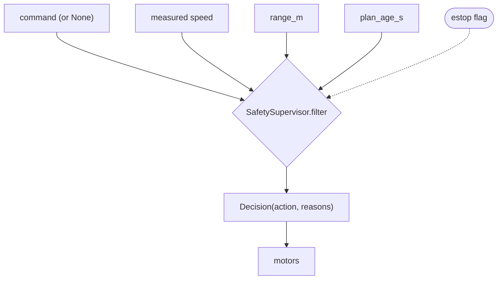
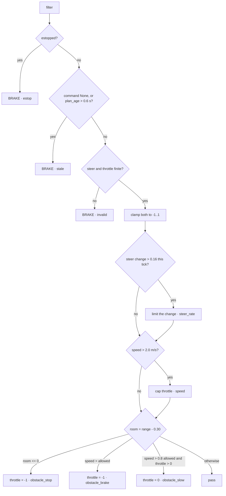
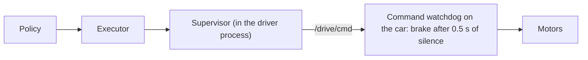

# 07 · Safety supervisor

*[Tiếng Việt](07-safety-supervisor.vi.md)*

## What problem are we solving?

A learned policy will be wrong sometimes, slow sometimes, and absent sometimes (a
crashed process, a hung GPU). None of those may reach the motors unexamined. The
supervisor is the one component that stands between every command and the car.

## Why must it be independent of the policy?

If the safety check used the policy's own perception, a single fault could both cause
the danger and blind the check. The supervisor therefore:

- takes **no input from the policy except the command itself**;
- has **its own sensor** (a forward range sensor), far simpler than a camera;
- is **small enough to read in one sitting** (74 lines) and to test exhaustively;
- **fails towards stopping**: every doubtful case ends in a full brake.

From the module's own docstring ([`drive/safety.py`](../../drive/safety.py)): "It
trusts nothing upstream: it sees only the commanded action, the measured speed and its
own range sensor, and it has the last word. Keep it this small on a real car, and run
it where a hung policy process cannot stop it."



## The rules, in order

[`SafetySupervisor.filter`](../../drive/safety.py#L33). The first three return
immediately with a full brake; the rest modify the command and accumulate reasons.



| # | Rule | Condition | Action | Reason | Limit ([`SafetyLimits`](../../drive/config.py#L42)) |
|---|---|---|---|---|---|
| 1 | Emergency stop | `estopped` | full brake | `estop` | set by `estop()` |
| 2 | No plan / stale plan | `command is None` or age $> 0.6$ s | full brake | `stale` | `max_plan_age_s` |
| 3 | Invalid numbers | NaN or ±∞ in the command | full brake | `invalid` | |
| 4 | Range clamp | always | clip to $[-1, 1]$ | (none) | |
| 5 | Steering rate | $\lvert\Delta\text{steer}\rvert > 8 \times dt = 0.16$ | move 0.16 towards it | `steer_rate` | `max_steer_rate_per_s` |
| 6 | Speed | $v > 2.0$ m/s | throttle $\le \max(-2(v - 2.0), -1)$ | `speed` | `max_speed_mps` |
| 7 | Obstacle | see below | brake or coast | `obstacle_*` | `planned_decel_mps2`, `stop_margin_m` |

A "full brake" ([`_brake`](../../drive/safety.py#L72)) is throttle $-1$ with the
**wheels held where they are**: `[self._steer, -1.0]`. Snapping the wheels straight
while braking in a bend would steer the car off the road.

### Rule 7: braking for what the sensor sees

**Intuition.** At any distance from an obstacle there is a fastest speed from which
the car can still stop in time. Stay under it.

**Mathematics.** Stopping from speed $v$ at constant deceleration $a$ takes
$v^2 / (2a)$ metres. Let the usable room be the measured range minus a margin,
$\text{room} = r - 0.30$. The speed from which the car stops exactly within that room is

$$v_{\text{allowed}} = \sqrt{2\,a\,\text{room}}, \qquad a = 4.0\ \text{m/s}^2$$

| Condition | Decision |
|---|---|
| $\text{room} \le 0$ | full brake: `obstacle_stop` |
| $v > v_{\text{allowed}}$ | full brake: `obstacle_brake` |
| $v > 0.8\,v_{\text{allowed}}$ and throttle $> 0$ | throttle $= 0$ (coast): `obstacle_slow` |
| otherwise | unchanged |

**Why 4.0 when the brakes can do 6.0?** The supervisor plans with less than the car
can deliver, so a weaker-than-expected brake still stops in time. On a real car this
number must be *measured* and then derated.

**Worked numbers.** `SafetyTests.test_obstacle_ladder` at $v = 1.0$ m/s:

| Range | Room | $v_{\text{allowed}}$ | $0.8\,v_{\text{allowed}}$ | Decision |
|---:|---:|---:|---:|---|
| 1.00 m | 0.70 m | 2.37 m/s | 1.89 | pass |
| 0.47 m | 0.17 m | 1.17 m/s | 0.93 | coast (`obstacle_slow`) |
| 0.40 m | 0.10 m | 0.89 m/s | 0.72 | brake (`obstacle_brake`) |
| 0.25 m (at rest) | −0.05 m | | | hold (`obstacle_stop`) |

At 1.5 m/s the car starts coasting when the range falls under 0.74 m and brakes under 0.58 m.

### What a stop looks like

`./drive.sh sim --obstacle 8` puts a cone 8 m along the track. The teacher does not
know about it and drives straight at it. *Measured* (trace of the supervisor's reasons):

| t (s) | Range | Speed | Supervisor |
|---:|---:|---:|---|
| < 5.04 | > 0.71 m | 1.48 m/s | passes |
| 5.04 | 0.71 m | 1.48 | `obstacle_slow`: throttle cut |
| 5.16 | 0.53 m | 1.31 | `obstacle_brake` |
| 5.16–5.44 | 0.53 → 0.31 m | 1.31 → 0.19 | alternates brake and coast, riding $v_{\text{allowed}}$ down |
| ≥ 5.5 | 0.30 m | 0 | `obstacle_stop`, held for the rest of the run |

```
pure-pursuit on peanut, 100.0 ms per inference (300 inferences), latency compensation on, safety on
  0.33 laps in 30.0 s at 0.24 m/s
  obstacles: not hit, closest 0.3 m
  safety overrode the policy: obstacle_brake 0.22 s, obstacle_slow 0.22 s, obstacle_stop 24.48 s, stale 0.1 s, steer_rate 0.06 s
```

and with `--no-safety`: `obstacles: HIT, closest 0.0 m`, at full speed.
`DriveTests.test_supervisor_stops_for_an_obstacle_the_policy_ignores` asserts both.

The alternation is the rule behaving as a bang-bang controller along the curve
$v = \sqrt{2a\,\text{room}}$. It is effective and not smooth; a real car would want a
proportional brake command there.

## Emergency stop

[`estop(engaged=True)`](../../drive/safety.py#L30) sets a flag that is checked first
and holds until released (`SafetyTests.test_estop_holds_until_released`).

- **Simulator**: the `e` key in the HUD toggles it ([`cli.py`](../../drive/cli.py#L70)).
- **ROS 2**: **no topic, service or parameter engages it.** The driver node creates the
  supervisor but exposes no way to call `estop()`. An e-stop input is a gap to close
  before a real car ([chapter 14](14-jetson-deployment.md)).

## Failure scenarios

| Scenario | What the supervisor sees | Result | Verified by |
|---|---|---|---|
| No plan yet (start-up) | `command is None` | brake until the first chunk | every run: `stale 0.1 s` |
| Policy too slow | plan age $> 0.6$ s | brake while stale | `test_watchdog_stops_a_model_too_slow_for_it` |
| Policy's chunk runs out | `command is None` | brake | lane-camera at 300 ms ([chapter 5](05-action-chunking-and-latency.md)) |
| Policy outputs NaN | non-finite command | brake | `test_brakes_without_a_fresh_valid_plan` |
| Policy outputs 3.0 or 7.0 | out of range | clamped | `test_clamps_and_limits_steering_rate` |
| Policy jerks the wheel | large $\Delta$steer | slewed at 8 /s | same |
| Policy speeds | $v > 2.0$ | throttle capped, then brake | `test_speed_limit`; `--speed 2.5` shows `speed 5.5 s` |
| Policy drives at an obstacle | range falls | coast, brake, hold at 0.30 m | `test_supervisor_stops_for_an_obstacle…` |
| Policy raises an exception | (the worker re-raises it in the loop) | the loop stops; **nothing brakes in-process** | `test_threaded_worker_raises_policy_errors_in_the_loop` |
| Driver process dies or hangs | (no more commands) | the *platform* must brake | `test_the_car_brakes_when_commands_stop` (the sim node's 0.5 s timeout) |
| Range sensor not heard yet (ROS) | `distance = 0.0` | `obstacle_stop` until a reading arrives | by construction: [`RosPlatform.__init__`](../../ros/src/drive_ros/drive_ros/platform.py#L14) |

The last three rows are the edge of what an in-process supervisor can do, and the
reason for a second, independent layer:



The simulated car implements that outer layer:
[`CMD_TIMEOUT_S = 0.5`](../../ros/src/drive_ros/drive_ros/sim_node.py#L20), "a car
must not coast on a dead link". The driver relies on it: `DriveNode.close` sends no
goodbye command, because "the car brakes by itself when the commands stop".

## What the supervisor does not do

Read this list before trusting it.

| Limitation | Consequence |
|---|---|
| It does not know where the road is | it will let the policy drive off the road at any legal speed |
| One forward sensor, ±15°, 4 m | blind to the sides, to low or narrow obstacles, to anything approaching |
| It runs in the same process and thread as the loop | a hang in that process stops it too; hence the car-side watchdog |
| Braking distance assumes 4 m/s² | untrue on a slippery surface |
| Only the *command* is checked for NaN; the range reading is not | *measured:* `filter(..., range_m=nan)` passes the command unchanged, because every comparison with NaN is false. `+inf` (nothing in range) correctly passes and `-inf` correctly stops. A real sensor driver must never publish NaN, or the supervisor needs a check |
| No latching: when the obstacle clears, driving resumes | may be wrong for a real e-stop policy |
| Teleop bypasses it | [`teleop_node.py`](../../ros/src/drive_ros/drive_ros/teleop_node.py): "Its commands go straight to the car, past the supervisor" |
| `--no-safety` removes it | "for experiments only: nothing guards the motors" ([`loop.py`](../../drive/loop.py#L45)) |
| No e-stop input over ROS 2 | see above |

It is a **collision and sanity guard for a straight-ahead hazard**, not a safety case.

## Common mistakes and misconceptions

- **"The supervisor makes the policy safe."** It bounds a few failure modes. Leaving
  the road is not one of them.
- **"Stale means the model is broken."** It means the plan is older than you decided
  to tolerate. At start-up it is normal.
- **"Raise `max_plan_age` until the warnings stop."** That converts a visible stop
  into an invisible risk ([chapter 5](05-action-chunking-and-latency.md)).
- **"Braking should straighten the wheels."** `_brake` deliberately holds them.
- **"The reasons are log messages."** They are data: `Metrics` accumulates the seconds
  per reason, and that table is the first thing to read in any result.

## Practical experiment

1. `make sim ARGS='--obstacle 8'`, then `make sim ARGS='--obstacle 8 --no-safety'`.
2. Predict the stopping distance for `--speed 0.8`, then check `closest` in the result.
3. Place the cone off-centre by editing nothing: read
   [`Track.obstacle`](../../drive/sim/track.py#L86) and
   [`World.range_m`](../../drive/sim/world.py#L53) and work out the largest lateral
   offset at which the sensor still sees a cone 1 m ahead. (Verify in Python with
   `World(track, (track.obstacle(8.0, lateral_m=…),))`.)

## Knowledge check

1. In what order are estop, stale and NaN checked, and does the order matter?
2. At 2.3 m/s the policy asks for full throttle. What throttle goes to the motors?
3. Range 0.9 m, speed 1.8 m/s, throttle 0.5. What does the supervisor do?
4. Why does the supervisor plan with 4 m/s² when the brakes give 6?
5. Which failure can the in-process supervisor not handle, and what does?

<details><summary>Answers</summary>

1. estop, then stale (including a missing command), then invalid. The order fixes which reason is reported; all three give a full brake.
2. $\max(-2 \times 0.3, -1) = -0.6$.
3. Room 0.6 m; $v_{\text{allowed}} = \sqrt{4.8} = 2.19$; $0.8 \times 2.19 = 1.75 < 1.8$: throttle set to 0, `obstacle_slow`.
4. Margin: the stop still succeeds if the real deceleration is a third lower than expected.
5. The driver process hanging or dying. The car's own command watchdog (0.5 s in the simulated car) brakes.
</details>

## Further reading

- [`tests/test_drive.py`](../../tests/test_drive.py#L256), `SafetyTests`: the supervisor's specification, in 50 lines.
- Åström and Murray, ch. 1, on why feedback and safety limits are layered.
- ISO 26262 and ISO 21448 (SOTIF) for how safety is argued in production vehicles; far beyond this project's scope, and worth knowing they exist.
