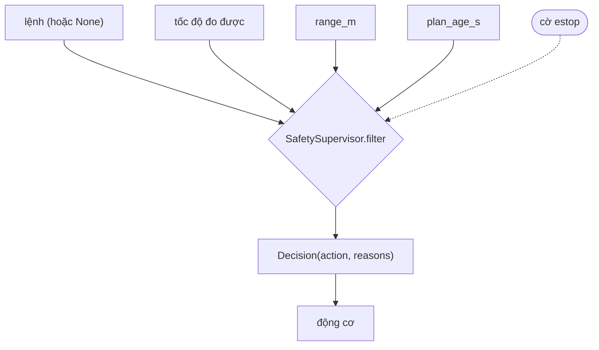
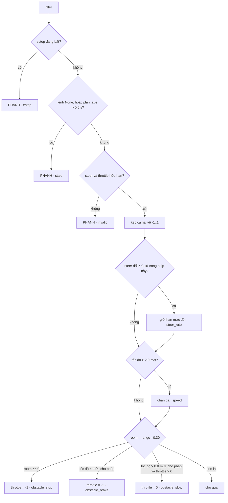
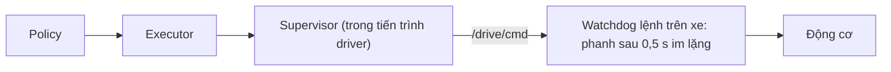

# 07 · Bộ giám sát an toàn

*Bản tiếng Việt · [English](07-safety-supervisor.md)*

*Bản tiếng Việt · [English](07-safety-supervisor.vi.md)*

## Ta đang giải bài toán gì?

Một policy học được đôi khi sẽ sai, đôi khi chậm, và đôi khi vắng mặt (một tiến trình đã sập,
một GPU bị treo). Không trường hợp nào được phép đi tới động cơ mà không bị xem xét.
Supervisor là thành phần duy nhất đứng giữa mọi lệnh và chiếc xe.

## Vì sao nó phải độc lập với policy?

Nếu phần kiểm tra an toàn dùng chính khả năng nhận thức của policy, một lỗi duy nhất có thể
vừa gây ra nguy hiểm vừa làm mù phần kiểm tra. Vì vậy supervisor:

- **không nhận đầu vào nào từ policy ngoài chính lệnh đó**;
- có **cảm biến riêng** (một cảm biến khoảng cách hướng về phía trước), đơn giản hơn camera nhiều;
- **đủ nhỏ để đọc hết trong một lần ngồi** (74 dòng) và để test đầy đủ;
- **khi hỏng thì nghiêng về dừng**: mọi trường hợp đáng ngờ đều kết thúc bằng phanh hết cỡ.

Từ chính docstring của module ([`drive/safety.py`](../../drive/safety.py)): "It trusts
nothing upstream: it sees only the commanded action, the measured speed and its own range
sensor, and it has the last word. Keep it this small on a real car, and run it where a hung
policy process cannot stop it." (Nó không tin gì từ phía trên: nó chỉ thấy action được ra
lệnh, tốc độ đo được và cảm biến khoảng cách của riêng nó, và nó có lời quyết định cuối. Hãy
giữ nó nhỏ như thế trên xe thật, và chạy nó ở chỗ mà một tiến trình policy bị treo không thể
làm nó dừng.)



## Các luật, theo thứ tự

[`SafetySupervisor.filter`](../../drive/safety.py#L33). Ba luật đầu trả về ngay với phanh hết
cỡ; các luật còn lại sửa lệnh và cộng dồn lý do.



| # | Luật | Điều kiện | Hành động | Lý do | Giới hạn ([`SafetyLimits`](../../drive/config.py#L42)) |
|---|---|---|---|---|---|
| 1 | Dừng khẩn cấp | `estopped` | phanh hết cỡ | `estop` | đặt bởi `estop()` |
| 2 | Không có / kế hoạch quá cũ | `command is None` hoặc tuổi $> 0.6$ s | phanh hết cỡ | `stale` | `max_plan_age_s` |
| 3 | Số không hợp lệ | NaN hoặc ±∞ trong lệnh | phanh hết cỡ | `invalid` | |
| 4 | Kẹp miền giá trị | luôn luôn | cắt về $[-1, 1]$ | (không) | |
| 5 | Tốc độ đánh lái | $\lvert\Delta\text{steer}\rvert > 8 \times dt = 0.16$ | dịch 0,16 về phía giá trị đó | `steer_rate` | `max_steer_rate_per_s` |
| 6 | Tốc độ | $v > 2.0$ m/s | throttle $\le \max(-2(v - 2.0), -1)$ | `speed` | `max_speed_mps` |
| 7 | Vật cản | xem bên dưới | phanh hoặc thả trôi | `obstacle_*` | `planned_decel_mps2`, `stop_margin_m` |

"Phanh hết cỡ" ([`_brake`](../../drive/safety.py#L72)) là throttle $-1$ với **bánh xe giữ
nguyên vị trí**: `[self._steer, -1.0]`. Bẻ thẳng bánh xe khi đang phanh trong khúc cua sẽ lái
xe ra khỏi đường.

### Luật 7: phanh vì thứ cảm biến nhìn thấy

**Trực giác.** Ở mỗi khoảng cách tới vật cản, có một tốc độ lớn nhất mà từ đó xe vẫn dừng kịp.
Hãy ở dưới tốc độ đó.

**Toán học.** Dừng từ tốc độ $v$ với gia tốc giảm tốc không đổi $a$ cần $v^2 / (2a)$ mét. Gọi
khoảng trống dùng được là khoảng cách đo được trừ một biên, $\text{room} = r - 0.30$. Tốc độ
mà từ đó xe dừng vừa đúng trong khoảng trống đó là

$$v_{\text{allowed}} = \sqrt{2\,a\,\text{room}}, \qquad a = 4.0\ \text{m/s}^2$$

| Điều kiện | Quyết định |
|---|---|
| $\text{room} \le 0$ | phanh hết cỡ: `obstacle_stop` |
| $v > v_{\text{allowed}}$ | phanh hết cỡ: `obstacle_brake` |
| $v > 0.8\,v_{\text{allowed}}$ và throttle $> 0$ | throttle $= 0$ (thả trôi): `obstacle_slow` |
| còn lại | giữ nguyên |

**Vì sao 4,0 khi phanh làm được 6,0?** Supervisor lập kế hoạch với mức thấp hơn khả năng thật
của xe, để một hệ thống phanh yếu hơn dự kiến vẫn dừng kịp. Trên xe thật, con số này phải được
*đo* rồi hạ bớt.

**Số liệu đã tính.** `SafetyTests.test_obstacle_ladder` ở $v = 1.0$ m/s:

| Khoảng cách | Khoảng trống | $v_{\text{allowed}}$ | $0.8\,v_{\text{allowed}}$ | Quyết định |
|---:|---:|---:|---:|---|
| 1.00 m | 0.70 m | 2.37 m/s | 1.89 | cho qua |
| 0.47 m | 0.17 m | 1.17 m/s | 0.93 | thả trôi (`obstacle_slow`) |
| 0.40 m | 0.10 m | 0.89 m/s | 0.72 | phanh (`obstacle_brake`) |
| 0.25 m (đứng yên) | −0.05 m | | | giữ phanh (`obstacle_stop`) |

Ở 1,5 m/s, xe bắt đầu thả trôi khi khoảng cách xuống dưới 0,74 m và phanh khi dưới 0,58 m.

### Một lần dừng trông thế nào

`./drive.sh sim --obstacle 8` đặt một cọc tiêu cách 8 m dọc đường đua. Teacher không biết về
nó và lái thẳng vào. *Measured* (vết các lý do của supervisor):

| t (s) | Khoảng cách | Tốc độ | Supervisor |
|---:|---:|---:|---|
| < 5.04 | > 0.71 m | 1.48 m/s | cho qua |
| 5.04 | 0.71 m | 1.48 | `obstacle_slow`: cắt ga |
| 5.16 | 0.53 m | 1.31 | `obstacle_brake` |
| 5.16–5.44 | 0.53 → 0.31 m | 1.31 → 0.19 | xen kẽ phanh và thả trôi, bám theo $v_{\text{allowed}}$ đi xuống |
| ≥ 5.5 | 0.30 m | 0 | `obstacle_stop`, giữ cho tới hết lần chạy |

```
pure-pursuit on peanut, 100.0 ms per inference (300 inferences), latency compensation on, safety on
  0.33 laps in 30.0 s at 0.24 m/s
  obstacles: not hit, closest 0.3 m
  safety overrode the policy: obstacle_brake 0.22 s, obstacle_slow 0.22 s, obstacle_stop 24.48 s, stale 0.1 s, steer_rate 0.06 s
```

và với `--no-safety`: `obstacles: HIT, closest 0.0 m`, ở tốc độ tối đa.
`DriveTests.test_supervisor_stops_for_an_obstacle_the_policy_ignores` khẳng định cả hai.

Sự xen kẽ đó là luật hành xử như một bộ điều khiển bật-tắt (bang-bang) dọc theo đường cong
$v = \sqrt{2a\,\text{room}}$. Nó hiệu quả nhưng không mượt; một chiếc xe thật sẽ muốn một lệnh
phanh tỷ lệ ở đó.

## Dừng khẩn cấp

[`estop(engaged=True)`](../../drive/safety.py#L30) đặt một cờ được kiểm tra đầu tiên và giữ
nguyên cho tới khi được nhả (`SafetyTests.test_estop_holds_until_released`).

- **Bộ mô phỏng**: phím `e` trong HUD bật/tắt nó ([`cli.py`](../../drive/cli.py#L70)).
- **ROS 2**: **không có topic, service hay parameter nào bật được nó.** Node driver tạo
  supervisor nhưng không cung cấp cách nào để gọi `estop()`. Đầu vào e-stop là một khoảng
  trống phải lấp trước khi lên xe thật ([chương 14](14-jetson-deployment.vi.md)).

## Các kịch bản hỏng hóc

| Kịch bản | Supervisor thấy gì | Kết quả | Kiểm chứng bởi |
|---|---|---|---|
| Chưa có kế hoạch (lúc khởi động) | `command is None` | phanh tới khi có chunk đầu tiên | mọi lần chạy: `stale 0.1 s` |
| Policy quá chậm | tuổi kế hoạch $> 0.6$ s | phanh trong lúc quá cũ | `test_watchdog_stops_a_model_too_slow_for_it` |
| Chunk của policy bị cạn | `command is None` | phanh | lane-camera ở 300 ms ([chương 5](05-action-chunking-and-latency.vi.md)) |
| Policy xuất ra NaN | lệnh không hữu hạn | phanh | `test_brakes_without_a_fresh_valid_plan` |
| Policy xuất ra 3.0 hay 7.0 | ngoài miền giá trị | bị kẹp | `test_clamps_and_limits_steering_rate` |
| Policy giật mạnh tay lái | $\Delta$steer lớn | bị giới hạn 8 /s | như trên |
| Policy chạy quá nhanh | $v > 2.0$ | chặn ga, rồi phanh | `test_speed_limit`; `--speed 2.5` cho `speed 5.5 s` |
| Policy lái thẳng vào vật cản | khoảng cách giảm | thả trôi, phanh, dừng ở 0,30 m | `test_supervisor_stops_for_an_obstacle…` |
| Policy raise một exception | (worker raise lại nó trong vòng lặp) | vòng lặp dừng; **không có gì phanh trong tiến trình** | `test_threaded_worker_raises_policy_errors_in_the_loop` |
| Tiến trình driver chết hoặc treo | (không còn lệnh nào) | *platform* phải phanh | `test_the_car_brakes_when_commands_stop` (timeout 0,5 s của node sim) |
| Chưa nhận được số đo khoảng cách (ROS) | `distance = 0.0` | `obstacle_stop` cho tới khi có số đo | theo cấu trúc: [`RosPlatform.__init__`](../../ros/src/drive_ros/drive_ros/platform.py#L14) |

Ba hàng cuối là giới hạn của những gì một supervisor trong cùng tiến trình làm được, và là lý
do cần một lớp thứ hai độc lập:



Chiếc xe mô phỏng hiện thực lớp ngoài đó:
[`CMD_TIMEOUT_S = 0.5`](../../ros/src/drive_ros/drive_ros/sim_node.py#L20), "a car must not
coast on a dead link" (một chiếc xe không được trôi theo một đường truyền đã chết). Driver dựa
vào nó: `DriveNode.close` không gửi lệnh tạm biệt nào, vì "the car brakes by itself when the
commands stop" (xe tự phanh khi lệnh ngừng tới).

## Những gì supervisor không làm

Đọc danh sách này trước khi tin nó.

| Giới hạn | Hệ quả |
|---|---|
| Nó không biết con đường ở đâu | nó sẽ để policy lái ra khỏi đường ở bất kỳ tốc độ hợp lệ nào |
| Một cảm biến phía trước, ±15°, 4 m | mù ở hai bên, với vật cản thấp hoặc hẹp, với bất cứ thứ gì đang tiến lại gần |
| Nó chạy cùng tiến trình và cùng thread với vòng lặp | tiến trình đó bị treo thì nó cũng dừng; vì vậy cần watchdog phía xe |
| Quãng phanh giả định 4 m/s² | không đúng trên mặt đường trơn |
| Chỉ *lệnh* được kiểm tra NaN; số đo khoảng cách thì không | *measured:* `filter(..., range_m=nan)` cho lệnh qua nguyên vẹn, vì mọi phép so sánh với NaN đều false. `+inf` (không có gì trong tầm) cho qua là đúng, và `-inf` dừng là đúng. Một driver cảm biến thật không bao giờ được publish NaN, hoặc supervisor cần thêm một phép kiểm tra |
| Không chốt trạng thái: khi vật cản biến mất, xe chạy tiếp | có thể sai với một chính sách e-stop thật |
| Teleop đi vòng qua nó | [`teleop_node.py`](../../ros/src/drive_ros/drive_ros/teleop_node.py): "Its commands go straight to the car, past the supervisor" (lệnh của nó đi thẳng tới xe, qua mặt supervisor) |
| `--no-safety` gỡ bỏ nó | "for experiments only: nothing guards the motors" (chỉ dùng cho thí nghiệm: không gì canh giữ động cơ) ([`loop.py`](../../drive/loop.py#L45)) |
| Không có đầu vào e-stop qua ROS 2 | xem ở trên |

Nó là một **lớp chắn va chạm và chống giá trị vô lý cho mối nguy ngay phía trước**, không
phải một hồ sơ an toàn (safety case).

## Những lỗi và hiểu lầm thường gặp

- **"Supervisor làm policy trở nên an toàn."** Nó chặn được vài kiểu hỏng. Lái ra khỏi đường
  không nằm trong số đó.
- **"Stale nghĩa là model bị hỏng."** Nó nghĩa là kế hoạch cũ hơn mức bạn đã quyết định chấp
  nhận. Lúc khởi động điều đó là bình thường.
- **"Nâng `max_plan_age` cho tới khi hết cảnh báo."** Làm vậy biến một lần dừng nhìn thấy được
  thành một rủi ro vô hình ([chương 5](05-action-chunking-and-latency.vi.md)).
- **"Phanh thì nên bẻ thẳng bánh xe."** `_brake` cố ý giữ nguyên chúng.
- **"Các lý do là thông điệp log."** Chúng là dữ liệu: `Metrics` cộng dồn số giây theo từng lý
  do, và bảng đó là thứ đầu tiên phải đọc trong mọi kết quả.

## Thí nghiệm thực hành

1. `make sim ARGS='--obstacle 8'`, rồi `make sim ARGS='--obstacle 8 --no-safety'`.
2. Đoán quãng dừng với `--speed 0.8`, rồi kiểm tra `closest` trong kết quả.
3. Đặt cọc tiêu lệch tâm mà không sửa gì: đọc [`Track.obstacle`](../../drive/sim/track.py#L86)
   và [`World.range_m`](../../drive/sim/world.py#L53) rồi tính độ lệch ngang lớn nhất mà cảm
   biến vẫn thấy một cọc tiêu cách 1 m phía trước. (Kiểm chứng bằng Python với
   `World(track, (track.obstacle(8.0, lateral_m=…),))`.)

## Kiểm tra kiến thức

1. estop, stale và NaN được kiểm tra theo thứ tự nào, và thứ tự có quan trọng không?
2. Ở 2,3 m/s policy đòi hết ga. Mức ga nào đi tới động cơ?
3. Khoảng cách 0,9 m, tốc độ 1,8 m/s, throttle 0,5. Supervisor làm gì?
4. Vì sao supervisor lập kế hoạch với 4 m/s² khi phanh cho được 6?
5. Lỗi nào supervisor trong cùng tiến trình không xử lý được, và cái gì xử lý nó?

<details><summary>Đáp án</summary>

1. estop, rồi stale (gồm cả trường hợp thiếu lệnh), rồi invalid. Thứ tự quyết định lý do nào được báo; cả ba đều cho phanh hết cỡ.
2. $\max(-2 \times 0.3, -1) = -0.6$.
3. Khoảng trống 0,6 m; $v_{\text{allowed}} = \sqrt{4.8} = 2.19$; $0.8 \times 2.19 = 1.75 < 1.8$: ga đặt về 0, `obstacle_slow`.
4. Biên an toàn: xe vẫn dừng kịp nếu mức giảm tốc thật thấp hơn dự kiến một phần ba.
5. Tiến trình driver bị treo hoặc chết. Watchdog lệnh của chính chiếc xe (0,5 s trên xe mô phỏng) sẽ phanh.
</details>

## Đọc thêm

- [`tests/test_drive.py`](../../tests/test_drive.py#L256), `SafetyTests`: đặc tả của supervisor, trong 50 dòng.
- Åström và Murray, chương 1, về vì sao phản hồi và các giới hạn an toàn được xếp thành lớp.
- ISO 26262 và ISO 21448 (SOTIF), về cách lập luận an toàn trong xe sản xuất hàng loạt; vượt xa phạm vi dự án này, nhưng đáng biết là chúng tồn tại.
