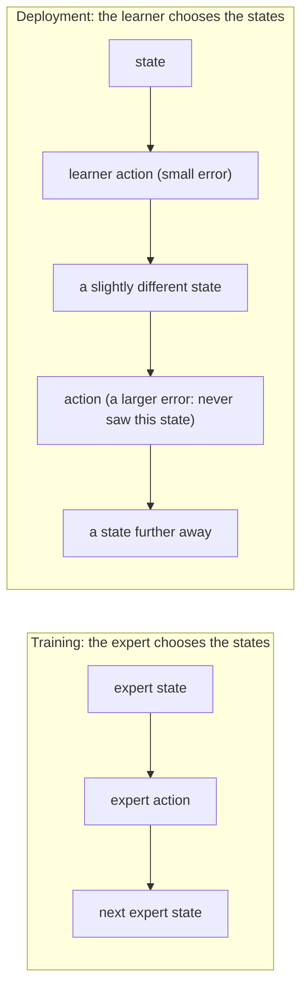

# 08 · Imitation learning fundamentals

## What problem are we solving?

Writing a driving policy by hand works when you can state the rule (pure pursuit) and
fails when you cannot ("stay on anything that looks like a road"). Imitation learning
replaces the rule with examples: record someone who drives well, and train a model to
do what they did.

## Why does it matter here?

This is the loop a VLA fine-tune goes through. The repository runs it end to end in
minutes with a 0.3 M-parameter network in place of SmolVLA, so its failure modes can
be met cheaply. The most important one, in this chapter, is that **a model can copy
its teacher almost perfectly and still be unable to drive.**

## From supervised learning to behaviour cloning

**Supervised learning.** Given pairs $(x_i, y_i)$, find parameters $\theta$ of a
function $f_\theta$ that minimise the average loss
$\frac{1}{n}\sum_i \mathcal{L}(f_\theta(x_i), y_i)$. It works when the inputs seen
after training come from the same distribution as the training inputs.

**Behaviour cloning (BC)** is supervised learning applied to a demonstrator:

| Supervised learning | Behaviour cloning in this repository |
|---|---|
| input $x$ | observation $o = $ (image $96 \times 128 \times 3$, state `[speed, steer]`) |
| label $y$ | the expert's plan: 16 future actions `[steer, throttle]`, 0.1 s apart |
| model $f_\theta$ | [`ChunkNet`](../../drive/learn/model.py#L11) |
| loss | Smooth L1 between predicted and expert plans |
| dataset | episodes recorded from the teacher (or a person) |

$$\theta^* = \arg\min_\theta\ \mathbb{E}_{(o,\,a_{0:15}) \sim \mathcal{D}}\ \big[\,\mathcal{L}\big(\pi_\theta(o),\ a_{0:15}\big)\big]$$

**Expert demonstrations** here come from two sources
([chapter 9](09-dataset-pipeline.md)): the pure-pursuit teacher in the simulator, who
states a plan with every frame, and drives recorded over ROS 2, where the plan is
reconstructed from the actions that followed.

**Observation–action pairs become observation–plan pairs.** The label is not one
action but the next 1.5 s of them. "The label is a plan, not a class"
([`docs/driving.md`](../driving.md)): nobody annotates anything by hand.

## The catch: the learner chooses its own inputs

In ordinary supervised learning a wrong prediction costs one error and the next input
arrives regardless. In driving, a wrong prediction **moves the car**, and the next
input is the view from the new position.



- **Distribution shift**: any difference between the data a model was trained on and
  the data it meets.
- **Covariate shift**: the special case where the *inputs* shift while the right
  answer for each input stays the same. Here: the correct steering for "10 cm left of
  the centre" has not changed; the model simply never saw that view.
- **Compounding errors**: each error makes the next more likely.

### How fast do errors compound?

Suppose the learner errs with probability $\epsilon$ per step on the expert's states,
over an episode of $T$ steps. Ross and Bagnell (2010) showed that for behaviour
cloning the expected total cost can grow as

$$J(\pi_\theta) \le J(\pi^*) + \mathcal{O}(\epsilon\,T^2)$$

quadratic in the horizon: one early mistake can cost every remaining step. Methods that
train on the states the *learner* visits (DAgger; Ross, Gordon and Bagnell 2011) bring
this down to $\mathcal{O}(\epsilon\,T)$.

A 40 s evaluation drive at 10 inferences per second is $T = 400$ decisions. A tiny
$\epsilon$ is not small against $T^2$.

## The fix used here: disturb the driving, keep the labels clean

A dataset of perfect driving contains only states on the centreline. What the learner
lacks is **recovery behaviour**: examples of being off-centre together with the
correct way back.

Three ways to get them:

| Method | How | Cost | Here |
|---|---|---|---|
| **DAgger** | run the *learner*, ask the expert to label the states it reaches, retrain, repeat | needs an expert on call and several rounds | **[FUTURE]** (possible in the simulator, where the teacher can be queried anywhere) |
| **DART** (Laskey et al. 2017) | add noise to the *expert's executed actions* while recording, and store the expert's *intended* action as the label | one pass; needs the intended action | **implemented** in `collect` |
| Extra cameras with a steering offset (Bojarski et al. 2016) | synthesise off-centre views | hardware and a heuristic | not used |

[`collect`](../../drive/learn/collect.py#L120) does DART:

```python
steer, throttle = teacher.act(world.state)                          # what the teacher wants
applied = np.array([clip(steer + disturbance.step(dt), -1, 1), throttle])
world.apply(applied, dt)                                            # what the car gets
...
recorder.add(t, image, speed, steer_pos, applied, teacher.infer(obs))   # label: the clean plan
```

- The car **wanders**, because the applied steering is disturbed.
- The **label is never disturbed**: at every recorded frame, the teacher states the
  plan it would follow *from wherever the car now is*.
- So the dataset is full of pairs "view from an off-centre, slightly askew car" →
  "the plan that returns to the centreline".

The disturbance is an **Ornstein–Uhlenbeck process**
([`Disturbance`](../../drive/learn/collect.py#L31)): random, but smooth in time.

$$n_{k+1} = n_k - n_k\,\frac{dt}{\tau_c} + \sigma\sqrt{\frac{2\,dt}{\tau_c}}\ \xi_k, \qquad \xi_k \sim \mathcal{N}(0, 1)$$

with strength $\sigma = 0.25$ (`--steer-noise`) and correlation time $\tau_c = 0.5$ s.
Its long-run standard deviation is about $\sigma$. Why not white noise? Independent
noise at 50 Hz averages out through the servo and the car's inertia and barely moves
the car. Noise that persists for half a second pushes the car a noticeable distance
off line, which is the point.

*Measured* on `runs/drive/episodes/sim-000`: the applied steering differs from the
teacher's intended steering by a median of 0.19, and a default `collect` run reports
the disturbed car straying tens of centimetres from the centreline (63 cm in one run of
40 episodes) on a road 90 cm wide.

Also randomised per episode, for diversity: the starting point on the track, a lateral
offset of ±15 cm, a heading offset of ±0.2 rad, the teacher's target speed
(0.9–1.8 m/s), and the direction of travel (alternating).

## The experiment that makes the point

The same pipeline, twice: once with the default disturbance, once with
`--steer-noise 0` into `--project runs/perfect`. *Repo* (`docs/driving.md` and the
reports under `runs/`):

| Training data | Validation steer error | Drives passed | On the peanut track |
|---|---:|---:|---|
| disturbed steering (`v1`) | 0.024 | 6/6 | 1.5 cm rms, never off the road |
| perfect driving only | **0.015** | **0/6** | off the road 75 % of the time |

The model trained on perfect driving is **better** by the offline measure and
**useless** on the road. Its drives in `runs/perfect/reports/v1.json` end tens of
metres from the track, at 1.7 m/s, with the supervisor's speed rule engaged for seven
seconds of each: once off the road it is in a world it has never seen, and nothing it
does there is meaningful.

### Why is the offline error lower for the worse model?

1. **Its task is easier.** Every training view is from the centreline; the mapping
   from image to plan is narrow and simple to fit.
2. **Its validation set has the same blind spot.** Held-out episodes of perfect
   driving contain no off-centre frames either. The validation error measures how well
   the model copies frames *like the ones it was given*; it says nothing about frames
   it will create for itself.

Offline validation answers "does the model agree with the expert on the expert's
states?" Driving asks "does the model stay in states it can handle?" Only a
closed-loop test answers the second ([chapter 11](11-model-evaluation.md)).

### The pipeline warns you

[`validate`](../../drive/learn/validate.py#L62) flags such a dataset without training
anything. For teacher-labelled episodes it compares the steering that was *applied*
with the first action of the plan (what the teacher *wanted*). If the median
difference, averaged over episodes, is under 0.02:

> WARN perfect driving only: the car never leaves the centerline, so a network trained
> on this cannot recover from its own errors (collect with --steer-noise)

(`ValidateTests.test_perfect_driving_and_single_episode_are_flagged`.)

## Dataset diversity

Recovery data is one axis of coverage. Others, and how the project addresses them:

| Axis | Risk if missing | Addressed by |
|---|---|---|
| Lateral position and heading | cannot recover | disturbed steering; random start offsets |
| Left and right bends | a bias to one side | alternating direction; mirroring augmentation ([chapter 10](10-model-training.md)) |
| Speed | brittle outside one speed | a different target speed per episode |
| Road shape | memorising one track | `--tracks`; evaluating on tracks never trained on |
| Appearance | keyed to exact colours | brightness augmentation; mottled grass. **Thin**: one simulator, one look |
| Other agents, obstacles | no reaction to them | **not addressed**: the policy never sees a reason to stop |

`validate` reports the left / straight / right split of the steering and the speed
range so that an unbalanced dataset is visible before training.

### A subtle limit: what the image does not show

*Repo:* the networks drive at 0.84–0.90 m/s; their teacher at 1.47 m/s.
`docs/driving.md` explains: "its target speed changed per episode and is not in the
image, so they settle on a cautious average."

The general lesson: when the expert's action depends on something the learner cannot
observe (here, a per-episode target speed), regression cannot recover it. It predicts
an average over the hidden cause. If you want the learner to follow a speed, the
speed must be an *input* (for a VLA, it could be part of the task sentence).

## Common mistakes and misconceptions

- **"Lower validation loss means a better driver."** Shown false above.
- **"Noise in the data teaches the model to be noisy."** Only if the noise is in the
  *labels*. Here it is in the executed actions; the labels are clean.
- **"More data fixes covariate shift."** More of the *same* data does not. Data from
  the states the learner reaches does.
- **"Disturbing the steering is data augmentation."** Augmentation transforms recorded
  samples. This changes which states are *visited*, which no transformation of
  centreline images can do.
- **"A person's drives are as good as the teacher's."** A person provides no clean
  plan: the label is what they actually did, including their corrections and their
  mistakes ([chapter 9](09-dataset-pipeline.md), `label`). And a careful person
  produces "perfect driving only".

## Practical experiment

Watch the mechanism, then measure it.

```bash
# 1. See what disturbed data looks like (window; q stops)
make collect ARGS='--project runs/demo --episodes 2 --show'
make collect ARGS='--project runs/demo0 --episodes 2 --steer-noise 0 --show'

# 2. The full comparison (about 3 minutes; needs the container)
make collect  ARGS='--project runs/noise0 --steer-noise 0'
make validate ARGS='--project runs/noise0'          # expect the "perfect driving only" warning
make train    V=v1 ARGS='--project runs/noise0'
make evaluate V=v1 ARGS='--project runs/noise0'
```

Before running step 2, write down what you expect for the validation steer error and
for the number of drives passed.

## Knowledge check

1. What is the difference between distribution shift and covariate shift?
2. In `collect`, which quantity is disturbed and which is recorded as the label?
3. Why is the disturbance correlated in time?
4. Why does the perfect-driving model have a *lower* validation error?
5. What would DAgger need that DART does not?
6. The CNN drives slower than its teacher. What does that tell you about its inputs?

<details><summary>Answers</summary>

1. Distribution shift is any train/deploy mismatch; covariate shift is a mismatch in the inputs only, with the correct output for each input unchanged.
2. The steering applied to the car is disturbed; the label is the teacher's clean plan from the resulting state.
3. So it displaces the car. Uncorrelated noise is filtered out by the servo and the car's dynamics.
4. Its training and validation data both contain only centreline views, an easier and narrower mapping.
5. Running the learner in the loop and querying the expert on the states the learner visits, over several rounds.
6. Something the teacher used (its target speed) is not observable from the image and state.
</details>

## Further reading

- Pomerleau 1988, *ALVINN*: the first neural network to steer a vehicle, and the first to meet this problem.
- Ross and Bagnell 2010, *Efficient Reductions for Imitation Learning*: the $\epsilon T^2$ bound.
- Ross, Gordon and Bagnell 2011 (DAgger).
- Laskey et al. 2017, *DART: Noise Injection for Robust Imitation Learning*: the method used here.
- Codevilla et al. 2019, *Exploring the Limitations of Behavior Cloning for Autonomous Driving*.
- Osa et al. 2018, *An Algorithmic Perspective on Imitation Learning*, for the field as a whole.
