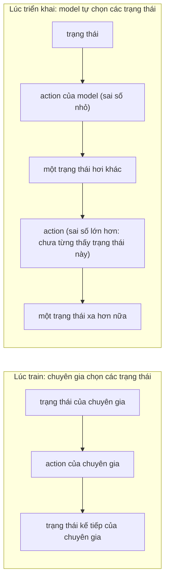

# 08 · Nền tảng học bắt chước

*Bản tiếng Việt · [English](08-imitation-learning.md)*

*Bản tiếng Việt · [English](08-imitation-learning.vi.md)*

## Ta đang giải bài toán gì?

Viết tay một policy lái xe được khi bạn phát biểu được luật (pure pursuit), và thất bại khi
bạn không phát biểu được ("cứ đi trên thứ gì trông giống con đường"). Học bắt chước
(imitation learning) thay luật bằng ví dụ: ghi lại một người lái giỏi, rồi train một model làm
những gì họ đã làm.

## Vì sao điều đó quan trọng ở đây?

Đây chính là vòng mà việc fine-tune một VLA phải đi qua. Repository chạy nó từ đầu tới cuối
trong vài phút với một mạng 0,3 triệu tham số thay cho SmolVLA, để gặp các kiểu hỏng của nó
với chi phí thấp. Kiểu hỏng quan trọng nhất, trong chương này, là **một model có thể chép
teacher gần như hoàn hảo mà vẫn không lái được.**

## Từ học có giám sát tới behaviour cloning

**Học có giám sát.** Cho các cặp $(x_i, y_i)$, tìm tham số $\theta$ của một hàm $f_\theta$
làm nhỏ nhất loss trung bình $\frac{1}{n}\sum_i \mathcal{L}(f_\theta(x_i), y_i)$. Nó hiệu quả
khi các đầu vào gặp sau khi train đến từ cùng phân phối với đầu vào lúc train.

**Behaviour cloning (BC)** là học có giám sát áp dụng cho một người làm mẫu:

| Học có giám sát | Behaviour cloning trong repository này |
|---|---|
| đầu vào $x$ | observation $o = $ (ảnh $96 \times 128 \times 3$, trạng thái `[speed, steer]`) |
| nhãn $y$ | kế hoạch của chuyên gia: 16 action tương lai `[steer, throttle]`, cách nhau 0,1 s |
| model $f_\theta$ | [`ChunkNet`](../../drive/learn/model.py#L11) |
| loss | Smooth L1 giữa kế hoạch dự đoán và kế hoạch của chuyên gia |
| bộ dữ liệu | các episode ghi từ teacher (hoặc một người) |

$$\theta^* = \arg\min_\theta\ \mathbb{E}_{(o,\,a_{0:15}) \sim \mathcal{D}}\ \big[\,\mathcal{L}\big(\pi_\theta(o),\ a_{0:15}\big)\big]$$

**Các lần làm mẫu của chuyên gia** ở đây đến từ hai nguồn ([chương 9](09-dataset-pipeline.vi.md)):
teacher pure pursuit trong bộ mô phỏng, người nói ra kế hoạch ở mỗi khung hình, và các lần lái
ghi qua ROS 2, nơi kế hoạch được dựng lại từ các action xảy ra sau đó.

**Cặp observation–action trở thành cặp observation–kế hoạch.** Nhãn không phải một action
mà là 1,5 s action tiếp theo. "The label is a plan, not a class" (nhãn là một kế hoạch, không
phải một lớp) ([`docs/driving.vi.md`](../driving.vi.md)): không ai gán nhãn bằng tay.

## Cái bẫy: model tự chọn đầu vào của nó

Trong học có giám sát thông thường, một dự đoán sai chỉ tốn một lỗi và đầu vào tiếp theo vẫn
tới như thường. Trong lái xe, một dự đoán sai **làm xe di chuyển**, và đầu vào tiếp theo là
khung cảnh nhìn từ vị trí mới.



- **Lệch phân phối (distribution shift)**: bất kỳ khác biệt nào giữa dữ liệu model được train
  và dữ liệu nó gặp.
- **Covariate shift**: trường hợp đặc biệt khi *đầu vào* dịch chuyển trong khi câu trả lời đúng
  cho mỗi đầu vào vẫn giữ nguyên. Ở đây: steer đúng cho tình huống "lệch trái tâm đường 10 cm"
  không đổi; chỉ là model chưa bao giờ thấy khung cảnh đó.
- **Sai số tích luỹ (compounding errors)**: mỗi sai số làm sai số tiếp theo dễ xảy ra hơn.

### Sai số tích luỹ nhanh tới mức nào?

Giả sử model sai với xác suất $\epsilon$ mỗi bước trên các trạng thái của chuyên gia, trong
một episode $T$ bước. Ross và Bagnell (2010) chỉ ra rằng với behaviour cloning, tổng chi phí
kỳ vọng có thể tăng theo

$$J(\pi_\theta) \le J(\pi^*) + \mathcal{O}(\epsilon\,T^2)$$

bậc hai theo horizon: một lỗi sớm có thể làm hỏng mọi bước còn lại. Các phương pháp train
trên các trạng thái mà *model* đi qua (DAgger; Ross, Gordon và Bagnell 2011) đưa con số này
xuống $\mathcal{O}(\epsilon\,T)$.

Một lần lái đánh giá 40 s với 10 lượt suy luận mỗi giây là $T = 400$ quyết định. Một
$\epsilon$ nhỏ xíu không còn nhỏ khi đặt cạnh $T^2$.

## Cách sửa dùng ở đây: làm nhiễu việc lái, giữ nhãn sạch

Một bộ dữ liệu lái hoàn hảo chỉ chứa các trạng thái nằm trên đường tâm. Thứ model thiếu là
**hành vi hồi phục**: các ví dụ về việc lệch tâm kèm theo cách quay về đúng.

Ba cách để có chúng:

| Phương pháp | Cách làm | Chi phí | Ở đây |
|---|---|---|---|
| **DAgger** | chạy *model đang học*, nhờ chuyên gia gán nhãn cho các trạng thái nó đi tới, train lại, lặp lại | cần một chuyên gia luôn sẵn sàng và nhiều vòng | **[FUTURE]** (làm được trong bộ mô phỏng, nơi có thể hỏi teacher ở bất cứ đâu) |
| **DART** (Laskey và cộng sự 2017) | thêm nhiễu vào *action chuyên gia thực sự thực hiện* trong lúc ghi, và lưu action chuyên gia *định làm* làm nhãn | một lượt; cần biết action định làm | **đã hiện thực** trong `collect` |
| Camera phụ với độ lệch lái (Bojarski và cộng sự 2016) | tổng hợp khung cảnh lệch tâm | phần cứng và một heuristic | không dùng |

[`collect`](../../drive/learn/collect.py#L120) làm DART:

```python
steer, throttle = teacher.act(world.state)                          # điều teacher muốn
applied = np.array([clip(steer + disturbance.step(dt), -1, 1), throttle])
world.apply(applied, dt)                                            # điều xe nhận được
...
recorder.add(t, image, speed, steer_pos, applied, teacher.infer(obs))   # nhãn: kế hoạch sạch
```

- Xe **đi lang thang**, vì steer áp vào nó bị làm nhiễu.
- **Nhãn không bao giờ bị làm nhiễu**: ở mỗi khung hình được ghi, teacher nói ra kế hoạch nó
  sẽ đi theo *từ bất cứ chỗ nào xe đang ở*.
- Vì vậy bộ dữ liệu đầy các cặp "khung cảnh từ một chiếc xe lệch tâm, hơi lệch hướng" → "kế
  hoạch quay về đường tâm".

Nhiễu là một **quá trình Ornstein–Uhlenbeck** ([`Disturbance`](../../drive/learn/collect.py#L31)):
ngẫu nhiên, nhưng mượt theo thời gian.

$$n_{k+1} = n_k - n_k\,\frac{dt}{\tau_c} + \sigma\sqrt{\frac{2\,dt}{\tau_c}}\ \xi_k, \qquad \xi_k \sim \mathcal{N}(0, 1)$$

với cường độ $\sigma = 0.25$ (`--steer-noise`) và thời gian tương quan $\tau_c = 0.5$ s. Độ
lệch chuẩn về lâu dài của nó xấp xỉ $\sigma$. Vì sao không dùng nhiễu trắng? Nhiễu độc lập ở
50 Hz bị san phẳng qua servo và quán tính của xe, gần như không đẩy xe đi đâu. Nhiễu kéo dài
nửa giây đẩy xe lệch khỏi đường một quãng đáng kể, và đó chính là mục đích.

*Measured* trên `runs/drive/episodes/sim-000`: steer áp vào khác steer teacher định làm với
trung vị 0,19, và một lần chạy `collect` mặc định báo chiếc xe bị làm nhiễu đi lệch khỏi
đường tâm hàng chục centimet (63 cm trong một lần chạy 40 episode) trên một mặt đường rộng
90 cm.

Cũng được ngẫu nhiên hoá theo từng episode, để đa dạng: điểm xuất phát trên đường đua, độ
lệch ngang ±15 cm, độ lệch hướng ±0,2 rad, tốc độ mục tiêu của teacher (0,9–1,8 m/s), và
chiều chạy (luân phiên).

## Thí nghiệm nói lên tất cả

Cùng một dây chuyền, chạy hai lần: một lần với nhiễu mặc định, một lần với `--steer-noise 0`
vào `--project runs/perfect`. *Repo* (`docs/driving.md` và các báo cáo trong `runs/`):

| Dữ liệu train | Sai số steer trên tập validation | Số lần lái đạt | Trên đường peanut |
|---|---:|---:|---|
| steer bị làm nhiễu (`v1`) | 0.024 | 6/6 | 1,5 cm rms, không bao giờ ra khỏi đường |
| chỉ lái hoàn hảo | **0.015** | **0/6** | ra khỏi đường 75 % thời gian |

Model train trên dữ liệu lái hoàn hảo **tốt hơn** theo thước đo offline và **vô dụng** trên
đường. Các lần lái của nó trong `runs/perfect/reports/v1.json` kết thúc cách đường đua hàng
chục mét, ở 1,7 m/s, với luật tốc độ của supervisor bật bảy giây mỗi lần: một khi đã ra khỏi
đường, nó ở trong một thế giới chưa từng thấy, và mọi thứ nó làm ở đó đều vô nghĩa.

### Vì sao model tệ hơn lại có sai số offline thấp hơn?

1. **Nhiệm vụ của nó dễ hơn.** Mọi khung cảnh train đều nhìn từ đường tâm; ánh xạ từ ảnh sang
   kế hoạch hẹp và dễ fit.
2. **Tập validation của nó có cùng điểm mù.** Các episode lái hoàn hảo được giữ lại để
   validation cũng không có khung hình lệch tâm nào. Sai số validation đo model chép tốt tới
   đâu các khung hình *giống những khung hình nó đã được cho*; nó không nói gì về những khung
   hình model sẽ tự tạo ra.

Validation offline trả lời "model có đồng ý với chuyên gia trên các trạng thái của chuyên gia
không?" Lái xe hỏi "model có ở lại trong những trạng thái nó xử lý được không?" Chỉ một bài
test vòng kín trả lời được câu thứ hai ([chương 11](11-model-evaluation.vi.md)).

### Dây chuyền cảnh báo bạn

[`validate`](../../drive/learn/validate.py#L62) gắn cờ một bộ dữ liệu như vậy mà không cần
train gì. Với các episode do teacher gán nhãn, nó so steer đã *áp vào* với action đầu tiên của
kế hoạch (điều teacher *muốn*). Nếu chênh lệch trung vị, lấy trung bình qua các episode, nhỏ
hơn 0,02:

> WARN perfect driving only: the car never leaves the centerline, so a network trained
> on this cannot recover from its own errors (collect with --steer-noise)

(cảnh báo: chỉ lái hoàn hảo; xe không bao giờ rời đường tâm, nên một mạng train trên dữ liệu
này không thể hồi phục khỏi lỗi của chính nó; hãy collect với --steer-noise.)
(`ValidateTests.test_perfect_driving_and_single_episode_are_flagged`.)

## Độ đa dạng của bộ dữ liệu

Dữ liệu hồi phục chỉ là một trục bao phủ. Các trục khác, và cách dự án xử lý chúng:

| Trục | Rủi ro nếu thiếu | Được xử lý bởi |
|---|---|---|
| Vị trí ngang và hướng | không hồi phục được | steer bị làm nhiễu; độ lệch xuất phát ngẫu nhiên |
| Cua trái và cua phải | thiên lệch về một bên | luân phiên chiều chạy; augmentation lật gương ([chương 10](10-model-training.vi.md)) |
| Tốc độ | dễ gãy ngoài một tốc độ | mỗi episode một tốc độ mục tiêu khác |
| Hình dạng đường | thuộc lòng một đường đua | `--tracks`; đánh giá trên đường đua chưa từng train |
| Vẻ ngoài | bám vào đúng màu sắc | augmentation độ sáng; cỏ lốm đốm. **Mỏng**: một bộ mô phỏng, một vẻ ngoài |
| Tác nhân khác, vật cản | không phản ứng với chúng | **chưa xử lý**: policy không bao giờ thấy lý do để dừng |

`validate` báo tỷ lệ trái / thẳng / phải của steer và khoảng tốc độ, để thấy được bộ dữ liệu
mất cân bằng trước khi train.

### Một giới hạn tinh tế: thứ ảnh không cho thấy

*Repo:* các mạng lái ở 0,84–0,90 m/s; teacher của chúng ở 1,47 m/s. `docs/driving.md` giải
thích: "its target speed changed per episode and is not in the image, so they settle on a
cautious average." (tốc độ mục tiêu của nó đổi theo từng episode và không có trong ảnh, nên
chúng chọn một mức trung bình thận trọng.)

Bài học chung: khi action của chuyên gia phụ thuộc vào thứ model không quan sát được (ở đây là
tốc độ mục tiêu theo từng episode), hồi quy không khôi phục được nó. Nó dự đoán một trung bình
theo nguyên nhân bị ẩn. Nếu bạn muốn model tuân theo một tốc độ, tốc độ đó phải là một *đầu
vào* (với VLA, nó có thể là một phần của câu mô tả nhiệm vụ).

## Những lỗi và hiểu lầm thường gặp

- **"Loss validation thấp hơn nghĩa là lái giỏi hơn."** Đã chứng minh là sai ở trên.
- **"Nhiễu trong dữ liệu dạy model lái nhiễu."** Chỉ khi nhiễu nằm trong *nhãn*. Ở đây nó nằm
  trong action được thực hiện; nhãn thì sạch.
- **"Thêm dữ liệu sẽ sửa được covariate shift."** Thêm dữ liệu *giống hệt* thì không. Dữ liệu từ
  các trạng thái model đi tới thì có.
- **"Làm nhiễu tay lái là data augmentation."** Augmentation biến đổi các mẫu đã ghi. Việc này
  thay đổi những trạng thái nào được *đi qua*, điều không phép biến đổi nào trên ảnh đường
  tâm làm được.
- **"Các lần lái của một người tốt ngang teacher."** Một người không cho ra kế hoạch sạch: nhãn
  là những gì họ thực sự đã làm, gồm cả các lần sửa và các lỗi của họ
  ([chương 9](09-dataset-pipeline.vi.md), `label`). Và một người cẩn thận sẽ tạo ra "chỉ lái
  hoàn hảo".

## Thí nghiệm thực hành

Xem cơ chế, rồi đo nó.

```bash
# 1. Xem dữ liệu bị làm nhiễu trông thế nào (cửa sổ; q để dừng)
make collect ARGS='--project runs/demo --episodes 2 --show'
make collect ARGS='--project runs/demo0 --episodes 2 --steer-noise 0 --show'

# 2. Phép so sánh đầy đủ (khoảng 3 phút; cần container)
make collect  ARGS='--project runs/noise0 --steer-noise 0'
make validate ARGS='--project runs/noise0'          # chờ đợi cảnh báo "perfect driving only"
make train    V=v1 ARGS='--project runs/noise0'
make evaluate V=v1 ARGS='--project runs/noise0'
```

Trước khi chạy bước 2, ghi lại bạn đoán sai số steer trên tập validation và số lần lái đạt
là bao nhiêu.

## Kiểm tra kiến thức

1. Lệch phân phối và covariate shift khác nhau thế nào?
2. Trong `collect`, đại lượng nào bị làm nhiễu và đại lượng nào được ghi làm nhãn?
3. Vì sao nhiễu có tương quan theo thời gian?
4. Vì sao model lái hoàn hảo có sai số validation *thấp hơn*?
5. DAgger cần thứ gì mà DART không cần?
6. CNN lái chậm hơn teacher. Điều đó cho bạn biết gì về đầu vào của nó?

<details><summary>Đáp án</summary>

1. Lệch phân phối là mọi khác biệt giữa lúc train và lúc triển khai; covariate shift là khác biệt chỉ ở đầu vào, với output đúng cho mỗi đầu vào không đổi.
2. Steer áp vào xe bị làm nhiễu; nhãn là kế hoạch sạch của teacher tính từ trạng thái mà xe rơi vào.
3. Để nó thực sự đẩy xe đi. Nhiễu không tương quan bị servo và động lực học của xe lọc mất.
4. Dữ liệu train và validation của nó đều chỉ có khung cảnh đường tâm, một ánh xạ dễ hơn và hẹp hơn.
5. Chạy model đang học trong vòng lặp và hỏi chuyên gia trên các trạng thái model đi qua, trong nhiều vòng.
6. Một thứ teacher đã dùng (tốc độ mục tiêu của nó) không quan sát được từ ảnh và trạng thái.
</details>

## Đọc thêm

- Pomerleau 1988, *ALVINN*: mạng nơ-ron đầu tiên lái một chiếc xe, và cũng là mạng đầu tiên gặp bài toán này.
- Ross và Bagnell 2010, *Efficient Reductions for Imitation Learning*: cận $\epsilon T^2$.
- Ross, Gordon và Bagnell 2011 (DAgger).
- Laskey và cộng sự 2017, *DART: Noise Injection for Robust Imitation Learning*: phương pháp dùng ở đây.
- Codevilla và cộng sự 2019, *Exploring the Limitations of Behavior Cloning for Autonomous Driving*.
- Osa và cộng sự 2018, *An Algorithmic Perspective on Imitation Learning*, cho cái nhìn toàn cảnh về lĩnh vực.
