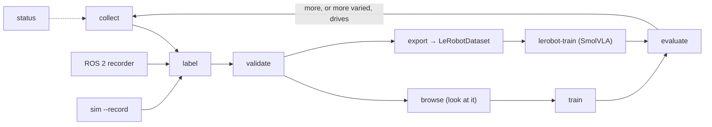

# 09 · Dataset pipeline

## What problem are we solving?

Between "a car drove" and "a network drives" there are several steps, and a mistake in
any of them produces a model that trains without complaint and drives badly. The
pipeline makes each step a separate, inspectable stage.



The last three boxes are the route to a VLA: `export` and the `vla` policy are in this
repository; `lerobot-train` is LeRobot's ([chapter 13](13-vla-and-smolvla.md),
[Lab 15](15-hands-on-labs.md#lab-15-fine-tune-smolvla-on-the-driving-data-on-this-laptop)).

All stages are **[TESTED]** in [`tests/test_drive_learn.py`](../../tests/test_drive_learn.py).

## How a stage is defined

A stage is a module in [`drive/learn/`](../../drive/learn) with two functions:

```python
def add_parser(subparsers): ...        # its command-line arguments
def run(project, args) -> int: ...     # do it; the return value is the exit code
```

and an entry in [`STAGES`](../../drive/learn/__init__.py#L17). The CLI
([`cli.main`](../../drive/cli.py#L143)) registers every stage's parser and dispatches
by name. Adding a stage is writing that module and listing it.

## The project directory

[`Project`](../../drive/learn/project.py#L18) is the single place that knows where
files live. Default `runs/drive`; every stage takes `--project DIR`.

```
runs/drive/
├── episodes/
│   └── sim-000/
│       ├── episode.npz     the recording
│       ├── meta.json       what the columns mean
│       └── labels.npz      the plans (may be absent until `label`)
├── models/
│   ├── v1.pt               weights and metadata
│   └── v1.json             the training report
└── reports/
    └── v1.json             an evaluation
```

`runs/` is in `.gitignore`: datasets and models are local.

## The episode format

Written by [`Recorder.save`](../../drive/recorder.py#L45).

### `episode.npz`

| Array | Shape | dtype | Meaning |
|---|---|---|---|
| `t` | `(N,)` | float32 | seconds since the episode's first frame |
| `images` | `(N, 240, 320, 3)` | uint8 | RGB camera frames |
| `states` | `(N, 2)` | float32 | `[speed in m/s, steering position in -1..1]` |
| `actions` | `(N, 2)` | float32 | `[steer, throttle]` that was **on the motors** at that instant |

The arrays line up by index: `images[i]` and `states[i]` were seen at `t[i]`, and
`actions[i]` was being applied then.

### `meta.json`

```json
{"task": "drive along the track", "fps": 10.0, "frames": 300,
 "state": ["speed_mps", "steer"], "action": ["steer", "throttle"],
 "image": "uint8 HxWx3 RGB"}
```

### `labels.npz`

Written by [`write_labels`](../../drive/learn/label.py#L38).

| Array | Shape | dtype | Meaning |
|---|---|---|---|
| `plans` | `(N, 16, 2)` | float32 | for each frame, the next 16 actions, 0.1 s apart |
| `valid` | `(N,)` | bool | false where no full plan exists (the end of a recording) |
| `dt` | scalar | float64 | seconds between a plan's actions: 0.1 |
| `source` | scalar | str | `"teacher"` or `"actions"` |

Labels live in a separate file so that **re-labelling never touches a recording.**

### Reading one episode

```python
import json
from pathlib import Path
import numpy as np

episode = Path("runs/drive/episodes/sim-000")
data   = np.load(episode / "episode.npz")
labels = np.load(episode / "labels.npz")
meta   = json.loads((episode / "meta.json").read_text())

for name in data.files:
    print(name, data[name].shape, data[name].dtype)
# t       (300,)              float32
# images  (300, 240, 320, 3)  uint8
# states  (300, 2)            float32
# actions (300, 2)            float32

i = 100
print(data["t"][i])            # 10.0
print(data["states"][i])       # [0.906 0.278]   speed 0.91 m/s, wheels 0.28 left
print(data["actions"][i])      # [0.254 0.109]   what was applied (disturbed)
print(labels["plans"][i][:3])  # [[0.511 0.109] [0.504 0.109] [0.482 0.109]]  what the teacher wanted next
print(float(labels["dt"]), str(labels["source"]), labels["valid"][i])   # 0.1 teacher True

import cv2                     # the image is RGB; OpenCV writes BGR
cv2.imwrite("/tmp/frame.png", cv2.cvtColor(data["images"][i], cv2.COLOR_RGB2BGR))
```

(*Measured* output from the first episode of a default `collect`.) Note the gap between
the applied steer (0.254) and the teacher's intended first action (0.511): that is the
disturbance of [chapter 8](08-imitation-learning.md), visible in a single frame.

In code, use the helpers rather than opening files by hand:
[`episodes(directory)`](../../drive/learn/label.py#L21) lists the episode directories,
[`read_labels(episode)`](../../drive/learn/label.py#L43) returns a dict or `None`, and
[`dataset.load(directory)`](../../drive/learn/dataset.py#L44) returns everything ready
for training.

An episode of 300 frames is about 3.4 MB compressed (69 MB raw: the images dominate).

## The stages

### 1. `collect`

| | |
|---|---|
| **Purpose** | Record the pure-pursuit teacher driving with disturbed steering |
| **Input** | none (the simulator) |
| **Output** | `episodes/<name>-NNN/` with `episode.npz`, `meta.json` **and** `labels.npz` (source `teacher`) |
| **Source** | [`collect`](../../drive/learn/collect.py#L120), [`Disturbance`](../../drive/learn/collect.py#L31), [`Recorder`](../../drive/recorder.py#L12) |
| **CLI** | `./drive.sh collect [--project DIR] [--name sim] [--episodes 40] [--duration-s 30] [--tracks peanut] [--steer-noise 0.25] [--seed 0] [--show] [--video FILE]` |

Per episode: choose track and direction; place the car at a random point, off-centre
and askew; draw a target speed in 0.9–1.8 m/s; run at 50 Hz, sampling at 10 Hz. The
defaults give 40 × 300 = 12 000 frames in about 35 s.

**What is recorded at each sample** (`recorder.add`): the time, the camera image, the
state, the action applied on the *previous* tick, and the teacher's fresh plan
(16 × 0.1 s) from the current state.

**Determinism.** Everything random derives from `--seed` and the episode index
(`np.random.default_rng([seed, index])`), so a seed reproduces a dataset bit for bit
(`CollectTests.test_reproducible_and_refuses_to_overwrite`).

**Common errors**

| Message | Cause | Fix |
|---|---|---|
| `… already has episodes named sim-*; choose another --name, and another --seed unless you want the same drives again` | the name exists; collect never overwrites | `--name sim2 --seed 100` |
| (no error, but no new information) | a new `--name` with the old `--seed` records identical drives | change the seed as well |

`--show` opens a window and runs in real time; `--video` writes the same view. Neither
changes what is recorded (`CollectTests.test_watching_does_not_change_the_recording`).

### 2. `label`

| | |
|---|---|
| **Purpose** | Give a plan to episodes recorded without one (ROS 2, a person, `sim --record`) |
| **Input** | `episode.npz` |
| **Output** | `labels.npz`, source `actions` |
| **Source** | [`plans_from_actions`](../../drive/learn/label.py#L26), [`label`](../../drive/learn/label.py#L52) |
| **CLI** | `./drive.sh label [--project DIR] [--relabel]` |

With no teacher to ask, the plan for frame $i$ is **what was actually done next**:

$$\text{plan}_i[k] = a\big(t_i + k \cdot 0.1\big), \qquad k = 0, \dots, 15$$

where $a(\cdot)$ is the recorded action signal, linearly interpolated (`np.interp`), so
a recording at any rate yields plans on the 0.1 s grid. A frame is **valid** only if
its whole plan lies inside the recording: $t_i + 1.5 \le t_{\text{end}}$. The last
1.5 s of every drive has no complete future and is excluded from training.

*Measured:* `ros-000` has 439 frames, 424 valid (the last 15 are not).

By default only unlabelled episodes are touched; `--relabel` replaces existing labels,
**including a teacher's**, which you almost never want.

### 3. `validate`

| | |
|---|---|
| **Purpose** | Decide whether the dataset is fit to train on, before spending time on it |
| **Input** | all episodes |
| **Output** | a printed report; exit code 0 if no failure, 1 otherwise |
| **Source** | [`check_episode`](../../drive/learn/validate.py#L15), [`validate`](../../drive/learn/validate.py#L62) |
| **CLI** | `./drive.sh validate [--project DIR]` |

**FAIL**: training on it would be wrong or impossible.

| Check | Level |
|---|---|
| file unreadable, or a required array missing | per episode |
| arrays differ in length, or fewer than 2 frames | per episode |
| images not `uint8 (N, H, W, 3)` | per episode |
| NaN or infinity in states, actions or timestamps | per episode |
| an action outside $[-1, 1]$ | per episode |
| speed $< 0$ or $\lvert\text{steer}\rvert > 1$ in the state | per episode |
| timestamps that do not increase | per episode |
| labels that do not match the recording, or hold an action outside $[-1, 1]$ | per episode |
| only one episode (validation holds whole episodes out) | dataset |
| mixed image sizes | dataset |
| mixed plan length or time step | dataset |

**WARN**: it will train, but look first.

| Check | Level |
|---|---|
| recorded rate differs from `meta.json`'s `fps` by more than 20 % | per episode |
| gaps in time (a step over 2.5× the median) | per episode |
| frames identical to the previous one while the car moved (a frozen camera) | per episode |
| not labelled yet | per episode |
| fewer than 2000 frames in total | dataset |
| the car stands still in more than 20 % of frames | dataset |
| **perfect driving only** ([chapter 8](08-imitation-learning.md)) | dataset |

Example output (*measured* on a project holding 80 teacher episodes and 2 ROS 2 recordings):

```
82 episodes, 24876 frames, 41.3 min, images 240x320
  speed      0.0 to 1.74 m/s, mean 1.31
  steering   left 40 %, straight 21 %, right 39 %
  labels     24845 usable frames, from actions and teacher
dataset: ok
```

Read the steering split: left and right should be close. Here they are, because
`collect` alternates direction.

### 4. `browse`

| | |
|---|---|
| **Purpose** | Let a person judge whether the labels make sense |
| **Input** | episodes and labels |
| **Output** | a window, or `--video FILE` |
| **Source** | [`plan_path`](../../drive/learn/browse.py#L25), [`draw`](../../drive/learn/browse.py#L35), [`browse`](../../drive/learn/browse.py#L54) |
| **CLI** | `./drive.sh browse [--project DIR] [--match PATTERN] [--every N] [--video FILE]` |

For each frame it rolls the labelled plan forward with the vehicle model
(`plan_path`), projects the resulting path into the image
([`Camera.project`](../../drive/sim/render.py#L71)) and draws it in cyan.
**A good label's path follows the road.** A path that leaves the road, points the
wrong way, or is missing ("no usable label for this frame") is what you are looking for.

Keys: `d`/`a` next/previous frame, `n`/`p` next/previous episode, space to play, `q` to quit.
`--match 'sim2-*'` restricts it to some episodes (a shell pattern on the directory name).

This is the stage that replaces annotation. Nobody draws labels; somebody must still
*look* at them.

### 5. `train`

| | |
|---|---|
| **Purpose** | Fit the network to the plans |
| **Input** | all labelled, valid frames |
| **Output** | `models/<version>.pt` and `models/<version>.json` |
| **Source** | [`train`](../../drive/learn/train.py#L45); details in [chapter 10](10-model-training.md) |
| **CLI** | `./drive.sh train VERSION [--project DIR] [--epochs 15] [--device DEVICE] [--seed 0]` (`DEVICE` is `cuda` or `cpu`) |

| Message | Cause |
|---|---|
| `… is not labelled; run ./drive.sh label` | an episode has no `labels.npz` |
| `episodes disagree on the plan's (length, time step)` | labels made with different settings |
| `need at least two episodes to hold one out for validation` | a single episode |
| `… exists; a trained model is not replaced, choose another version` | versions are immutable |
| `training needs PyTorch …; use the container: make train` | run outside the container |

### 6. `evaluate`

| | |
|---|---|
| **Purpose** | Judge models by driving them |
| **Input** | model versions, checkpoint files, or `pure-pursuit` / `lane-camera` |
| **Output** | `reports/<name>.json`, a per-drive table, a comparison; exit code 0 only if every drive of every model passed |
| **Source** | [`evaluate`](../../drive/learn/evaluate.py#L22); details in [chapter 11](11-model-evaluation.md) |
| **CLI** | `./drive.sh evaluate MODEL [MODEL …] [--project DIR] [--tracks peanut,oval,trefoil] [--duration-s 40] [--latency-ms 100]` |

### 7. `status`

| | |
|---|---|
| **Purpose** | Say what the project holds and what to do next |
| **Source** | [`summary`](../../drive/learn/status.py#L11), [`next_step`](../../drive/learn/status.py#L33) |
| **CLI** | `./drive.sh status [--project DIR]` |

```
project runs/drive
  episodes   82: 24876 frames, 41.5 min
  labels     24845 usable frames (2 actions, 80 teacher)
  model      v1: 10800 frames, 15 epochs, validation steer error 0.0242; drives 6/6 passed, 1.3 cm rms off the centerline
  model      v2: 11645 frames, 15 epochs, validation steer error 0.0223; drives 6/6 passed, 1.2 cm rms off the centerline
  next       more or more varied episodes, then train the next version
```

`next_step` is a small state machine: no episodes → collect; unlabelled → label; no
model → validate and train; unevaluated model → evaluate; otherwise, more data.

> **Discrepancy to know about.** With no episodes, `next_step` suggests
> `make ros-drive RECORD=1`. The Makefile has no `RECORD` variable. The working
> commands are `make ros-record`, or `make ros-launch ARGS='record:=true'`.

### 8. `export`

| | |
|---|---|
| **Purpose** | Write the episodes as a LeRobotDataset, so LeRobot can fine-tune a VLA (SmolVLA) on them |
| **Input** | labelled episodes |
| **Output** | `<project>/lerobot/` (default): `meta/info.json`, `meta/stats.json`, Parquet tables, one AV1 video per camera |
| **Source** | [`frames`](../../drive/learn/export.py#L53), [`export`](../../drive/learn/export.py#L75) |
| **CLI** | `python -m drive export [--project DIR] [--out DIR] [--match PATTERN] [--action intended\|applied] [--repo-id local/vla-drive]` |
| **Status** | **[TESTED]**: `ExportTests` (the per-frame mapping always; writing and reading back when LeRobot is installed) |

It needs LeRobot, which the project's container does not have, so it runs with the
Python of a LeRobot environment ([Lab 15](15-hands-on-labs.md#lab-15-fine-tune-smolvla-on-the-driving-data-on-this-laptop)).
Without one it stops with "export needs LeRobot".

| Episode | LeRobot feature |
|---|---|
| `images[i]` | `observation.images.front`, video 240×320 |
| `states[i]` | `observation.state`: `[speed_mps, steer]` |
| `plans[i, 0]` (default, `--action intended`) or `actions[i]` (`--action applied`) | `action`: `[steer, throttle]` |
| `meta.json` `task` | `task` |

**Why the label's first action.** For a `collect` episode, `actions[i]` holds the
disturbed steering; `plans[i, 0]` is what the teacher wanted from that state (DART's
label). For an episode labelled from its actions, `plans[i, 0]` *is* `actions[i]`. So
the default is right for both.

*Measured* on the 82 episodes of `runs/drive`: 24 876 frames in 35 MB. Read back with LeRobot, states and actions match exactly and images differ
by about 1.5 / 255 on average (AV1 is lossy).

**Common errors**

| Message | Cause | Fix |
|---|---|---|
| `export needs LeRobot` | run with a Python that has no `lerobot` | use the LeRobot environment's Python |
| `… is not labelled; run ./drive.sh label` | an unlabelled episode | `./drive.sh label` |
| `… exists; a LeRobotDataset is written once` | the output directory exists | `--out` elsewhere, or remove it |
| `frames stray N ms from a steady 10 Hz` | an episode's timestamps drift by half a period or more; LeRobot assumes frame $i$ is at $i/\text{fps}$ | leave it out with `--match` |

> **A limit of the format.** LeRobot keeps one `action` per frame and builds the
> target chunk for frame $i$ from the actions of frames $i \dots i+15$. For `collect`
> episodes those are the teacher's intentions at the states the *disturbed* car
> reached next, not the clean plan the teacher stated at frame $i$ (which is what the
> CNN learns). *Measured* over the 80 teacher episodes, the two agree at step 0 and
> differ by a mean of 0.04 in steering 0.1 s ahead, 0.13 at 0.3 s and about 0.2 from
> 0.5 s on (for scale, mean |steer| in the plans is 0.24). The far end of a SmolVLA
> chunk is therefore learned from a noisier target than the CNN's
> ([chapter 13](13-vla-and-smolvla.md)).

## Three ways an episode is born

| Source | Command | Labels | Disturbed? |
|---|---|---|---|
| Teacher in the simulator | `make collect` | `teacher`, written at once | yes |
| ROS 2 recorder | `make ros-record`, Ctrl-C to save | none → `make label` → `actions` | only if whoever drives wanders |
| Simulated drive | `./drive.sh sim --record DIR` | none → `label` | no |

The recorder node ([`RecorderNode`](../../ros/src/drive_ros/drive_ros/recorder_node.py#L21))
listens to `/drive/image`, `/drive/state` and `/drive/cmd`, starts when the first
command is heard, samples at 10 Hz on the image's timestamp, and names the episode
`<name>-NNN` after the count of existing ones.

## From episodes to arrays: `dataset.load`

[`load`](../../drive/learn/dataset.py#L44) concatenates every valid frame of every
episode into a [`Dataset`](../../drive/learn/dataset.py#L21):

| Field | Shape (12 000 frames) |
|---|---|
| `images` | `(12000, 96, 128, 3)` uint8, shrunk with `cv2.INTER_AREA` |
| `states` | `(12000, 2)` float32 |
| `plans` | `(12000, 16, 2)` float32 |
| `episode` | `(12000,)` int: which episode each frame came from |
| `plan_dt` | 0.1 |

[`Dataset.split`](../../drive/learn/dataset.py#L31) holds out the **last 10 % of
episodes, whole** (at least one). Frames 0.1 s apart are near-duplicates; splitting by
frame would put almost every validation frame's twin in the training set and make the
validation error meaningless (`DatasetTests.test_load_and_split_by_episode`).

> **Consequence to know about.** "Last" means last in sorted directory order. With
> `ros-*` and `sim-*` episodes, the held-out ones are always the final `sim-*` (or
> `sim2-*`). ROS 2 recordings never appear in validation.

## Common mistakes and misconceptions

- **"`actions[i]` is the label."** It is what was applied, which for teacher episodes
  includes the disturbance. The label is `plans[i]`.
- **"`label` improves labels."** `--relabel` on teacher episodes *replaces clean plans
  with disturbed actions*.
- **"validate passed, so the data is good."** It checked consistency and a few
  statistics. Only `browse` shows whether the plans follow the road.
- **"I collected again and got more data."** Not with the same seed.
- **"Images are BGR because OpenCV."** Episodes store RGB; convert only at the
  boundary with OpenCV's display and file functions.

## Practical experiment

Break a dataset on purpose and see `validate` catch it.

```bash
./drive.sh collect --project runs/broken --episodes 3 --duration-s 5
python3 - <<'EOF'
import numpy as np
p = "runs/broken/episodes/sim-001/episode.npz"
d = dict(np.load(p)); d["actions"][10, 0] = np.nan
np.savez_compressed(p, **d)
EOF
./drive.sh validate --project runs/broken; echo "exit code $?"
```

Then try other faults: a timestamp that goes backwards, an action of 1.5, a duplicated
image. Predict FAIL or WARN before each.

## Knowledge check

1. What are the shapes of the four arrays in `episode.npz` for a 30 s episode at 10 Hz?
2. How does a plan come to exist for a ROS 2 recording?
3. Why are the last 15 frames of a 10 Hz recording invalid?
4. Why is the validation split made by episode?
5. Name two things `validate` cannot tell you.

<details><summary>Answers</summary>

1. `t (300,)`, `images (300, 240, 320, 3)`, `states (300, 2)`, `actions (300, 2)`.
2. `label` takes, for each frame, the 16 actions recorded over the following 1.5 s.
3. Their plan would extend past the end of the recording.
4. Neighbouring frames are nearly identical; a per-frame split leaks the validation set into training.
5. Whether the labelled paths actually follow the road (that is `browse`), and whether a model trained on the data can drive (that is `evaluate`).
</details>

## Further reading

- NumPy: `savez_compressed` and the `.npz` format.
- LeRobot dataset documentation, for the format these episodes would be converted to ([chapter 13](13-vla-and-smolvla.md)).
- Laskey et al. 2017 (DART), for why `collect` records what it records.
