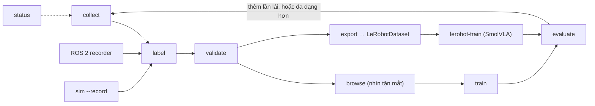

# 09 · Dây chuyền dữ liệu

*Bản tiếng Việt · [English](09-dataset-pipeline.md)*

*Bản tiếng Việt · [English](09-dataset-pipeline.vi.md)*

## Ta đang giải bài toán gì?

Giữa "một chiếc xe đã lái" và "một mạng lái được" có nhiều bước, và một lỗi ở bất kỳ bước nào
cũng tạo ra một model train êm ru mà lái tệ. Dây chuyền biến mỗi bước thành một giai đoạn
riêng, xem xét được.



Ba ô cuối là con đường tới một VLA: `export` và policy `vla` nằm trong repository này;
`lerobot-train` là của LeRobot ([chương 13](13-vla-and-smolvla.vi.md),
[Lab 15](15-hands-on-labs.vi.md#lab-15-fine-tune-smolvla-trên-dữ-liệu-lái-xe-ngay-trên-laptop-này)).

Mọi giai đoạn đều **[TESTED]** trong [`tests/test_drive_learn.py`](../../tests/test_drive_learn.py).

## Một giai đoạn được định nghĩa thế nào

Một giai đoạn là một module trong [`drive/learn/`](../../drive/learn) có hai hàm:

```python
def add_parser(subparsers): ...        # các tham số dòng lệnh của nó
def run(project, args) -> int: ...     # làm việc; giá trị trả về là exit code
```

và một mục trong [`STAGES`](../../drive/learn/__init__.py#L17). CLI
([`cli.main`](../../drive/cli.py#L148)) đăng ký parser của mọi giai đoạn và điều phối theo
tên. Thêm một giai đoạn là viết module đó và liệt kê nó.

## Thư mục project

[`Project`](../../drive/learn/project.py#L18) là nơi duy nhất biết các file nằm ở đâu. Mặc
định `runs/drive`; mọi giai đoạn nhận `--project DIR`.

```
runs/drive/
├── episodes/
│   └── sim-000/
│       ├── episode.npz     bản ghi
│       ├── meta.json       các cột nghĩa là gì
│       └── labels.npz      các kế hoạch (có thể chưa có cho tới khi `label`)
├── models/
│   ├── v1.pt               trọng số và metadata
│   └── v1.json             báo cáo train
└── reports/
    └── v1.json             một lần đánh giá
```

`runs/` nằm trong `.gitignore`: bộ dữ liệu và model là cục bộ.

## Định dạng episode

Được ghi bởi [`Recorder.save`](../../drive/recorder.py#L46).

### `episode.npz`

| Mảng | Shape | dtype | Nghĩa |
|---|---|---|---|
| `t` | `(N,)` | float32 | số giây kể từ khung hình đầu tiên của episode |
| `images` | `(N, 240, 320, 3)` | uint8 | các khung hình camera RGB |
| `states` | `(N, 2)` | float32 | `[tốc độ m/s, vị trí tay lái trong -1..1]` |
| `actions` | `(N, 2)` | float32 | `[steer, throttle]` đang **ở trên động cơ** tại thời điểm đó |

Các mảng thẳng hàng theo chỉ số: `images[i]` và `states[i]` được thấy tại `t[i]`, và
`actions[i]` là thứ đang được áp vào lúc đó.

### `meta.json`

```json
{"task": "drive along the track", "fps": 10.0, "frames": 300,
 "state": ["speed_mps", "steer"], "action": ["steer", "throttle"],
 "image": "uint8 HxWx3 RGB"}
```

### `labels.npz`

Được ghi bởi [`write_labels`](../../drive/learn/label.py#L38).

| Mảng | Shape | dtype | Nghĩa |
|---|---|---|---|
| `plans` | `(N, 16, 2)` | float32 | với mỗi khung hình, 16 action tiếp theo, cách nhau 0,1 s |
| `valid` | `(N,)` | bool | false ở những chỗ không có kế hoạch đầy đủ (cuối bản ghi) |
| `dt` | scalar | float64 | số giây giữa các action của một kế hoạch: 0,1 |
| `source` | scalar | str | `"teacher"` hoặc `"actions"` |

Nhãn nằm trong một file riêng để **gán nhãn lại không bao giờ đụng tới bản ghi.**

### Đọc một episode

```python
import json
from pathlib import Path
import numpy as np

episode = Path("runs/drive/episodes/sim-000")
data   = np.load(episode / "episode.npz")
labels = np.load(episode / "labels.npz")
meta   = json.loads((episode / "meta.json").read_text())

for name in data.files:
    print(name, data[name].shape, data[name].dtype)
# t       (300,)              float32
# images  (300, 240, 320, 3)  uint8
# states  (300, 2)            float32
# actions (300, 2)            float32

i = 100
print(data["t"][i])            # 10.0
print(data["states"][i])       # [0.906 0.278]   tốc độ 0,91 m/s, bánh xe lệch trái 0,28
print(data["actions"][i])      # [0.254 0.109]   thứ đã được áp vào (bị làm nhiễu)
print(labels["plans"][i][:3])  # [[0.511 0.109] [0.504 0.109] [0.482 0.109]]  thứ teacher muốn làm tiếp
print(float(labels["dt"]), str(labels["source"]), labels["valid"][i])   # 0.1 teacher True

import cv2                     # ảnh là RGB; OpenCV ghi BGR
cv2.imwrite("/tmp/frame.png", cv2.cvtColor(data["images"][i], cv2.COLOR_RGB2BGR))
```

(Output *measured* từ episode đầu tiên của một lần `collect` mặc định.) Để ý khoảng cách giữa
steer đã áp vào (0,254) và action đầu tiên teacher định làm (0,511): đó là nhiễu của
[chương 8](08-imitation-learning.vi.md), thấy được chỉ trong một khung hình.

Trong code, hãy dùng các hàm hỗ trợ thay vì tự mở file:
[`episodes(directory)`](../../drive/learn/label.py#L21) liệt kê các thư mục episode,
[`read_labels(episode)`](../../drive/learn/label.py#L43) trả về một dict hoặc `None`, và
[`dataset.load(directory)`](../../drive/learn/dataset.py#L44) trả về mọi thứ sẵn sàng để train.

Một episode 300 khung hình nặng khoảng 3,4 MB khi nén (69 MB khi chưa nén: ảnh chiếm phần lớn).

## Các giai đoạn

### 1. `collect`

| | |
|---|---|
| **Mục đích** | Ghi lại teacher pure pursuit lái với steer bị làm nhiễu |
| **Đầu vào** | không có (bộ mô phỏng) |
| **Đầu ra** | `episodes/<name>-NNN/` với `episode.npz`, `meta.json` **và** `labels.npz` (source `teacher`) |
| **Mã nguồn** | [`collect`](../../drive/learn/collect.py#L120), [`Disturbance`](../../drive/learn/collect.py#L31), [`Recorder`](../../drive/recorder.py#L13) |
| **CLI** | `./drive.sh collect [--project DIR] [--name sim] [--episodes 40] [--duration-s 30] [--tracks peanut] [--speeds 0.9,1.8] [--steer-noise 0.25] [--seed 0] [--show] [--video FILE] [--driver teacher\|cnn --checkpoint V [--beta 0]]` |

Với mỗi episode: chọn đường đua và chiều chạy; đặt xe ở một điểm ngẫu nhiên, lệch tâm và lệch
hướng; rút một tốc độ mục tiêu trong 0,9–1,8 m/s (`--speeds`; một giá trị thì cố định nó);
chạy ở 50 Hz, lấy mẫu ở 10 Hz. Giá trị mặc định cho 40 × 300 = 12 000 khung hình trong khoảng
35 s. Dòng cuối của output đếm số khung hình được ghi khi xe đã ra khỏi đường; trên 5 % thì nó
cảnh báo rằng nhiễu mạnh hơn mức teacher sửa được. Với `--driver cnn --checkpoint v1`, một
mạng đã train lái qua vòng điều khiển và supervisor trong khi teacher gán nhãn mọi khung hình:
đó là DAgger (Ross và cộng sự 2011), được làm từng bước trong
[docs/thuc-hanh, bài 7](../thuc-hanh/07-debug-chuyen-nghiep.md).

**Thứ được ghi ở mỗi mẫu** (`recorder.add`): thời điểm, ảnh camera, trạng thái, action đã áp
vào ở nhịp *trước*, và kế hoạch mới của teacher (16 × 0,1 s) tính từ trạng thái hiện tại.

**Tính tất định.** Mọi thứ ngẫu nhiên đều suy ra từ `--seed` và chỉ số episode
(`np.random.default_rng([seed, index])`), nên một seed tái tạo một bộ dữ liệu giống từng bit
(`CollectTests.test_reproducible_and_refuses_to_overwrite`).

**Các lỗi thường gặp**

| Thông báo | Nguyên nhân | Cách sửa |
|---|---|---|
| `… already has episodes named sim-*; choose another --name, and another --seed unless you want the same drives again` | tên đã tồn tại; collect không bao giờ ghi đè | `--name sim2 --seed 100` |
| (không lỗi, nhưng không có thông tin mới) | một `--name` mới với `--seed` cũ ghi lại đúng những lần lái giống hệt | đổi cả seed |

`--show` mở một cửa sổ và chạy theo thời gian thật; `--video` ghi cùng khung cảnh đó. Cả hai
không thay đổi những gì được ghi (`CollectTests.test_watching_does_not_change_the_recording`).

### 2. `label`

| | |
|---|---|
| **Mục đích** | Cho một kế hoạch tới các episode được ghi mà không có kế hoạch (ROS 2, một người, `sim --record`) |
| **Đầu vào** | `episode.npz` |
| **Đầu ra** | `labels.npz`, source `actions` |
| **Mã nguồn** | [`plans_from_actions`](../../drive/learn/label.py#L26), [`label`](../../drive/learn/label.py#L52) |
| **CLI** | `./drive.sh label [--project DIR] [--relabel]` |

Không có teacher để hỏi, kế hoạch cho khung hình $i$ là **những gì thực sự đã được làm tiếp theo**:

$$\text{plan}_i[k] = a\big(t_i + k \cdot 0.1\big), \qquad k = 0, \dots, 15$$

trong đó $a(\cdot)$ là tín hiệu action đã ghi, nội suy tuyến tính (`np.interp`), nên một bản
ghi ở bất kỳ tần số nào cũng cho ra kế hoạch trên lưới 0,1 s. Một khung hình chỉ **hợp lệ**
nếu cả kế hoạch của nó nằm trong bản ghi: $t_i + 1.5 \le t_{\text{end}}$. 1,5 s cuối của mọi
lần lái không có tương lai đầy đủ và bị loại khỏi train.

*Measured:* `ros-000` có 439 khung hình, 424 hợp lệ (15 khung cuối thì không).

Mặc định chỉ các episode chưa có nhãn được đụng tới; `--relabel` thay các nhãn có sẵn, **kể
cả nhãn của teacher**, điều bạn gần như không bao giờ muốn.

### 3. `validate`

| | |
|---|---|
| **Mục đích** | Quyết định bộ dữ liệu có đủ tốt để train không, trước khi tốn thời gian cho nó |
| **Đầu vào** | mọi episode |
| **Đầu ra** | một báo cáo in ra; exit code 0 nếu không có lỗi FAIL, 1 nếu có |
| **Mã nguồn** | [`check_episode`](../../drive/learn/validate.py#L15), [`validate`](../../drive/learn/validate.py#L62) |
| **CLI** | `./drive.sh validate [--project DIR]` |

**FAIL**: train trên nó sẽ sai hoặc không thể.

| Phép kiểm tra | Cấp |
|---|---|
| không đọc được file, hoặc thiếu một mảng bắt buộc | từng episode |
| các mảng dài khác nhau, hoặc ít hơn 2 khung hình | từng episode |
| ảnh không phải `uint8 (N, H, W, 3)` | từng episode |
| NaN hoặc vô cực trong states, actions hoặc timestamp | từng episode |
| một action nằm ngoài $[-1, 1]$ | từng episode |
| tốc độ $< 0$ hoặc $\lvert\text{steer}\rvert > 1$ trong state | từng episode |
| timestamp không tăng dần | từng episode |
| nhãn không khớp với bản ghi, hoặc chứa action ngoài $[-1, 1]$ | từng episode |
| chỉ có một episode (validation giữ lại nguyên các episode) | bộ dữ liệu |
| kích thước ảnh lẫn lộn | bộ dữ liệu |
| độ dài kế hoạch hoặc bước thời gian lẫn lộn | bộ dữ liệu |

**WARN**: vẫn train được, nhưng hãy xem trước.

| Phép kiểm tra | Cấp |
|---|---|
| tần số ghi khác `fps` trong `meta.json` hơn 20 % | từng episode |
| có khoảng hở thời gian (một bước dài hơn 2,5× trung vị) | từng episode |
| khung hình giống hệt khung trước trong khi xe đang chạy (camera bị đứng hình) | từng episode |
| chưa được gán nhãn | từng episode |
| tổng cộng ít hơn 2000 khung hình | bộ dữ liệu |
| xe đứng yên trong hơn 20 % số khung hình | bộ dữ liệu |
| **chỉ lái hoàn hảo** ([chương 8](08-imitation-learning.vi.md)) | bộ dữ liệu |

Output mẫu (*measured* trên một project có 80 episode của teacher và 2 bản ghi ROS 2):

```
82 episodes, 24876 frames, 41.3 min, images 240x320
  speed      0.0 to 1.74 m/s, mean 1.31
  steering   left 40 %, straight 21 %, right 39 %
  labels     24845 usable frames, from actions and teacher
dataset: ok
```

Đọc tỷ lệ steer: trái và phải nên gần bằng nhau. Ở đây đúng là vậy, vì `collect` luân phiên
chiều chạy.

### 4. `browse`

| | |
|---|---|
| **Mục đích** | Để một người đánh giá các nhãn có hợp lý không |
| **Đầu vào** | các episode và nhãn |
| **Đầu ra** | một cửa sổ, hoặc `--video FILE` |
| **Mã nguồn** | [`plan_path`](../../drive/learn/browse.py#L25), [`draw`](../../drive/learn/browse.py#L35), [`browse`](../../drive/learn/browse.py#L54) |
| **CLI** | `./drive.sh browse [--project DIR] [--match PATTERN] [--every N] [--video FILE]` |

Với mỗi khung hình, nó cho kế hoạch đã gán nhãn chạy tới trước bằng mô hình xe (`plan_path`),
chiếu quỹ đạo thu được lên ảnh ([`Camera.project`](../../drive/sim/render.py#L71)) và vẽ nó
màu lục lam. **Quỹ đạo của một nhãn tốt đi theo con đường.** Một quỹ đạo đi ra khỏi đường,
chỉ sai hướng, hoặc bị thiếu ("no usable label for this frame") chính là thứ bạn cần tìm.

Phím: `d`/`a` khung hình tiếp/trước, `n`/`p` episode tiếp/trước, phím cách để phát, `q` để
thoát. `--match 'sim2-*'` giới hạn vào một số episode (một mẫu shell trên tên thư mục).

Đây là giai đoạn thay cho việc gán nhãn bằng tay. Không ai vẽ nhãn; nhưng vẫn phải có người
*nhìn* chúng.

### 5. `train`

| | |
|---|---|
| **Mục đích** | Fit mạng theo các kế hoạch |
| **Đầu vào** | mọi khung hình đã gán nhãn và hợp lệ |
| **Đầu ra** | `models/<version>.pt` và `models/<version>.json` |
| **Mã nguồn** | [`train`](../../drive/learn/train.py#L45); chi tiết ở [chương 10](10-model-training.vi.md) |
| **CLI** | `./drive.sh train VERSION [--project DIR] [--epochs 15] [--batch 128] [--lr 0.001] [--no-augmentation] [--device DEVICE] [--seed 0]` (`DEVICE` là `cuda`, `mps` hoặc `cpu`) |

| Thông báo | Nguyên nhân |
|---|---|
| `… is not labelled; run ./drive.sh label` | một episode không có `labels.npz` |
| `episodes disagree on the plan's (length, time step)` | nhãn được tạo với thiết lập khác nhau |
| `need at least two episodes to hold one out for validation` | chỉ có một episode |
| `… exists; a trained model is not replaced, choose another version` | các phiên bản là bất biến |
| `training needs PyTorch …; use the container: make train` | chạy bên ngoài container |

### 6. `evaluate`

| | |
|---|---|
| **Mục đích** | Đánh giá model bằng cách cho chúng lái |
| **Đầu vào** | các phiên bản model, file checkpoint, hoặc `pure-pursuit` / `lane-camera` |
| **Đầu ra** | `reports/<name>.json`, một bảng từng lần lái, một bảng so sánh; exit code 0 chỉ khi mọi lần lái của mọi model đều đạt |
| **Mã nguồn** | [`evaluate`](../../drive/learn/evaluate.py#L22); chi tiết ở [chương 11](11-model-evaluation.vi.md) |
| **CLI** | `./drive.sh evaluate MODEL [MODEL …] [--project DIR] [--tracks peanut,oval,trefoil] [--duration-s 40] [--latency-ms 100] [--max-plan-age-ms 600]` |

### 7. `status`

| | |
|---|---|
| **Mục đích** | Nói project đang có gì và việc tiếp theo là gì |
| **Mã nguồn** | [`summary`](../../drive/learn/status.py#L11), [`next_step`](../../drive/learn/status.py#L33) |
| **CLI** | `./drive.sh status [--project DIR]` |

```
project runs/drive
  episodes   82: 24876 frames, 41.5 min
  labels     24845 usable frames (2 actions, 80 teacher)
  model      v1: 10800 frames, 15 epochs, validation steer error 0.0242; drives 6/6 passed, 1.3 cm rms off the centerline
  model      v2: 11645 frames, 15 epochs, validation steer error 0.0223; drives 6/6 passed, 1.2 cm rms off the centerline
  next       more or more varied episodes, then train the next version
```

`next_step` là một máy trạng thái nhỏ: chưa có episode → collect; chưa gán nhãn → label; chưa
có model → validate và train; model chưa đánh giá → evaluate; còn lại, thêm dữ liệu. Khi chưa
có episode nào, nó chỉ tới `collect`, hoặc tới `make ros-record` chạy cạnh `ros-sim` và
`ros-drive` (hoặc `make ros-launch ARGS='record:=true'`).

### 8. `export`

| | |
|---|---|
| **Mục đích** | Ghi các episode thành một LeRobotDataset, để LeRobot fine-tune được một VLA (SmolVLA) trên chúng |
| **Đầu vào** | các episode đã gán nhãn |
| **Đầu ra** | `<project>/lerobot/` (mặc định): `meta/info.json`, `meta/stats.json`, các bảng Parquet, mỗi camera một video AV1 |
| **Mã nguồn** | [`frames`](../../drive/learn/export.py#L53), [`export`](../../drive/learn/export.py#L75) |
| **CLI** | `python -m drive export [--project DIR] [--out DIR] [--match PATTERN] [--action intended\|applied] [--repo-id local/vla-drive]` |
| **Trạng thái** | **[TESTED]**: `ExportTests` (ánh xạ từng khung hình thì luôn test; ghi và đọc lại khi có LeRobot) |

Nó cần LeRobot, thứ container của dự án không có, nên nó chạy bằng Python của một môi trường
LeRobot ([Lab 15](15-hands-on-labs.vi.md#lab-15-fine-tune-smolvla-trên-dữ-liệu-lái-xe-ngay-trên-laptop-này)).
Không có thì nó dừng với "export needs LeRobot".

| Episode | Feature của LeRobot |
|---|---|
| `images[i]` | `observation.images.front`, video 240×320 |
| `states[i]` | `observation.state`: `[speed_mps, steer]` |
| `plans[i, 0]` (mặc định, `--action intended`) hoặc `actions[i]` (`--action applied`) | `action`: `[steer, throttle]` |
| `task` trong `meta.json` | `task` |

**Vì sao lấy action đầu tiên của nhãn.** Với một episode từ `collect`, `actions[i]` chứa steer
đã bị làm nhiễu; `plans[i, 0]` là điều teacher muốn làm từ trạng thái đó (nhãn của DART). Với
một episode được gán nhãn từ action của chính nó, `plans[i, 0]` *chính là* `actions[i]`. Vì vậy
giá trị mặc định đúng cho cả hai.

*Measured* trên 82 episode của `runs/drive`: 24 876 khung hình trong 35 MB. Đọc lại bằng
LeRobot, states và actions khớp chính xác, còn ảnh lệch trung bình khoảng 1,5 / 255 (AV1 là
nén mất dữ liệu).

**Các lỗi thường gặp**

| Thông báo | Nguyên nhân | Cách sửa |
|---|---|---|
| `export needs LeRobot` | chạy bằng một Python không có `lerobot` | dùng Python của môi trường LeRobot |
| `… is not labelled; run ./drive.sh label` | một episode chưa gán nhãn | `./drive.sh label` |
| `… exists; a LeRobotDataset is written once` | thư mục output đã tồn tại | `--out` sang chỗ khác, hoặc xoá nó |
| `frames stray N ms from a steady 10 Hz` | timestamp của một episode trôi từ nửa chu kỳ trở lên; LeRobot giả định khung hình $i$ ở thời điểm $i/\text{fps}$ | loại nó ra bằng `--match` |

> **Một giới hạn của định dạng.** LeRobot giữ một `action` cho mỗi khung hình và dựng chunk
> mục tiêu cho khung hình $i$ từ action của các khung hình $i \dots i+15$. Với các episode từ
> `collect`, đó là ý định của teacher tại các trạng thái mà chiếc xe *bị làm nhiễu* đi tới
> sau đó, không phải kế hoạch sạch teacher đã nói ra ở khung hình $i$ (thứ CNN học). *Measured*
> trên 80 episode của teacher, hai thứ khớp nhau ở bước 0 và lệch trung bình 0,04 về steer
> ở 0,1 s phía trước, 0,13 ở 0,3 s và khoảng 0,2 từ 0,5 s trở đi (để so sánh, trung bình
> |steer| trong các kế hoạch là 0,24). Vì vậy phần cuối của một chunk SmolVLA được học từ một
> mục tiêu nhiễu hơn so với của CNN ([chương 13](13-vla-and-smolvla.vi.md)).

## Ba cách một episode ra đời

| Nguồn | Lệnh | Nhãn | Có bị làm nhiễu? |
|---|---|---|---|
| Teacher trong bộ mô phỏng | `make collect` | `teacher`, ghi ngay | có |
| Recorder ROS 2 | `make ros-record`, Ctrl-C để lưu | chưa có → `make label` → `actions` | chỉ khi người lái tự đi lệch |
| Lần lái mô phỏng | `./drive.sh sim --record DIR` | chưa có → `label` | không |

Node recorder ([`RecorderNode`](../../ros/src/drive_ros/drive_ros/recorder_node.py#L21)) nghe
`/drive/image`, `/drive/state` và `/drive/cmd`, bắt đầu khi nghe thấy lệnh đầu tiên, lấy mẫu ở
10 Hz theo timestamp của ảnh, và đặt tên episode `<name>-NNN` theo số episode đã có.

## Từ episode tới mảng: `dataset.load`

[`load`](../../drive/learn/dataset.py#L44) nối mọi khung hình hợp lệ của mọi episode thành
một [`Dataset`](../../drive/learn/dataset.py#L21):

| Field | Shape (12 000 khung hình) |
|---|---|
| `images` | `(12000, 96, 128, 3)` uint8, thu nhỏ bằng `cv2.INTER_AREA` |
| `states` | `(12000, 2)` float32 |
| `plans` | `(12000, 16, 2)` float32 |
| `episode` | `(12000,)` int: mỗi khung hình đến từ episode nào |
| `plan_dt` | 0.1 |

[`Dataset.split`](../../drive/learn/dataset.py#L31) giữ lại **10 % episode cuối, nguyên
episode** (ít nhất một). Các khung hình cách nhau 0,1 s gần như trùng nhau; chia theo khung hình
sẽ đặt "anh em sinh đôi" của gần như mọi khung hình validation vào tập train và làm sai số
validation mất ý nghĩa (`DatasetTests.test_load_and_split_by_episode`).

> **Hệ quả cần biết.** "Cuối" nghĩa là cuối theo thứ tự tên thư mục đã sắp xếp. Với các
> episode `ros-*` và `sim-*`, các episode bị giữ lại luôn là `sim-*` (hoặc `sim2-*`) cuối
> cùng. Bản ghi ROS 2 không bao giờ xuất hiện trong validation.

## Những lỗi và hiểu lầm thường gặp

- **"`actions[i]` là nhãn."** Nó là thứ đã được áp vào, với episode của teacher thì có cả
  nhiễu. Nhãn là `plans[i]`.
- **"`label` làm nhãn tốt hơn."** `--relabel` trên episode của teacher *thay kế hoạch sạch bằng
  action đã bị làm nhiễu*.
- **"validate qua rồi, nên dữ liệu tốt."** Nó chỉ kiểm tra tính nhất quán và vài thống kê. Chỉ
  `browse` cho thấy các kế hoạch có đi theo con đường hay không.
- **"Tôi collect lại và có thêm dữ liệu."** Không, nếu cùng seed.
- **"Ảnh là BGR vì OpenCV."** Episode lưu RGB; chỉ đổi ở ranh giới với các hàm hiển thị và ghi
  file của OpenCV.

## Thí nghiệm thực hành

Cố ý làm hỏng một bộ dữ liệu và xem `validate` bắt được.

```bash
./drive.sh collect --project runs/broken --episodes 3 --duration-s 5
python3 - <<'EOF'
import numpy as np
p = "runs/broken/episodes/sim-001/episode.npz"
d = dict(np.load(p)); d["actions"][10, 0] = np.nan
np.savez_compressed(p, **d)
EOF
./drive.sh validate --project runs/broken; echo "exit code $?"
```

Rồi thử các lỗi khác: một timestamp chạy ngược, một action bằng 1,5, một ảnh bị lặp. Đoán
FAIL hay WARN trước mỗi lần.

## Kiểm tra kiến thức

1. Shape của bốn mảng trong `episode.npz` cho một episode 30 s ở 10 Hz là gì?
2. Một kế hoạch có được cho bản ghi ROS 2 bằng cách nào?
3. Vì sao 15 khung hình cuối của một bản ghi 10 Hz không hợp lệ?
4. Vì sao tập validation được chia theo episode?
5. Kể hai điều `validate` không cho bạn biết được.

<details><summary>Đáp án</summary>

1. `t (300,)`, `images (300, 240, 320, 3)`, `states (300, 2)`, `actions (300, 2)`.
2. `label` lấy, cho mỗi khung hình, 16 action được ghi trong 1,5 s tiếp theo.
3. Kế hoạch của chúng sẽ kéo dài qua khỏi cuối bản ghi.
4. Các khung hình liền kề gần như giống hệt nhau; chia theo khung hình làm rò tập validation vào tập train.
5. Các quỹ đạo được gán nhãn có thực sự đi theo con đường không (đó là `browse`), và một model train trên dữ liệu có lái được không (đó là `evaluate`).
</details>

## Đọc thêm

- NumPy: `savez_compressed` và định dạng `.npz`.
- Tài liệu bộ dữ liệu của LeRobot, cho định dạng mà `./drive.sh export` ghi ra ([chương 13](13-vla-and-smolvla.vi.md), Lab 15).
- Laskey và cộng sự 2017 (DART), về lý do `collect` ghi những gì nó ghi.
