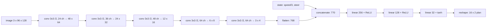
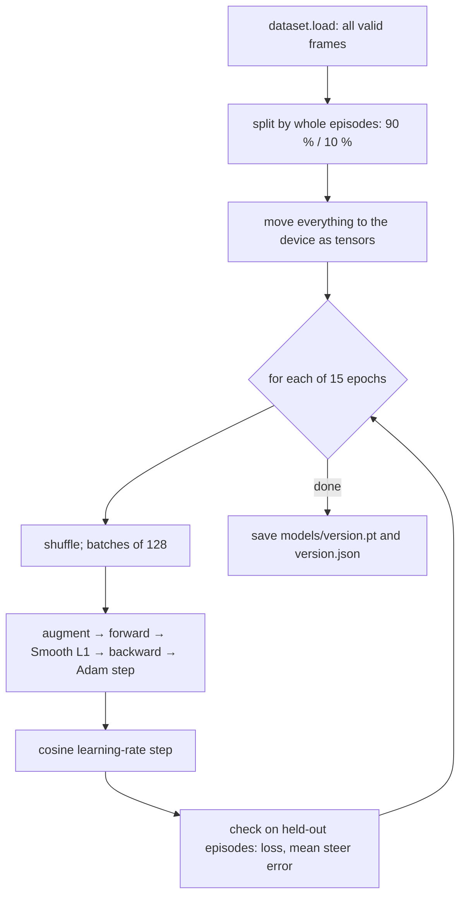

# 10 · Model training

**[TESTED]** by `LearnTests` in [`tests/test_drive_learn.py`](../../tests/test_drive_learn.py#L481)
(skipped when PyTorch is absent; run `make test` in the container).

## What problem are we solving?

Find a function from what the car senses to a 1.5 s plan, by fitting it to the
teacher's plans ([chapter 8](08-imitation-learning.md)):

$$\pi_\theta:\ \big(\underbrace{I}_{96 \times 128 \times 3},\ \underbrace{s}_{[v,\ \sigma]}\big)\ \longmapsto\ \underbrace{\hat A}_{16 \times 2}$$

## Why this network?

It is deliberately small: 323 124 parameters, trained in about 20 s on a laptop GPU.
Its job is to exercise the pipeline and the control loop, not to be a good driver in
the real world. It shares the one property of a VLA that the rest of the stack cares
about: **it answers with a chunk**, so the same executor and latency handling apply.

## Input preprocessing

Two steps, split on purpose between NumPy and the network.

**1. Resize, outside the network** ([`shrink`](../../drive/learn/dataset.py#L15)):
240×320 → 96×128 with `cv2.INTER_AREA` (area averaging, the right filter for
downscaling). The docstring states the rule: "Used for training and at inference: keep
them identical." Training calls it in `dataset.load`; inference calls it in
[`CnnPolicy.infer`](../../drive/policy/cnn.py#L26). A different resize at inference
(another interpolation, another aspect ratio) is a silent distribution shift.

**2. Normalise, inside the network** ([`ChunkNet.forward`](../../drive/learn/model.py#L30)):

$$x = \frac{I}{255} - 0.5 \in [-0.5, 0.5], \qquad \tilde s = \Big[\frac{v}{3.0},\ \sigma\Big]$$

Because normalisation is part of `forward`, a checkpoint cannot be used with the wrong
scaling. `SPEED_SCALE = 3.0` is the car's top speed, so both state components are of
order 1, like the image features.

## Architecture

[`ChunkNet`](../../drive/learn/model.py#L11), "in the shape of NVIDIA's PilotNet".



Each convolution is 3×3, stride 2, padding 1, followed by ReLU: it halves the height
and width. Five of them reduce 96×128 to 3×4.

### Shapes and parameters

A convolution from $c_{in}$ to $c_{out}$ channels has $9\,c_{in}c_{out} + c_{out}$
parameters; a linear layer $n_{in} n_{out} + n_{out}$.

| Layer | Output | Parameters |
|---|---|---:|
| conv 3 → 24 | 24 × 48 × 64 | 672 |
| conv 24 → 36 | 36 × 24 × 32 | 7 812 |
| conv 36 → 48 | 48 × 12 × 16 | 15 600 |
| conv 48 → 64 | 64 × 6 × 8 | 27 712 |
| conv 64 → 64 | 64 × 3 × 4 = 768 | 36 928 |
| linear 770 → 256 | 256 | 197 376 |
| linear 256 → 128 | 128 | 32 896 |
| linear 128 → 32 | 32 → 16 × 2 | 4 128 |
| **Total** | | **323 124** |

The total matches `"parameters": 323124` in the training reports. Sixty-one per cent
of the parameters are in the first linear layer: the convolutional part is cheap.

### How 16 future actions come out

The last layer has $16 \times 2 = 32$ outputs, reshaped to `(batch, 16, 2)`. All 16
actions are produced **in one forward pass**. There is no recurrence and no
autoregression: output $k$ is simply trained to equal the teacher's action
$k \times 0.1$ s ahead.

`tanh` on the output guarantees every action is in $[-1, 1]$, the legal range, by
construction (`LearnTests.test_network_shape_and_range`).

**The state enters late**, after the convolutions. The image says where the road is;
speed and steering position say what the car is currently doing. Speed in particular
cannot be read from a single frame.

Compare with a VLA: SmolVLA also emits a whole chunk at once, but generates it by
iteratively denoising a noise sample (flow matching), which can represent several
distinct good plans. A regression network like this one outputs the *average* plan,
which is fine while there is only one sensible thing to do.

## Loss

[`SmoothL1Loss(beta=0.05)`](../../drive/learn/train.py#L45), averaged over the batch,
the 16 steps and both action components. For an error $e = \hat a - a$:

$$
\ell(e) = \begin{cases}
\dfrac{e^2}{2\beta} & |e| < \beta \\[2mm]
|e| - \dfrac{\beta}{2} & \text{otherwise}
\end{cases}, \qquad \beta = 0.05
$$

Quadratic for small errors (smooth gradients near the optimum), linear for large ones
(an occasional large disagreement, such as a frame where the teacher brakes hard, does
not dominate the gradient). With actions in $[-1, 1]$, $\beta = 0.05$ means anything
beyond 2.5 % of the range is treated as "large".

The reported validation metric is simpler and more readable: the **mean absolute
steering error** over all 16 steps, in units of full lock
([`check`](../../drive/learn/train.py#L69)). 0.024 means 2.4 % of full lock, about 0.6°
at the wheels.

## Data augmentation

[`augment`](../../drive/learn/train.py#L20), applied per batch on the GPU:

**Mirroring**, for a random half of each batch. A left bend becomes a right bend, so
three things must change together:

| Quantity | Transformation |
|---|---|
| image | flipped left–right (`images.flip(2)`, the width axis of `(B, H, W, 3)`) |
| state | steering position negated; speed unchanged |
| plan | every steer negated; every throttle unchanged |

Flipping the image without negating the steering would teach the network to turn the
wrong way. `LearnTests.test_mirroring_flips_image_and_steering_only` exists for that reason.

**Brightness**: each image multiplied by a random gain in $[0.8, 1.2]$ and clamped to
0–255, so the network does not depend on exact pixel values.

Mirroring doubles the effective data and removes any left/right bias. It is valid here
because the world is symmetric: no lane to keep to one side of, no signs to read. On a
real road it would not be.

## The training loop

[`train`](../../drive/learn/train.py#L45):



| Setting | Value |
|---|---|
| Optimiser | Adam, learning rate $10^{-3}$ |
| Schedule | cosine annealing to zero over the run |
| Epochs | 15 (`--epochs`) |
| Batch | 128 |
| Seed | 0 (`--seed`): `torch.manual_seed` and a seeded generator for shuffling and augmentation |
| Device | CUDA if it works, else CPU ([`pick_device`](../../drive/learn/train.py#L32)) |

The whole dataset is held on the device as `uint8` (12 000 × 96 × 128 × 3 = 442 MB)
and indexed directly; there is no `DataLoader`. For a dataset this size that is the
fastest design; it would not scale to a million frames.

`pick_device` contains one piece of hard-won operations knowledge: if CUDA is present
but fails with "unknown error" (typical after the laptop has been suspended), it
prints the fix (`sudo rmmod nvidia_uvm && sudo modprobe nvidia_uvm`) and falls back to
the CPU.

## Train/validation split

By whole episodes, the last 10 % ([chapter 9](09-dataset-pipeline.md)). For the
default 40-episode dataset: 36 episodes (10 800 frames) for training, 4 (1 200 frames)
held out.

## Checkpoints

[`save`](../../drive/learn/model.py#L37) writes a dictionary:

| Key | Content | Why it is in the file |
|---|---|---|
| `weights` | `state_dict` | |
| `steps` | 16 | to rebuild the network |
| `image_hw` | `[96, 128]` | so inference resizes to what training used |
| `plan_dt` | 0.1 | so the policy stamps its chunks correctly |
| `report` | the training history | provenance |

[`load`](../../drive/learn/model.py#L42) uses `weights_only=True`: it refuses to
unpickle arbitrary Python objects, so a checkpoint from an untrusted source cannot run
code. The same report is written beside the model as `<version>.json`.

**A version is never overwritten** ([`train.run`](../../drive/learn/train.py#L115)):
"a trained model is not replaced, choose another version". Reports and comparisons
refer to versions; they must keep meaning what they meant.

## What training looks like

*Repo* (`runs/drive/models/v1.json`): 10 800 training frames, 15 epochs, 21.0 s on CUDA.

| Epoch | Train loss | Validation loss | Validation steer error |
|---:|---:|---:|---:|
| 1 | 0.1123 | 0.0926 | 0.188 |
| 3 | 0.0257 | 0.0289 | 0.060 |
| 5 | 0.0149 | 0.0193 | 0.041 |
| 10 | 0.0091 | 0.0140 | 0.029 |
| 15 | 0.0080 | 0.0124 | 0.024 |

## Overfitting and generalisation

- **Overfitting**: the training loss keeps falling while the validation loss stops or
  rises; the network is memorising frames. Here the validation loss is about 1.5 times
  the training loss at the end and still falling: a modest gap, no sign of memorisation.
- **Generalisation, offline**: low error on held-out *episodes of the same kind*.
- **Generalisation, where it counts**: driving tracks and directions never seen in
  training. `v1` was trained only on the peanut and passes on the oval and the trefoil
  ([chapter 11](11-model-evaluation.md)).

Three reasons such a small network generalises across tracks in this simulator: the
task is local (the plan depends on the next metre or two of road, and every track is
made of similar bends); mirroring and both driving directions cover left and right;
and the disturbed data covers positions off the centreline. None of this says anything
about generalising to a different-looking world.

Remember chapter 8: the validation error is not the objective. The model trained on
perfect driving reaches 0.015, better than `v1`'s 0.024, and fails every drive.

## Common mistakes and misconceptions

- **"More epochs, lower loss, better model."** Lower *offline* loss. Evaluate by driving.
- **"The network predicts actions one at a time."** One pass, 32 numbers.
- **"Augmentation can replace recovery data."** Mirroring and brightness change how a
  recorded state looks, not which states were recorded.
- **"Resize however is convenient at inference."** It must be `shrink`, with the
  checkpoint's `image_hw`.
- **"I'll retrain v1 with a fix."** You cannot, by design. Train `v2`.
- **"Validation steer error 0.024 means 2.4 cm."** It is 2.4 % of full steering lock.

## Practical experiment

```bash
make train V=e5  ARGS='--epochs 5'
make train V=e30 ARGS='--epochs 30'
make evaluate V="e5 v1 e30"
```

Record the final validation steer error of each from `runs/drive/models/*.json` and
the drives passed and rms from the evaluation. Is the ordering by validation error the
same as the ordering by driving quality?

## Knowledge check

1. Why does the network have 32 outputs?
2. What three things must change when an image is mirrored?
3. Why is the image normalised inside `forward` rather than in the data loader?
4. What does `weights_only=True` protect against?
5. Compute the number of parameters in the first convolution.
6. Why is the split made by episode, and which episodes are held out?

<details><summary>Answers</summary>

1. 16 future steps × 2 action components.
2. The image is flipped, the steering position in the state is negated, and the steer of every plan step is negated.
3. So that the scaling travels with the weights and cannot differ between training and inference.
4. Executing arbitrary code hidden in a pickled checkpoint.
5. $9 \times 3 \times 24 + 24 = 672$.
6. Neighbouring frames are near-duplicates; the last 10 % of episodes in sorted order are held out.
</details>

## Further reading

- Bojarski et al. 2016, *End to End Learning for Self-Driving Cars* (PilotNet).
- PyTorch documentation: `SmoothL1Loss`, `CosineAnnealingLR`.
- Zhao et al. 2023 (ACT) and Chi et al. 2023 (Diffusion Policy), for generative alternatives to regressing a chunk.
