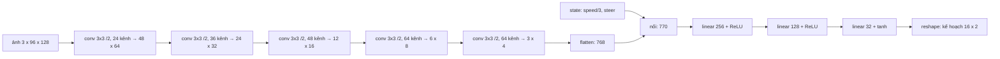
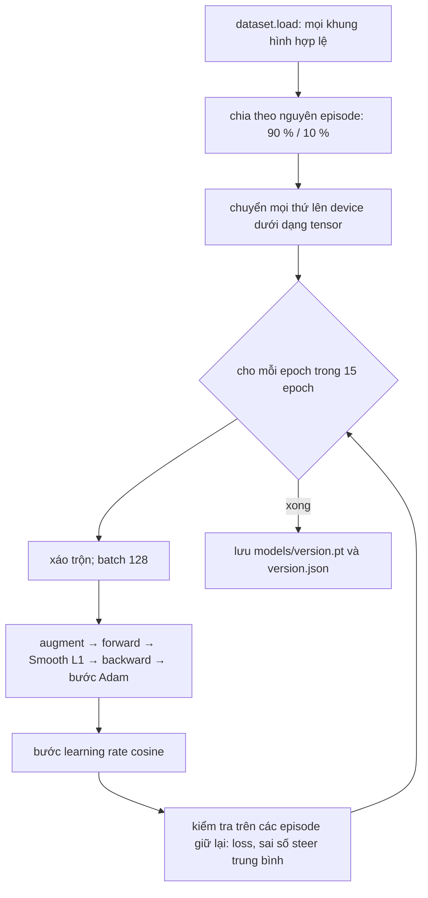

# 10 · Train model

*Bản tiếng Việt · [English](10-model-training.md)*

*Bản tiếng Việt · [English](10-model-training.vi.md)*

**[TESTED]** bởi `LearnTests` trong [`tests/test_drive_learn.py`](../../tests/test_drive_learn.py#L481)
(bị bỏ qua khi không có PyTorch; chạy `make test` trong container).

## Ta đang giải bài toán gì?

Tìm một hàm đi từ những gì xe cảm nhận tới một kế hoạch 1,5 s, bằng cách fit nó theo các kế
hoạch của teacher ([chương 8](08-imitation-learning.vi.md)):

$$\pi_\theta:\ \big(\underbrace{I}_{96 \times 128 \times 3},\ \underbrace{s}_{[v,\ \sigma]}\big)\ \longmapsto\ \underbrace{\hat A}_{16 \times 2}$$

## Vì sao là mạng này?

Nó cố ý nhỏ: 323 124 tham số, train trong khoảng 20 s trên GPU laptop. Việc của nó là chạy
thử dây chuyền và vòng điều khiển, không phải làm một tay lái giỏi ngoài đời thật. Nó có chung
với VLA đúng một đặc điểm mà phần còn lại của hệ thống quan tâm: **nó trả lời bằng một chunk**,
nên cùng executor và cùng cách xử lý độ trễ áp dụng được.

## Tiền xử lý đầu vào

Hai bước, cố ý chia giữa NumPy và mạng.

**1. Đổi kích thước, bên ngoài mạng** ([`shrink`](../../drive/learn/dataset.py#L15)):
240×320 → 96×128 với `cv2.INTER_AREA` (lấy trung bình theo vùng, bộ lọc đúng để thu nhỏ).
Docstring nêu luật: "Used for training and at inference: keep them identical." (Dùng khi train
và khi suy luận: giữ chúng giống hệt nhau.) Lúc train nó được gọi trong `dataset.load`; lúc suy
luận được gọi trong [`CnnPolicy.infer`](../../drive/policy/cnn.py#L26). Một cách đổi kích
thước khác lúc suy luận (phép nội suy khác, tỷ lệ khung khác) là một lệch phân phối thầm lặng.

**2. Chuẩn hoá, bên trong mạng** ([`ChunkNet.forward`](../../drive/learn/model.py#L30)):

$$x = \frac{I}{255} - 0.5 \in [-0.5, 0.5], \qquad \tilde s = \Big[\frac{v}{3.0},\ \sigma\Big]$$

Vì chuẩn hoá là một phần của `forward`, một checkpoint không thể bị dùng với thang chia sai.
`SPEED_SCALE = 3.0` là tốc độ tối đa của xe, nên cả hai thành phần của state đều cỡ 1, giống
các đặc trưng của ảnh.

## Kiến trúc

[`ChunkNet`](../../drive/learn/model.py#L11), "in the shape of NVIDIA's PilotNet" (theo dáng
PilotNet của NVIDIA).



Mỗi convolution là 3×3, stride 2, padding 1, theo sau là ReLU: nó chia đôi chiều cao và chiều
rộng. Năm lớp như vậy thu 96×128 xuống 3×4.

### Shape và số tham số

Một convolution từ $c_{in}$ sang $c_{out}$ kênh có $9\,c_{in}c_{out} + c_{out}$ tham số; một
lớp linear có $n_{in} n_{out} + n_{out}$.

| Lớp | Output | Số tham số |
|---|---|---:|
| conv 3 → 24 | 24 × 48 × 64 | 672 |
| conv 24 → 36 | 36 × 24 × 32 | 7 812 |
| conv 36 → 48 | 48 × 12 × 16 | 15 600 |
| conv 48 → 64 | 64 × 6 × 8 | 27 712 |
| conv 64 → 64 | 64 × 3 × 4 = 768 | 36 928 |
| linear 770 → 256 | 256 | 197 376 |
| linear 256 → 128 | 128 | 32 896 |
| linear 128 → 32 | 32 → 16 × 2 | 4 128 |
| **Tổng** | | **323 124** |

Tổng khớp với `"parameters": 323124` trong các báo cáo train. Sáu mươi mốt phần trăm số tham
số nằm ở lớp linear đầu tiên: phần convolution rất rẻ.

### 16 action tương lai ra đời thế nào

Lớp cuối có $16 \times 2 = 32$ output, được reshape thành `(batch, 16, 2)`. Cả 16 action được
tạo ra **trong một lượt forward**. Không có hồi quy (recurrence) và không có tự hồi quy
(autoregression): output $k$ chỉ đơn giản được train để bằng action của teacher ở
$k \times 0.1$ s phía trước.

`tanh` ở output bảo đảm mọi action nằm trong $[-1, 1]$, miền hợp lệ, theo cấu trúc
(`LearnTests.test_network_shape_and_range`).

**State đi vào muộn**, sau các convolution. Ảnh nói con đường ở đâu; tốc độ và vị trí tay lái
nói xe đang làm gì. Riêng tốc độ thì không đọc được từ một khung hình duy nhất.

So với một VLA: SmolVLA cũng xuất cả một chunk một lúc, nhưng sinh nó bằng cách khử nhiễu lặp
một mẫu nhiễu (flow matching), cách có thể biểu diễn nhiều kế hoạch tốt khác nhau. Một mạng hồi
quy như mạng này xuất ra kế hoạch *trung bình*, như vậy là ổn khi chỉ có một việc hợp lý để làm.

## Loss

[`SmoothL1Loss(beta=0.05)`](../../drive/learn/train.py#L45), lấy trung bình trên batch, trên
16 bước và cả hai thành phần action. Với sai số $e = \hat a - a$:

$$
\ell(e) = \begin{cases}
\dfrac{e^2}{2\beta} & |e| < \beta \\[2mm]
|e| - \dfrac{\beta}{2} & \text{trường hợp còn lại}
\end{cases}, \qquad \beta = 0.05
$$

Bậc hai với sai số nhỏ (gradient mượt gần điểm tối ưu), tuyến tính với sai số lớn (một lần bất
đồng lớn hiếm hoi, như một khung hình teacher phanh gấp, không lấn át gradient). Với action
trong $[-1, 1]$, $\beta = 0.05$ nghĩa là mọi thứ vượt 2,5 % miền giá trị được coi là "lớn".

Metric validation được báo đơn giản và dễ đọc hơn: **sai số steer tuyệt đối trung bình** trên
cả 16 bước, tính theo đơn vị góc lái tối đa ([`check`](../../drive/learn/train.py#L69)). 0,024
nghĩa là 2,4 % góc lái tối đa, khoảng 0,6° ở bánh xe.

## Data augmentation

[`augment`](../../drive/learn/train.py#L20), áp theo từng batch trên GPU:

**Lật gương**, cho một nửa ngẫu nhiên của mỗi batch. Một khúc cua trái thành cua phải, nên ba
thứ phải đổi cùng nhau:

| Đại lượng | Phép biến đổi |
|---|---|
| ảnh | lật trái–phải (`images.flip(2)`, trục chiều rộng của `(B, H, W, 3)`) |
| state | vị trí tay lái đổi dấu; tốc độ giữ nguyên |
| kế hoạch | mọi steer đổi dấu; mọi throttle giữ nguyên |

Lật ảnh mà không đổi dấu steer sẽ dạy mạng quay sai hướng.
`LearnTests.test_mirroring_flips_image_and_steering_only` tồn tại vì lý do đó.

**Độ sáng**: mỗi ảnh nhân với một hệ số ngẫu nhiên trong $[0.8, 1.2]$ rồi kẹp về 0–255, để mạng
không phụ thuộc vào giá trị pixel chính xác.

Lật gương nhân đôi lượng dữ liệu hiệu dụng và xoá mọi thiên lệch trái/phải. Nó hợp lệ ở đây vì
thế giới đối xứng: không có làn đường phải đi về một bên, không có biển báo để đọc. Trên đường
thật thì không còn đúng.

## Vòng train

[`train`](../../drive/learn/train.py#L45):



| Thiết lập | Giá trị |
|---|---|
| Optimiser | Adam, learning rate $10^{-3}$ |
| Lịch learning rate | cosine annealing về 0 trong suốt lần chạy |
| Epoch | 15 (`--epochs`) |
| Batch | 128 |
| Seed | 0 (`--seed`): `torch.manual_seed` và một bộ sinh số có seed cho việc xáo trộn và augmentation |
| Device | CUDA nếu chạy được, nếu không thì CPU ([`pick_device`](../../drive/learn/train.py#L32)) |

Toàn bộ bộ dữ liệu được giữ trên device dưới dạng `uint8` (12 000 × 96 × 128 × 3 = 442 MB) và
đánh chỉ số trực tiếp; không có `DataLoader`. Với bộ dữ liệu cỡ này, đó là thiết kế nhanh nhất;
nó sẽ không mở rộng được tới một triệu khung hình.

`pick_device` chứa một mẩu kinh nghiệm vận hành phải trả giá mới có: nếu CUDA có mặt nhưng
hỏng với "unknown error" (thường gặp sau khi laptop vừa ngủ dậy), nó in cách sửa
(`sudo rmmod nvidia_uvm && sudo modprobe nvidia_uvm`) rồi lùi về CPU.

## Chia train/validation

Theo nguyên episode, 10 % cuối ([chương 9](09-dataset-pipeline.vi.md)). Với bộ dữ liệu mặc định
40 episode: 36 episode (10 800 khung hình) để train, 4 episode (1 200 khung hình) giữ lại.

## Checkpoint

[`save`](../../drive/learn/model.py#L37) ghi một dictionary:

| Khoá | Nội dung | Vì sao có trong file |
|---|---|---|
| `weights` | `state_dict` | |
| `steps` | 16 | để dựng lại mạng |
| `image_hw` | `[96, 128]` | để lúc suy luận đổi kích thước giống lúc train |
| `plan_dt` | 0.1 | để policy đóng dấu chunk cho đúng |
| `report` | lịch sử train | nguồn gốc |

[`load`](../../drive/learn/model.py#L42) dùng `weights_only=True`: nó từ chối unpickle object
Python tuỳ ý, nên một checkpoint từ nguồn không tin cậy không thể chạy code. Cùng báo cáo đó
được ghi bên cạnh model dưới tên `<version>.json`.

**Một phiên bản không bao giờ bị ghi đè** ([`train.run`](../../drive/learn/train.py#L115)):
"a trained model is not replaced, choose another version". Các báo cáo và phép so sánh tham
chiếu tới phiên bản; chúng phải giữ nguyên nghĩa đã có.

## Train trông thế nào

*Repo* (`runs/drive/models/v1.json`): 10 800 khung hình train, 15 epoch, 21,0 s trên CUDA.

| Epoch | Loss train | Loss validation | Sai số steer validation |
|---:|---:|---:|---:|
| 1 | 0.1123 | 0.0926 | 0.188 |
| 3 | 0.0257 | 0.0289 | 0.060 |
| 5 | 0.0149 | 0.0193 | 0.041 |
| 10 | 0.0091 | 0.0140 | 0.029 |
| 15 | 0.0080 | 0.0124 | 0.024 |

## Overfitting và tổng quát hoá

- **Overfitting**: loss train tiếp tục giảm trong khi loss validation dừng hoặc tăng; mạng
  đang học thuộc lòng các khung hình. Ở đây cuối cùng loss validation khoảng 1,5 lần loss
  train và vẫn đang giảm: khoảng cách vừa phải, không có dấu hiệu học thuộc.
- **Tổng quát hoá, offline**: sai số thấp trên các *episode cùng loại* được giữ lại.
- **Tổng quát hoá, ở chỗ quan trọng**: lái trên các đường đua và chiều chạy chưa từng thấy lúc
  train. `v1` chỉ được train trên peanut và vẫn đạt trên oval và trefoil
  ([chương 11](11-model-evaluation.vi.md)).

Ba lý do một mạng nhỏ như vậy tổng quát hoá qua các đường đua trong bộ mô phỏng này: nhiệm vụ
mang tính cục bộ (kế hoạch phụ thuộc vào một hai mét đường tiếp theo, và mọi đường đua đều làm
từ những khúc cua tương tự); lật gương và cả hai chiều chạy phủ cả trái lẫn phải; và dữ liệu bị
làm nhiễu phủ các vị trí lệch khỏi đường tâm. Không điều nào trong số đó nói gì về việc tổng
quát hoá sang một thế giới có vẻ ngoài khác.

Nhớ lại chương 8: sai số validation không phải là mục tiêu. Model train trên dữ liệu lái hoàn
hảo đạt 0,015, tốt hơn 0,024 của `v1`, và trượt mọi lần lái.

## Những lỗi và hiểu lầm thường gặp

- **"Nhiều epoch hơn, loss thấp hơn, model tốt hơn."** Loss *offline* thấp hơn. Hãy đánh giá
  bằng cách lái.
- **"Mạng dự đoán từng action một."** Một lượt, 32 con số.
- **"Augmentation có thể thay dữ liệu hồi phục."** Lật gương và độ sáng thay đổi vẻ ngoài của
  một trạng thái đã ghi, không thay đổi trạng thái nào được ghi.
- **"Lúc suy luận đổi kích thước kiểu nào tiện là được."** Phải là `shrink`, với `image_hw` của
  checkpoint.
- **"Tôi sẽ train lại v1 với một bản sửa."** Không được, theo thiết kế. Hãy train `v2`.
- **"Sai số steer validation 0,024 nghĩa là 2,4 cm."** Đó là 2,4 % góc lái tối đa.

## Thí nghiệm thực hành

```bash
make train V=e5  ARGS='--epochs 5'
make train V=e30 ARGS='--epochs 30'
make evaluate V="e5 v1 e30"
```

Ghi lại sai số steer validation cuối cùng của mỗi model từ `runs/drive/models/*.json`, cùng số
lần lái đạt và rms từ lần đánh giá. Thứ tự theo sai số validation có giống thứ tự theo chất
lượng lái không?

## Kiểm tra kiến thức

1. Vì sao mạng có 32 output?
2. Ba thứ gì phải đổi khi một ảnh bị lật gương?
3. Vì sao ảnh được chuẩn hoá bên trong `forward` thay vì trong bộ nạp dữ liệu?
4. `weights_only=True` bảo vệ khỏi điều gì?
5. Tính số tham số của convolution đầu tiên.
6. Vì sao chia theo episode, và những episode nào được giữ lại?

<details><summary>Đáp án</summary>

1. 16 bước tương lai × 2 thành phần action.
2. Ảnh bị lật, vị trí tay lái trong state đổi dấu, và steer của mọi bước trong kế hoạch đổi dấu.
3. Để thang chia đi cùng trọng số và không thể khác nhau giữa lúc train và lúc suy luận.
4. Chạy code tuỳ ý giấu trong một checkpoint bị pickle.
5. $9 \times 3 \times 24 + 24 = 672$.
6. Các khung hình liền kề gần như trùng nhau; 10 % episode cuối theo thứ tự đã sắp xếp được giữ lại.
</details>

## Đọc thêm

- Bojarski và cộng sự 2016, *End to End Learning for Self-Driving Cars* (PilotNet).
- Tài liệu PyTorch: `SmoothL1Loss`, `CosineAnnealingLR`.
- Zhao và cộng sự 2023 (ACT) và Chi và cộng sự 2023 (Diffusion Policy), về các lựa chọn sinh (generative) thay cho hồi quy một chunk.
