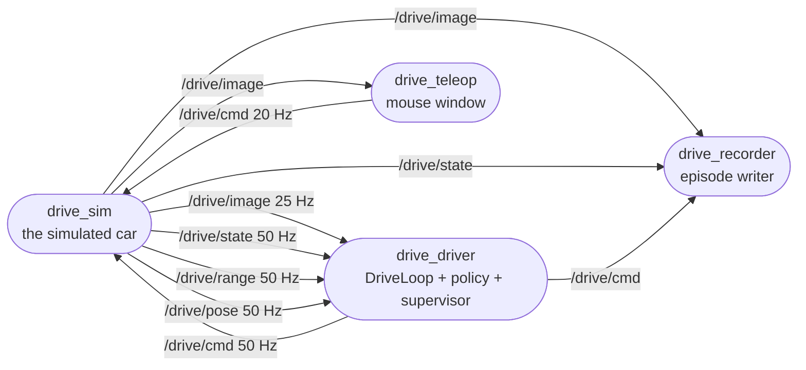
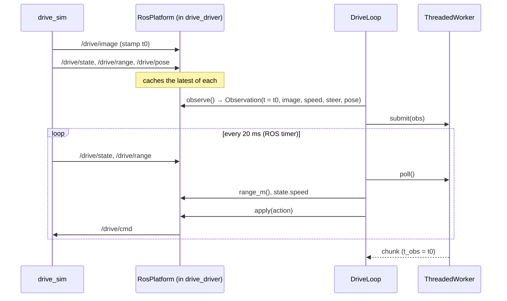

# 12 · ROS 2 integration

*[Tiếng Việt](12-ros2-integration.vi.md)*

**[TESTED]** by [`tests/test_drive_ros.py`](../../tests/test_drive_ros.py) (skipped
without ROS 2; run `make test` in the container). The car behind the topics is the
simulator: **[SIM-ONLY]**.

## What problem are we solving?

[Chapter 1](01-system-architecture.md) ran everything in one Python process. A real
robot is several processes, often several computers: a camera driver, a motor
controller, the autonomy code, a recorder, a person with a joystick. They need a
common way to exchange data. ROS 2 is that way, and this chapter shows how the driving
stack is placed behind it **without changing the control loop.**

## ROS 2 in five definitions

| Term | Meaning | Here |
|---|---|---|
| **Node** | a process (or part of one) with a name, doing one job | `drive_sim`, `drive_driver`, `drive_recorder`, `drive_teleop` |
| **Topic** | a named, typed channel; anyone may publish, anyone may subscribe | `/drive/image`, `/drive/cmd`, … |
| **Message** | the data structure sent on a topic | `sensor_msgs/Image`, `geometry_msgs/Twist`, … |
| **Publisher / subscriber** | a node's handle for sending on / receiving from a topic | `create_publisher`, `create_subscription` |
| **Parameter** | a named setting of a node, given at start | `-p policy:=cnn` |
| **Launch file** | a script that starts several nodes with their parameters | `drive.launch.py` |

Publishers and subscribers do not know each other. That decoupling is the whole value:
swap the simulator node for a real car's node and nobody else notices.

## The node graph



Run either the driver or the teleop, not both: nothing arbitrates between two
publishers on `/drive/cmd`; the car obeys whichever message arrived last.

## The topics: the whole interface

Defined in [`topics.py`](../../ros/src/drive_ros/drive_ros/topics.py#L18), with the
conversions between messages and arrays.

### `/drive/image` · `sensor_msgs/Image`

| Field | Value |
|---|---|
| `header.stamp` | when the frame was rendered (the sim node's clock) |
| `header.frame_id` | `"camera"` |
| `height`, `width` | 240, 320 |
| `encoding` | `"rgb8"` (anything else is rejected by `msg_to_image`) |
| `step` | bytes per row: `3 * width` |
| `data` | the pixels, row by row |

[`image_to_msg`](../../ros/src/drive_ros/drive_ros/topics.py#L31) /
[`msg_to_image`](../../ros/src/drive_ros/drive_ros/topics.py#L41). The decoder honours
`step`, so a driver that pads its rows still decodes correctly
(`MessageTests.test_image_round_trip`).

### `/drive/state` · `geometry_msgs/TwistStamped`

| Field | Meaning |
|---|---|
| `header.stamp` | time of the measurement |
| `twist.linear.x` | speed, m/s |
| `twist.angular.z` | steering **position**, −1..1 (not a yaw rate) |

### `/drive/range` · `sensor_msgs/Range`

| Field | Value |
|---|---|
| `header.stamp` | time of the reading |
| `radiation_type` | `Range.INFRARED` |
| `max_range` | 4.0 m |
| `range` | distance to the nearest thing ahead, m |

`field_of_view` and `min_range` are left at zero by the simulator.

### `/drive/pose` · `geometry_msgs/Pose2D`

`x`, `y`, `theta`: where the car is. **Only a simulator publishes it**; the
pure-pursuit teacher is its only consumer. A real car would not have this topic, and
the teacher would fail with "pure pursuit needs the simulator's pose".

### `/drive/cmd` · `geometry_msgs/Twist`

| Field | Meaning |
|---|---|
| `linear.x` | throttle, −1..1 |
| `angular.z` | steer, −1..1 (+1 full left) |

[`action_to_msg`](../../ros/src/drive_ros/drive_ros/topics.py#L47) /
[`msg_to_action`](../../ros/src/drive_ros/drive_ros/topics.py#L54).

> **A convention to be aware of.** `Twist` normally carries velocities in m/s and
> rad/s. Here its fields carry *normalised* commands and a steering position. The
> types were chosen because every ROS 2 tool understands them; the units are this
> project's own. Do not connect `/drive/cmd` to a stock base controller expecting
> `cmd_vel` semantics.

Every publisher and subscription uses a queue depth of 1: only the newest message
matters, and an old command must never be delivered late.

## The four nodes

### `sim`: the simulated car

[`SimNode`](../../ros/src/drive_ros/drive_ros/sim_node.py#L24). Wraps
`drive.sim.World` and steps it on a 50 Hz timer.

| Parameter | Default | Meaning |
|---|---|---|
| `track` | `peanut` | track shape |
| `reverse` | `false` | drive it clockwise |
| `obstacles` | `""` | cones, as metres along the track: `"8"` or `"8,15"` |
| `show` | `false` | open a window with the camera and the map |

Each tick: apply the latest command, then publish state, range and pose. Every second
tick (25 Hz): render and publish the camera.

**Command watchdog.** If no command has arrived for `CMD_TIMEOUT_S = 0.5` s, the node
applies a full brake, keeping the last steering: "a car must not coast on a dead
link". It also starts braked. `NodeTests.test_the_car_brakes_when_commands_stop`.
This is the behaviour a real car's node must reproduce.

### `driver`: the control loop

[`DriveNode`](../../ros/src/drive_ros/drive_ros/drive_node.py#L27).

| Parameter | Default | Meaning |
|---|---|---|
| `policy` | `pure-pursuit` | one of `POLICIES` |
| `checkpoint` | `""` | for `cnn`: a version (`v1`) or a file |
| `project` | `runs/drive` | where versions are looked up |
| `track`, `reverse` | `peanut`, `false` | **must match the simulator's**; only the teacher uses them (it follows the map) |
| `speed` | `0.0` | target speed; 0 means the policy's own |
| `latency_ms` | `0.0` | *extra* delay per inference, to imitate a slower model |
| `max_plan_age_ms` | `600.0` | the supervisor's watchdog |

It builds exactly what `episode.build` builds, with a different platform:

```python
self.platform = RosPlatform(self)
self.loop = DriveLoop(self.platform, ThreadedWorker(policy, extra_latency / 1000),
                      SafetySupervisor(SafetyLimits(max_plan_age_s=max_plan_age / 1000)), LoopConfig())
self.create_timer(self.loop.config.dt, self.step)      # 50 Hz
self.create_timer(2.0, self.report)                    # a status line
```

`step` does nothing until a camera frame and a state have arrived
([`RosPlatform.ready`](../../ros/src/drive_ros/drive_ros/platform.py#L34)). On
shutdown it sends no final command: the car's watchdog brakes.

### `teleop`: drive by hand

[`TeleopNode`](../../ros/src/drive_ros/drive_ros/teleop_node.py#L34). A window showing
the camera; **the pointer is the stick** while the left button is held
([`stick`](../../ros/src/drive_ros/drive_ros/teleop_node.py#L26)):

$$\text{steer} = -\frac{x - W/2}{W/2}, \qquad \text{throttle} = \frac{H/2 - y}{H/2} \times \begin{cases} 0.6 & \text{above the middle} \\ 1 & \text{below (brake)} \end{cases}$$

Releasing the button coasts with the wheels straight; space brakes; `q` quits. It
publishes at 20 Hz.

Two things to know. Its commands "go straight to the car, past the supervisor". And
its status: `docs/driving.md` says it "has been started and seen to open its window,
not driven for a recording". The stick mapping is unit-tested
(`MessageTests.test_teleop_stick`); driving with it is **[UNTESTED]**.

### `recorder`: episodes from topics

[`RecorderNode`](../../ros/src/drive_ros/drive_ros/recorder_node.py#L21).

| Parameter | Default | Meaning |
|---|---|---|
| `project` | `runs/drive` | |
| `name` | `ros` | episodes are `<name>-NNN` |
| `hz` | `10.0` | sampling rate |
| `task` | `drive along the track` | stored in `meta.json` |

It keeps the latest state and command, and on each image decides whether a sample is
due. Recording starts at the first image after a command has been heard ("nobody is
driving yet" otherwise); time zero is that image's stamp. Ctrl-C saves. The result has
no labels; `make label` creates them ([chapter 9](09-dataset-pipeline.md)).

## How `RosPlatform` keeps `DriveLoop` unchanged

[`RosPlatform`](../../ros/src/drive_ros/drive_ros/platform.py#L13) is 60 lines that
satisfy the `Platform` protocol by caching the latest message of each topic.

| `Platform` member | `World` (simulator) | `RosPlatform` |
|---|---|---|
| `t` | simulated seconds | seconds since the node started, from the node's clock |
| `state` | the true state | `VehicleState(0, 0, 0, speed, steer)` from `/drive/state` |
| `observe(task)` | renders the camera now | the latest image, **stamped with its header time** |
| `range_m()` | computes it | the latest `/drive/range` |
| `apply(action, dt)` | steps the model, advances time | publishes `/drive/cmd`; `dt` is ignored, real time passes by itself |

Three details carry the design:

1. **Observation time is the image's stamp** (`image_t = stamp − node start`). The
   frame's age, including transport, is then part of the plan's age, as it should be
   ([chapter 2](02-data-flow-and-lifecycle.md)).
2. **Fail-safe default.** `self.distance = 0.0` until a range message arrives:
   "nothing heard yet: assume something is right ahead". The supervisor holds the car
   with `obstacle_stop` until the sensor speaks.
3. **`state` carries only what the loop reads.** Position is zero; the loop uses
   `.speed` only.



### Threads

`rclpy.spin` uses a single-threaded executor: subscription callbacks and timer
callbacks run one at a time on the same thread, so `RosPlatform` needs no locks. The
only other thread is the worker's `policy-inference`.

A consequence: a slow callback delays the 50 Hz timer. The policy must therefore stay
off this thread, which `ThreadedWorker` ensures.

### Clocks

Timestamps from the simulator node and the driver's notion of "now" both come from
the system clock, so they are comparable when both run on one machine. Across two
computers (a car and a PC) the clocks must be synchronised, or plan ages will be wrong
by the offset: a deployment requirement, not something the code enforces.

## Parameters and their types

[`topics.param`](../../ros/src/drive_ros/drive_ros/topics.py#L21) declares each
parameter with dynamic typing and converts it to the type of its default. The comment
gives the reason: `-p latency_ms:=200` is an integer to ROS 2, and a strictly typed
float parameter would refuse it.

## Launch file

[`drive.launch.py`](../../ros/src/drive_ros/launch/drive.launch.py) starts `sim` and
`driver`, and `recorder` when `record:=true`.

| Argument | Default | Goes to |
|---|---|---|
| `track`, `reverse` | `peanut`, `false` | sim and driver (kept in agreement) |
| `obstacles`, `show` | `""`, `true` | sim |
| `policy`, `checkpoint`, `latency_ms` | `pure-pursuit`, `""`, `0.0` | driver |
| `record`, `name` | `false`, `ros` | recorder |

## Running it

```bash
make ros-build                       # once: colcon build --symlink-install
# one terminal each:
make ros-sim   TRACK=trefoil         # the simulated car, with a window
make ros-drive POLICY=cnn V=v1       # the control loop drives it
make ros-record NAME=ros             # Ctrl-C saves runs/drive/episodes/ros-NNN
make ros-view                        # rqt_image_view on /drive/image
# or, at once:
make ros-launch ARGS='policy:=cnn checkpoint:=v1 record:=true'
```

Each `make` target is a separate container. They find each other because
[`docker-compose.yml`](../../docker-compose.yml) uses the host's network and IPC
namespaces; `ROS_LOCALHOST_ONLY=1` keeps the traffic on the machine.

The package is `ament_python` ([`package.xml`](../../ros/src/drive_ros/package.xml),
[`setup.py`](../../ros/src/drive_ros/setup.py)); the `drive` package itself is found
through `PYTHONPATH=/work`, not installed.

## Replacing the simulator

"The topics are the whole interface." A real car, or a CARLA bridge, needs one node that:

| Must | Detail |
|---|---|
| publish `/drive/image` | `rgb8`, stamped at capture |
| publish `/drive/state` | speed in m/s and steering position in −1..1 |
| publish `/drive/range` | metres; never NaN ([chapter 7](07-safety-supervisor.md)) |
| obey `/drive/cmd` | map −1..1 to servo and ESC signals |
| brake when commands stop | the 0.5 s watchdog |
| not publish `/drive/pose` | unless it truly has one |

Then the driver, the recorder and the training pipeline run unchanged. Neither a real
platform node nor a CARLA bridge exists: **[PROPOSED]**.

## What is not there

No TF frames, URDF, custom message types, lifecycle nodes, namespaces, tuned QoS
profiles, command multiplexer, or e-stop topic. Topic names are absolute, so two cars
on one ROS domain would collide (remapping would be needed).

## Common mistakes and misconceptions

- **"ROS 2 runs the control loop."** It delivers messages and fires a timer.
  `DriveLoop.step` is the same code as in the simulator.
- **"`angular.z` is a yaw rate."** On `/drive/cmd` it is a steering command; on
  `/drive/state`, a steering position.
- **"Teleop is supervised."** It is not.
- **"The driver can use any track setting."** For the teacher, `track` and `reverse`
  must equal the simulator's, or it follows a map of a different road.
- **"Stopping the driver stops the car."** The car stops itself, 0.5 s later, because
  commands ceased.

## Practical experiment

```bash
make ros-launch ARGS='obstacles:=8'
```

In another terminal (`make shell`): `ros2 topic list`, `ros2 topic hz /drive/image`,
`ros2 topic hz /drive/cmd`, `ros2 topic echo /drive/range --once`,
`ros2 node info /drive_driver`. Then stop only the driver (find and kill its process,
or run `make ros-sim` and `make ros-drive` separately and Ctrl-C the driver) and watch
the car in the simulator window: how long until it brakes?

## Knowledge check

1. Which node publishes `/drive/cmd`, and which subscribe to it?
2. What does `RosPlatform.apply` do with `dt`?
3. Why is the observation stamped with the image header's time?
4. What happens if the range topic never publishes?
5. What must a real car's node do when commands stop, and why does the driver depend on it?
6. Why is the queue depth 1 everywhere?

<details><summary>Answers</summary>

1. The driver (or teleop) publishes; the simulated car and the recorder subscribe.
2. Nothing: real time passes on its own.
3. So that the frame's age, including delivery, counts towards the plan's age and is compensated.
4. `distance` stays 0.0 and the supervisor holds the car with `obstacle_stop`.
5. Brake within about 0.5 s; the driver sends no stop command when it exits or crashes.
6. Only the newest sensor value and the newest command are useful; a queued old command would be acted on late.
</details>

## Further reading

- ROS 2 Humble: Concepts (nodes, topics, QoS), and the beginner tutorials.
- `sensor_msgs` and `geometry_msgs` interface definitions.
- REP 103 (units and coordinate conventions) and REP 117 (range readings), for the conventions this project partly departs from.
