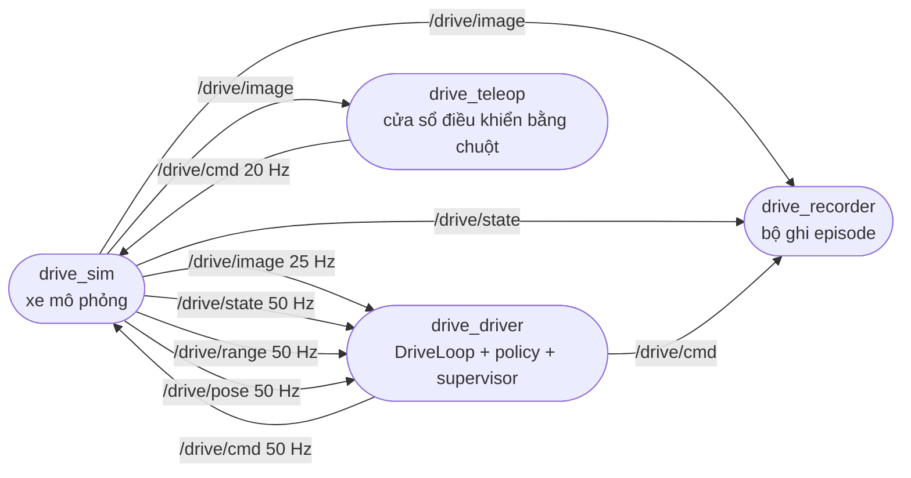
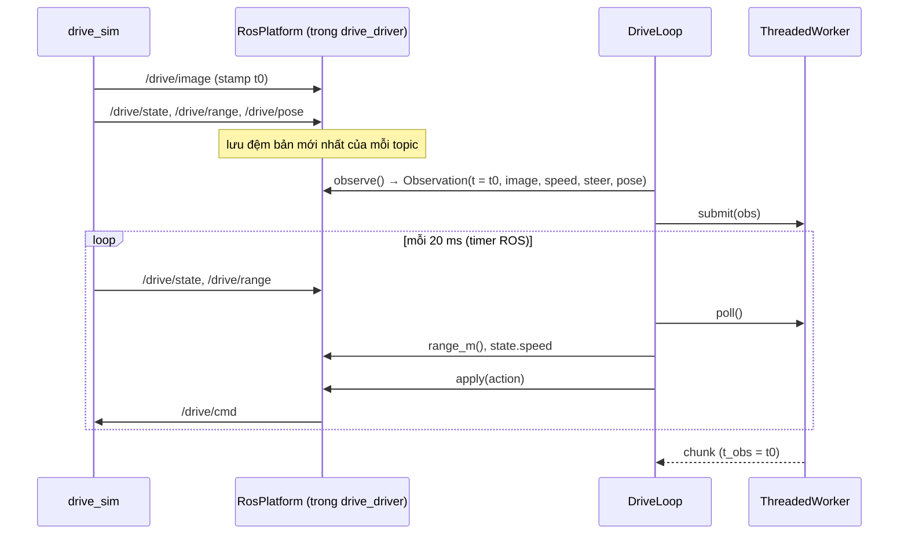

# 12 · Tích hợp ROS 2

*Bản tiếng Việt · [English](12-ros2-integration.md)*

*Bản tiếng Việt · [English](12-ros2-integration.vi.md)*

**[TESTED]** bởi [`tests/test_drive_ros.py`](../../tests/test_drive_ros.py) (bị bỏ qua khi không
có ROS 2; chạy `make test` trong container). Chiếc xe đứng sau các topic là bộ mô phỏng:
**[SIM-ONLY]**.

## Ta đang giải bài toán gì?

[Chương 1](01-system-architecture.vi.md) chạy mọi thứ trong một tiến trình Python. Một robot thật
là nhiều tiến trình, thường là nhiều máy tính: một driver camera, một bộ điều khiển động cơ,
code tự hành, một bộ ghi, một người cầm joystick. Chúng cần một cách chung để trao đổi dữ liệu.
ROS 2 là cách đó, và chương này cho thấy hệ thống lái được đặt sau nó **mà không phải đổi vòng
điều khiển.**

## ROS 2 trong năm định nghĩa

| Thuật ngữ | Nghĩa | Ở đây |
|---|---|---|
| **Node** | một tiến trình (hoặc một phần của nó) có tên, làm một việc | `drive_sim`, `drive_driver`, `drive_recorder`, `drive_teleop` |
| **Topic** | một kênh có tên và có kiểu; ai cũng có thể publish, ai cũng có thể subscribe | `/drive/image`, `/drive/cmd`, … |
| **Message** | cấu trúc dữ liệu gửi trên một topic | `sensor_msgs/Image`, `geometry_msgs/Twist`, … |
| **Publisher / subscriber** | handle của một node để gửi lên / nhận từ một topic | `create_publisher`, `create_subscription` |
| **Parameter** | một thiết lập có tên của node, cho lúc khởi động | `-p policy:=cnn` |
| **Launch file** | một script khởi động nhiều node cùng tham số của chúng | `drive.launch.py` |

Publisher và subscriber không biết nhau. Sự tách rời đó là toàn bộ giá trị: thay node bộ mô
phỏng bằng node của một chiếc xe thật và không ai khác nhận ra.

## Đồ thị các node



Chạy driver hoặc teleop, không chạy cả hai: không có gì phân xử giữa hai publisher trên
`/drive/cmd`; xe làm theo message nào tới sau cùng.

## Các topic: toàn bộ interface

Định nghĩa trong [`topics.py`](../../ros/src/drive_ros/drive_ros/topics.py#L18), cùng các hàm
chuyển đổi giữa message và mảng.

### `/drive/image` · `sensor_msgs/Image`

| Field | Giá trị |
|---|---|
| `header.stamp` | lúc khung hình được render (đồng hồ của node sim) |
| `header.frame_id` | `"camera"` |
| `height`, `width` | 240, 320 |
| `encoding` | `"rgb8"` (mọi encoding khác bị `msg_to_image` từ chối) |
| `step` | số byte mỗi hàng: `3 * width` |
| `data` | các pixel, lần lượt từng hàng |

[`image_to_msg`](../../ros/src/drive_ros/drive_ros/topics.py#L31) /
[`msg_to_image`](../../ros/src/drive_ros/drive_ros/topics.py#L41). Bộ giải mã tôn trọng
`step`, nên một driver đệm thêm byte vào mỗi hàng vẫn giải mã đúng
(`MessageTests.test_image_round_trip`).

### `/drive/state` · `geometry_msgs/TwistStamped`

| Field | Nghĩa |
|---|---|
| `header.stamp` | thời điểm đo |
| `twist.linear.x` | tốc độ, m/s |
| `twist.angular.z` | **vị trí** tay lái, −1..1 (không phải tốc độ quay) |

### `/drive/range` · `sensor_msgs/Range`

| Field | Giá trị |
|---|---|
| `header.stamp` | thời điểm của số đo |
| `radiation_type` | `Range.INFRARED` |
| `max_range` | 4.0 m |
| `range` | khoảng cách tới vật gần nhất phía trước, m |

`field_of_view` và `min_range` được bộ mô phỏng để bằng 0.

### `/drive/pose` · `geometry_msgs/Pose2D`

`x`, `y`, `theta`: xe đang ở đâu. **Chỉ bộ mô phỏng publish nó**; teacher pure pursuit là
người dùng duy nhất. Một chiếc xe thật sẽ không có topic này, và teacher sẽ hỏng với "pure
pursuit needs the simulator's pose".

### `/drive/cmd` · `geometry_msgs/Twist`

| Field | Nghĩa |
|---|---|
| `linear.x` | throttle, −1..1 |
| `angular.z` | steer, −1..1 (+1 là hết cỡ sang trái) |

[`action_to_msg`](../../ros/src/drive_ros/drive_ros/topics.py#L47) /
[`msg_to_action`](../../ros/src/drive_ros/drive_ros/topics.py#L54).

> **Một quy ước cần biết.** `Twist` thường mang vận tốc theo m/s và rad/s. Ở đây các field của
> nó mang lệnh *đã chuẩn hoá* và một vị trí tay lái. Các kiểu này được chọn vì mọi công cụ ROS 2
> đều hiểu chúng; đơn vị là của riêng dự án này. Đừng nối `/drive/cmd` vào một bộ điều khiển
> base có sẵn đang chờ ngữ nghĩa `cmd_vel`.

Mọi publisher và subscription đều dùng độ sâu hàng đợi 1: chỉ message mới nhất có giá trị, và
một lệnh cũ không bao giờ được giao muộn.

## Bốn node

### `sim`: chiếc xe mô phỏng

[`SimNode`](../../ros/src/drive_ros/drive_ros/sim_node.py#L24). Bọc `drive.sim.World` và bước nó
trên một timer 50 Hz.

| Tham số | Mặc định | Nghĩa |
|---|---|---|
| `track` | `peanut` | hình dạng đường đua |
| `reverse` | `false` | chạy theo chiều kim đồng hồ |
| `obstacles` | `""` | cọc tiêu, tính bằng mét dọc đường đua: `"8"` hoặc `"8,15"` |
| `show` | `false` | mở một cửa sổ với camera và bản đồ |

Mỗi nhịp: áp lệnh mới nhất, rồi publish state, range và pose. Cứ mỗi hai nhịp (25 Hz): render và
publish camera.

**Watchdog lệnh.** Nếu `CMD_TIMEOUT_S = 0.5` s không có lệnh nào tới, node phanh hết cỡ, giữ
nguyên steer cuối: "a car must not coast on a dead link". Nó cũng khởi động ở trạng thái phanh.
`NodeTests.test_the_car_brakes_when_commands_stop`. Đây là hành vi mà node của một chiếc xe
thật phải tái tạo.

### `driver`: vòng điều khiển

[`DriveNode`](../../ros/src/drive_ros/drive_ros/drive_node.py#L27).

| Tham số | Mặc định | Nghĩa |
|---|---|---|
| `policy` | `pure-pursuit` | một trong `POLICIES` |
| `checkpoint` | `""` | cho `cnn`: một phiên bản (`v1`) hoặc một file |
| `project` | `runs/drive` | nơi tra cứu các phiên bản |
| `track`, `reverse` | `peanut`, `false` | **phải khớp với bộ mô phỏng**; chỉ teacher dùng chúng (nó đi theo bản đồ) |
| `speed` | `0.0` | tốc độ mục tiêu; 0 nghĩa là tốc độ của chính policy |
| `latency_ms` | `0.0` | độ trễ *thêm* cho mỗi lượt suy luận, để bắt chước một model chậm hơn |
| `max_plan_age_ms` | `600.0` | watchdog của supervisor |

Nó dựng đúng những gì `episode.build` dựng, với một platform khác:

```python
self.platform = RosPlatform(self)
self.loop = DriveLoop(self.platform, ThreadedWorker(policy, extra_latency / 1000),
                      SafetySupervisor(SafetyLimits(max_plan_age_s=max_plan_age / 1000)), LoopConfig())
self.create_timer(self.loop.config.dt, self.step)      # 50 Hz
self.create_timer(2.0, self.report)                    # một dòng trạng thái
```

`step` không làm gì cho tới khi có một khung hình camera và một state
([`RosPlatform.ready`](../../ros/src/drive_ros/drive_ros/platform.py#L34)). Khi tắt, nó không
gửi lệnh cuối nào: watchdog của xe sẽ phanh.

### `teleop`: lái bằng tay

[`TeleopNode`](../../ros/src/drive_ros/drive_ros/teleop_node.py#L34). Một cửa sổ hiển thị
camera; **con trỏ chuột là cần điều khiển** khi giữ nút trái
([`stick`](../../ros/src/drive_ros/drive_ros/teleop_node.py#L26)):

$$\text{steer} = -\frac{x - W/2}{W/2}, \qquad \text{throttle} = \frac{H/2 - y}{H/2} \times \begin{cases} 0.6 & \text{nửa trên} \\ 1 & \text{nửa dưới (phanh)} \end{cases}$$

Nhả nút thì xe thả trôi với bánh thẳng; phím cách để phanh; `q` để thoát. Nó publish ở 20 Hz.

Hai điều cần biết. Lệnh của nó "go straight to the car, past the supervisor" (đi thẳng tới xe,
qua mặt supervisor). Và về trạng thái: `docs/driving.md` nói nó "has been started and seen to
open its window, not driven for a recording" (đã được khởi động và thấy mở cửa sổ, chưa được
dùng để lái ghi dữ liệu). Phép ánh xạ cần điều khiển có unit test
(`MessageTests.test_teleop_stick`); lái bằng nó là **[UNTESTED]**.

### `recorder`: episode từ các topic

[`RecorderNode`](../../ros/src/drive_ros/drive_ros/recorder_node.py#L21).

| Tham số | Mặc định | Nghĩa |
|---|---|---|
| `project` | `runs/drive` | |
| `name` | `ros` | episode có tên `<name>-NNN` |
| `hz` | `10.0` | tần số lấy mẫu |
| `task` | `drive along the track` | lưu trong `meta.json` |

Nó giữ state và lệnh mới nhất, và với mỗi ảnh thì quyết định đã tới lúc lấy một mẫu chưa. Việc
ghi bắt đầu ở ảnh đầu tiên sau khi đã nghe thấy một lệnh (nếu không thì "nobody is driving
yet"); mốc thời gian 0 là stamp của ảnh đó. Ctrl-C để lưu. Kết quả chưa có nhãn; `make label`
tạo nhãn ([chương 9](09-dataset-pipeline.vi.md)).

## `RosPlatform` giữ `DriveLoop` nguyên vẹn thế nào

[`RosPlatform`](../../ros/src/drive_ros/drive_ros/platform.py#L13) là 60 dòng thoả protocol
`Platform` bằng cách lưu đệm message mới nhất của mỗi topic.

| Thành viên `Platform` | `World` (bộ mô phỏng) | `RosPlatform` |
|---|---|---|
| `t` | số giây mô phỏng | số giây kể từ khi node khởi động, theo đồng hồ của node |
| `state` | trạng thái thật | `VehicleState(0, 0, 0, speed, steer)` từ `/drive/state` |
| `observe(task)` | render camera ngay lúc đó | ảnh mới nhất, **đóng dấu bằng thời gian trong header của nó** |
| `range_m()` | tự tính | `/drive/range` mới nhất |
| `apply(action, dt)` | bước mô hình, đẩy thời gian | publish `/drive/cmd`; `dt` bị bỏ qua, thời gian thật tự trôi |

Ba chi tiết gánh cả thiết kế:

1. **Thời điểm observation là stamp của ảnh** (`image_t = stamp − node start`). Khi đó tuổi của
   khung hình, gồm cả thời gian truyền, trở thành một phần của tuổi kế hoạch, đúng như phải thế
   ([chương 2](02-data-flow-and-lifecycle.vi.md)).
2. **Mặc định an toàn khi hỏng.** `self.distance = 0.0` cho tới khi có message range: "nothing
   heard yet: assume something is right ahead" (chưa nghe thấy gì: cứ coi như có vật ngay phía
   trước). Supervisor giữ xe bằng `obstacle_stop` cho tới khi cảm biến lên tiếng.
3. **`state` chỉ mang những gì vòng lặp đọc.** Vị trí là 0; vòng lặp chỉ dùng `.speed`.



### Thread

`rclpy.spin` dùng một executor đơn luồng: các callback subscription và callback timer chạy lần
lượt từng cái trên cùng một thread, nên `RosPlatform` không cần khoá. Thread duy nhất khác là
`policy-inference` của worker.

Một hệ quả: một callback chậm làm trễ timer 50 Hz. Vì vậy policy phải nằm ngoài thread này, điều
mà `ThreadedWorker` bảo đảm.

### Đồng hồ

Timestamp từ node bộ mô phỏng và khái niệm "now" của driver đều lấy từ đồng hồ hệ thống, nên so
được với nhau khi cả hai chạy trên một máy. Qua hai máy tính (một xe và một PC), các đồng hồ
phải được đồng bộ, nếu không tuổi kế hoạch sẽ sai đúng bằng độ lệch: đó là một yêu cầu triển
khai, không phải thứ code bắt buộc.

## Tham số và kiểu của chúng

[`topics.param`](../../ros/src/drive_ros/drive_ros/topics.py#L21) khai báo mỗi tham số với kiểu
động và chuyển nó về kiểu của giá trị mặc định. Comment nêu lý do: `-p latency_ms:=200` là số
nguyên với ROS 2, và một tham số float khai báo kiểu cứng sẽ từ chối nó.

## Launch file

[`drive.launch.py`](../../ros/src/drive_ros/launch/drive.launch.py) khởi động `sim` và `driver`,
và `recorder` khi `record:=true`.

| Đối số | Mặc định | Đi tới |
|---|---|---|
| `track`, `reverse` | `peanut`, `false` | sim và driver (giữ khớp nhau) |
| `obstacles`, `show` | `""`, `true` | sim |
| `policy`, `checkpoint`, `latency_ms` | `pure-pursuit`, `""`, `0.0` | driver |
| `record`, `name` | `false`, `ros` | recorder |

## Chạy nó

```bash
make ros-build                       # một lần: colcon build --symlink-install
# mỗi lệnh một terminal:
make ros-sim   TRACK=trefoil         # xe mô phỏng, có cửa sổ
make ros-drive POLICY=cnn V=v1       # vòng điều khiển lái nó
make ros-record NAME=ros             # Ctrl-C để lưu runs/drive/episodes/ros-NNN
make ros-view                        # rqt_image_view trên /drive/image
# hoặc, tất cả cùng lúc:
make ros-launch ARGS='policy:=cnn checkpoint:=v1 record:=true'
```

Mỗi target `make` là một container riêng. Chúng tìm thấy nhau vì
[`docker-compose.yml`](../../docker-compose.yml) dùng namespace mạng và IPC của máy host;
`ROS_LOCALHOST_ONLY=1` giữ lưu lượng trong máy.

Package là `ament_python` ([`package.xml`](../../ros/src/drive_ros/package.xml),
[`setup.py`](../../ros/src/drive_ros/setup.py)); bản thân package `drive` được tìm thấy qua
`PYTHONPATH=/work`, không được cài đặt.

## Thay bộ mô phỏng

"The topics are the whole interface." (Các topic là toàn bộ interface.) Một chiếc xe thật, hoặc
một cầu nối CARLA, cần một node:

| Phải | Chi tiết |
|---|---|
| publish `/drive/image` | `rgb8`, đóng dấu lúc chụp |
| publish `/drive/state` | tốc độ theo m/s và vị trí tay lái trong −1..1 |
| publish `/drive/range` | tính bằng mét; không bao giờ NaN ([chương 7](07-safety-supervisor.vi.md)) |
| tuân theo `/drive/cmd` | ánh xạ −1..1 sang tín hiệu servo và ESC |
| phanh khi lệnh ngừng tới | watchdog 0,5 s |
| không publish `/drive/pose` | trừ khi nó thực sự có pose |

Khi đó driver, recorder và dây chuyền train chạy nguyên vẹn. Chưa có node platform thật nào
cũng như cầu nối CARLA nào: **[PROPOSED]**.

## Những gì chưa có

Không có TF frame, URDF, kiểu message tự định nghĩa, lifecycle node, namespace, profile QoS đã
tinh chỉnh, bộ ghép kênh lệnh (command multiplexer), hay topic e-stop. Tên topic là tuyệt đối,
nên hai xe trên cùng một ROS domain sẽ đụng nhau (sẽ cần remapping).

## Những lỗi và hiểu lầm thường gặp

- **"ROS 2 chạy vòng điều khiển."** Nó giao message và kích một timer. `DriveLoop.step` là cùng
  đoạn code như trong bộ mô phỏng.
- **"`angular.z` là tốc độ quay."** Trên `/drive/cmd` nó là lệnh lái; trên `/drive/state`, là
  vị trí tay lái.
- **"Teleop có supervisor giám sát."** Không có.
- **"Driver dùng thiết lập đường đua nào cũng được."** Với teacher, `track` và `reverse` phải
  bằng của bộ mô phỏng, nếu không nó đi theo bản đồ của một con đường khác.
- **"Dừng driver là dừng xe."** Xe tự dừng, 0,5 s sau, vì lệnh đã ngừng tới.

## Thí nghiệm thực hành

```bash
make ros-launch ARGS='obstacles:=8'
```

Ở một terminal khác (`make shell`): `ros2 topic list`, `ros2 topic hz /drive/image`,
`ros2 topic hz /drive/cmd`, `ros2 topic echo /drive/range --once`,
`ros2 node info /drive_driver`. Sau đó chỉ dừng driver (tìm và kill tiến trình của nó, hoặc
chạy riêng `make ros-sim` và `make ros-drive` rồi Ctrl-C driver) và xem xe trong cửa sổ bộ mô
phỏng: bao lâu thì nó phanh?

## Kiểm tra kiến thức

1. Node nào publish `/drive/cmd`, và những node nào subscribe nó?
2. `RosPlatform.apply` làm gì với `dt`?
3. Vì sao observation được đóng dấu bằng thời gian trong header của ảnh?
4. Chuyện gì xảy ra nếu topic range không bao giờ publish?
5. Node của một chiếc xe thật phải làm gì khi lệnh ngừng tới, và vì sao driver phụ thuộc vào điều đó?
6. Vì sao độ sâu hàng đợi ở mọi nơi đều là 1?

<details><summary>Đáp án</summary>

1. Driver (hoặc teleop) publish; xe mô phỏng và recorder subscribe.
2. Không làm gì: thời gian thật tự trôi.
3. Để tuổi của khung hình, gồm cả thời gian truyền, được tính vào tuổi kế hoạch và được bù.
4. `distance` giữ 0.0 và supervisor giữ xe bằng `obstacle_stop`.
5. Phanh trong khoảng 0,5 s; driver không gửi lệnh dừng nào khi nó thoát hay sập.
6. Chỉ giá trị cảm biến mới nhất và lệnh mới nhất là có ích; một lệnh cũ nằm trong hàng đợi sẽ bị thực hiện muộn.
</details>

## Đọc thêm

- ROS 2 Humble: Concepts (node, topic, QoS), và các tutorial cho người mới bắt đầu.
- Định nghĩa interface của `sensor_msgs` và `geometry_msgs`.
- REP 103 (đơn vị và quy ước toạ độ) và REP 117 (số đo khoảng cách), về các quy ước mà dự án này đi lệch một phần.
