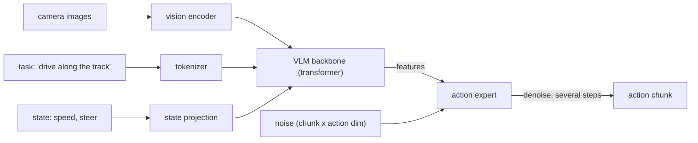
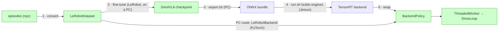

# 13 · VLA and SmolVLA

*[Tiếng Việt](13-vla-and-smolvla.vi.md)*

> **Read this first.** Since 2026-11-17 a SmolVLA fine-tuned on this project's
> episodes drives the simulated car, on a laptop GPU, in PyTorch: the episodes are
> exported with `export`, fine-tuned with LeRobot's `lerobot-train`, and run through
> the `vla` policy. Nothing VLA-related has run on a Jetson or a real car. Statements
> about SmolVLA and LeRobot are sourced: from the SmolVLA paper, from LeRobot 0.5.2
> (the code, and runs made for this guide), or from the jetson-orin-nano-vla README.
> Anything not sourced is marked as a proposal. To do it yourself, follow
> [Lab 15](15-hands-on-labs.md#lab-15-fine-tune-smolvla-on-the-driving-data-on-this-laptop).

## What problem are we solving?

The CNN of [chapter 10](10-model-training.md) knows one simulator and one behaviour.
The project's aim is a policy that starts from a model pre-trained on a great deal of
visual and robot data, and that can be told what to do in words. That kind of model
is a vision-language-action model.

## What is a VLA?

A **vision-language model (VLM)** takes images and text and produces text. It has
learned, from internet-scale data, a good deal about what things look like and how
language refers to them. A **vision-language-action model** keeps that backbone and
adds an output for *actions*: given camera images, a task sentence and the robot's
state, it produces what the robot should do.



Two families of action output exist:

| Family | How actions are produced | Examples |
|---|---|---|
| Tokenised actions | actions are discretised and generated as tokens, like text | RT-2, OpenVLA |
| Continuous action head | a separate "action expert" generates a chunk of continuous actions by denoising (diffusion or flow matching) | π0, π0.5, SmolVLA |

The second family is the reason this stack is shaped the way it is: such models are
slow per call and return a chunk.

## SmolVLA

SmolVLA (Shukor et al. 2025) is a small VLA from Hugging Face's LeRobot team: about
450 M parameters, designed, in the paper's words, to be trained on a single GPU and
deployed on consumer-grade hardware, and released with an asynchronous inference stack
that decouples action prediction from action execution.

What can be read from LeRobot 0.5.2's `SmolVLAConfig` defaults:

| Setting | Default | Relevance here |
|---|---|---|
| `vlm_model_name` | `HuggingFaceTB/SmolVLM2-500M-Video-Instruct` | the backbone |
| `num_vlm_layers` | 16 | only the first 16 layers of the VLM are used |
| `chunk_size`, `n_action_steps` | 50, 50 | a chunk of 50 actions |
| `num_steps` | 10 | denoising (flow-matching) steps per inference |
| `max_state_dim`, `max_action_dim` | 32, 32 | states and actions are padded to width 32 |
| `resize_imgs_with_padding` | (512, 512) | images are resized and padded to this |
| `freeze_vision_encoder`, `train_expert_only` | true, true | by default fine-tuning trains the action expert, not the VLM |
| `rtc_config` | `None` | an optional real-time-chunking configuration |

How it lines up with this repository:

| SmolVLA | This repository |
|---|---|
| chunk of 50 actions | `ActionChunk` with $N = 50$; `docs/driving.md` proposes `BackendPolicy(backend, chunk_size=50, …)` |
| action width 32 (padded) | `BackendPolicy` keeps columns 0 and 1 and discards the rest; `noise_width=32` |
| starts denoising from noise | `BackendObservation.noise`, shape `(1, chunk_size, noise_width)` |
| state input | `[speed, steer]` |
| task sentence | `Observation.task`, default `"drive along the track"` |
| about 108 ms on an Orin Nano | the 100 ms default latency of the simulator |

### Why inference is slow

Per call: encode each image into visual tokens; run them with the text and state
through the VLM layers; then run the action expert once **per denoising step** (10 by
default). The VLM features are computed once and reused across steps, but the
expert's ten passes are sequential. On the Jetson, jetson-orin-nano-vla reports
107.55 ms p50 (9.30 Hz) for `lerobot/smolvla_base` with two cameras, using 1.78 GB of
RAM.

## Fine-tuning

Pre-training gives a VLA general visual and motor priors; it has never seen this car.
**Fine-tuning** continues training on demonstrations from the target robot so that
its outputs mean `[steer, throttle]` for this vehicle. Structurally it is the
behaviour cloning of [chapter 8](08-imitation-learning.md) with a much larger model
and a generative loss in place of regression: the model learns to turn noise into the
demonstrated chunk, conditioned on the observation.

Everything from chapter 8 still applies, and matters more because each training run
is expensive: recovery data, closed-loop evaluation, distrust of the offline loss.

## LeRobotDataset

LeRobot's dataset format (codebase version `v3.0` in LeRobot 0.5.2): tabular data in
Parquet, camera streams as video, and metadata describing features, rate, episodes and
tasks. By convention the features are named `observation.images.<camera>`,
`observation.state` and `action`, and every frame carries a `task`.

A dataset is written with (signatures from `lerobot_dataset.py`):

```python
dataset = LeRobotDataset.create(repo_id, fps, features, root=...)   # write mode
dataset.add_frame(frame)        # a dict of feature values; "Must include a 'task' key"
dataset.save_episode()
dataset.finalize()
```

## The proposed path



Green: exists here and has run. Steps 3 and 4 exist in jetson-orin-nano-vla and have
not been tried with a driving checkpoint.

| Step | What | Status | Evidence |
|---|---|---|---|
| 0 | Episodes with images, state `[speed, steer]`, action `[steer, throttle]` | **[TESTED]** | [chapter 9](09-dataset-pipeline.md) |
| 1 | Convert episodes to a LeRobotDataset | **[TESTED]** | [`drive/learn/export.py`](../../drive/learn/export.py), `ExportTests`; run on all 82 episodes |
| 2 | Fine-tune SmolVLA with LeRobot | **done once**, on a laptop: 2000 steps, 13 minutes | [Lab 15](15-hands-on-labs.md#lab-15-fine-tune-smolvla-on-the-driving-data-on-this-laptop) |
| 3 | Export the checkpoint on the PC (`./export.sh`) | exists in **jetson-orin-nano-vla**, not here; custom checkpoints "experimental" per its README | |
| 4 | Build and run TensorRT engines on the Jetson (`./run.sh`) | exists in **jetson-orin-nano-vla**; benchmarks only | |
| 5 | `BackendPolicy` around the backend | **ran** with a PyTorch backend ([`LeRobotBackend`](../../drive/policy/lerobot_backend.py)); still only a stub test for a TensorRT one | Lab 15 |
| 6 | `vla` selectable from the CLI or a ROS parameter | **implemented** (`--policy vla --checkpoint …`, `evaluate <version>`); the ROS 2 driver accepts `policy:=vla` through the same `make_policy`, **not run** | [`POLICIES`](../../drive/policy/__init__.py#L6) |
| 7 | A fine-tuned driving checkpoint | **exists locally** (`runs/drive/vla/smolvla-v1`, not in git); simulator only | Lab 15 |

### Step 1 in detail: the conversion (`export`)

[`drive/learn/export.py`](../../drive/learn/export.py) is a pipeline stage like the
others ([chapter 9](09-dataset-pipeline.md)); it imports LeRobot only when it runs.

| Episode | LeRobot feature | Shape |
|---|---|---|
| `images[i]` | `observation.images.front` | (240, 320, 3), AV1 video |
| `states[i]` | `observation.state` | (2,): `speed_mps`, `steer` |
| `plans[i, 0]`, or `actions[i]` with `--action applied` | `action` | (2,): `steer`, `throttle` |
| `meta["task"]` | `task` | string |
| `meta["fps"]` | `fps` | 10 |

How it answers the three design questions:

**1. Which action?** A LeRobot policy builds its training target for frame $i$ from
the `action` column of frames $i, i+1, \dots$. For `collect` episodes, `actions[i]`
is the **disturbed** steering that was applied, so writing it would teach the noise.

| Choice for `action` at frame $i$ | Resulting chunk target | Here |
|---|---|---|
| `actions[i]` (what was applied) | the disturbed commands | `--action applied`; right only for a person's or ROS 2 recordings |
| `plans[i, 0]` (what the teacher wanted at that frame) | the teacher's intended action at each state the wandering car visited | **the default**; DART as published. For action-labelled episodes it equals `actions[i]` |
| the full `plans[i]` | the teacher's clean plan from that state | does not fit LeRobot's one-action-per-frame format |

The cost of the default, *measured* over the 80 teacher episodes: the target chunk
equals the clean plan at step 0, and differs from it by a mean of 0.04 in steering at
0.1 s, 0.09 at 0.2 s, 0.13 at 0.3 s and about 0.2 from 0.5 s on, against a mean
|steer| of 0.24. The far end of each chunk is learnt from the teacher's reactions to
disturbances that have not happened yet, which no observation can predict. The part
the car executes at 100–200 ms latency (steps 1–2) is the least affected.

**2. Which rate?** Episodes are 10 Hz, so a 50-action chunk would span 5 s. The
fine-tune uses `--policy.chunk_size=16`: 16 actions 0.1 s apart, the CNN's 1.5 s. The
model's weights do not depend on the chunk length (checked in `modeling_smolvla.py`:
the action projections are sized by `max_action_dim`, not `chunk_size`). Training ran
at 0.37 s per step at batch 16, against 0.69 s on the two-camera public dataset with
chunk 50; fewer images and a shorter chunk both contribute, and were not separated.

**3. How many cameras?** One. It is stored as `front` and renamed to `camera1`, the
first of the three slots `smolvla_base` was trained with, by `--rename_map`. The
rename is saved in the checkpoint's preprocessor, so at inference the image is passed
in as `front`. LeRobot accepts a dataset whose cameras are a subset of the model's.

Episodes whose timestamps stray half a period or more from a steady rate are refused,
because LeRobot places frame $i$ at $i/\text{fps}$. The two ROS 2 recordings stray by up
to 40 ms and are kept.

### Step 5 in detail: the adapter

Explained in [chapter 4](04-driving-policies.md). What its test does and does not show:

```python
class Backend:                                     # tests/test_drive.py: a stand-in
    def infer(self, obs):
        chunk = np.zeros((50, 32), np.float32)
        chunk[:, 0], chunk[:, 1] = 0.25, 3.0
        return SimpleNamespace(chunk=chunk, timings_ms={"total": 100.0})
```

It proves the plumbing: shapes, clipping, state and task forwarding, fresh noise per
call. It proves nothing about a model: no weights, no image ever reaches a network,
and the "actions" are constants.

The interface it imitates was checked for this guide against a local checkout of
jetson-orin-nano-vla: `bench.obs.Observation` has the fields `index`, `images`,
`state`, `task`, `noise`; `Backend.infer(obs)` returns an `InferResult` whose `chunk`
is `(chunk_size, action_dim)` in robot units; `TrtSplitSmolVLABackend(bundle,
cache_dir, action_dim=32, chain="host")` must be `load()`ed before use. The two
match as of that checkout; nothing keeps them in step if the other repository changes.

## What a VLA would and would not add

| Would add | Would not add |
|---|---|
| A pre-trained visual backbone: fewer demonstrations to cope with a new look | Safety: the supervisor is as necessary as before |
| Language conditioning: "stop at the cone", "drive slowly", if the data contains such tasks | Language understanding from data with **one** task sentence. Every episode here says "drive along the track"; a model fine-tuned on it has no reason to attend to the text |
| A generative action head that can represent several valid plans | Lower latency: about 108 ms on the Jetson, where the CNN took 2.9 ms per inference on a laptop CPU (*measured* with `--realtime --latency-ms 0`) |
| | Robustness to its own errors without recovery data |

## Real-time chunking

[Chapter 5](05-action-chunking-and-latency.md) showed the loop failing beyond about
250 ms at 1.5 m/s, and named real-time chunking (Black, Galliker and Levine 2025) as
the remedy. Two facts worth knowing:

- This repository does not implement it: `docs/driving.md`, "That is not built here."
- LeRobot 0.5.2 contains an `rtc` policy module and `SmolVLAConfig` has an
  `rtc_config` field. So a PyTorch SmolVLA could be run with RTC through LeRobot.
  Whether that survives the export to split TensorRT engines is unknown and would
  have to be established: **[FUTURE]**.

## The PC-only route, done once

The full path needs a Jetson. The question "can a fine-tuned SmolVLA drive this
simulated car at all?" does not, and has been answered on this laptop (RTX 4060
Laptop, 8 GB):

| Step | Command | *Measured* |
|---|---|---|
| export | `python -m drive export` | 82 episodes, 24 876 frames, 35 MB |
| fine-tune | `lerobot-train --policy.path=lerobot/smolvla_base … --policy.chunk_size=16 --batch_size=16 --steps=2000` | 13 min; 100 M of 450 M parameters trained; 2.9 GB of GPU memory; held-out loss 0.65 → 0.47 |
| inference | `LeRobotBackend` | 124 ms per chunk (10 denoising steps), 7 s to load |
| drive | `python -m drive sim --policy vla --checkpoint smolvla-v1 --latency-ms 125` | 30 s on the peanut: 1.39 m/s, 4.4 cm rms, 10.5 cm max, never off the road |
| evaluate | `python -m drive evaluate smolvla-v1 --latency-ms 125` | **6/6 drives passed**: 1.44 m/s, 4.8 cm rms, 15.0 cm worst, never off the road; 5 min |

Compared with the CNN `v1` (100 ms latency, [chapter 11](11-model-evaluation.md)):

| Model | Trained on | Latency | Passed | Mean speed | rms | Worst |
|---|---|---:|---:|---:|---:|---:|
| `smolvla-v1` | 82 episodes: 80 teacher drives on the peanut, 2 ROS 2 drives (oval, trefoil) | 125 ms | 6/6 | **1.44 m/s** | 4.8 cm | 15.0 cm |
| CNN `v1` | 40 teacher drives on the peanut | 100 ms | 6/6 | 0.84 m/s | 1.3 cm | 4.0 cm |
| CNN `v2` | `v1`'s plus the 2 ROS 2 drives | 100 ms | 6/6 | 0.90 m/s | 1.2 cm | 3.8 cm |
| `pure-pursuit` (the teacher) | — | 100 ms | 6/6 | 1.47 m/s | 1.5 cm | 3.4 cm |

Not like for like: different data, latency and speed, and one run each. Read it as
two observations to test, not conclusions:

- **SmolVLA drives at the teacher's speed; the CNNs do not.** The speeds in the
  exported data have a median of 1.33 m/s (from the dataset's statistics). Why the
  regression CNN settles near 0.84 m/s and the flow-matching SmolVLA does not has not
  been established here.
- **SmolVLA weaves three to four times more.** Candidates, none isolated: the noisy far
  end of the chunk target (above), only 2000 steps, the frozen vision encoder seeing
  240×320 renders resized to 512×512, and the faster speed itself (the teacher's own
  error grows with speed, [chapter 6](06-control-theory.md)).

What this run does and does not show:

- It shows the whole software path works: export, fine-tuning on the PC, a PyTorch
  backend behind `BackendPolicy`, latency compensation and the supervisor, unchanged.
- One fine-tune, one seed, 2000 steps: not a measure of what SmolVLA can do here.
- The latency is the laptop's, imposed by `SimulatedWorker`. On a Jetson it will be
  different and must be measured with the fine-tuned model.
- It is the simulator: rendered images, one look, one task sentence.

## Common mistakes and misconceptions

- **"A VLA drives the car."** A fine-tuned SmolVLA drives the *simulated* car, in
  PyTorch on a laptop. Nothing has run on a Jetson or a car.
- **"The PyTorch run proves the Jetson path."** Export to TensorRT, its latency and its
  numerical parity with the PyTorch model are all still to be established.
- **"Use the Colab notebook's command."** `--policy.type=smolvla` does not load the
  pre-trained VLM in LeRobot 0.5.2; use `--policy.path=lerobot/smolvla_base`.
- **"Convert `actions` to `action` and train."** For teacher episodes that trains on noise.
- **"A VLA will understand instructions."** Only instructions like those in its
  fine-tuning data.
- **"SmolVLA is small, so latency is not a concern."** 108 ms is the reason for this
  whole architecture.

## Practical experiment

Do [Lab 15](15-hands-on-labs.md#lab-15-fine-tune-smolvla-on-the-driving-data-on-this-laptop).
Before the fine-tune, measure the chunk-target effect yourself:

```bash
python3 - <<'EOF'
import numpy as np
from pathlib import Path
from drive.learn.label import episodes, read_labels
d = {k: [] for k in (0, 1, 3, 5, 15)}
for ep in episodes(Path("runs/drive/episodes")):
    plans = read_labels(ep)["plans"]
    for k in d:
        d[k].append(np.abs(plans[k:, 0, 0] - plans[:len(plans) - k, k, 0]))
print({k: round(float(np.concatenate(v).mean()), 3) for k, v in d.items()})
EOF
```

Then explain why the numbers grow with the step, and why they would be zero for an
episode recorded with `--steer-noise 0`.

## Knowledge check

1. What does a VLA add to a VLM?
2. Why does SmolVLA need a noise input, and where does this stack provide it?
3. Which steps of the proposed path exist in this repository?
4. Why is `actions[i]` the wrong `action` for episodes made by `collect`?
5. If you fine-tune at 10 Hz with a chunk of 50, how long is a chunk, and what is `chunk_dt_s`?
6. Why would fine-tuning on this dataset not produce a model that follows instructions?

<details><summary>Answers</summary>

1. An output that produces robot actions, conditioned on images, text and state.
2. Its action head generates a chunk by denoising; `BackendPolicy` draws the starting noise and passes it in `BackendObservation.noise`.
3. Steps 0, 1 and 2 (episodes, `export`, a fine-tune on the PC), step 5 with a PyTorch backend, and step 6; steps 3–4 (TensorRT, Jetson) have not been tried.
4. It is the disturbed steering that was applied, not what the teacher intended.
5. 4.9 s between the first and last action (5 s of actions); `chunk_dt_s = 0.1`.
6. Every episode has the same task sentence, so the text carries no information.
</details>

## Further reading

- Shukor et al. 2025, *SmolVLA* (paper, model card, LeRobot documentation).
- Black et al. 2024 (π0) for flow-matching action experts; Kim et al. 2024 (OpenVLA) and Brohan et al. 2023 (RT-2) for tokenised actions.
- LeRobot dataset documentation (v3.0).
- Black, Galliker and Levine 2025, real-time chunking.
- [`docs/driving.md`](../driving.md), "From here to a car".
