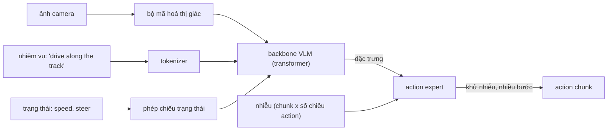
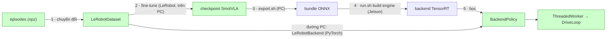

# 13 · VLA và SmolVLA

*Bản tiếng Việt · [English](13-vla-and-smolvla.md)*

*Bản tiếng Việt · [English](13-vla-and-smolvla.vi.md)*

> **Đọc phần này trước.** Từ 2026-11-17, một SmolVLA được fine-tune trên các episode của dự
> án này lái được chiếc xe mô phỏng, trên GPU của laptop, bằng PyTorch: các episode được xuất
> bằng `export`, fine-tune bằng `lerobot-train` của LeRobot, và chạy qua policy `vla`. Chưa có
> gì liên quan tới VLA chạy trên Jetson hay xe thật. Các nhận định về SmolVLA và LeRobot đều có
> nguồn: từ bài báo SmolVLA, từ LeRobot 0.5.2 (code, và các lần chạy làm cho giáo trình này),
> hoặc từ README của jetson-orin-nano-vla. Thứ gì không có nguồn đều được đánh dấu là đề xuất.
> Để tự làm, đi theo
> [Lab 15](15-hands-on-labs.vi.md#lab-15-fine-tune-smolvla-trên-dữ-liệu-lái-xe-ngay-trên-laptop-này).

## Ta đang giải bài toán gì?

CNN của [chương 10](10-model-training.vi.md) chỉ biết một bộ mô phỏng và một hành vi. Mục tiêu của
dự án là một policy bắt đầu từ một model đã pre-train trên rất nhiều dữ liệu thị giác và dữ liệu
robot, và có thể được bảo làm gì bằng lời. Loại model đó là một model thị giác–ngôn ngữ–hành
động (vision-language-action, VLA).

## VLA là gì?

Một **model thị giác–ngôn ngữ (VLM)** nhận ảnh và văn bản, sinh ra văn bản. Từ dữ liệu cỡ
internet, nó đã học được khá nhiều về vẻ ngoài của sự vật và cách ngôn ngữ nói về chúng. Một
**model thị giác–ngôn ngữ–hành động** giữ backbone đó và thêm một đầu ra cho *action*: với ảnh
camera, một câu mô tả nhiệm vụ và trạng thái của robot, nó sinh ra những gì robot nên làm.



Có hai họ đầu ra action:

| Họ | Action được sinh ra thế nào | Ví dụ |
|---|---|---|
| Action dạng token | action được rời rạc hoá và sinh ra như token, giống văn bản | RT-2, OpenVLA |
| Đầu ra action liên tục | một "action expert" riêng sinh ra một chunk action liên tục bằng cách khử nhiễu (diffusion hoặc flow matching) | π0, π0.5, SmolVLA |

Họ thứ hai là lý do hệ thống này có hình dạng như hiện tại: những model như vậy chậm ở mỗi lần
gọi và trả về một chunk.

## SmolVLA

SmolVLA (Shukor và cộng sự 2025) là một VLA nhỏ của nhóm LeRobot thuộc Hugging Face: khoảng 450
triệu tham số, được thiết kế, theo lời bài báo, để train trên một GPU và triển khai trên phần
cứng phổ thông, và được phát hành kèm một hệ thống suy luận bất đồng bộ tách việc dự đoán action
khỏi việc thực thi action.

Những gì đọc được từ các giá trị mặc định của `SmolVLAConfig` trong LeRobot 0.5.2:

| Thiết lập | Mặc định | Liên quan gì ở đây |
|---|---|---|
| `vlm_model_name` | `HuggingFaceTB/SmolVLM2-500M-Video-Instruct` | backbone |
| `num_vlm_layers` | 16 | chỉ 16 layer đầu của VLM được dùng |
| `chunk_size`, `n_action_steps` | 50, 50 | một chunk 50 action |
| `num_steps` | 10 | số bước khử nhiễu (flow matching) mỗi lượt suy luận |
| `max_state_dim`, `max_action_dim` | 32, 32 | state và action được đệm tới độ rộng 32 |
| `resize_imgs_with_padding` | (512, 512) | ảnh được đổi kích thước và đệm về cỡ này |
| `freeze_vision_encoder`, `train_expert_only` | true, true | mặc định, fine-tune chỉ train action expert, không train VLM |
| `rtc_config` | `None` | một cấu hình real-time chunking tuỳ chọn |

Nó khớp với repository này thế nào:

| SmolVLA | Repository này |
|---|---|
| chunk 50 action | `ActionChunk` với $N = 50$; `docs/driving.md` đề xuất `BackendPolicy(backend, chunk_size=50, …)` |
| độ rộng action 32 (có đệm) | `BackendPolicy` giữ cột 0 và 1 và bỏ phần còn lại; `noise_width=32` |
| bắt đầu khử nhiễu từ nhiễu | `BackendObservation.noise`, shape `(1, chunk_size, noise_width)` |
| đầu vào state | `[speed, steer]` |
| câu mô tả nhiệm vụ | `Observation.task`, mặc định `"drive along the track"` |
| khoảng 108 ms trên Orin Nano | độ trễ mặc định 100 ms của bộ mô phỏng |

### Vì sao suy luận chậm

Mỗi lần gọi: mã hoá từng ảnh thành các token thị giác; cho chúng cùng văn bản và state chạy qua
các layer VLM; rồi chạy action expert một lần **cho mỗi bước khử nhiễu** (mặc định 10). Đặc
trưng của VLM chỉ tính một lần và được dùng lại qua các bước, nhưng mười lượt của expert là tuần
tự. Trên Jetson, jetson-orin-nano-vla báo p50 là 107,55 ms (9,30 Hz) cho `lerobot/smolvla_base`
với hai camera, dùng 1,78 GB RAM.

## Fine-tuning

Pre-training cho VLA những hiểu biết nền chung về thị giác và vận động; nó chưa bao giờ thấy
chiếc xe này. **Fine-tuning** train tiếp trên các lần làm mẫu từ robot đích để output của nó mang
nghĩa `[steer, throttle]` cho chiếc xe này. Về cấu trúc, đó là behaviour cloning của
[chương 8](08-imitation-learning.vi.md) với một model lớn hơn nhiều và một loss sinh (generative)
thay cho hồi quy: model học cách biến nhiễu thành chunk đã được làm mẫu, có điều kiện theo
observation.

Mọi điều ở chương 8 vẫn đúng, và còn quan trọng hơn vì mỗi lần train rất tốn kém: dữ liệu hồi
phục, đánh giá vòng kín, không tin loss offline.

## LeRobotDataset

Định dạng bộ dữ liệu của LeRobot (phiên bản codebase `v3.0` trong LeRobot 0.5.2): dữ liệu dạng
bảng trong Parquet, các luồng camera dạng video, và metadata mô tả các feature, tần số, episode
và nhiệm vụ. Theo quy ước, các feature được đặt tên `observation.images.<camera>`,
`observation.state` và `action`, và mỗi khung hình mang một `task`.

Một bộ dữ liệu được ghi bằng (chữ ký hàm từ `lerobot_dataset.py`):

```python
dataset = LeRobotDataset.create(repo_id, fps, features, root=...)   # chế độ ghi
dataset.add_frame(frame)        # một dict giá trị feature; "Must include a 'task' key"
dataset.save_episode()
dataset.finalize()
```

## Con đường đề xuất



Màu xanh: có ở đây và đã chạy. Bước 3 và 4 có trong jetson-orin-nano-vla và chưa được thử với
một checkpoint lái xe.

| Bước | Việc gì | Trạng thái | Bằng chứng |
|---|---|---|---|
| 0 | Episode có ảnh, state `[speed, steer]`, action `[steer, throttle]` | **[TESTED]** | [chương 9](09-dataset-pipeline.vi.md) |
| 1 | Chuyển episode sang LeRobotDataset | **[TESTED]** | [`drive/learn/export.py`](../../drive/learn/export.py), `ExportTests`; đã chạy trên cả 82 episode |
| 2 | Fine-tune SmolVLA bằng LeRobot | **đã làm một lần**, trên laptop: 2000 bước, 13 phút | [Lab 15](15-hands-on-labs.vi.md#lab-15-fine-tune-smolvla-trên-dữ-liệu-lái-xe-ngay-trên-laptop-này) |
| 3 | Xuất checkpoint trên PC (`./export.sh`) | có trong **jetson-orin-nano-vla**, không có ở đây; checkpoint tự train là "experimental" theo README của nó | |
| 4 | Build và chạy engine TensorRT trên Jetson (`./run.sh`) | có trong **jetson-orin-nano-vla**; chỉ để benchmark | |
| 5 | `BackendPolicy` bọc quanh backend | **đã chạy** với một backend PyTorch ([`LeRobotBackend`](../../drive/policy/lerobot_backend.py)); với TensorRT vẫn chỉ có test bằng stub | Lab 15 |
| 6 | Chọn được `vla` từ CLI hoặc tham số ROS | **đã hiện thực** (`--policy vla --checkpoint …`, `evaluate <version>`); driver ROS 2 nhận `policy:=vla` qua cùng `make_policy`, **chưa chạy** | [`POLICIES`](../../drive/policy/__init__.py#L6) |
| 7 | Một checkpoint lái xe đã fine-tune | **có trên máy** (`runs/drive/vla/smolvla-v1`, không nằm trong git); chỉ trong bộ mô phỏng | Lab 15 |

### Chi tiết bước 1: chuyển đổi (`export`)

[`drive/learn/export.py`](../../drive/learn/export.py) là một giai đoạn của dây chuyền giống các
giai đoạn khác ([chương 9](09-dataset-pipeline.vi.md)); nó chỉ import LeRobot khi chạy.

| Episode | Feature của LeRobot | Shape |
|---|---|---|
| `images[i]` | `observation.images.front` | (240, 320, 3), video AV1 |
| `states[i]` | `observation.state` | (2,): `speed_mps`, `steer` |
| `plans[i, 0]`, hoặc `actions[i]` với `--action applied` | `action` | (2,): `steer`, `throttle` |
| `meta["task"]` | `task` | chuỗi |
| `meta["fps"]` | `fps` | 10 |

Nó trả lời ba câu hỏi thiết kế thế nào:

**1. Action nào?** Một policy LeRobot dựng mục tiêu train cho khung hình $i$ từ cột `action` của
các khung hình $i, i+1, \dots$. Với các episode từ `collect`, `actions[i]` là steer **đã bị làm
nhiễu** được áp vào, nên ghi nó vào sẽ dạy nhiễu.

| Lựa chọn cho `action` ở khung hình $i$ | Mục tiêu chunk thu được | Ở đây |
|---|---|---|
| `actions[i]` (thứ đã được áp vào) | các lệnh đã bị làm nhiễu | `--action applied`; chỉ đúng với bản ghi của người hoặc của ROS 2 |
| `plans[i, 0]` (thứ teacher muốn ở khung hình đó) | action teacher định làm ở mỗi trạng thái chiếc xe lang thang đã đi qua | **mặc định**; đúng là DART như đã công bố. Với episode được gán nhãn từ action, nó bằng `actions[i]` |
| toàn bộ `plans[i]` | kế hoạch sạch của teacher từ trạng thái đó | không vừa định dạng mỗi khung hình một action của LeRobot |

Cái giá của lựa chọn mặc định, *measured* trên 80 episode của teacher: chunk mục tiêu bằng kế
hoạch sạch ở bước 0, và lệch khỏi nó trung bình 0,04 về steer ở 0,1 s, 0,09 ở 0,2 s, 0,13 ở
0,3 s và khoảng 0,2 từ 0,5 s trở đi, so với trung bình |steer| là 0,24. Phần cuối của mỗi chunk
được học từ phản ứng của teacher trước những nhiễu chưa xảy ra, thứ không observation nào dự
đoán được. Phần xe thực sự thực hiện ở độ trễ 100–200 ms (bước 1–2) bị ảnh hưởng ít nhất.

**2. Tần số nào?** Episode ở 10 Hz, nên một chunk 50 action sẽ trải dài 5 s. Lần fine-tune dùng
`--policy.chunk_size=16`: 16 action cách nhau 0,1 s, đúng 1,5 s của CNN. Trọng số của model
không phụ thuộc độ dài chunk (đã kiểm tra trong `modeling_smolvla.py`: các phép chiếu action
có kích thước theo `max_action_dim`, không theo `chunk_size`). Train chạy 0,37 s mỗi bước với
batch 16, so với 0,69 s trên bộ dữ liệu công khai hai camera với chunk 50; ít ảnh hơn và chunk
ngắn hơn đều góp phần, và chưa được tách riêng.

**3. Bao nhiêu camera?** Một. Nó được lưu dưới tên `front` và đổi tên thành `camera1`, ô đầu
tiên trong ba ô mà `smolvla_base` được train cùng, bằng `--rename_map`. Việc đổi tên được lưu
trong bộ tiền xử lý của checkpoint, nên lúc suy luận ảnh được truyền vào dưới tên `front`.
LeRobot chấp nhận một bộ dữ liệu có các camera là tập con của các camera của model.

Các episode có timestamp lệch nửa chu kỳ trở lên so với một tần số đều bị từ chối, vì LeRobot
đặt khung hình $i$ ở $i/\text{fps}$. Hai bản ghi ROS 2 lệch tới 40 ms và vẫn được giữ.

### Chi tiết bước 5: adapter

Đã giải thích ở [chương 4](04-driving-policies.vi.md). Test của nó cho thấy gì và không cho thấy gì:

```python
class Backend:                                     # tests/test_drive.py: một bản thay thế
    def infer(self, obs):
        chunk = np.zeros((50, 32), np.float32)
        chunk[:, 0], chunk[:, 1] = 0.25, 3.0
        return SimpleNamespace(chunk=chunk, timings_ms={"total": 100.0})
```

Nó chứng minh phần đường ống: shape, việc cắt giá trị, chuyển tiếp state và task, nhiễu mới cho
mỗi lần gọi. Nó không chứng minh gì về một model: không có trọng số, không có ảnh nào tới được
một mạng, và các "action" là hằng số.

Interface mà nó bắt chước đã được kiểm tra cho giáo trình này với một bản checkout cục bộ của
jetson-orin-nano-vla: `bench.obs.Observation` có các field `index`, `images`, `state`, `task`,
`noise`; `Backend.infer(obs)` trả về một `InferResult` có `chunk` là
`(chunk_size, action_dim)` theo đơn vị của robot; `TrtSplitSmolVLABackend(bundle, cache_dir,
action_dim=32, chain="host")` phải được `load()` trước khi dùng. Hai bên khớp nhau tại thời
điểm checkout đó; không có gì giữ chúng đồng bộ nếu repository kia thay đổi.

## Một VLA sẽ thêm gì và không thêm gì

| Sẽ thêm | Sẽ không thêm |
|---|---|
| Một backbone thị giác đã pre-train: cần ít lần làm mẫu hơn để đối phó với một vẻ ngoài mới | An toàn: supervisor vẫn cần thiết như trước |
| Điều kiện theo ngôn ngữ: "dừng ở cọc tiêu", "lái chậm thôi", nếu dữ liệu có những nhiệm vụ như vậy | Hiểu ngôn ngữ từ dữ liệu chỉ có **một** câu nhiệm vụ. Mọi episode ở đây đều nói "drive along the track"; một model fine-tune trên đó không có lý do gì để chú ý tới văn bản |
| Một đầu ra action sinh (generative) có thể biểu diễn nhiều kế hoạch hợp lệ | Độ trễ thấp hơn: khoảng 108 ms trên Jetson, trong khi CNN mất 2,9 ms mỗi lượt suy luận trên CPU laptop (*measured* với `--realtime --latency-ms 0`) |
| | Khả năng chống chịu lỗi của chính nó khi không có dữ liệu hồi phục |

## Real-time chunking

[Chương 5](05-action-chunking-and-latency.vi.md) cho thấy vòng lặp hỏng khi quá khoảng 250 ms ở
1,5 m/s, và nêu real-time chunking (Black, Galliker và Levine 2025) là cách chữa. Hai điều đáng
biết:

- Repository này không hiện thực nó: `docs/driving.md`, "That is not built here."
- LeRobot 0.5.2 có một module policy `rtc` và `SmolVLAConfig` có field `rtc_config`. Vậy một
  SmolVLA bằng PyTorch có thể chạy với RTC qua LeRobot. Liệu điều đó có sống sót qua việc xuất
  sang các engine TensorRT tách rời hay không thì chưa biết và phải được xác lập: **[FUTURE]**.

## Con đường chỉ dùng PC, đã làm một lần

Con đường đầy đủ cần một Jetson. Câu hỏi "một SmolVLA đã fine-tune có lái được chiếc xe mô phỏng
này không?" thì không cần, và đã được trả lời trên laptop này (RTX 4060 Laptop, 8 GB):

| Bước | Lệnh | *Measured* |
|---|---|---|
| export | `python -m drive export` | 82 episode, 24 876 khung hình, 35 MB |
| fine-tune | `lerobot-train --policy.path=lerobot/smolvla_base … --policy.chunk_size=16 --batch_size=16 --steps=2000` | 13 phút; 100 triệu trên 450 triệu tham số được train; 2,9 GB bộ nhớ GPU; loss trên tập giữ lại 0,65 → 0,47 |
| suy luận | `LeRobotBackend` | 124 ms mỗi chunk (10 bước khử nhiễu), 7 s để nạp |
| lái | `python -m drive sim --policy vla --checkpoint smolvla-v1 --latency-ms 125` | 30 s trên peanut: 1,39 m/s, 4,4 cm rms, 10,5 cm max, không bao giờ ra khỏi đường |
| đánh giá | `python -m drive evaluate smolvla-v1 --latency-ms 125` | **6/6 lần lái đạt**: 1,44 m/s, 4,8 cm rms, 15,0 cm tệ nhất, không bao giờ ra khỏi đường; 5 phút |

So với CNN `v1` (độ trễ 100 ms, [chương 11](11-model-evaluation.vi.md)):

| Model | Train trên | Độ trễ | Đạt | Tốc độ trung bình | rms | Tệ nhất |
|---|---|---:|---:|---:|---:|---:|
| `smolvla-v1` | 82 episode: 80 lần lái của teacher trên peanut, 2 lần lái ROS 2 (oval, trefoil) | 125 ms | 6/6 | **1.44 m/s** | 4.8 cm | 15.0 cm |
| CNN `v1` | 40 lần lái của teacher trên peanut | 100 ms | 6/6 | 0.84 m/s | 1.3 cm | 4.0 cm |
| CNN `v2` | dữ liệu của `v1` cộng 2 lần lái ROS 2 | 100 ms | 6/6 | 0.90 m/s | 1.2 cm | 3.8 cm |
| `pure-pursuit` (teacher) | — | 100 ms | 6/6 | 1.47 m/s | 1.5 cm | 3.4 cm |

Không phải so cùng loại: dữ liệu, độ trễ và tốc độ khác nhau, và mỗi thứ chỉ một lần chạy. Hãy
đọc nó như hai quan sát cần kiểm chứng, không phải kết luận:

- **SmolVLA lái ở tốc độ của teacher; các CNN thì không.** Tốc độ trong dữ liệu đã xuất có trung
  vị 1,33 m/s (từ thống kê của bộ dữ liệu). Vì sao CNN hồi quy dừng ở khoảng 0,84 m/s còn SmolVLA
  dùng flow matching thì không, chưa được xác lập ở đây.
- **SmolVLA lạng lách nhiều hơn ba tới bốn lần.** Các ứng viên, chưa cái nào được tách riêng:
  phần cuối nhiễu của chunk mục tiêu (ở trên), chỉ 2000 bước, bộ mã hoá thị giác bị đóng băng
  phải nhìn ảnh render 240×320 bị đổi cỡ lên 512×512, và chính tốc độ cao hơn (sai số của bản
  thân teacher cũng tăng theo tốc độ, [chương 6](06-control-theory.vi.md)).

Lần chạy này cho thấy gì và không cho thấy gì:

- Nó cho thấy cả con đường phần mềm chạy được: export, fine-tune trên PC, một backend PyTorch
  sau `BackendPolicy`, bù độ trễ và supervisor, không cần sửa gì.
- Một lần fine-tune, một seed, 2000 bước: không phải thước đo cho những gì SmolVLA làm được ở đây.
- Độ trễ là của laptop, do `SimulatedWorker` áp vào. Trên Jetson nó sẽ khác và phải được đo với
  model đã fine-tune.
- Đây là bộ mô phỏng: ảnh render, một vẻ ngoài, một câu nhiệm vụ.

## Những lỗi và hiểu lầm thường gặp

- **"Một VLA lái chiếc xe."** Một SmolVLA đã fine-tune lái chiếc xe *mô phỏng*, bằng PyTorch
  trên laptop. Chưa có gì chạy trên Jetson hay xe thật.
- **"Lần chạy PyTorch chứng minh con đường Jetson."** Việc xuất sang TensorRT, độ trễ của nó và
  độ khớp số học với model PyTorch đều vẫn phải được xác lập.
- **"Dùng lệnh của notebook Colab."** `--policy.type=smolvla` không nạp VLM đã pre-train trong
  LeRobot 0.5.2; hãy dùng `--policy.path=lerobot/smolvla_base`.
- **"Đổi `actions` thành `action` rồi train."** Với episode của teacher, làm vậy là train trên nhiễu.
- **"Một VLA sẽ hiểu chỉ dẫn."** Chỉ những chỉ dẫn giống trong dữ liệu fine-tune của nó.
- **"SmolVLA nhỏ, nên độ trễ không đáng lo."** 108 ms là lý do của toàn bộ kiến trúc này.

## Thí nghiệm thực hành

Làm [Lab 15](15-hands-on-labs.vi.md#lab-15-fine-tune-smolvla-trên-dữ-liệu-lái-xe-ngay-trên-laptop-này).
Trước khi fine-tune, tự đo ảnh hưởng của chunk mục tiêu:

```bash
python3 - <<'EOF'
import numpy as np
from pathlib import Path
from drive.learn.label import episodes, read_labels
d = {k: [] for k in (0, 1, 3, 5, 15)}
for ep in episodes(Path("runs/drive/episodes")):
    plans = read_labels(ep)["plans"]
    for k in d:
        d[k].append(np.abs(plans[k:, 0, 0] - plans[:len(plans) - k, k, 0]))
print({k: round(float(np.concatenate(v).mean()), 3) for k, v in d.items()})
EOF
```

Sau đó giải thích vì sao các con số tăng theo bước, và vì sao chúng sẽ bằng 0 với một episode
ghi bằng `--steer-noise 0`.

## Kiểm tra kiến thức

1. Một VLA thêm gì vào một VLM?
2. Vì sao SmolVLA cần một đầu vào nhiễu, và hệ thống này cung cấp nó ở đâu?
3. Những bước nào của con đường đề xuất có trong repository này?
4. Vì sao `actions[i]` là `action` sai cho các episode tạo bằng `collect`?
5. Nếu fine-tune ở 10 Hz với chunk 50, một chunk dài bao lâu, và `chunk_dt_s` là bao nhiêu?
6. Vì sao fine-tune trên bộ dữ liệu này sẽ không cho ra một model biết làm theo chỉ dẫn?

<details><summary>Đáp án</summary>

1. Một đầu ra sinh action cho robot, có điều kiện theo ảnh, văn bản và trạng thái.
2. Đầu ra action của nó sinh chunk bằng cách khử nhiễu; `BackendPolicy` rút nhiễu khởi đầu và truyền vào `BackendObservation.noise`.
3. Bước 0, 1 và 2 (episode, `export`, một lần fine-tune trên PC), bước 5 với một backend PyTorch, và bước 6; bước 3–4 (TensorRT, Jetson) chưa được thử.
4. Đó là steer đã bị làm nhiễu được áp vào, không phải thứ teacher định làm.
5. 4,9 s giữa action đầu và action cuối (5 s action); `chunk_dt_s = 0.1`.
6. Mọi episode có cùng một câu nhiệm vụ, nên văn bản không mang thông tin gì.
</details>

## Đọc thêm

- Shukor và cộng sự 2025, *SmolVLA* (bài báo, model card, tài liệu LeRobot).
- Black và cộng sự 2024 (π0) về action expert dùng flow matching; Kim và cộng sự 2024 (OpenVLA) và Brohan và cộng sự 2023 (RT-2) về action dạng token.
- Tài liệu bộ dữ liệu của LeRobot (v3.0).
- Black, Galliker và Levine 2025, real-time chunking.
- [`docs/driving.vi.md`](../driving.vi.md), mục "Từ đây tới một chiếc xe thật".
