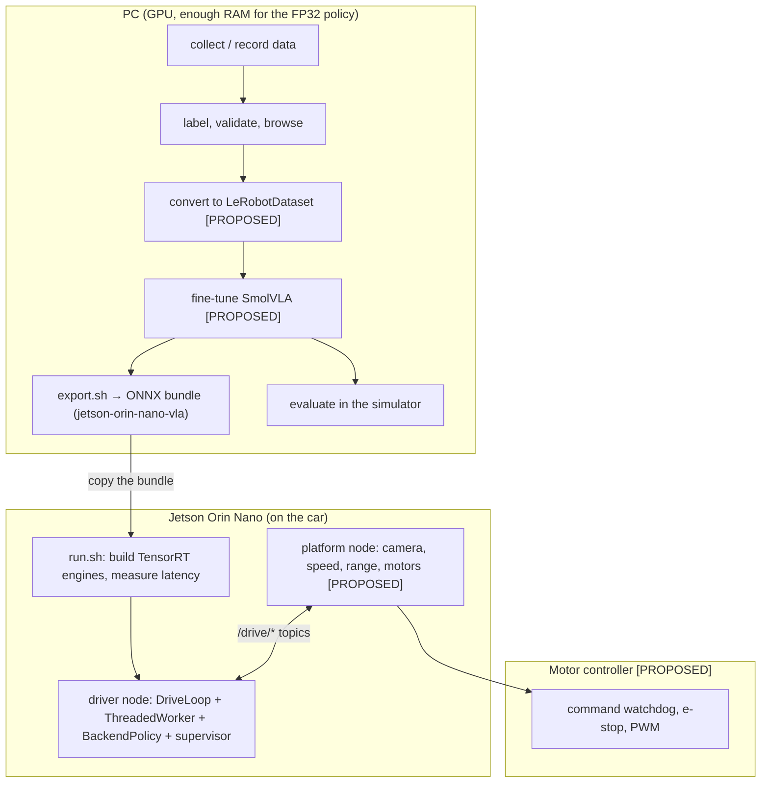
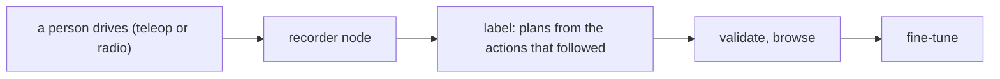

# 14 · Jetson Orin Nano deployment

> **Status of this whole chapter: [PROPOSED].** Nothing in this repository has run on
> a Jetson or on a real car. The PC side has moved: the episodes can be exported to a
> LeRobotDataset, and a SmolVLA fine-tuned on them drives the simulator in PyTorch on
> a laptop ([Lab 15](15-hands-on-labs.md#lab-15-fine-tune-smolvla-on-the-driving-data-on-this-laptop)).
> Still not here: the real platform, a CARLA bridge, a TensorRT export of a driving
> checkpoint, and any measurement on the board. This chapter describes the intended
> architecture and the work that separates the repository from it.

## What problem are we solving?

Moving from a simulator on a PC to a small computer on a moving car changes three
things at once: the compute budget (8 GB shared between CPU and GPU), the clock (real
time, with jitter), and the consequences of a mistake.

## The target

| Item | Value | Source |
|---|---|---|
| Computer | Jetson Orin Nano Super, 8 GB | project README |
| Vehicle | 1:10 scale car | the simulator's `VehicleParams` |
| Policy | a fine-tuned SmolVLA behind TensorRT | project README |
| Control rate | 50 Hz | `LoopConfig` |

## Who does what



| Responsibility | PC | Jetson |
|---|---|---|
| Recording data | simulator; later, drives from the car copied over | the recorder node while a person drives |
| Training and fine-tuning | yes | no |
| Export to ONNX | yes ("needs the whole FP32 policy in memory") | untested by its authors |
| Building TensorRT engines | no (engines are specific to the device) | yes, 5–15 minutes on first run, then cached |
| Inference while driving | no | yes |
| Closed-loop evaluation in simulation | yes | not needed |

## Model export and TensorRT

**TensorRT** is NVIDIA's inference optimiser: it takes a network (usually as ONNX) and
builds an *engine*, a plan specialised for one GPU, one precision and fixed input
shapes. It fuses layers, selects kernels and can lower precision to FP16.

What jetson-orin-nano-vla does, per its README:

1. **`./export.sh <checkpoint>` on a PC** writes a bundle of several ONNX graphs
   (vision, language, denoise, …) with the stock policy's reference actions. Models
   are split because most are "too big to build as a single monolithic TensorRT
   engine on 8 GB".
2. **Copy** the bundle to the Jetson.
3. **`./run.sh <bundle>` on the Jetson** builds the engines piece by piece, checks the
   actions against the stock policy's (cosine ≥ 0.99999 in its published runs), and
   benchmarks. Engines are "mostly FP16".

It is explicit about its scope: "This repo is for benchmarking only. It measures how
fast the models run on the board, and it does not provide the code to drive a robot
with them." Custom (fine-tuned) checkpoints are "experimental".

## Latency and memory on the board

From the jetson-orin-nano-vla README (JetPack 7.2.1, MAXN_SUPER with pinned clocks,
300 s runs, **synthetic observations**):

| Model | p50 latency | Rate | RAM in use |
|---|---:|---:|---:|
| SmolVLA 450M (2 cameras) | 107.55 ms | 9.30 Hz | 1.78 GB |
| GR00T N1.6 / N1.7 3B | 273 ms | 3.66 Hz | 5.3–5.8 GB |
| EVO1 775M | 332.77 ms | 3.00 Hz | 2.76 GB |
| X-VLA 0.9B | 342.59 ms | 2.92 Hz | 3.04 GB |
| π0.5 LIBERO 3.3B | 438.47 ms | 2.28 Hz | 6.39 GB |
| π0.5 base 3.3B | 643.39 ms | 1.55 Hz | 6.18 GB |

### What those latencies would mean for this control loop

Combining them with this repository's simulator measurements
([chapters 5](05-action-chunking-and-latency.md) and [11](11-model-evaluation.md)).
**This is an inference from simulation with the pure-pursuit teacher, not a
measurement of any of these models driving.**

| Latency class | Plan age $[L, 2L)$ | Default 600 ms watchdog | Teacher at 1.5 m/s (*measured*) | Implication |
|---|---|---|---|---|
| ~108 ms (SmolVLA) | 0.11–0.22 s | fine | stable (1.8–2.0 cm at 100–200 ms) | the case this stack was designed for |
| ~273 ms (GR00T) | 0.27–0.55 s | fine, barely | 250 ms: 3.1 cm; 300 ms: 20 cm | on the edge at 1.5 m/s; drive slower |
| ~335 ms (EVO1, X-VLA) | 0.34–0.68 s | **braked part of every cycle** | unstable at 1.5 m/s; at 0.6 m/s, 400 ms holds 1.6 cm | needs a higher limit *and* a low speed |
| ~440–640 ms (π0.5) | up to 1.3 s | **never moves** (as the 650 ms test shows) | unstable even at 0.6 m/s by 650 ms | needs real-time chunking |

And remember the learned CNN tolerated *less* latency than the teacher (it failed at
300 ms at 0.84 m/s). Expect the same of any learned policy until measured.

Add to the model's latency, on a real car: camera exposure and readout, image
transport, and the ROS hop. `RosPlatform` accounts for them automatically because it
stamps the observation with the image's capture time, provided the camera driver
stamps honestly.

### Memory

8 GB is shared by the OS, the desktop (the README recommends running headless), ROS 2,
the camera pipeline, Python and the model. SmolVLA's 1.78 GB leaves room; the 3 B
models' 5–6 GB leave little for anything else.

## The runtime on the Jetson (intended)

```python
# PROPOSED wiring, not run anywhere. Names from jetson-orin-nano-vla as of a local checkout.
from bench.backends.trt_split_smolvla import TrtSplitSmolVLABackend
from drive.control import ThreadedWorker
from drive.policy.vla import BackendPolicy

backend = TrtSplitSmolVLABackend(bundle_dir, cache_dir)       # action_dim=32, chain="host"
backend.load()                                                # builds or loads the engines
policy = BackendPolicy(backend, chunk_size=50, noise_width=32, chunk_dt_s=1 / fps)
worker = ThreadedWorker(policy)                               # inference off the 50 Hz loop
```

`docs/driving.md` gives the same construction:
`BackendPolicy(backend, chunk_size=50, noise_width=32, chunk_dt_s=1 / fps)` in a
`ThreadedWorker`.

[`make_policy`](../../drive/policy/__init__.py#L9) has a `vla` branch, and
[`DriveNode`](../../ros/src/drive_ros/drive_ros/drive_node.py#L27) reaches it through
`policy:=vla`, but that branch loads a **LeRobot (PyTorch) checkpoint** with
`LeRobotBackend`. For the Jetson it needs a second backend: one that takes a bundle
path and builds `TrtSplitSmolVLABackend` as above. That does not exist.

### Real-time constraints

| Constraint | Why | State |
|---|---|---|
| The 50 Hz tick must not wait for the model | or the car is uncommanded for 100+ ms | handled: `ThreadedWorker` infers outside the lock |
| The Python control thread must get CPU time while the GPU pipeline is busy | the GIL and CPU contention can stretch a 20 ms tick | **unmeasured** on a Jetson |
| Latency jitter | plan age varies | handled in principle (the origin is `t_obs`); `--jitter-ms` in simulation |
| Thermal and power throttling | latency drifts upward mid-drive | the benchmark records throttle events; the drive loop does not react to them |
| Timer accuracy | rclpy timers on a loaded, non-real-time kernel | **unmeasured** |

A useful first measurement on the board, before any car: run the driver node against
the simulator node with the real backend and log the distribution of tick intervals
and plan ages.

## Hardware integration: what the platform node must provide

The simulator supplies a great deal for free. On a car each item is a piece of
engineering. All **[PROPOSED]**; the contract is in [chapter 12](12-ros2-integration.md).

| Need | Simulator | On a real 1:10 car |
|---|---|---|
| Camera, `rgb8`, stamped at capture | rendered, perfect, instantaneous | a CSI or USB camera; exposure, rolling shutter, latency; the field of view, height and pitch differ from `CameraParams` |
| Speed, m/s | exact | a wheel or motor encoder, or the ESC's telemetry; noisy at low speed |
| **Steering position**, −1..1 | exact, lags the command | hobby servos give **no feedback**. It must be estimated (for example, the last command through a lag model) or measured with an added sensor. The policies take it as an input |
| Range, m | exact, 50 Hz | a time-of-flight or ultrasonic sensor: 20–50 Hz, minimum range, false returns; must never publish NaN |
| Steer and throttle, −1..1 | exact | calibration to PWM: centre trim, end points, ESC dead zone |
| Brake, throttle −1 | 6 m/s², holds at zero | depends on the ESC; some reverse instead of braking |
| Command watchdog | 0.5 s in the sim node | must exist in the motor controller, below Linux |
| Emergency stop | `e` key in the HUD | a physical or radio kill switch that does not depend on the Jetson; no ROS input exists for it yet |

### Safety placement

[`drive/safety.py`](../../drive/safety.py): "Keep it this small on a real car, and run
it where a hung policy process cannot stop it." Today the supervisor runs **in the
driver process**, on the same thread as the loop. A hang there silences it. The
layering to aim for:

1. Supervisor in the driver (what exists): limits and obstacle braking.
2. Command watchdog in the platform node (modelled by the simulator).
3. Watchdog and kill switch in the motor microcontroller (does not exist).

### Software environment

The repository's container ([`docker/Dockerfile`](../../docker/Dockerfile)) is built
for a PC: `osrf/ros:humble-desktop-full` with PyTorch 2.5.1 CUDA 12.1 wheels and the
NVIDIA container runtime. There is no Jetson image. On the board, PyTorch and TensorRT
come from JetPack, and the ROS 2 distribution must be one that JetPack's Ubuntu
supports. The driver needs only numpy, OpenCV, rclpy and the backend; it does not
need PyTorch when the policy is a TensorRT backend.

## The sim-to-real gap for the *data*

A policy fine-tuned on simulator images will not drive a real car: the images differ
in every respect. The intended data source is the car itself:



Chapter 8's lesson returns with force. A person driving carefully produces **perfect
driving only**, there is no teacher to state a clean plan from an off-centre position,
and `validate`'s "perfect driving only" check applies only to teacher-labelled data.
Options to plan for: deliberately recorded recoveries (drive off-line, record only the
return), DAgger-style rounds with a person correcting the policy, or noise injected
into the person's steering with their intended command recorded as the label (DART
with a human).

## The remaining work, in order

| # | Task | Depends on | Kind |
|---|---|---|---|
| 1 | ~~Episode → LeRobotDataset conversion, including the choice of `action`~~ **done**: `export` | — | software, PC |
| 2 | ~~Fine-tune SmolVLA; drive it in the simulator via a PyTorch backend~~ **done once** (2000 steps; Lab 15) | 1 | ML, PC |
| 3 | ~~Register `vla` in `make_policy`, the CLI and the driver node~~ **done** for LeRobot checkpoints; a TensorRT-bundle backend remains | 2 | software |
| 4 | ~~Export; build engines; measure latency of the *fine-tuned* model on the board~~ **done** for a C++ probe ([`jetson/smolvla_trt`](../../jetson/smolvla_trt/README.md)): three FP16 engines, 82 ms per chunk, within 0.002 of fp32. Not yet behind `BackendPolicy` in the control loop | 2 | Jetson |
| 5 | Run the driver on the Jetson against the simulator node; measure tick jitter and plan age | 3, 4 | Jetson |
| 6 | Platform node for the car: camera, speed, steering estimate, range, PWM, watchdog | — | hardware, ROS 2 |
| 7 | E-stop path independent of the Jetson; e-stop input to the supervisor | 6 | hardware, safety |
| 8 | Measure the car: braking deceleration, steering lag, speed limits; set `SafetyLimits` | 6 | measurement |
| 9 | Record real drives with recoveries; label; validate | 6 | data |
| 10 | Fine-tune on real data; first closed-loop tests at walking pace, wheels off the ground first | 2, 8, 9 | integration |
| 11 | Real-time chunking, if the measured latency × speed demands it | 5 | research |

## Common mistakes and misconceptions

- **"It ran at 108 ms in the benchmark, so the car will see 108 ms."** That figure is
  the base checkpoint on synthetic images with the board tuned. Camera and transport
  latency add to it, and a fine-tuned model must be measured itself.
- **"The simulator's safety limits apply to the car."** `planned_decel_mps2 = 4.0`
  and `stop_margin_m = 0.30` are properties of a model, not of your tyres.
- **"The policy needs `steer` from the car, so I'll publish the last command."** That
  is an estimate with no lag; the simulator's value lags by 80 ms. The mismatch is a
  distribution shift in the policy's state input.
- **"If inference hangs, the supervisor will brake."** It will (the plan goes stale),
  unless the hang takes the control thread with it.
- **"Train in simulation, deploy on the car."** Not with these images.

## Practical experiment

A paper exercise ([Lab 14](15-hands-on-labs.md#lab-14-analyse-the-vla-deployment-architecture))
and one that needs no hardware:

```bash
# How would each benchmarked model fare in this loop? Use the teacher as a stand-in.
for L in 108 273 335 440 643; do
  ./drive.sh sim --latency-ms $L --duration-s 30 | sed -n '1,2p;4p'
done
# and at a speed chosen for the slow ones
./drive.sh sweep --speed 0.6 --max-plan-age-ms 1500 --latencies 108,273,335,440,643
```

For each model, state the largest speed and the watchdog limit you would allow, and
how far the car travels on its oldest plan.

## Knowledge check

1. Which machine exports, which builds engines, and why?
2. Why are the engines "split"?
3. A model has 335 ms latency. What does the default watchdog do, and what two changes would let it drive?
4. Name three signals the simulator provides exactly that a real car must estimate or measure.
5. Where does the supervisor run today, and where should the last line of defence be?
6. Why is real-car data likely to be "perfect driving only", and what can be done?

<details><summary>Answers</summary>

1. The PC exports (it needs the whole FP32 model in memory); the Jetson builds engines (they are specific to the device).
2. Most of the models are too large to build as one TensorRT engine within 8 GB.
3. Plan age reaches 0.67 s, so the car is braked for part of every cycle. Raise `max_plan_age` above 0.67 s and lower the speed (around 0.6 m/s by the teacher's sweep).
4. Steering position, speed, range (also: pose, which the car does not have at all).
5. In the driver process; in the motor controller, with a kill switch independent of the Jetson.
6. A careful person stays on the centreline and cannot state a clean plan from elsewhere. Record deliberate recoveries, use DAgger-style correction, or inject noise while recording the intended command.
</details>

## Further reading

- [jetson-orin-nano-vla](https://github.com/eetmie/jetson-orin-nano-vla): README, `docs/optimization.md`, `export/README.md`.
- NVIDIA TensorRT documentation; the Jetson Orin Nano developer kit guide.
- [`docs/driving.md`](../driving.md), "From here to a car".
- [Chapter 12](12-ros2-integration.md), "Replacing the simulator".
