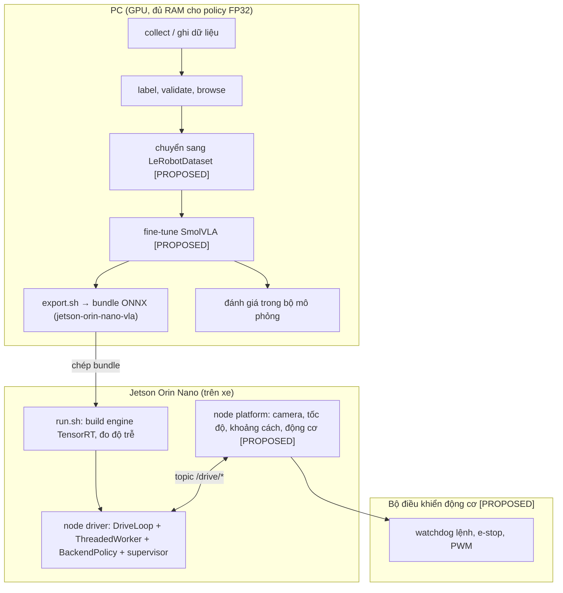
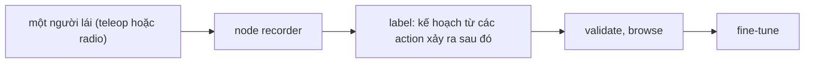

# 14 · Triển khai lên Jetson Orin Nano

*Bản tiếng Việt · [English](14-jetson-deployment.md)*

*Bản tiếng Việt · [English](14-jetson-deployment.vi.md)*

> **Trạng thái của cả chương này: [PROPOSED].** Chưa có gì trong repository này chạy trên
> Jetson hay trên một chiếc xe thật. Phía PC đã tiến lên: các episode xuất được sang
> LeRobotDataset, và một SmolVLA fine-tune trên chúng lái được bộ mô phỏng bằng PyTorch trên
> laptop ([Lab 15](15-hands-on-labs.vi.md#lab-15-fine-tune-smolvla-trên-dữ-liệu-lái-xe-ngay-trên-laptop-này)).
> Vẫn chưa có ở đây: platform thật, cầu nối CARLA, bản xuất TensorRT của một checkpoint lái
> xe, và bất kỳ phép đo nào trên board. Chương này mô tả kiến trúc dự định và phần việc đang
> ngăn cách repository với nó.

## Ta đang giải bài toán gì?

Chuyển từ một bộ mô phỏng trên PC sang một máy tính nhỏ trên một chiếc xe đang chạy làm thay
đổi ba thứ cùng lúc: ngân sách tính toán (8 GB dùng chung giữa CPU và GPU), đồng hồ (thời gian
thật, có dao động), và hậu quả của một sai lầm.

## Mục tiêu

| Hạng mục | Giá trị | Nguồn |
|---|---|---|
| Máy tính | Jetson Orin Nano Super, 8 GB | README của dự án |
| Xe | xe tỷ lệ 1:10 | `VehicleParams` của bộ mô phỏng |
| Policy | một SmolVLA đã fine-tune chạy sau TensorRT | README của dự án |
| Tần số điều khiển | 50 Hz | `LoopConfig` |

## Ai làm gì



| Trách nhiệm | PC | Jetson |
|---|---|---|
| Ghi dữ liệu | bộ mô phỏng; sau này, các lần lái từ xe chép sang | node recorder trong lúc một người lái |
| Train và fine-tune | có | không |
| Xuất sang ONNX | có ("needs the whole FP32 policy in memory") | tác giả chưa test |
| Build engine TensorRT | không (engine gắn với thiết bị) | có, 5–15 phút ở lần chạy đầu, sau đó được lưu đệm |
| Suy luận khi đang lái | không | có |
| Đánh giá vòng kín trong mô phỏng | có | không cần |

## Xuất model và TensorRT

**TensorRT** là bộ tối ưu suy luận của NVIDIA: nó nhận một mạng (thường dưới dạng ONNX) và
build một *engine*, một kế hoạch chuyên cho một GPU, một độ chính xác số và các shape đầu vào
cố định. Nó gộp layer, chọn kernel và có thể hạ độ chính xác xuống FP16.

Những gì jetson-orin-nano-vla làm, theo README của nó:

1. **`./export.sh <checkpoint>` trên PC** ghi một bundle gồm nhiều đồ thị ONNX (thị giác, ngôn
   ngữ, khử nhiễu, …) cùng các action tham chiếu của policy gốc. Model bị tách vì phần lớn "too
   big to build as a single monolithic TensorRT engine on 8 GB" (quá lớn để build thành một
   engine TensorRT nguyên khối trong 8 GB).
2. **Chép** bundle sang Jetson.
3. **`./run.sh <bundle>` trên Jetson** build từng engine một, kiểm tra action so với của policy
   gốc (cosine ≥ 0,99999 trong các lần chạy đã công bố), và đo hiệu năng. Engine "mostly FP16"
   (phần lớn FP16).

Nó nói rõ phạm vi của mình: "This repo is for benchmarking only. It measures how fast the
models run on the board, and it does not provide the code to drive a robot with them." (Repo
này chỉ để benchmark. Nó đo model chạy nhanh tới đâu trên board, và không cung cấp code để lái
một robot bằng chúng.) Checkpoint tự train (đã fine-tune) là "experimental".

## Độ trễ và bộ nhớ trên board

Từ README của jetson-orin-nano-vla (JetPack 7.2.1, MAXN_SUPER với xung nhịp cố định, các lần
chạy 300 s, **observation tổng hợp**):

| Model | Độ trễ p50 | Tần số | RAM đang dùng |
|---|---:|---:|---:|
| SmolVLA 450M (2 camera) | 107.55 ms | 9.30 Hz | 1.78 GB |
| GR00T N1.6 / N1.7 3B | 273 ms | 3.66 Hz | 5.3–5.8 GB |
| EVO1 775M | 332.77 ms | 3.00 Hz | 2.76 GB |
| X-VLA 0.9B | 342.59 ms | 2.92 Hz | 3.04 GB |
| π0.5 LIBERO 3.3B | 438.47 ms | 2.28 Hz | 6.39 GB |
| π0.5 base 3.3B | 643.39 ms | 1.55 Hz | 6.18 GB |

### Những độ trễ đó có nghĩa gì với vòng điều khiển này

Kết hợp chúng với các phép đo trong bộ mô phỏng của repository này
([chương 5](05-action-chunking-and-latency.vi.md) và [11](11-model-evaluation.vi.md)).
**Đây là suy luận từ mô phỏng với teacher pure pursuit, không phải phép đo bất kỳ model nào
trong số này đang lái.**

| Lớp độ trễ | Tuổi kế hoạch $[L, 2L)$ | Watchdog mặc định 600 ms | Teacher ở 1,5 m/s (*measured*) | Hàm ý |
|---|---|---|---|---|
| ~108 ms (SmolVLA) | 0.11–0.22 s | ổn | ổn định (1,8–2,0 cm ở 100–200 ms) | trường hợp mà hệ thống này được thiết kế cho |
| ~273 ms (GR00T) | 0.27–0.55 s | ổn, sát nút | 250 ms: 3,1 cm; 300 ms: 20 cm | ở bờ vực tại 1,5 m/s; hãy lái chậm hơn |
| ~335 ms (EVO1, X-VLA) | 0.34–0.68 s | **phanh một phần của mỗi chu kỳ** | mất ổn định ở 1,5 m/s; ở 0,6 m/s, 400 ms giữ được 1,6 cm | cần nâng giới hạn *và* lái chậm |
| ~440–640 ms (π0.5) | tới 1.3 s | **không bao giờ chạy** (như test 650 ms cho thấy) | mất ổn định ngay cả ở 0,6 m/s khi tới 650 ms | cần real-time chunking |

Và nhớ rằng CNN học được chịu độ trễ *kém hơn* teacher (nó hỏng ở 300 ms khi chạy 0,84 m/s).
Hãy chờ đợi điều tương tự ở mọi policy học được cho tới khi đo.

Trên xe thật, cộng thêm vào độ trễ của model: thời gian phơi sáng và đọc ảnh của camera, truyền
ảnh, và chặng ROS. `RosPlatform` tự tính chúng vào vì nó đóng dấu observation bằng thời điểm
chụp ảnh, miễn là driver camera đóng dấu trung thực.

### Bộ nhớ

8 GB được dùng chung bởi hệ điều hành, desktop (README khuyên chạy không giao diện), ROS 2,
pipeline camera, Python và model. 1,78 GB của SmolVLA còn chừa chỗ; 5–6 GB của các model 3 tỷ
tham số chừa lại rất ít cho mọi thứ khác.

## Runtime trên Jetson (dự định)

```python
# Cách nối PROPOSED, chưa chạy ở đâu cả. Tên lấy từ jetson-orin-nano-vla theo một bản checkout cục bộ.
from bench.backends.trt_split_smolvla import TrtSplitSmolVLABackend
from drive.control import ThreadedWorker
from drive.policy.vla import BackendPolicy

backend = TrtSplitSmolVLABackend(bundle_dir, cache_dir)       # action_dim=32, chain="host"
backend.load()                                                # build hoặc nạp các engine
policy = BackendPolicy(backend, chunk_size=50, noise_width=32, chunk_dt_s=1 / fps)
worker = ThreadedWorker(policy)                               # suy luận tách khỏi vòng 50 Hz
```

`docs/driving.md` đưa ra cùng cách dựng:
`BackendPolicy(backend, chunk_size=50, noise_width=32, chunk_dt_s=1 / fps)` trong một
`ThreadedWorker`.

[`make_policy`](../../drive/policy/__init__.py#L9) có nhánh `vla`, và
[`DriveNode`](../../ros/src/drive_ros/drive_ros/drive_node.py#L27) đi tới nhánh đó qua
`policy:=vla`, nhưng nhánh đó nạp một **checkpoint LeRobot (PyTorch)** bằng `LeRobotBackend`.
Với Jetson, nó cần một backend thứ hai: nhận đường dẫn tới bundle và dựng
`TrtSplitSmolVLABackend` như trên. Backend đó chưa tồn tại.

### Ràng buộc thời gian thực

| Ràng buộc | Vì sao | Trạng thái |
|---|---|---|
| Nhịp 50 Hz không được chờ model | nếu không, xe không có lệnh trong 100+ ms | đã xử lý: `ThreadedWorker` suy luận ngoài khoá |
| Thread điều khiển Python phải có thời gian CPU trong lúc pipeline GPU bận | GIL và tranh chấp CPU có thể kéo dài một nhịp 20 ms | **chưa đo** trên Jetson |
| Dao động độ trễ | tuổi kế hoạch thay đổi | về nguyên tắc đã xử lý (gốc thời gian là `t_obs`); `--jitter-ms` trong mô phỏng |
| Giảm xung vì nhiệt và nguồn | độ trễ trôi lên giữa lần lái | benchmark ghi lại các sự kiện giảm xung; vòng lái không phản ứng với chúng |
| Độ chính xác của timer | timer rclpy trên một kernel đang tải, không phải thời gian thực | **chưa đo** |

Một phép đo đầu tiên hữu ích trên board, trước khi có xe: chạy node driver với node bộ mô phỏng
dùng backend thật, và ghi log phân bố của khoảng cách giữa các nhịp và tuổi kế hoạch.

## Tích hợp phần cứng: node platform phải cung cấp gì

Bộ mô phỏng cho không rất nhiều thứ. Trên xe, mỗi hạng mục là một phần việc kỹ thuật. Tất cả
**[PROPOSED]**; hợp đồng nằm ở [chương 12](12-ros2-integration.vi.md).

| Nhu cầu | Bộ mô phỏng | Trên một xe 1:10 thật |
|---|---|---|
| Camera, `rgb8`, đóng dấu lúc chụp | render, hoàn hảo, tức thời | camera CSI hoặc USB; phơi sáng, rolling shutter, độ trễ; góc nhìn, độ cao và góc chúc khác `CameraParams` |
| Tốc độ, m/s | chính xác | encoder ở bánh hoặc ở động cơ, hoặc telemetry của ESC; nhiễu ở tốc độ thấp |
| **Vị trí tay lái**, −1..1 | chính xác, trễ sau lệnh | servo dân dụng **không có phản hồi**. Phải ước lượng nó (ví dụ, lệnh cuối qua một mô hình trễ) hoặc đo bằng một cảm biến gắn thêm. Các policy nhận nó làm đầu vào |
| Khoảng cách, m | chính xác, 50 Hz | cảm biến time-of-flight hoặc siêu âm: 20–50 Hz, tầm tối thiểu, phản hồi giả; không bao giờ được publish NaN |
| Steer và throttle, −1..1 | chính xác | hiệu chuẩn sang PWM: chỉnh tâm, hai đầu mút, vùng chết của ESC |
| Phanh, throttle −1 | 6 m/s², giữ ở 0 | tuỳ ESC; có cái lùi thay vì phanh |
| Watchdog lệnh | 0,5 s trong node sim | phải nằm trong bộ điều khiển động cơ, bên dưới Linux |
| Dừng khẩn cấp | phím `e` trong HUD | một công tắc ngắt vật lý hoặc qua radio, không phụ thuộc vào Jetson; chưa có đầu vào ROS nào cho nó |

### Đặt lớp an toàn ở đâu

[`drive/safety.py`](../../drive/safety.py): "Keep it this small on a real car, and run it
where a hung policy process cannot stop it." Hiện nay supervisor chạy **trong tiến trình
driver**, trên cùng thread với vòng lặp. Tiến trình đó treo thì nó im lặng. Cách xếp lớp cần
hướng tới:

1. Supervisor trong driver (cái đang có): các giới hạn và phanh khi gặp vật cản.
2. Watchdog lệnh trong node platform (bộ mô phỏng có mô phỏng nó).
3. Watchdog và công tắc ngắt trong vi điều khiển của động cơ (chưa có).

### Môi trường phần mềm

Container của repository ([`docker/Dockerfile`](../../docker/Dockerfile)) được build cho PC:
`osrf/ros:humble-desktop-full` với wheel PyTorch 2.5.1 CUDA 12.1 và NVIDIA container runtime.
Không có image cho Jetson. Trên board, PyTorch và TensorRT đến từ JetPack, và bản phân phối ROS 2
phải là bản mà Ubuntu của JetPack hỗ trợ. Driver chỉ cần numpy, OpenCV, rclpy và backend; nó
không cần PyTorch khi policy là một backend TensorRT.

## Khoảng cách mô phỏng–thực tế của *dữ liệu*

Một policy fine-tune trên ảnh của bộ mô phỏng sẽ không lái được xe thật: ảnh khác nhau ở mọi mặt.
Nguồn dữ liệu dự định là chính chiếc xe:



Bài học của chương 8 quay lại mạnh mẽ. Một người lái cẩn thận tạo ra **chỉ lái hoàn hảo**, không
có teacher nào nói ra được kế hoạch sạch từ một vị trí lệch tâm, và phép kiểm tra "perfect
driving only" của `validate` chỉ áp dụng cho dữ liệu do teacher gán nhãn. Các phương án cần lên
kế hoạch: cố ý ghi các lần hồi phục (lái lệch khỏi đường, chỉ ghi lúc quay về), các vòng kiểu
DAgger với một người sửa lỗi cho policy, hoặc chèn nhiễu vào tay lái của người lái và ghi lệnh họ
định làm làm nhãn (DART với con người).

## Phần việc còn lại, theo thứ tự

| # | Việc | Phụ thuộc | Loại |
|---|---|---|---|
| 1 | ~~Chuyển episode → LeRobotDataset, gồm cả việc chọn `action`~~ **đã xong**: `export` | — | phần mềm, PC |
| 2 | ~~Fine-tune SmolVLA; cho nó lái trong bộ mô phỏng qua một backend PyTorch~~ **đã làm một lần** (2000 bước; Lab 15) | 1 | ML, PC |
| 3 | ~~Đăng ký `vla` trong `make_policy`, CLI và node driver~~ **đã xong** cho checkpoint LeRobot; còn lại một backend cho bundle TensorRT | 2 | phần mềm |
| 4 | Xuất; build engine; đo độ trễ của model *đã fine-tune* trên board | 2 | Jetson |
| 5 | Chạy driver trên Jetson với node bộ mô phỏng; đo dao động của nhịp và tuổi kế hoạch | 3, 4 | Jetson |
| 6 | Node platform cho xe: camera, tốc độ, ước lượng tay lái, khoảng cách, PWM, watchdog | — | phần cứng, ROS 2 |
| 7 | Đường e-stop độc lập với Jetson; đầu vào e-stop cho supervisor | 6 | phần cứng, an toàn |
| 8 | Đo xe: mức giảm tốc khi phanh, độ trễ tay lái, giới hạn tốc độ; đặt `SafetyLimits` | 6 | đo đạc |
| 9 | Ghi các lần lái thật có hồi phục; gán nhãn; validate | 6 | dữ liệu |
| 10 | Fine-tune trên dữ liệu thật; các bài test vòng kín đầu tiên ở tốc độ đi bộ, ban đầu để bánh nhấc khỏi mặt đất | 2, 8, 9 | tích hợp |
| 11 | Real-time chunking, nếu độ trễ × tốc độ đo được đòi hỏi | 5 | nghiên cứu |

## Những lỗi và hiểu lầm thường gặp

- **"Benchmark chạy được 108 ms, nên xe sẽ thấy 108 ms."** Con số đó là checkpoint gốc trên ảnh
  tổng hợp với board đã được tinh chỉnh. Độ trễ của camera và đường truyền cộng thêm vào, và một
  model đã fine-tune phải được đo riêng.
- **"Giới hạn an toàn của bộ mô phỏng áp dụng cho xe."** `planned_decel_mps2 = 4.0` và
  `stop_margin_m = 0.30` là đặc tính của một mô hình, không phải của lốp xe bạn.
- **"Policy cần `steer` từ xe, nên tôi sẽ publish lệnh cuối cùng."** Đó là một ước lượng không
  có độ trễ; giá trị của bộ mô phỏng trễ 80 ms. Sự chênh lệch là một lệch phân phối ở đầu vào
  state của policy.
- **"Nếu suy luận bị treo, supervisor sẽ phanh."** Đúng vậy (kế hoạch trở nên quá cũ), trừ khi
  lần treo kéo theo cả thread điều khiển.
- **"Train trong mô phỏng, triển khai lên xe."** Không với những ảnh này.

## Thí nghiệm thực hành

Một bài tập trên giấy ([Lab 14](15-hands-on-labs.vi.md#lab-14-phân-tích-kiến-trúc-triển-khai-vla))
và một bài không cần phần cứng:

```bash
# Mỗi model đã benchmark sẽ ra sao trong vòng lặp này? Dùng teacher làm bản thay thế.
for L in 108 273 335 440 643; do
  ./drive.sh sim --latency-ms $L --duration-s 30 | sed -n '1,2p;4p'
done
# và ở một tốc độ chọn cho các model chậm
./drive.sh sweep --speed 0.6 --max-plan-age-ms 1500 --latencies 108,273,335,440,643
```

Với mỗi model, nêu tốc độ lớn nhất và giới hạn watchdog bạn sẽ cho phép, và xe đi được bao xa
trên kế hoạch cũ nhất của nó.

## Kiểm tra kiến thức

1. Máy nào xuất model, máy nào build engine, và vì sao?
2. Vì sao các engine bị "tách"?
3. Một model có độ trễ 335 ms. Watchdog mặc định làm gì, và hai thay đổi nào sẽ cho nó lái được?
4. Kể ba tín hiệu bộ mô phỏng cung cấp chính xác mà một xe thật phải ước lượng hoặc đo.
5. Hiện nay supervisor chạy ở đâu, và tuyến phòng thủ cuối cùng nên nằm ở đâu?
6. Vì sao dữ liệu từ xe thật dễ là "chỉ lái hoàn hảo", và có thể làm gì?

<details><summary>Đáp án</summary>

1. PC xuất (nó cần cả model FP32 trong bộ nhớ); Jetson build engine (engine gắn với thiết bị).
2. Phần lớn các model quá lớn để build thành một engine TensorRT trong 8 GB.
3. Tuổi kế hoạch đạt 0,67 s, nên xe bị phanh một phần của mỗi chu kỳ. Nâng `max_plan_age` lên trên 0,67 s và hạ tốc độ (khoảng 0,6 m/s theo lần quét của teacher).
4. Vị trí tay lái, tốc độ, khoảng cách (và cả pose, thứ xe hoàn toàn không có).
5. Trong tiến trình driver; trong bộ điều khiển động cơ, cùng một công tắc ngắt độc lập với Jetson.
6. Một người cẩn thận luôn ở trên đường tâm và không thể nói ra kế hoạch sạch từ chỗ khác. Hãy cố ý ghi các lần hồi phục, dùng cách sửa kiểu DAgger, hoặc chèn nhiễu trong lúc ghi lệnh họ định làm.
</details>

## Đọc thêm

- [jetson-orin-nano-vla](https://github.com/eetmie/jetson-orin-nano-vla): README, `docs/optimization.md`, `export/README.md`.
- Tài liệu NVIDIA TensorRT; hướng dẫn bộ kit phát triển Jetson Orin Nano.
- [`docs/driving.vi.md`](../driving.vi.md), mục "Từ đây tới một chiếc xe thật".
- [Chương 12](12-ros2-integration.vi.md), mục "Thay bộ mô phỏng".
