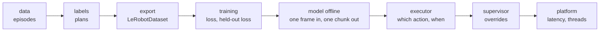
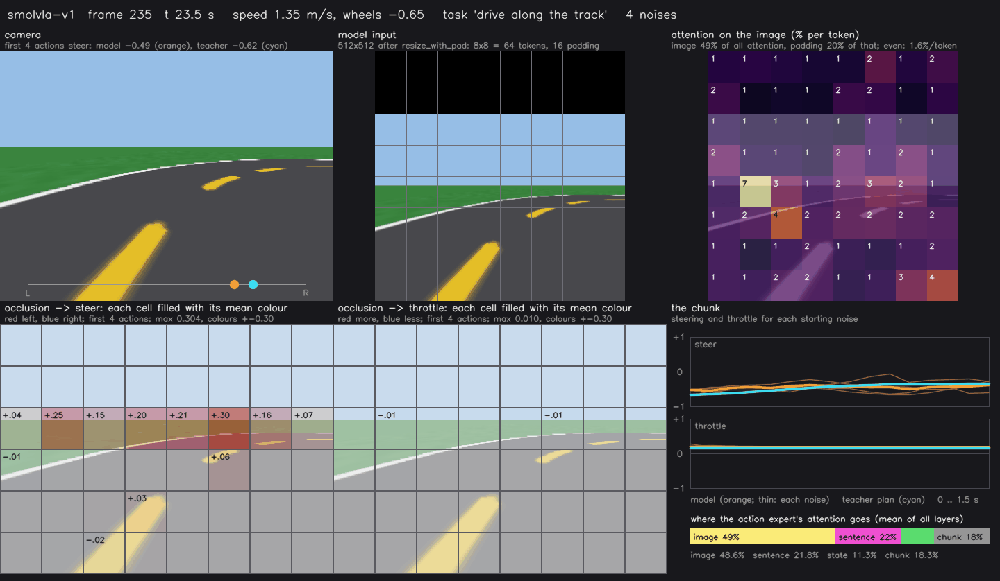
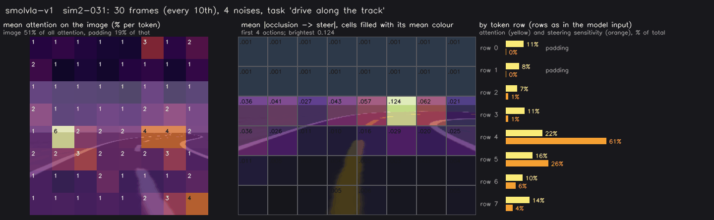
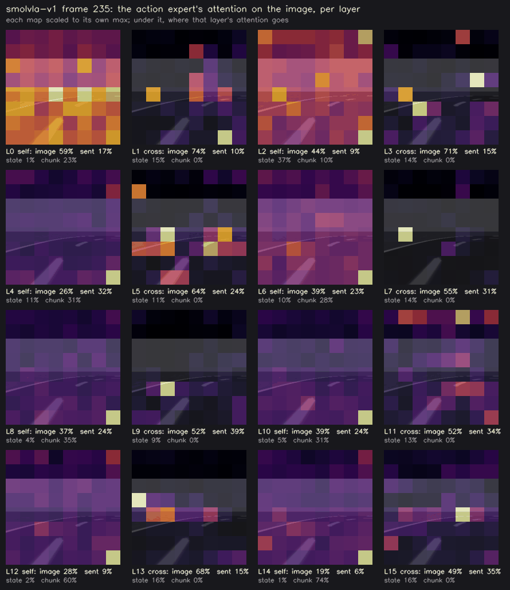
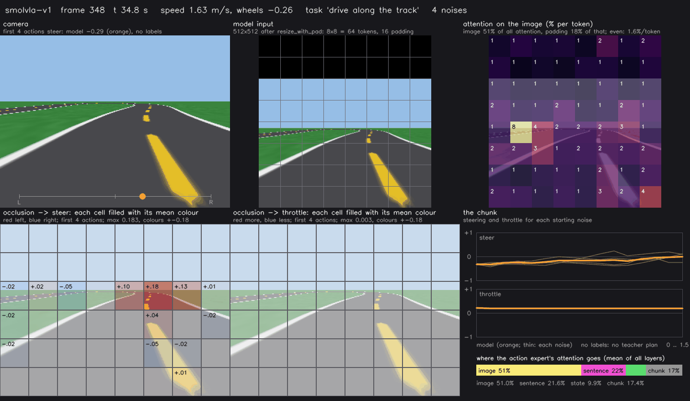
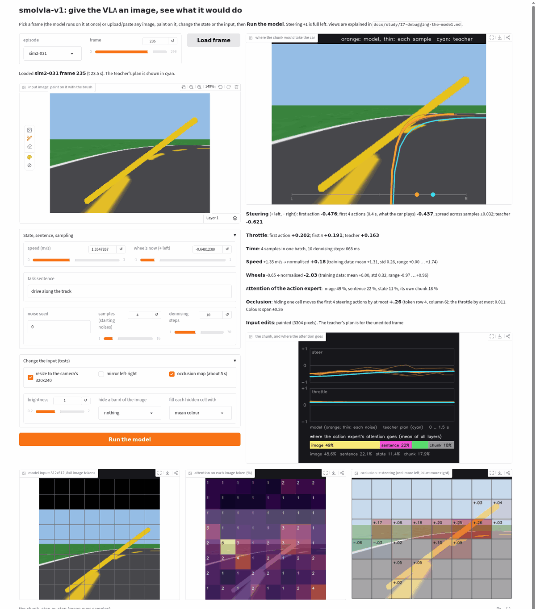

# 17 · Debugging the model and the algorithm

How to find out *why* a learned driving policy behaves as it does, with the tools in
this repository and LeRobot. Every output quoted below was produced for this guide on
2026-11-17 with the fine-tuned SmolVLA `smolvla-v1` of
[Lab 15](15-hands-on-labs.md#lab-15-fine-tune-smolvla-on-the-driving-data-on-this-laptop),
unless it is marked otherwise.

## What problem are we solving?

`smolvla-v1` passes every evaluation drive, but it weaves: 4.8 cm rms against the
teacher's 1.5 cm. "The model is not good enough" is not a diagnosis. The cause could
be in the data, the labels, the export, the training, the network, the way its chunks
are played, the supervisor, or the computer's timing. Debugging a learned controller
is **localisation**: find the layer where things first go wrong, then the reason
inside it.

## The layers, and where to look first



Work from the right when a drive goes wrong (is it the loop or the model?), and from
the left when a model is new (is the data what you think?).

| Symptom | First suspect | First tool |
|---|---|---|
| leaves the road from the start, or drives off at once | labels, export (wrong action column, camera key) | `browse`, the export read-back below |
| weaves around the line | model output, starting noise, latency | `tools/probe_vla.py`, debug panel, `--log` |
| stops or lurches | the supervisor (stale plans, obstacle rule) | the `overrides` column of `--log`, the HUD's red text |
| fine in `sim`, worse with `--show` | real latency, CPU load | `latency_ms_mean` in the result, `plan_age_ms` in `--log` |
| training loss falls, driving does not improve | the target, not the optimiser | the chunk-target check (§1), `evaluate` |
| loss is NaN, or does not fall at all | data ranges, learning rate, a frozen-everything config | the training log (§2) |

## The tools

| Tool | What it shows | Where |
|---|---|---|
| `./drive.sh validate` | dataset consistency, *perfect driving only* | [chapter 9](09-dataset-pipeline.md) |
| `./drive.sh browse --match …` | each frame with its labelled plan drawn on the road | chapter 9 |
| LeRobot read-back | what the trainer will actually feed the model | §1 |
| the `lerobot-train` log | loss, gradient norm, learning rate, speed, memory, held-out loss | §2 |
| **`tools/probe_vla.py`** | the model offline: accuracy per chunk step, noise, symmetry, sensitivity, timing, shapes | §3 |
| **`tools/see_vla.py`** | where in the image the output comes from: the model's input, attention, occlusion | §3 |
| **`tools/vla_app.py`** | a web app: one image in (a frame, an upload, your painting), the chunk out, drawn on the road | §3 |
| **`./drive.sh probe`** | the same for the CNN: layers, training curves against the average plan, gradient norms and update/weight ratios per epoch, errors per step, road and speed against two baselines, input ablation, dead units, saliency, mirror, brightness, blank, speed and steering-state tests, the error on its own drives against the distance off-centre, and an HTML report of all of it | [docs/thuc-hanh, lessons 3, 4 and 7](../thuc-hanh/07-debug-chuyen-nghiep.md) |
| `./drive.sh lrfind`, `collect --driver cnn` | the learning-rate range test; DAgger, the network driving while the teacher labels | [docs/thuc-hanh, lesson 7](../thuc-hanh/07-debug-chuyen-nghiep.md) |
| `sim --show` debug panel | the chunk in use, the skipped part, the action played, model against motors | [Lab 1](15-hands-on-labs.md#lab-1-run-the-simulator) |
| `sim --log actions.csv` | every 20 ms tick, for analysis afterwards | §4 |
| `evaluate`, `sweep` | closed-loop results, latency sensitivity | chapters [11](11-model-evaluation.md), [5](05-action-chunking-and-latency.md) |
| a debugger | stop inside any function, inspect tensors | §5 |

All model-side commands run with the LeRobot environment, from the repository root:

```bash
export D=/home/fanning/data1/AI_SOURCE/smolvla-local HF_HOME=/home/fanning/data1/AI_SOURCE/smolvla-local/hf
export V=$D/.venv/bin/python PYTHONPATH=.
cd /home/fanning/data1/AI_SOURCE/vla-drive
```

**On a Mac (or anywhere, without that folder):** `make vla-setup` makes the environment
in `.venv-vla`, and `./vla.sh` stands for `$V` with `PYTHONPATH=.` set, so `$V tools/see_vla.py`
becomes `./vla.sh tools/see_vla.py`. The model runs on the Apple GPU (MPS); each tool takes
`--device` (or `VLA_DEVICE`) to choose, and running one frame on `mps` and on `cpu` is how
to check that the GPU computes what the CPU does (the MPS bug in
[docs/thuc-hanh, lesson 6](../thuc-hanh/06-debug-model.md) was found that way). Measured on
an M3 (10-core GPU, 16 GB), LeRobot 0.5.1: one chunk with 10 denoising steps takes about
360 ms, `see_vla.py` about 30 s per frame with two noises, and the web app answers in about
1 s. The whole route on a Mac, with outputs, is
[docs/thuc-hanh/08-vla-tren-mac.md](../thuc-hanh/08-vla-tren-mac.md).

---

## 1 · Debug the data before the model

A model can only be as right as its targets. Three checks, in increasing depth.

**`validate` and `browse`.** Both from chapter 9. In `browse`, the cyan path must
follow the road ahead; a path that leaves the road or points the wrong way is a label
bug, not a model bug.

**Read the dataset back the way the trainer will.** The export is the boundary between
two code bases, so check it from LeRobot's side:

```bash
$V - <<'EOF'
import numpy as np
from lerobot.datasets.lerobot_dataset import LeRobotDataset
from drive.learn.label import read_labels
ds = LeRobotDataset("local/vla-drive", root="runs/drive/lerobot",
                    delta_timestamps={"action": [k / 10 for k in range(16)]})
item = ds[100]
print(len(ds), item["observation.images.front"].shape, item["observation.state"], item["action"].shape)
EOF
```

*Measured:* `24876 torch.Size([3, 240, 320]) tensor([1.4858, 0.0958]) torch.Size([16, 2])`.
Compare a few items with the source `.npz` and `labels.npz`: when this was done for
the export, states and the first action matched exactly and images differed by about
1.5 / 255 (AV1 compression).

**Look at the target, not only the inputs.** The chunk LeRobot trains frame $i$ on is
the `action` of frames $i \dots i+15$. For disturbed `collect` episodes that is not the
teacher's clean plan. Measure the gap:

```bash
python3 - <<'EOF'
import numpy as np
from pathlib import Path
from drive.learn.label import episodes, read_labels
d = {k: [] for k in (0, 1, 3, 5, 15)}
for ep in episodes(Path("runs/drive/episodes")):
    plans = read_labels(ep)["plans"]
    for k in d:
        d[k].append(np.abs(plans[k:, 0, 0] - plans[:len(plans) - k, k, 0]))
print({k: round(float(np.concatenate(v).mean()), 3) for k, v in d.items()})
EOF
```

*Measured* (80 teacher episodes): 0 at step 0, 0.04 at step 1, 0.13 at step 3, about
0.2 from step 5, against a mean |steer| of 0.24. A model cannot predict the far end of
that target from one image; expect its later chunk steps to be worse.

---

## 2 · Debug the training

### Read the log line

`lerobot-train` prints, every `--log_freq` steps (from the Lab 15 run):

```
step:550 smpl:9K ep:29 epch:0.40 loss:0.477 grdn:5.771 lr:8.4e-05 updt_s:0.368 data_s:0.003 smp/s:43 mem_gb:2.91
INFO … step 500: eval_loss=0.6511
```

| Field | Meaning | What to look for |
|---|---|---|
| `loss` | flow-matching MSE on the training batch | falls quickly, then slowly; it never reaches 0 (the target includes random noise) |
| `eval_loss` | the same on held-out episodes (`--dataset.eval_split`, `--eval_steps`) | stops falling → more steps will not help *the loss*; still evaluate by driving |
| `grdn` | gradient norm before clipping (clipped at 10, `optimizer_grad_clip_norm`) | sudden spikes or `nan` → bad data or too high a learning rate |
| `lr` | current learning rate (warm-up, then cosine decay) | warm-up visible at the start |
| `updt_s`, `data_s` | seconds per update, per batch load | `data_s` close to `updt_s` → the data loader is the bottleneck |
| `smp/s`, `mem_gb` | throughput, peak GPU memory | room to raise the batch? |
| `epch` | passes over the training set | 2000 steps × 16 = 1.4 passes over 22 176 frames |

### Look inside the loss

`SmolVLAPolicy.forward` (in LeRobot's `policies/smolvla/modeling_smolvla.py`, line 358
in 0.5.2) returns,
besides the loss, a dictionary with three stages of it:

| Key | After |
|---|---|
| `losses_after_forward` | the network's MSE, sliced to the 2 real action dimensions |
| `losses_after_in_ep_bound` | masking the chunk steps that fall past the end of an episode (`action_is_pad`) |
| `losses_after_rm_padding` | removing the padding to 32 dimensions |

If the first and second differ a lot, many targets run past episode ends (short
episodes, or a long `chunk_size`).

### Can it learn at all? Overfit a tiny dataset

The classic first test of any training pipeline: on one or two episodes, the loss
must fall far below where it settles on the full data. If it does not, the bug is in
the pipeline (targets, normalisation, frozen parameters), not in the amount of data.

```bash
$V -m drive export --match 'sim-000' --out /tmp/one-episode
$D/.venv/bin/lerobot-train --policy.path=lerobot/smolvla_base \
  --dataset.repo_id=local/one --dataset.root=/tmp/one-episode \
  --rename_map='{"observation.images.front": "observation.images.camera1"}' \
  --policy.chunk_size=16 --policy.n_action_steps=16 --batch_size=8 --steps=400 --log_freq=50 \
  --save_checkpoint=false --policy.push_to_hub=false --wandb.enable=false --output_dir=/tmp/overfit
```

*Not run for this guide*: record the loss at step 50 and 400 and compare with the
full run's 0.47 at step 550.

### NaN and other numerical faults

- `grdn:nan` or `loss:nan` → `validate` the dataset (it fails on NaN and out-of-range
  values), then lower `--policy.optimizer_lr`.
- To find the operation that produced it, run a few steps with
  `torch.autograd.set_detect_anomaly(True)` set at the top of a copy of the training
  script; it is slow and only for diagnosis.

---

## 3 · Debug the model offline: `tools/probe_vla.py`

Driving mixes the model with latency, the executor and the supervisor. To see the
model alone, give it single observations and read its chunks.
[`tools/probe_vla.py`](../../tools/probe_vla.py) runs nine probes on a checkpoint:

```bash
$V tools/probe_vla.py --checkpoint smolvla-v1          # a few minutes, most of it loading
```

It uses the episodes LeRobot held out (`eval_split=0.1` holds out the **last** 10 %
of the episodes of each task: here `sim2-031` … `sim2-039`), so the model has not
trained on them.

### offline: accuracy per chunk step

```
[offline] 261 frames from 9 held-out episodes: mean |steer error| by chunk step
  step:              0     1     2     3     5    10    15
  vs clean plan: 0.088 0.086 0.118 0.142 0.162 0.155 0.172
  vs LeRobot's target: 0.088 0.086 0.100 0.122 0.190 0.251 0.271
  step 0: correlation with the teacher 0.937; mean steer model +0.014, teacher -0.011
```

- The first steps track the teacher well (correlation 0.94), with an error of about
  0.09: 9 % of full lock.
- From step 5 the error against LeRobot's own target *grows* to 0.27, larger than
  against the clean plan. The model has not learnt the unpredictable far end (§1); it
  predicts something closer to the clean plan. That is the better behaviour, and it
  shows the training target, not the network, limits the far end.
- At 125 ms latency the car plays steps 1–3 of each chunk, where the error is
  0.09–0.14.

### noise: how much does the starting noise move the chunk?

```
[noise] one frame, 10 different noises: std of steering by step 0.159 0.216 0.103 0.113 0.316; std of throttle at step 0 0.096
```

SmolVLA generates each chunk by denoising a random starting point, and
`BackendPolicy` draws a new one for every chunk. On this frame, ten draws give
steering that varies with a standard deviation of 0.16–0.32: as large as the error
itself. Consecutive chunks therefore disagree by chance, which is a direct cause of
weaving. A diffusion or flow policy that is well trained and confident gives a small
spread; a large one says the model is unsure, or has learnt a wide target (§1).

**Test the hypothesis by substitution.** Same drive, same latency, the starting noise
set to zero instead of random (a one-line change, in a scratch script, to
`loop.worker.policy.rng`):

| Starting noise | rms | max | mean speed |
|---|---:|---:|---:|
| random (as shipped) | 4.4 cm | 10.5 cm | 1.39 m/s |
| zero | 3.0 cm | 7.4 cm | 1.21 m/s |

(30 s on the peanut at 125 ms, `SimulatedWorker`, one run each.) Tracking improves by a
third, but the car is also slower, and slower cars track better (chapter 6), so the
effect is not yet separated. Next steps: all six evaluation drives, three seeds, and a
speed-matched comparison. Zero noise is also a choice with costs: it removes the
model's ability to choose between several valid plans.

### repeat: determinism

```
[repeat] same frame, same noise, twice: max difference 0.00e+00
```

With the noise fixed, the model is deterministic. Any run-to-run difference with the
same noise comes from elsewhere (threads, timing). This is what makes `SimulatedWorker`
runs repeatable: `BackendPolicy` seeds its generator.

### mirror: is the policy symmetric?

```
[mirror] steer step 0: original -0.039, mirrored +0.556 (a symmetric policy gives +0.039); mean |orig + mirrored| over the chunk 0.280
```

The world has no left or right preference: flip the image and negate the steering in
the state, and a correct policy negates its steering. `smolvla-v1` does not, by a wide
margin on this frame. The CNN is trained with mirrored images
([chapter 10](10-model-training.md)); the SmolVLA fine-tune is not. Mirroring the
episodes at export is a candidate fix ([diagram page 5](diagrams/vla-drive-architecture.drawio)).
One frame is not a measurement of the whole policy: run the probe on other frames
(edit `sample` in the script) before concluding.

### blank: what does it do when it sees nothing?

```
[blank] black image: steer +0.056 … -0.013, throttle +0.920
[blank] grey image: steer +0.059 … -0.039, throttle +0.903
```

With no image at all it drives straight at nearly full throttle: from this frame's
state (standing still), "accelerate" is what the data taught. The model has no notion
of "I cannot see"; a blind camera on a car would not stop it. That is a job for the
supervisor's range sensor and for a camera health check, not for the model.

### speed: does the throttle respond to the state?

```
[speed] same frame, steer +0.00: first throttle at speed
  0.0 m/s -> throttle +0.913
  0.5 m/s -> throttle +0.888
  1.0 m/s -> throttle +0.117
  1.4 m/s -> throttle +0.167
  1.8 m/s -> throttle +0.198
  2.5 m/s -> throttle +0.035
```

It accelerates hard below 1 m/s and holds a small throttle above, but it does not
brake at 1.8 or 2.5 m/s. The teacher's throttle law would. The training data hardly
contains such speeds (see the next probe), so the model never learnt what to do there.

### shapes: what enters the network

```
[shapes] into embed_prefix:
  images[0] (1, 3, 512, 512) torch.float32  range [-1.00, 0.85]  present [True]
  lang_tokens (1, 48), 5 real tokens
  state (1, 32): [-5.050000190734863, -0.0010000000474974513, 0.0, 0.0] …
  -> prefix embeddings (1, 113, 960)
```

- The 240×320 image arrives resized and padded to 512×512, in $[-1, 1]$.
- The task is 5 real tokens padded to 48.
- The prefix is 113 tokens of width 960. 113 = 48 text + 1 state + 64, so each image
  becomes 64 tokens (derived from the shapes).
- **The state is −5.05 standard deviations.** Speed is normalised with the dataset's
  mean 1.31 m/s and standard deviation 0.26 m/s. A car standing still is five
  deviations away from anything the model was trained on. The start of every drive,
  and every stop, is out of distribution. Candidate fixes: record more slow driving
  (starts, stops, slow bends), or normalise the state with fixed bounds: LeRobot's
  `NormalizationMode` offers `MIN_MAX` besides `MEAN_STD` (through the policy's
  `normalization_mapping`; not tried here).

### task: does the sentence matter?

```
[task] same frame, same noise, other sentences: mean |steer change| over the chunk
  'drive slowly'           0.087   throttle +0.876
  'stop'                   0.019   throttle +0.870
  'turn left'              0.045   throttle +0.868
  ''                       0.033   throttle +0.853
```

Changing the sentence changes the output a little and arbitrarily: "stop" does not
stop it and "turn left" does not turn it. The model never saw another sentence, so
the text is noise to it ([chapter 13](13-vla-and-smolvla.md)).

### timing: where the time goes

```
[timing] one chunk: 160 ms with 1 step, 309 ms with 10 → about 16.6 ms per denoising step,
143 ms for everything else (pre-processing, image encoder, VLM prefix, post-processing)
```

Measured while a C++ build kept the CPU busy (load average about 20 on 20 cores); on a
quieter machine one chunk with 10 steps took 124 ms (Lab 15). The split is the useful
part: the 10 denoising steps are about half the time. `num_steps` 5 would save roughly
80 ms here; whether accuracy survives is an experiment ([diagram page 5](diagrams/vla-drive-architecture.drawio)).
The probe sets `backend.policy.config.num_steps`, which is what `sample_actions` reads.

### Where does it look? `tools/see_vla.py`

The probes say *what* the model outputs. [`tools/see_vla.py`](../../tools/see_vla.py)
draws *where in the image* the output comes from (measured 2026-11-18):

```bash
$V tools/see_vla.py                         # 3 frames of sim2-031 (hardest left, hardest right, straightest)
$V tools/see_vla.py --summary 10            # every 10th frame, averaged: about 2.5 min
$V tools/see_vla.py --frames 235 --video    # one frame, and the attention on every frame as an mp4
```

Everything goes to `runs/drive/reports/see-smolvla-v1/`: a panel per frame, the same
attention layer by layer (`…-layers.png`), the numbers (`.json`), and the summary.



#### How the image becomes tokens

LeRobot's `resize_with_pad` scales the 320×240 camera image to 512×384 and pads the
**top** with 128 black rows. SigLIP cuts the 512×512 image into 32×32 patches, and
SmolVLM2's connector merges each 4×4 group of patches into one token: an **8×8 grid of
64 tokens, row by row** (`pixel_shuffle` in `transformers/models/smolvlm/modeling_smolvlm.py`).
One token is a 64×64 cell of the model input, a 40×40 cell of the camera image
(the "model input" view above). So:

- **16 of the 64 image tokens are padding** (token rows 0–1), and the next 16 are sky
  (rows 2–3). Half the image tokens show nothing about the road.
- The order was checked, not assumed. A bright 40×40 square on a mid-grey image, in
  each of the 48 camera cells in turn, changed the token in the same cell most in 41 of the 48 cases.
  In the other 7 the most-changed token was within two cells, mostly at the left and
  right edges. Tokens are mostly local, but not strictly. SigLIP's attention mixes the
  whole image, so a token can carry something from elsewhere.

#### Two ways to ask "where"

| | attention | occlusion |
|---|---|---|
| question | where does the network *read* from? | what *changes the answer*? |
| how | record the softmax of the action expert's queries in every denoising step; average over 15 heads, 16 layers, 10 steps, 16 chunk tokens, 4 noises | fill one camera cell with its mean colour, rerun with the same noises, measure how far the mean of the first 4 actions (0.4 s, the part the executor plays) moves |
| cost | free: one forward pass | 48 cells × 4 noises = 192 forward passes, about 5 s a frame in batches of 16 |
| limit | attention is not importance (below) | one cell at a time: a cue repeated elsewhere survives; a uniform cell (sky, plain asphalt) cannot change under its own mean colour |

The attention is recorded with the wrap-a-function trick of §5: `Seer.look` swaps
`vlm_with_expert.eager_attention_forward` for a copy that also keeps the probabilities.
In a denoising step the queries are the 16 chunk tokens. The keys are the 113 prefix
tokens: 64 image tokens, 48 sentence tokens and 1 state token. In the self-attention
layers the 16 chunk tokens are also keys.

#### What `smolvla-v1` looks at

The summary over 30 frames of `sim2-031` (every 10th, 4 noises):



| token row | camera rows | ground ahead of the car | attention | steering sensitivity, mean-colour fill | grey fill |
|---|---|---|---|---|---|
| 0–1 | — | padding | 19 % | — | — |
| 2–3 | 0–80 | sky | 18 % | 3 % | 30 % |
| **4** | 80–120 | horizon to 0.76 m | 22 % | **61 %** | 27 % |
| 5 | 120–160 | 0.76 to 0.36 m | 16 % | 26 % | 24 % |
| 6–7 | 160–240 | 0.36 to 0.20 m | 25 % | 10 % | 19 % |

The distances come from the simulator's camera (`Camera.forward_m` in `drive/sim/render.py`).
Steering sensitivity is each row's share of the summed |Δsteer| over the 48 cells. The
grey column is `--summary 10 --fill grey`, which hides each cell under plain grey (128).

- **It steers by the road from about 0.4 m ahead to the horizon.** 87 % of the steering sensitivity is in
  token rows 4–5. On a second held-out episode, `sim2-035`, the same holds: 63 % in row 4,
  24 % in row 5, 10 % in rows 6–7 and 2 % in the sky. The teacher, pure pursuit, aims at a point `0.4 + 0.35·v` m ahead
  (`drive/policy/pure_pursuit.py`): 0.87 m at the 1.35 m/s of these frames. That point is
  camera row 116, inside token row 4. The model learnt to read where its teacher looks.
  In frame 235 (the panel above, a right bend), hiding a single cell of row 4 moved
  the steering by up to +0.30 (towards the left) on a command of −0.49. Hiding a cell of
  the road just ahead moved it by 0.03 at most. With the grey fill, too, the three most
  sensitive cells (0.065–0.083 on average) are in rows 4–5, on the road edges.
- **Hiding a whole band says the same.** Filling every cell of a band with its own mean
  colour (29 frames of `sim2-031`, 4 noises) moved the steering by, on average: row 4
  **0.085**, row 5 0.080, rows 6–7 together **0.024** (at most 0.096). The road just in
  front of the car is a third of the camera image, and the model hardly needs it.
- **It ignores the sky only because the sky never changes.** Under its own mean colour a
  sky cell does not change, so 3 % says little. A grey square in the sky moves the
  steering by 0.02–0.04 per cell: something the model has never seen there, and it
  reacts. The mean-colour fill asks "does the detail here matter?". The grey fill asks
  "would anything here matter?". A real obstacle or a sign above the horizon would be
  new to this model.
- **The throttle does not come from any single cell.** No cell moved it by more than
  0.002 on average (0.010 in frame 235). The [blank probe](#blank-what-does-it-do-when-it-sees-nothing)
  shows that the image as a whole does matter: a black image gives throttle 0.92.
- **Half of the attention goes to the image:** 51 % on average. The sentence gets 22 %,
  the state 10 %, and the chunk tokens 17 %. The 22 % on a sentence that never changes
  ([task probe](#task-does-the-sentence-matter)) is spent on a constant.
- **Attention agrees with occlusion on the best row, and disagrees elsewhere.** Row 4
  gets the most attention (22 %) and the most sensitivity. But the padding rows get 19 %
  of the image attention. Their pixels are the same black in every frame, so they hold
  nothing about this frame. A token at the bottom-right corner also gets 3.8 %, more than most road
  tokens, and it is bright in most self-attention layers (`…-layers.png`). Transformers often
  park attention on such uninformative tokens: "attention sinks". **Use attention
  to see how the network routes information, and occlusion to see what it depends on.**
- **The layers differ** (frame 235, the image below). The cross-attention
  layers (odd) put 49–74 % of their attention on the image, concentrated on a few
  tokens, mostly in rows 4–5. The self-attention layers (even) spread over the image
  and give 10–74 % to the chunk tokens, that is, to the plan being denoised.



#### What to try (hypotheses, not tested)

- **Crop before export.** A quarter of the image tokens are padding and a quarter are
  sky. Cropping the camera image to the road band, or making it square, would put
  those 32 tokens on the road: more resolution where the model reads. That means a
  new export, a new fine-tune and a closed-loop evaluation ([chapter 16](16-experiments.md)
  format). Re-run this tool on the new model to see whether it reads the same band.
- **Compare models.** The same tool works for any LeRobot checkpoint (`--checkpoint`).
  Comparing the row profile of a model that drives better or worse tells you whether
  the difference is *where* it looks.
- **Look at failures, not averages**: next.

#### At the worst moment of a drive

`--episode` also takes a directory with an `episode.npz`, such as the one `sim --record`
writes during a closed-loop drive. `--frames` also takes times. Record a drive with its
action log, find the worst moment in the log, and look at the frames before it:

```bash
R=runs/drive/reports/see-smolvla-v1
$V -m drive sim --policy vla --checkpoint smolvla-v1 --duration-s 60 --latency-ms 125 \
    --record $R/drive --log $R/drive.csv
$V tools/see_vla.py --episode $R/drive --frames 34.8s,35.3s,35.8s --out $R/drive-see
```

The drive went 4.02 laps at 1.48 m/s, 5.5 cm rms, worst 14.2 cm at 35.76 s, with the
plan 200 ms old there. That is inside the normal range at 125 ms latency, so
latency was not the trigger this time. A recorded drive has no labels, so the panel
shows no teacher:



The car is left of the line: the centre line is right of the image's middle in the near
rows. It is going 1.63 m/s, faster than most training frames (mean 1.31 m/s, standard
deviation 0.26 m/s). The road bends right far ahead. The model steers −0.29, then −0.18
and −0.15, towards the line. The far bend still drives the answer: hiding one cell of
row 4 moves the steering by +0.18. Hiding a cell of the near rows, where the offset is
plainest, moves it by 0.05 at most. Over 11 frames from 33 to 36 s, hiding rows 6–7 together moved the steering by
0.022 on average, and hiding row 4 by 0.099.

What this rules out: the model is **not** looking at the wrong place. It reads the band
that holds its teacher's aim point. Pure pursuit steers from that one point (and its
exact pose) and tracks at 1.5 cm, so what a good steering command needs is in the band
the model reads. The weave is more likely in *how precisely* it answers than in *where*
it looks. That matches two earlier results:
- the spread of the chunk across starting noises (the
  [noise probe](#noise-how-much-does-the-starting-noise-move-the-chunk));
- the drop from 4.4 to 3.0 cm rms with zero noise. That drive was also slower, so the
  two causes are not yet separated.

A tool that rules a cause out is as useful as one that finds it.

### Try it by hand: `tools/vla_app.py`

The probes and `see_vla.py` answer fixed questions. [`tools/vla_app.py`](../../tools/vla_app.py)
is a small web app for your own: give the model one image, change one thing, and see
what it does. It needs gradio in the LeRobot environment, installed once. The install
measured here added 15 packages (gradio 6.32) and changed none of the existing ones:

```bash
UV_CACHE_DIR=$D/uv-cache uv pip install --python $V gradio
$V tools/vla_app.py                 # loads the model (about 10 s), then open http://127.0.0.1:7860
```

It listens on this computer only. The image editor draws with WebGL, which every
normal browser has. Headless Chrome without a GPU does not, and shows an empty editor.



- **Input.** Pick an episode and a frame. The model runs on it at once, so the frame
  slider scrubs through a drive. Or upload, paste or photograph any image. Then:
  - paint on the image with the brush, in road colours;
  - set the speed and the wheel position the model is told;
  - change the task sentence, the noise seed, the number of samples (starting noises)
    and the number of denoising steps;
  - mirror the image, change its brightness, or hide a band of it with the cells'
    mean colour, grey or black;
  - turn on the occlusion map (about 5 s).
- **Output.**
  - Where the chunk would take the car, drawn on the road. The chunk is driven
    through the vehicle model with `plan_path` and projected with the simulator's
    camera, like `browse` draws a labelled plan. Orange is the mean of the samples,
    the thin lines are each sample, and cyan is the teacher's plan when the frame
    comes from a labelled episode.
  - The numbers: steering and throttle, their spread across samples, and the time.
    The state is shown as the normaliser sees it, with a warning when it is outside
    the training data.
  - The chunk, the model input with its token grid, the attention, the occlusion
    map, and a step-by-step table against the teacher.

The app reuses `Seer` from `see_vla.py`, so its numbers are the same: frame 235 gives
−0.488, as in the panel above. What `smolvla-v1` did with frame 54 of `sim2-031` (seed 0,
4 samples, 10 steps). The steering is the mean of the first 4 actions; the model gives
−0.131 and the teacher −0.082:

| change | question | steering | throttle | note |
|---|---|---|---|---|
| none | | −0.131 | +0.170 | 241 ms for the batch of 4 |
| mirror left-right | is it symmetric? | +0.121 | | a symmetric policy gives +0.131 |
| hide the horizon band (mean colour) | does it steer by the far road? | −0.199 | | |
| hide the near road (mean colour) | | −0.131 | | 0 pixels changed: plain asphalt here. The app says so |
| hide the near road (grey) | | −0.145 | | |
| hide the sky (grey) | does it ignore the sky? | −0.148 | | |
| brightness ×0.3 | does it need daylight? | −0.187 | | |
| speed 0 m/s | | −0.104 | **+0.996** | the app warns: normalised −5.05 |
| speed 2.5 m/s | does it brake when too fast? | −0.113 | +0.166 | no; warning: above the training range |
| task "stop" | does it obey? | −0.126 | +0.176 | no |
| 1 sample, 1 denoising step | how much do the steps cost? | −0.140 | | 48 ms, against 219 ms for 1 sample and 10 steps |

On frame 235, painting a yellow stroke across the road (the screenshot) moved the
steering from −0.488 to −0.437. In the occlusion map, cells along the stroke now
matter too. Two sky cells it crosses give +0.03 and +0.04, where nothing mattered
before. Two road cells below the horizon give up to +0.10, where one cell reached
+0.06 before.

---

## 4 · Debug the closed loop

### Watch it

```bash
$V -m drive sim --policy vla --checkpoint smolvla-v1 --latency-ms 0 --show --log runs/actions.csv
```

In the debug panel (Lab 1): a chunk whose cyan line wiggles from step to step is the
noise of §3; a grey band wider than usual is a slow inference; thick and thin lines
that part are the supervisor at work.

### Analyse the log

`--log` writes one row per 20 ms tick
([`ActionLog`](../../drive/recorder.py#L62)): `t, new_chunk, chunk_t_obs,
plan_age_ms, cmd_steer, cmd_throttle, steer, throttle, overrides, speed_mps,
wheel_steer, lateral_m`.

```bash
python3 - <<'EOF'
import csv, numpy as np
rows = list(csv.DictReader(open("runs/drive/vla/smolvla-v1-actions.csv")))
f = lambda k: np.array([float(r[k]) if r[k] != "" else np.nan for r in rows])
t, cmd, lat, age = f("t"), f("cmd_steer"), f("lateral_m"), f("plan_age_ms")
new = np.array([r["new_chunk"] == "1" for r in rows])
d = np.abs(np.diff(cmd)); at_switch = new[1:]
print(f"steer change per tick: at a chunk switch {np.nanmean(d[at_switch]):.3f}, otherwise {np.nanmean(d[~at_switch]):.3f}")
i = int(np.nanargmax(np.abs(lat)))
print(f"worst moment: t={t[i]:.2f} s, lateral {100*lat[i]:+.1f} cm, plan age {age[i]:.0f} ms")
print("ticks per override:", {k: sum(k in r["overrides"] for r in rows) for k in ("stale", "steer_rate", "speed", "obstacle")})
EOF
```

*Measured* on the 60 s live drive of Lab 15 (`--show`, real inference thread):

- **Steering change per tick: 0.014 at a chunk switch, 0.020 otherwise.** The 0.1 s
  blend works: switching chunks is not where the jerks come from.
- **The worst moment** (−20.9 cm at 41.7 s) had a plan age of 360 ms, twice the
  median of 180 ms, and a run of `stale` ticks followed between 42.7 and 44.3 s. A
  latency spike lined up with the worst tracking: look at the platform layer (CPU
  load, other processes) before the model.
- 52 `stale` ticks in all: 0.54 s at start-up (loading the model's first inference)
  and short stretches when an inference took longer than 300 ms.

### Isolate by substitution

Change one component, keep the rest, and see whether the symptom moves with it:

| Swap | Command | What it separates | Result here |
|---|---|---|---|
| the model → the teacher, same latency | `./drive.sh sim --latency-ms 125` | model vs loop | teacher at 100–200 ms: 1.8–2.0 cm (chapter 5) → the loop is not the main cause |
| random → zero starting noise | scratch script (§3) | sampling noise vs the model's mean | 4.4 → 3.0 cm, speed confounded |
| real latency → none | `--latency-ms 0` (without `--show`) | latency vs model | not run |
| compensation on → off | `--no-latency-compensation` | executor | not run for the VLA |
| supervisor on → off | `--no-safety` (diagnosis only) | supervisor vs policy | supervisor intervened only at start-up in `evaluate` → not the cause |
| SmolVLA → CNN, same latency | `--policy cnn --checkpoint v1 --latency-ms 125` | model family | not run at 125 ms |

---

## 5 · Step through it with a debugger

### In VS Code

Add a configuration to `.vscode/launch.json` that uses the LeRobot environment's
Python, then set breakpoints in
[`LeRobotBackend.infer`](../../drive/policy/lerobot_backend.py),
[`ChunkExecutor.action`](../../drive/control/executor.py#L34) or
[`SafetySupervisor.filter`](../../drive/safety.py#L33), or in LeRobot's
`modeling_smolvla.py` (`embed_prefix`, `sample_actions`):

```json
{
  "name": "drive: sim with smolvla-v1",
  "type": "debugpy",
  "request": "launch",
  "module": "drive",
  "args": ["sim", "--policy", "vla", "--checkpoint", "smolvla-v1", "--latency-ms", "125", "--duration-s", "5"],
  "python": "/home/fanning/data1/AI_SOURCE/smolvla-local/.venv/bin/python",
  "cwd": "${workspaceFolder}",
  "env": {
    "PYTHONPATH": "${workspaceFolder}",
    "HF_HOME": "/home/fanning/data1/AI_SOURCE/smolvla-local/hf",
    "HF_HUB_OFFLINE": "1"
  },
  "justMyCode": false
}
```

`justMyCode: false` lets you step into LeRobot and PyTorch. Without `--show` the run
uses `SimulatedWorker`, so inference happens on the main thread and breakpoints in
the model stop the simulation cleanly. (This configuration was not run for this guide.)

### In a terminal

```bash
$V -m pdb -m drive sim --policy vla --checkpoint smolvla-v1 --duration-s 2
(Pdb) b drive/policy/lerobot_backend.py:76      # after pre-processing, before the network
(Pdb) c
(Pdb) p batch["observation.state"]          # normalised state, as the model sees it
```

Or put `breakpoint()` on the line you care about. Useful at a stop:
`tensor.shape`, `tensor.dtype`, `tensor.isnan().any()`, `tensor.min(), tensor.max()`.

### Without stopping: wrap a function

`tools/probe_vla.py` prints the inputs of `embed_prefix` by replacing it with a
wrapper for one call. The same trick works for any method: keep the original, wrap,
call, restore. It changes nothing on disk and needs no debugger.

---

## Common bugs, with their signature

| Symptom | Cause | Check |
|---|---|---|
| drives well offline, badly in the loop | latency higher than evaluated, or `chunk_dt_s` wrong | `latency_ms_mean`; the chunk's `dt` in the debug panel (0.1 s for 10 Hz data) |
| "Feature mismatch … camera1" at training | camera names differ | `--rename_map` |
| "All image features are missing from the batch" | the image was passed under a key the pre-processor does not rename to `camera1` | `LeRobotBackend.camera` (printed by the probe) against the checkpoint's `policy_preprocessor.json` |
| absurd actions, e.g. full lock | normalisation statistics from another dataset | the checkpoint's `policy_preprocessor_step_*_normalizer_processor.safetensors` |
| colours wrong, model worse on real images | BGR passed where RGB is expected | episodes and `Observation.images` are RGB; convert only at OpenCV's boundary |
| the model learnt the disturbance | exported with `--action applied` | the export's printout and `info.json` |
| lurches at start-up | first inference slower than the watchdog | `stale` at t < 1 s in `--log` |
| results differ between identical runs | `--show` / `--realtime` (real threads) | compare without them: `SimulatedWorker` is deterministic |

## Knowledge check

1. A drive weaves. Name the substitution that tells you whether the model or the loop is at fault, and what result points to which.
2. Why must offline probes use the last 9 episodes and not any 9?
3. The noise probe gives a steering spread of 0.3 at step 15. Name two possible causes, one in the model and one in the data.
4. Why is a standing car out of distribution for `smolvla-v1`, and what would you change?
5. What does a large gap between `losses_after_forward` and `losses_after_in_ep_bound` tell you?
6. A padding token gets 3 % of the image attention, more than most road tokens. Does the model depend on it? Which tool answers that, and why can the other not?

<details><summary>Answers</summary>

1. Drive the teacher with the same latency. If it also weaves, the loop (latency, executor) is the cause; if it tracks well, the model is.
2. LeRobot held out the last 10 % of each task's episodes; any other episode was trained on, so its error says how well the model memorised, not how it generalises.
3. Model: undertrained or uncertain, so the flow is wide. Data: the target's far end varies with disturbances the image cannot show (§1).
4. Speed is normalised with mean 1.31 and std 0.26 m/s, so 0 m/s is −5 deviations. Record slow driving, or use fixed-range normalisation.
5. Many target chunks run past the end of an episode and are masked: episodes are short relative to `chunk_size`.
6. Attention says where the network reads, not what its answer depends on. A token that is the same in every frame can soak up attention (an attention sink) without carrying anything about the frame. Occlusion answers it: change the input and measure the output. Padding cannot be occluded in the camera image, but its pixels never change, so its share says nothing about the road.
</details>

## Further reading

- [Chapter 11](11-model-evaluation.md) on closed-loop evaluation, and [chapter 16](16-experiments.md) for the experiment format.
- LeRobot source: `policies/smolvla/modeling_smolvla.py` (`forward`, `sample_actions`), `scripts/lerobot_train.py` (`update_policy`); the reading order is on page 4 of the [diagrams](diagrams/vla-drive-architecture.drawio).
- Chi et al. 2023, *Diffusion Policy*, on sampling noise and multimodality in generative policies.
