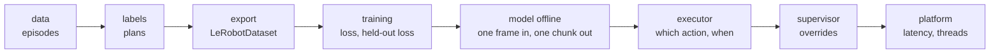

# 17 · Debugging the model and the algorithm

How to find out *why* a learned driving policy behaves as it does, with the tools in
this repository and LeRobot. Every output quoted below was produced for this guide on
2026-11-17 with the fine-tuned SmolVLA `smolvla-v1` of
[Lab 15](15-hands-on-labs.md#lab-15-fine-tune-smolvla-on-the-driving-data-on-this-laptop),
unless it is marked otherwise.

## What problem are we solving?

`smolvla-v1` passes every evaluation drive, but it weaves: 4.8 cm rms against the
teacher's 1.5 cm. "The model is not good enough" is not a diagnosis. The cause could
be in the data, the labels, the export, the training, the network, the way its chunks
are played, the supervisor, or the computer's timing. Debugging a learned controller
is **localisation**: find the layer where things first go wrong, then the reason
inside it.

## The layers, and where to look first



Work from the right when a drive goes wrong (is it the loop or the model?), and from
the left when a model is new (is the data what you think?).

| Symptom | First suspect | First tool |
|---|---|---|
| leaves the road from the start, or drives off at once | labels, export (wrong action column, camera key) | `browse`, the export read-back below |
| weaves around the line | model output, starting noise, latency | `tools/probe_vla.py`, debug panel, `--log` |
| stops or lurches | the supervisor (stale plans, obstacle rule) | the `overrides` column of `--log`, the HUD's red text |
| fine in `sim`, worse with `--show` | real latency, CPU load | `latency_ms_mean` in the result, `plan_age_ms` in `--log` |
| training loss falls, driving does not improve | the target, not the optimiser | the chunk-target check (§1), `evaluate` |
| loss is NaN, or does not fall at all | data ranges, learning rate, a frozen-everything config | the training log (§2) |

## The tools

| Tool | What it shows | Where |
|---|---|---|
| `./drive.sh validate` | dataset consistency, *perfect driving only* | [chapter 9](09-dataset-pipeline.md) |
| `./drive.sh browse --match …` | each frame with its labelled plan drawn on the road | chapter 9 |
| LeRobot read-back | what the trainer will actually feed the model | §1 |
| the `lerobot-train` log | loss, gradient norm, learning rate, speed, memory, held-out loss | §2 |
| **`tools/probe_vla.py`** | the model offline: accuracy per chunk step, noise, symmetry, sensitivity, timing, shapes | §3 |
| `sim --show` debug panel | the chunk in use, the skipped part, the action played, model against motors | [Lab 1](15-hands-on-labs.md#lab-1-run-the-simulator) |
| `sim --log actions.csv` | every 20 ms tick, for analysis afterwards | §4 |
| `evaluate`, `sweep` | closed-loop results, latency sensitivity | chapters [11](11-model-evaluation.md), [5](05-action-chunking-and-latency.md) |
| a debugger | stop inside any function, inspect tensors | §5 |

All model-side commands run with the LeRobot environment, from the repository root:

```bash
export D=/home/fanning/data1/AI_SOURCE/smolvla-local HF_HOME=/home/fanning/data1/AI_SOURCE/smolvla-local/hf
export V=$D/.venv/bin/python PYTHONPATH=.
cd /home/fanning/data1/AI_SOURCE/vla-drive
```

---

## 1 · Debug the data before the model

A model can only be as right as its targets. Three checks, in increasing depth.

**`validate` and `browse`.** Both from chapter 9. In `browse`, the cyan path must
follow the road ahead; a path that leaves the road or points the wrong way is a label
bug, not a model bug.

**Read the dataset back the way the trainer will.** The export is the boundary between
two code bases, so check it from LeRobot's side:

```bash
$V - <<'EOF'
import numpy as np
from lerobot.datasets.lerobot_dataset import LeRobotDataset
from drive.learn.label import read_labels
ds = LeRobotDataset("local/vla-drive", root="runs/drive/lerobot",
                    delta_timestamps={"action": [k / 10 for k in range(16)]})
item = ds[100]
print(len(ds), item["observation.images.front"].shape, item["observation.state"], item["action"].shape)
EOF
```

*Measured:* `24876 torch.Size([3, 240, 320]) tensor([1.4858, 0.0958]) torch.Size([16, 2])`.
Compare a few items with the source `.npz` and `labels.npz`: when this was done for
the export, states and the first action matched exactly and images differed by about
1.5 / 255 (AV1 compression).

**Look at the target, not only the inputs.** The chunk LeRobot trains frame $i$ on is
the `action` of frames $i \dots i+15$. For disturbed `collect` episodes that is not the
teacher's clean plan. Measure the gap:

```bash
python3 - <<'EOF'
import numpy as np
from pathlib import Path
from drive.learn.label import episodes, read_labels
d = {k: [] for k in (0, 1, 3, 5, 15)}
for ep in episodes(Path("runs/drive/episodes")):
    plans = read_labels(ep)["plans"]
    for k in d:
        d[k].append(np.abs(plans[k:, 0, 0] - plans[:len(plans) - k, k, 0]))
print({k: round(float(np.concatenate(v).mean()), 3) for k, v in d.items()})
EOF
```

*Measured* (80 teacher episodes): 0 at step 0, 0.04 at step 1, 0.13 at step 3, about
0.2 from step 5, against a mean |steer| of 0.24. A model cannot predict the far end of
that target from one image; expect its later chunk steps to be worse.

---

## 2 · Debug the training

### Read the log line

`lerobot-train` prints, every `--log_freq` steps (from the Lab 15 run):

```
step:550 smpl:9K ep:29 epch:0.40 loss:0.477 grdn:5.771 lr:8.4e-05 updt_s:0.368 data_s:0.003 smp/s:43 mem_gb:2.91
INFO … step 500: eval_loss=0.6511
```

| Field | Meaning | What to look for |
|---|---|---|
| `loss` | flow-matching MSE on the training batch | falls quickly, then slowly; it never reaches 0 (the target includes random noise) |
| `eval_loss` | the same on held-out episodes (`--dataset.eval_split`, `--eval_steps`) | stops falling → more steps will not help *the loss*; still evaluate by driving |
| `grdn` | gradient norm before clipping (clipped at 10, `optimizer_grad_clip_norm`) | sudden spikes or `nan` → bad data or too high a learning rate |
| `lr` | current learning rate (warm-up, then cosine decay) | warm-up visible at the start |
| `updt_s`, `data_s` | seconds per update, per batch load | `data_s` close to `updt_s` → the data loader is the bottleneck |
| `smp/s`, `mem_gb` | throughput, peak GPU memory | room to raise the batch? |
| `epch` | passes over the training set | 2000 steps × 16 = 1.4 passes over 22 176 frames |

### Look inside the loss

`SmolVLAPolicy.forward` (in LeRobot's `policies/smolvla/modeling_smolvla.py`, line 358
in 0.5.2) returns,
besides the loss, a dictionary with three stages of it:

| Key | After |
|---|---|
| `losses_after_forward` | the network's MSE, sliced to the 2 real action dimensions |
| `losses_after_in_ep_bound` | masking the chunk steps that fall past the end of an episode (`action_is_pad`) |
| `losses_after_rm_padding` | removing the padding to 32 dimensions |

If the first and second differ a lot, many targets run past episode ends (short
episodes, or a long `chunk_size`).

### Can it learn at all? Overfit a tiny dataset

The classic first test of any training pipeline: on one or two episodes, the loss
must fall far below where it settles on the full data. If it does not, the bug is in
the pipeline (targets, normalisation, frozen parameters), not in the amount of data.

```bash
$V -m drive export --match 'sim-000' --out /tmp/one-episode
$D/.venv/bin/lerobot-train --policy.path=lerobot/smolvla_base \
  --dataset.repo_id=local/one --dataset.root=/tmp/one-episode \
  --rename_map='{"observation.images.front": "observation.images.camera1"}' \
  --policy.chunk_size=16 --policy.n_action_steps=16 --batch_size=8 --steps=400 --log_freq=50 \
  --save_checkpoint=false --policy.push_to_hub=false --wandb.enable=false --output_dir=/tmp/overfit
```

*Not run for this guide*: record the loss at step 50 and 400 and compare with the
full run's 0.47 at step 550.

### NaN and other numerical faults

- `grdn:nan` or `loss:nan` → `validate` the dataset (it fails on NaN and out-of-range
  values), then lower `--policy.optimizer_lr`.
- To find the operation that produced it, run a few steps with
  `torch.autograd.set_detect_anomaly(True)` set at the top of a copy of the training
  script; it is slow and only for diagnosis.

---

## 3 · Debug the model offline: `tools/probe_vla.py`

Driving mixes the model with latency, the executor and the supervisor. To see the
model alone, give it single observations and read its chunks.
[`tools/probe_vla.py`](../../tools/probe_vla.py) runs nine probes on a checkpoint:

```bash
$V tools/probe_vla.py --checkpoint smolvla-v1          # a few minutes, most of it loading
```

It uses the episodes LeRobot held out (`eval_split=0.1` holds out the **last** 10 %
of the episodes of each task: here `sim2-031` … `sim2-039`), so the model has not
trained on them.

### offline: accuracy per chunk step

```
[offline] 261 frames from 9 held-out episodes: mean |steer error| by chunk step
  step:              0     1     2     3     5    10    15
  vs clean plan: 0.088 0.086 0.118 0.142 0.162 0.155 0.172
  vs LeRobot's target: 0.088 0.086 0.100 0.122 0.190 0.251 0.271
  step 0: correlation with the teacher 0.937; mean steer model +0.014, teacher -0.011
```

- The first steps track the teacher well (correlation 0.94), with an error of about
  0.09: 9 % of full lock.
- From step 5 the error against LeRobot's own target *grows* to 0.27, larger than
  against the clean plan. The model has not learnt the unpredictable far end (§1); it
  predicts something closer to the clean plan. That is the better behaviour, and it
  shows the training target, not the network, limits the far end.
- At 125 ms latency the car plays steps 1–3 of each chunk, where the error is
  0.09–0.14.

### noise: how much does the starting noise move the chunk?

```
[noise] one frame, 10 different noises: std of steering by step 0.159 0.216 0.103 0.113 0.316; std of throttle at step 0 0.096
```

SmolVLA generates each chunk by denoising a random starting point, and
`BackendPolicy` draws a new one for every chunk. On this frame, ten draws give
steering that varies with a standard deviation of 0.16–0.32: as large as the error
itself. Consecutive chunks therefore disagree by chance, which is a direct cause of
weaving. A diffusion or flow policy that is well trained and confident gives a small
spread; a large one says the model is unsure, or has learnt a wide target (§1).

**Test the hypothesis by substitution.** Same drive, same latency, the starting noise
set to zero instead of random (a one-line change, in a scratch script, to
`loop.worker.policy.rng`):

| Starting noise | rms | max | mean speed |
|---|---:|---:|---:|
| random (as shipped) | 4.4 cm | 10.5 cm | 1.39 m/s |
| zero | 3.0 cm | 7.4 cm | 1.21 m/s |

(30 s on the peanut at 125 ms, `SimulatedWorker`, one run each.) Tracking improves by a
third, but the car is also slower, and slower cars track better (chapter 6), so the
effect is not yet separated. Next steps: all six evaluation drives, three seeds, and a
speed-matched comparison. Zero noise is also a choice with costs: it removes the
model's ability to choose between several valid plans.

### repeat: determinism

```
[repeat] same frame, same noise, twice: max difference 0.00e+00
```

With the noise fixed, the model is deterministic. Any run-to-run difference with the
same noise comes from elsewhere (threads, timing). This is what makes `SimulatedWorker`
runs repeatable: `BackendPolicy` seeds its generator.

### mirror: is the policy symmetric?

```
[mirror] steer step 0: original -0.039, mirrored +0.556 (a symmetric policy gives +0.039); mean |orig + mirrored| over the chunk 0.280
```

The world has no left or right preference: flip the image and negate the steering in
the state, and a correct policy negates its steering. `smolvla-v1` does not, by a wide
margin on this frame. The CNN is trained with mirrored images
([chapter 10](10-model-training.md)); the SmolVLA fine-tune is not. Mirroring the
episodes at export is a candidate fix ([diagram page 5](diagrams/vla-drive-architecture.drawio)).
One frame is not a measurement of the whole policy: run the probe on other frames
(edit `sample` in the script) before concluding.

### blank: what does it do when it sees nothing?

```
[blank] black image: steer +0.056 … -0.013, throttle +0.920
[blank] grey image: steer +0.059 … -0.039, throttle +0.903
```

With no image at all it drives straight at nearly full throttle: from this frame's
state (standing still), "accelerate" is what the data taught. The model has no notion
of "I cannot see"; a blind camera on a car would not stop it. That is a job for the
supervisor's range sensor and for a camera health check, not for the model.

### speed: does the throttle respond to the state?

```
[speed] same frame, steer +0.00: first throttle at speed
  0.0 m/s -> throttle +0.913
  0.5 m/s -> throttle +0.888
  1.0 m/s -> throttle +0.117
  1.4 m/s -> throttle +0.167
  1.8 m/s -> throttle +0.198
  2.5 m/s -> throttle +0.035
```

It accelerates hard below 1 m/s and holds a small throttle above, but it does not
brake at 1.8 or 2.5 m/s. The teacher's throttle law would. The training data hardly
contains such speeds (see the next probe), so the model never learnt what to do there.

### shapes: what enters the network

```
[shapes] into embed_prefix:
  images[0] (1, 3, 512, 512) torch.float32  range [-1.00, 0.85]  present [True]
  lang_tokens (1, 48), 5 real tokens
  state (1, 32): [-5.050000190734863, -0.0010000000474974513, 0.0, 0.0] …
  -> prefix embeddings (1, 113, 960)
```

- The 240×320 image arrives resized and padded to 512×512, in $[-1, 1]$.
- The task is 5 real tokens padded to 48.
- The prefix is 113 tokens of width 960. 113 = 48 text + 1 state + 64, so each image
  becomes 64 tokens (derived from the shapes).
- **The state is −5.05 standard deviations.** Speed is normalised with the dataset's
  mean 1.31 m/s and standard deviation 0.26 m/s. A car standing still is five
  deviations away from anything the model was trained on. The start of every drive,
  and every stop, is out of distribution. Candidate fixes: record more slow driving
  (starts, stops, slow bends), or normalise the state with fixed bounds: LeRobot's
  `NormalizationMode` offers `MIN_MAX` besides `MEAN_STD` (through the policy's
  `normalization_mapping`; not tried here).

### task: does the sentence matter?

```
[task] same frame, same noise, other sentences: mean |steer change| over the chunk
  'drive slowly'           0.087   throttle +0.876
  'stop'                   0.019   throttle +0.870
  'turn left'              0.045   throttle +0.868
  ''                       0.033   throttle +0.853
```

Changing the sentence changes the output a little and arbitrarily: "stop" does not
stop it and "turn left" does not turn it. The model never saw another sentence, so
the text is noise to it ([chapter 13](13-vla-and-smolvla.md)).

### timing: where the time goes

```
[timing] one chunk: 160 ms with 1 step, 309 ms with 10 → about 16.6 ms per denoising step,
143 ms for everything else (pre-processing, image encoder, VLM prefix, post-processing)
```

Measured while a C++ build kept the CPU busy (load average about 20 on 20 cores); on a
quieter machine one chunk with 10 steps took 124 ms (Lab 15). The split is the useful
part: the 10 denoising steps are about half the time. `num_steps` 5 would save roughly
80 ms here; whether accuracy survives is an experiment ([diagram page 5](diagrams/vla-drive-architecture.drawio)).
The probe sets `backend.policy.config.num_steps`, which is what `sample_actions` reads.

---

## 4 · Debug the closed loop

### Watch it

```bash
$V -m drive sim --policy vla --checkpoint smolvla-v1 --latency-ms 0 --show --log runs/actions.csv
```

In the debug panel (Lab 1): a chunk whose cyan line wiggles from step to step is the
noise of §3; a grey band wider than usual is a slow inference; thick and thin lines
that part are the supervisor at work.

### Analyse the log

`--log` writes one row per 20 ms tick
([`ActionLog`](../../drive/recorder.py#L62)): `t, new_chunk, chunk_t_obs,
plan_age_ms, cmd_steer, cmd_throttle, steer, throttle, overrides, speed_mps,
wheel_steer, lateral_m`.

```bash
python3 - <<'EOF'
import csv, numpy as np
rows = list(csv.DictReader(open("runs/drive/vla/smolvla-v1-actions.csv")))
f = lambda k: np.array([float(r[k]) if r[k] != "" else np.nan for r in rows])
t, cmd, lat, age = f("t"), f("cmd_steer"), f("lateral_m"), f("plan_age_ms")
new = np.array([r["new_chunk"] == "1" for r in rows])
d = np.abs(np.diff(cmd)); at_switch = new[1:]
print(f"steer change per tick: at a chunk switch {np.nanmean(d[at_switch]):.3f}, otherwise {np.nanmean(d[~at_switch]):.3f}")
i = int(np.nanargmax(np.abs(lat)))
print(f"worst moment: t={t[i]:.2f} s, lateral {100*lat[i]:+.1f} cm, plan age {age[i]:.0f} ms")
print("ticks per override:", {k: sum(k in r["overrides"] for r in rows) for k in ("stale", "steer_rate", "speed", "obstacle")})
EOF
```

*Measured* on the 60 s live drive of Lab 15 (`--show`, real inference thread):

- **Steering change per tick: 0.014 at a chunk switch, 0.020 otherwise.** The 0.1 s
  blend works: switching chunks is not where the jerks come from.
- **The worst moment** (−20.9 cm at 41.7 s) had a plan age of 360 ms, twice the
  median of 180 ms, and a run of `stale` ticks followed between 42.7 and 44.3 s. A
  latency spike lined up with the worst tracking: look at the platform layer (CPU
  load, other processes) before the model.
- 52 `stale` ticks in all: 0.54 s at start-up (loading the model's first inference)
  and short stretches when an inference took longer than 300 ms.

### Isolate by substitution

Change one component, keep the rest, and see whether the symptom moves with it:

| Swap | Command | What it separates | Result here |
|---|---|---|---|
| the model → the teacher, same latency | `./drive.sh sim --latency-ms 125` | model vs loop | teacher at 100–200 ms: 1.8–2.0 cm (chapter 5) → the loop is not the main cause |
| random → zero starting noise | scratch script (§3) | sampling noise vs the model's mean | 4.4 → 3.0 cm, speed confounded |
| real latency → none | `--latency-ms 0` (without `--show`) | latency vs model | not run |
| compensation on → off | `--no-latency-compensation` | executor | not run for the VLA |
| supervisor on → off | `--no-safety` (diagnosis only) | supervisor vs policy | supervisor intervened only at start-up in `evaluate` → not the cause |
| SmolVLA → CNN, same latency | `--policy cnn --checkpoint v1 --latency-ms 125` | model family | not run at 125 ms |

---

## 5 · Step through it with a debugger

### In VS Code

Add a configuration to `.vscode/launch.json` that uses the LeRobot environment's
Python, then set breakpoints in
[`LeRobotBackend.infer`](../../drive/policy/lerobot_backend.py),
[`ChunkExecutor.action`](../../drive/control/executor.py#L34) or
[`SafetySupervisor.filter`](../../drive/safety.py#L33), or in LeRobot's
`modeling_smolvla.py` (`embed_prefix`, `sample_actions`):

```json
{
  "name": "drive: sim with smolvla-v1",
  "type": "debugpy",
  "request": "launch",
  "module": "drive",
  "args": ["sim", "--policy", "vla", "--checkpoint", "smolvla-v1", "--latency-ms", "125", "--duration-s", "5"],
  "python": "/home/fanning/data1/AI_SOURCE/smolvla-local/.venv/bin/python",
  "cwd": "${workspaceFolder}",
  "env": {
    "PYTHONPATH": "${workspaceFolder}",
    "HF_HOME": "/home/fanning/data1/AI_SOURCE/smolvla-local/hf",
    "HF_HUB_OFFLINE": "1"
  },
  "justMyCode": false
}
```

`justMyCode: false` lets you step into LeRobot and PyTorch. Without `--show` the run
uses `SimulatedWorker`, so inference happens on the main thread and breakpoints in
the model stop the simulation cleanly. (This configuration was not run for this guide.)

### In a terminal

```bash
$V -m pdb -m drive sim --policy vla --checkpoint smolvla-v1 --duration-s 2
(Pdb) b drive/policy/lerobot_backend.py:76      # after pre-processing, before the network
(Pdb) c
(Pdb) p batch["observation.state"]          # normalised state, as the model sees it
```

Or put `breakpoint()` on the line you care about. Useful at a stop:
`tensor.shape`, `tensor.dtype`, `tensor.isnan().any()`, `tensor.min(), tensor.max()`.

### Without stopping: wrap a function

`tools/probe_vla.py` prints the inputs of `embed_prefix` by replacing it with a
wrapper for one call. The same trick works for any method: keep the original, wrap,
call, restore. It changes nothing on disk and needs no debugger.

---

## Common bugs, with their signature

| Symptom | Cause | Check |
|---|---|---|
| drives well offline, badly in the loop | latency higher than evaluated, or `chunk_dt_s` wrong | `latency_ms_mean`; the chunk's `dt` in the debug panel (0.1 s for 10 Hz data) |
| "Feature mismatch … camera1" at training | camera names differ | `--rename_map` |
| "All image features are missing from the batch" | the image was passed under a key the pre-processor does not rename to `camera1` | `LeRobotBackend.camera` (printed by the probe) against the checkpoint's `policy_preprocessor.json` |
| absurd actions, e.g. full lock | normalisation statistics from another dataset | the checkpoint's `policy_preprocessor_step_*_normalizer_processor.safetensors` |
| colours wrong, model worse on real images | BGR passed where RGB is expected | episodes and `Observation.images` are RGB; convert only at OpenCV's boundary |
| the model learnt the disturbance | exported with `--action applied` | the export's printout and `info.json` |
| lurches at start-up | first inference slower than the watchdog | `stale` at t < 1 s in `--log` |
| results differ between identical runs | `--show` / `--realtime` (real threads) | compare without them: `SimulatedWorker` is deterministic |

## Knowledge check

1. A drive weaves. Name the substitution that tells you whether the model or the loop is at fault, and what result points to which.
2. Why must offline probes use the last 9 episodes and not any 9?
3. The noise probe gives a steering spread of 0.3 at step 15. Name two possible causes, one in the model and one in the data.
4. Why is a standing car out of distribution for `smolvla-v1`, and what would you change?
5. What does a large gap between `losses_after_forward` and `losses_after_in_ep_bound` tell you?

<details><summary>Answers</summary>

1. Drive the teacher with the same latency. If it also weaves, the loop (latency, executor) is the cause; if it tracks well, the model is.
2. LeRobot held out the last 10 % of each task's episodes; any other episode was trained on, so its error says how well the model memorised, not how it generalises.
3. Model: undertrained or uncertain, so the flow is wide. Data: the target's far end varies with disturbances the image cannot show (§1).
4. Speed is normalised with mean 1.31 and std 0.26 m/s, so 0 m/s is −5 deviations. Record slow driving, or use fixed-range normalisation.
5. Many target chunks run past the end of an episode and are masked: episodes are short relative to `chunk_size`.
</details>

## Further reading

- [Chapter 11](11-model-evaluation.md) on closed-loop evaluation, and [chapter 16](16-experiments.md) for the experiment format.
- LeRobot source: `policies/smolvla/modeling_smolvla.py` (`forward`, `sample_actions`), `scripts/lerobot_train.py` (`update_policy`); the reading order is on page 4 of the [diagrams](diagrams/vla-drive-architecture.drawio).
- Chi et al. 2023, *Diffusion Policy*, on sampling noise and multimodality in generative policies.
