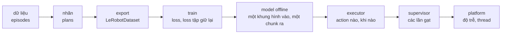
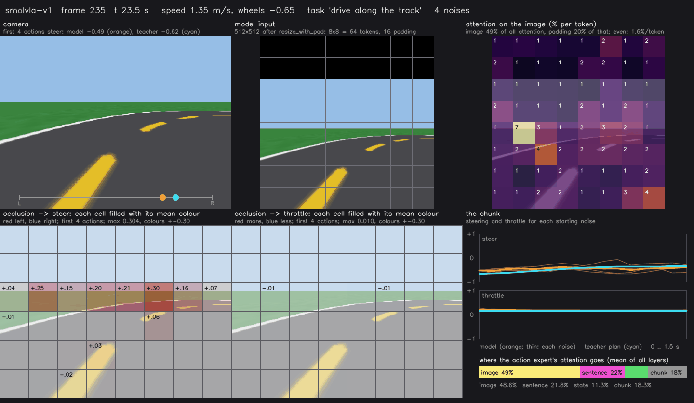
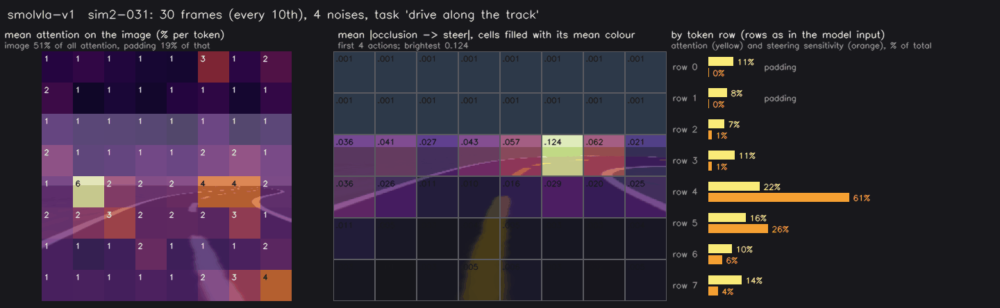
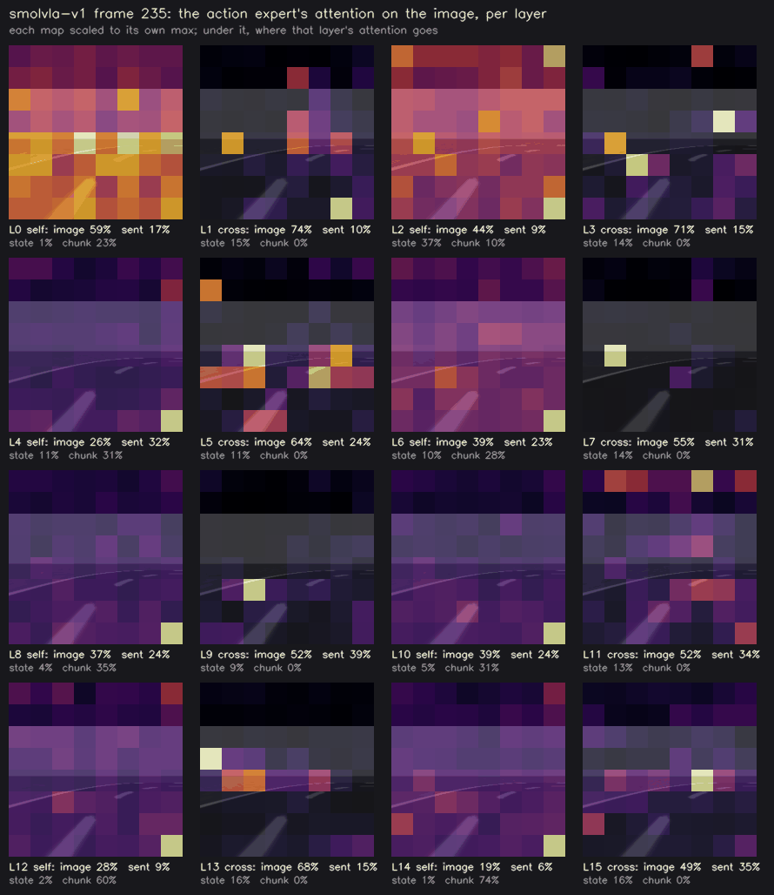
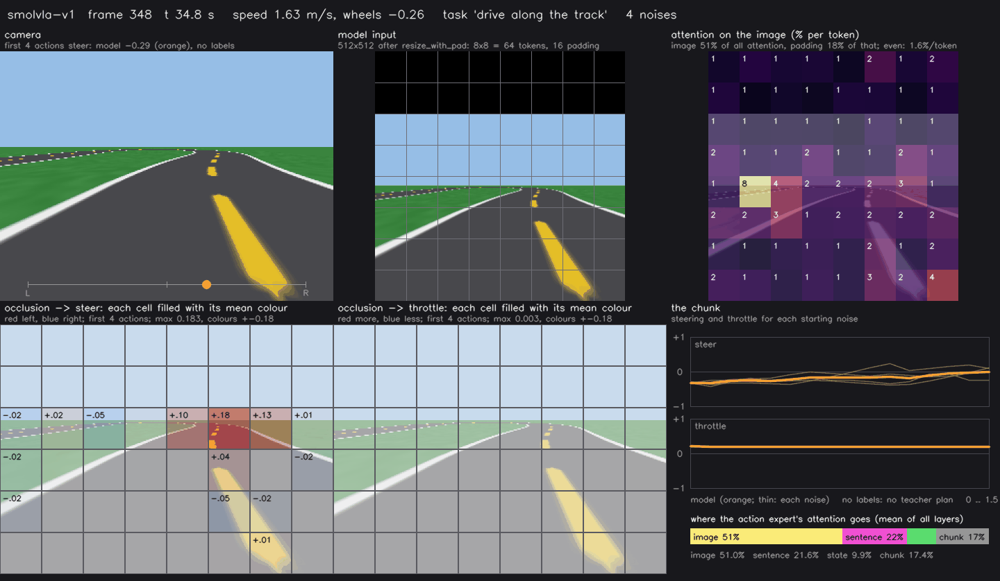
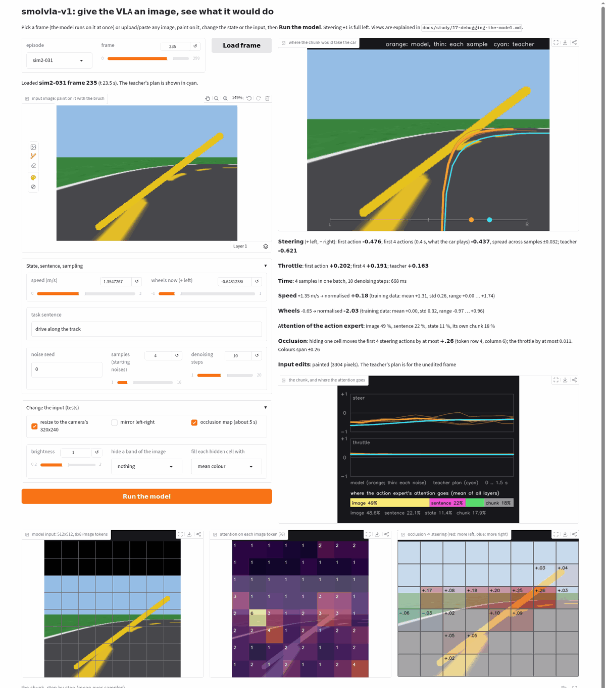

# 17 · Debug model và thuật toán

*Bản tiếng Việt · [English](17-debugging-the-model.md)*

*Bản tiếng Việt · [English](17-debugging-the-model.vi.md)*

Cách tìm ra *vì sao* một policy lái xe học được lại hành xử như nó đang làm, bằng các công cụ
trong repository này và LeRobot. Mọi output trích dẫn bên dưới đều được tạo cho giáo trình này
ngày 2026-11-17 với SmolVLA đã fine-tune `smolvla-v1` của
[Lab 15](15-hands-on-labs.vi.md#lab-15-fine-tune-smolvla-trên-dữ-liệu-lái-xe-ngay-trên-laptop-này), trừ
khi có ghi chú khác.

## Ta đang giải bài toán gì?

`smolvla-v1` đạt mọi lần lái đánh giá, nhưng nó lạng lách: 4,8 cm rms so với 1,5 cm của teacher.
"Model chưa đủ tốt" không phải là một chẩn đoán. Nguyên nhân có thể nằm ở dữ liệu, nhãn, bước
export, quá trình train, mạng, cách các chunk của nó được phát, supervisor, hoặc nhịp thời gian
của máy tính. Debug một bộ điều khiển học được là **khoanh vùng**: tìm lớp đầu tiên mà mọi thứ bắt
đầu sai, rồi tìm lý do bên trong lớp đó.

## Các lớp, và nên nhìn vào đâu trước



Đi từ bên phải khi một lần lái hỏng (lỗi ở vòng lặp hay ở model?), và đi từ bên trái khi model
còn mới (dữ liệu có đúng như bạn nghĩ không?).

| Triệu chứng | Nghi phạm đầu tiên | Công cụ đầu tiên |
|---|---|---|
| ra khỏi đường ngay từ đầu, hoặc lái đi lạc ngay lập tức | nhãn, export (sai cột action, sai khoá camera) | `browse`, phần đọc lại bản export bên dưới |
| lạng lách quanh đường tâm | output của model, nhiễu khởi đầu, độ trễ | `tools/probe_vla.py`, bảng debug, `--log` |
| dừng lại hoặc giật cục | supervisor (kế hoạch quá cũ, luật vật cản) | cột `overrides` trong `--log`, chữ đỏ trên HUD |
| ổn trong `sim`, tệ hơn với `--show` | độ trễ thật, tải CPU | `latency_ms_mean` trong kết quả, `plan_age_ms` trong `--log` |
| loss train giảm, khả năng lái không cải thiện | mục tiêu train, không phải optimiser | phép kiểm tra chunk mục tiêu (§1), `evaluate` |
| loss là NaN, hoặc hoàn toàn không giảm | miền giá trị của dữ liệu, learning rate, một cấu hình đóng băng mọi thứ | log train (§2) |

## Các công cụ

| Công cụ | Cho thấy gì | Ở đâu |
|---|---|---|
| `./drive.sh validate` | tính nhất quán của bộ dữ liệu, *perfect driving only* | [chương 9](09-dataset-pipeline.vi.md) |
| `./drive.sh browse --match …` | mỗi khung hình với kế hoạch đã gán nhãn vẽ lên mặt đường | chương 9 |
| Đọc lại bằng LeRobot | thứ trainer thực sự sẽ đưa cho model | §1 |
| log của `lerobot-train` | loss, chuẩn gradient, learning rate, tốc độ, bộ nhớ, loss trên tập giữ lại | §2 |
| **`tools/probe_vla.py`** | model khi chạy offline: độ chính xác theo từng bước của chunk, nhiễu, tính đối xứng, độ nhạy, thời gian, shape | §3 |
| **`tools/see_vla.py`** | output đến từ đâu trong ảnh: đầu vào của model, attention, occlusion | §3 |
| **`tools/vla_app.py`** | một web app: một ảnh vào (một khung hình, một ảnh tải lên, ảnh bạn tự vẽ), chunk ra, vẽ lên mặt đường | §3 |
| **`./drive.sh probe`** | tương tự cho CNN: các layer, đường cong train so với kế hoạch trung bình, chuẩn gradient và tỷ lệ cập nhật/trọng số theo từng epoch, sai số theo từng bước, mặt đường và tốc độ so với hai baseline, ablation đầu vào, các unit chết, saliency, các bài test lật gương, độ sáng, ảnh trống, tốc độ và trạng thái tay lái, sai số trên chính các lần lái của nó theo khoảng cách lệch tâm, và một báo cáo HTML gom tất cả | [docs/thuc-hanh, bài 3, 4 và 7](../thuc-hanh/07-debug-chuyen-nghiep.md) |
| `./drive.sh lrfind`, `collect --driver cnn` | learning-rate range test; DAgger, mạng lái trong khi teacher gán nhãn | [docs/thuc-hanh, bài 7](../thuc-hanh/07-debug-chuyen-nghiep.md) |
| bảng debug của `sim --show` | chunk đang dùng, phần bị bỏ qua, action đang phát, model so với động cơ | [Lab 1](15-hands-on-labs.vi.md#lab-1-chạy-bộ-mô-phỏng) |
| `sim --log actions.csv` | mỗi nhịp 20 ms, để phân tích sau | §4 |
| `evaluate`, `sweep` | kết quả vòng kín, độ nhạy với độ trễ | chương [11](11-model-evaluation.vi.md), [5](05-action-chunking-and-latency.vi.md) |
| một debugger | dừng bên trong bất kỳ hàm nào, xem tensor | §5 |

Mọi lệnh phía model đều chạy bằng môi trường LeRobot, từ thư mục gốc của repository:

```bash
export D=/home/fanning/data1/AI_SOURCE/smolvla-local HF_HOME=/home/fanning/data1/AI_SOURCE/smolvla-local/hf
export V=$D/.venv/bin/python PYTHONPATH=.
cd /home/fanning/data1/AI_SOURCE/vla-drive
```

**Trên Mac (hoặc ở bất cứ đâu, không có thư mục đó):** `make vla-setup` tạo môi trường trong
`.venv-vla`, và `./vla.sh` đóng vai `$V` với `PYTHONPATH=.` đã đặt, nên `$V tools/see_vla.py` thành
`./vla.sh tools/see_vla.py`. Model chạy trên GPU của Apple (MPS); mỗi công cụ nhận `--device` (hoặc
`VLA_DEVICE`) để chọn, và chạy một khung hình trên `mps` rồi trên `cpu` là cách kiểm tra GPU tính
đúng như CPU (lỗi MPS trong [docs/thuc-hanh, bài 6](../thuc-hanh/06-debug-model.md) được tìm ra
theo cách đó). Đo trên M3 (GPU 10 nhân, 16 GB), LeRobot 0.5.1: một chunk với 10 bước khử nhiễu
mất khoảng 360 ms, `see_vla.py` khoảng 30 s mỗi khung hình với hai mẫu nhiễu, và web app trả lời
trong khoảng 1 s. Toàn bộ con đường trên Mac, kèm output, nằm ở
[docs/thuc-hanh/08-vla-tren-mac.md](../thuc-hanh/08-vla-tren-mac.md).

---

## 1 · Debug dữ liệu trước khi debug model

Một model chỉ đúng được tới mức mục tiêu của nó đúng. Ba phép kiểm tra, độ sâu tăng dần.

**`validate` và `browse`.** Cả hai từ chương 9. Trong `browse`, quỹ đạo màu lục lam phải đi theo
con đường phía trước; một quỹ đạo ra khỏi đường hoặc chỉ sai hướng là lỗi nhãn, không phải lỗi
model.

**Đọc lại bộ dữ liệu theo đúng cách trainer sẽ đọc.** Bản export là ranh giới giữa hai codebase,
nên hãy kiểm tra nó từ phía LeRobot:

```bash
$V - <<'EOF'
import numpy as np
from lerobot.datasets.lerobot_dataset import LeRobotDataset
from drive.learn.label import read_labels
ds = LeRobotDataset("local/vla-drive", root="runs/drive/lerobot",
                    delta_timestamps={"action": [k / 10 for k in range(16)]})
item = ds[100]
print(len(ds), item["observation.images.front"].shape, item["observation.state"], item["action"].shape)
EOF
```

*Measured:* `24876 torch.Size([3, 240, 320]) tensor([1.4858, 0.0958]) torch.Size([16, 2])`. So vài
mục với file `.npz` và `labels.npz` gốc: khi làm điều này cho bản export, state và action đầu
tiên khớp chính xác, còn ảnh lệch khoảng 1,5 / 255 (do nén AV1).

**Nhìn vào mục tiêu, không chỉ đầu vào.** Chunk mà LeRobot dùng để train khung hình $i$ là
`action` của các khung hình $i \dots i+15$. Với các episode `collect` bị làm nhiễu, đó không phải
kế hoạch sạch của teacher. Đo khoảng chênh:

```bash
python3 - <<'EOF'
import numpy as np
from pathlib import Path
from drive.learn.label import episodes, read_labels
d = {k: [] for k in (0, 1, 3, 5, 15)}
for ep in episodes(Path("runs/drive/episodes")):
    plans = read_labels(ep)["plans"]
    for k in d:
        d[k].append(np.abs(plans[k:, 0, 0] - plans[:len(plans) - k, k, 0]))
print({k: round(float(np.concatenate(v).mean()), 3) for k, v in d.items()})
EOF
```

*Measured* (80 episode của teacher): 0 ở bước 0, 0,04 ở bước 1, 0,13 ở bước 3, khoảng 0,2 từ bước
5, so với trung bình |steer| là 0,24. Một model không thể dự đoán phần cuối của mục tiêu đó từ một
ảnh; hãy chờ đợi các bước sau của chunk tệ hơn.

---

## 2 · Debug quá trình train

### Đọc dòng log

`lerobot-train` in ra, mỗi `--log_freq` bước (từ lần chạy của Lab 15):

```
step:550 smpl:9K ep:29 epch:0.40 loss:0.477 grdn:5.771 lr:8.4e-05 updt_s:0.368 data_s:0.003 smp/s:43 mem_gb:2.91
INFO … step 500: eval_loss=0.6511
```

| Field | Nghĩa | Cần để ý gì |
|---|---|---|
| `loss` | MSE của flow matching trên batch train | giảm nhanh, rồi chậm lại; không bao giờ về 0 (mục tiêu có chứa nhiễu ngẫu nhiên) |
| `eval_loss` | như trên nhưng trên các episode giữ lại (`--dataset.eval_split`, `--eval_steps`) | ngừng giảm → train thêm sẽ không giúp *loss*; vẫn phải đánh giá bằng cách lái |
| `grdn` | chuẩn gradient trước khi cắt (cắt ở 10, `optimizer_grad_clip_norm`) | tăng vọt đột ngột hoặc `nan` → dữ liệu xấu hoặc learning rate quá cao |
| `lr` | learning rate hiện tại (warm-up, rồi giảm theo cosine) | thấy được giai đoạn warm-up ở đầu |
| `updt_s`, `data_s` | số giây mỗi lần cập nhật, mỗi lần nạp batch | `data_s` gần bằng `updt_s` → bộ nạp dữ liệu là nút cổ chai |
| `smp/s`, `mem_gb` | thông lượng, bộ nhớ GPU đỉnh | còn chỗ để tăng batch không? |
| `epch` | số lượt đi qua tập train | 2000 bước × 16 = 1,4 lượt qua 22 176 khung hình |

### Nhìn vào bên trong loss

`SmolVLAPolicy.forward` (trong `policies/smolvla/modeling_smolvla.py` của LeRobot, dòng 358 ở bản
0.5.2) trả về, ngoài loss, một dictionary với ba giai đoạn của nó:

| Khoá | Sau bước |
|---|---|
| `losses_after_forward` | MSE của mạng, cắt về 2 chiều action thật |
| `losses_after_in_ep_bound` | che các bước của chunk rơi ra ngoài cuối episode (`action_is_pad`) |
| `losses_after_rm_padding` | bỏ phần đệm lên 32 chiều |

Nếu cái thứ nhất và thứ hai khác nhau nhiều, có nhiều mục tiêu chạy qua khỏi cuối episode (episode
ngắn, hoặc `chunk_size` dài).

### Nó có học được không? Overfit một bộ dữ liệu tí hon

Bài test kinh điển đầu tiên cho mọi dây chuyền train: trên một hai episode, loss phải giảm xuống
thấp hơn hẳn mức nó dừng lại trên dữ liệu đầy đủ. Nếu không, lỗi nằm trong dây chuyền (mục tiêu,
chuẩn hoá, tham số bị đóng băng), không phải ở lượng dữ liệu.

```bash
$V -m drive export --match 'sim-000' --out /tmp/one-episode
$D/.venv/bin/lerobot-train --policy.path=lerobot/smolvla_base \
  --dataset.repo_id=local/one --dataset.root=/tmp/one-episode \
  --rename_map='{"observation.images.front": "observation.images.camera1"}' \
  --policy.chunk_size=16 --policy.n_action_steps=16 --batch_size=8 --steps=400 --log_freq=50 \
  --save_checkpoint=false --policy.push_to_hub=false --wandb.enable=false --output_dir=/tmp/overfit
```

*Chưa chạy cho giáo trình này*: ghi loss ở bước 50 và 400 rồi so với 0,47 ở bước 550 của lần chạy
đầy đủ.

### NaN và các lỗi số học khác

- `grdn:nan` hoặc `loss:nan` → `validate` bộ dữ liệu (nó báo FAIL với NaN và giá trị ngoài miền),
  rồi hạ `--policy.optimizer_lr`.
- Để tìm phép tính đã sinh ra nó, chạy vài bước với `torch.autograd.set_detect_anomaly(True)` đặt
  ở đầu một bản sao của script train; cách này chậm và chỉ dùng để chẩn đoán.

---

## 3 · Debug model khi chạy offline: `tools/probe_vla.py`

Việc lái trộn model với độ trễ, executor và supervisor. Để thấy riêng model, hãy cho nó từng
observation riêng lẻ và đọc các chunk của nó. [`tools/probe_vla.py`](../../tools/probe_vla.py)
chạy chín phép thăm dò (probe) trên một checkpoint:

```bash
$V tools/probe_vla.py --checkpoint smolvla-v1          # vài phút, phần lớn là nạp model
```

Nó dùng các episode mà LeRobot đã giữ lại (`eval_split=0.1` giữ lại 10 % episode **cuối** của mỗi
nhiệm vụ: ở đây là `sim2-031` … `sim2-039`), nên model chưa được train trên chúng.

### offline: độ chính xác theo từng bước của chunk

```
[offline] 261 frames from 9 held-out episodes: mean |steer error| by chunk step
  step:              0     1     2     3     5    10    15
  vs clean plan: 0.088 0.086 0.118 0.142 0.162 0.155 0.172
  vs LeRobot's target: 0.088 0.086 0.100 0.122 0.190 0.251 0.271
  step 0: correlation with the teacher 0.937; mean steer model +0.014, teacher -0.011
```

- Các bước đầu bám teacher tốt (tương quan 0,94), với sai số khoảng 0,09: 9 % góc lái tối đa.
- Từ bước 5, sai số so với mục tiêu của chính LeRobot *tăng* lên 0,27, lớn hơn so với kế hoạch
  sạch. Model không học phần cuối không dự đoán được (§1); nó dự đoán thứ gần với kế hoạch sạch
  hơn. Đó là hành vi tốt hơn, và nó cho thấy chính mục tiêu train, không phải mạng, giới hạn
  phần cuối.
- Ở độ trễ 125 ms, xe phát các bước 1–3 của mỗi chunk, nơi sai số là 0,09–0,14.

### noise: nhiễu khởi đầu làm chunk dịch đi bao nhiêu?

```
[noise] one frame, 10 different noises: std of steering by step 0.159 0.216 0.103 0.113 0.316; std of throttle at step 0 0.096
```

SmolVLA sinh mỗi chunk bằng cách khử nhiễu một điểm khởi đầu ngẫu nhiên, và `BackendPolicy` rút một
điểm mới cho mỗi chunk. Trên khung hình này, mười lần rút cho steer dao động với độ lệch chuẩn
0,16–0,32: lớn ngang chính sai số. Vì vậy các chunk liên tiếp bất đồng một cách ngẫu nhiên, và đó
là một nguyên nhân trực tiếp của việc lạng lách. Một policy diffusion hay flow được train tốt và
tự tin cho độ phân tán nhỏ; độ phân tán lớn nói rằng model không chắc, hoặc đã học một mục tiêu
rộng (§1).

**Kiểm chứng giả thuyết bằng phép thay thế.** Cùng lần lái, cùng độ trễ, nhiễu khởi đầu đặt bằng 0
thay vì ngẫu nhiên (thay một dòng, trong một script nháp, ở `loop.worker.policy.rng`):

| Nhiễu khởi đầu | rms | max | tốc độ trung bình |
|---|---:|---:|---:|
| ngẫu nhiên (như bản phát hành) | 4.4 cm | 10.5 cm | 1.39 m/s |
| bằng 0 | 3.0 cm | 7.4 cm | 1.21 m/s |

(30 s trên peanut ở 125 ms, `SimulatedWorker`, mỗi trường hợp một lần chạy.) Khả năng bám đường
tốt lên một phần ba, nhưng xe cũng chậm hơn, và xe chậm hơn thì bám tốt hơn (chương 6), nên hiệu
ứng chưa được tách riêng. Các bước tiếp: cả sáu lần lái đánh giá, ba seed, và một phép so sánh có
khớp tốc độ. Nhiễu bằng 0 cũng là một lựa chọn có cái giá: nó lấy đi khả năng của model chọn giữa
nhiều kế hoạch hợp lệ.

### repeat: tính tất định

```
[repeat] same frame, same noise, twice: max difference 0.00e+00
```

Khi nhiễu cố định, model là tất định. Mọi khác biệt giữa các lần chạy với cùng nhiễu đến từ chỗ
khác (thread, nhịp thời gian). Đây là điều làm các lần chạy `SimulatedWorker` lặp lại được:
`BackendPolicy` đặt seed cho bộ sinh số của nó.

### mirror: policy có đối xứng không?

```
[mirror] steer step 0: original -0.039, mirrored +0.556 (a symmetric policy gives +0.039); mean |orig + mirrored| over the chunk 0.280
```

Thế giới không thiên về trái hay phải: lật ảnh và đổi dấu steer trong state, thì một policy đúng
sẽ đổi dấu steer của nó. `smolvla-v1` không làm vậy, chênh rất xa trên khung hình này. CNN được
train với ảnh lật gương ([chương 10](10-model-training.vi.md)); lần fine-tune SmolVLA thì không. Lật
gương các episode khi export là một cách sửa ứng viên
([trang 5 của sơ đồ](diagrams/vla-drive-architecture.drawio)). Một khung hình không phải phép đo
cho cả policy: hãy chạy probe trên các khung hình khác (sửa `sample` trong script) trước khi kết
luận.

### blank: nó làm gì khi không thấy gì?

```
[blank] black image: steer +0.056 … -0.013, throttle +0.920
[blank] grey image: steer +0.059 … -0.039, throttle +0.903
```

Không có ảnh nào, nó lái thẳng với ga gần tối đa: từ state của khung hình này (đang đứng yên),
"tăng tốc" là thứ dữ liệu đã dạy. Model không có khái niệm "tôi không nhìn thấy"; một camera bị mù
trên xe sẽ không làm nó dừng. Đó là việc của cảm biến khoảng cách của supervisor và một phép kiểm
tra sức khoẻ camera, không phải việc của model.

### speed: ga có phản ứng theo state không?

```
[speed] same frame, steer +0.00: first throttle at speed
  0.0 m/s -> throttle +0.913
  0.5 m/s -> throttle +0.888
  1.0 m/s -> throttle +0.117
  1.4 m/s -> throttle +0.167
  1.8 m/s -> throttle +0.198
  2.5 m/s -> throttle +0.035
```

Nó tăng tốc mạnh dưới 1 m/s và giữ một mức ga nhỏ ở trên đó, nhưng không phanh ở 1,8 hay 2,5 m/s.
Luật ga của teacher thì sẽ phanh. Dữ liệu train hầu như không có những tốc độ như vậy (xem probe
tiếp theo), nên model chưa bao giờ học phải làm gì ở đó.

### shapes: thứ gì đi vào mạng

```
[shapes] into embed_prefix:
  images[0] (1, 3, 512, 512) torch.float32  range [-1.00, 0.85]  present [True]
  lang_tokens (1, 48), 5 real tokens
  state (1, 32): [-5.050000190734863, -0.0010000000474974513, 0.0, 0.0] …
  -> prefix embeddings (1, 113, 960)
```

- Ảnh 240×320 tới nơi đã được đổi cỡ và đệm thành 512×512, trong $[-1, 1]$.
- Nhiệm vụ là 5 token thật được đệm lên 48.
- Prefix là 113 token độ rộng 960. 113 = 48 văn bản + 1 state + 64, nên mỗi ảnh thành 64 token
  (suy ra từ các shape).
- **State là −5,05 độ lệch chuẩn.** Tốc độ được chuẩn hoá bằng trung bình 1,31 m/s và độ lệch
  chuẩn 0,26 m/s của bộ dữ liệu. Một chiếc xe đứng yên cách mọi thứ model từng được train năm độ
  lệch chuẩn. Lúc bắt đầu mọi lần lái, và mọi lần dừng, đều nằm ngoài phân phối. Các cách sửa ứng
  viên: ghi thêm dữ liệu lái chậm (xuất phát, dừng, cua chậm), hoặc chuẩn hoá state theo các cận
  cố định: `NormalizationMode` của LeRobot có `MIN_MAX` bên cạnh `MEAN_STD` (qua
  `normalization_mapping` của policy; chưa thử ở đây).

### task: câu nhiệm vụ có quan trọng không?

```
[task] same frame, same noise, other sentences: mean |steer change| over the chunk
  'drive slowly'           0.087   throttle +0.876
  'stop'                   0.019   throttle +0.870
  'turn left'              0.045   throttle +0.868
  ''                       0.033   throttle +0.853
```

Đổi câu làm output thay đổi một chút và tuỳ tiện: "stop" không làm nó dừng và "turn left" không
làm nó rẽ. Model chưa bao giờ thấy câu nào khác, nên văn bản với nó là nhiễu
([chương 13](13-vla-and-smolvla.vi.md)).

### timing: thời gian đi đâu

```
[timing] one chunk: 160 ms with 1 step, 309 ms with 10 → about 16.6 ms per denoising step,
143 ms for everything else (pre-processing, image encoder, VLM prefix, post-processing)
```

Đo trong lúc một bản build C++ làm CPU bận (load average khoảng 20 trên 20 nhân); trên một máy
yên tĩnh hơn, một chunk với 10 bước mất 124 ms (Lab 15). Phần hữu ích là cách chia: 10 bước khử
nhiễu chiếm khoảng một nửa thời gian. `num_steps` bằng 5 sẽ tiết kiệm khoảng 80 ms ở đây; độ chính
xác có giữ được không là một thí nghiệm ([trang 5 của sơ đồ](diagrams/vla-drive-architecture.drawio)).
Probe đặt `backend.policy.config.num_steps`, chính là thứ `sample_actions` đọc.

### Nó nhìn vào đâu? `tools/see_vla.py`

Các probe nói model xuất ra *gì*. [`tools/see_vla.py`](../../tools/see_vla.py) vẽ ra output đến
*từ đâu trong ảnh* (đo ngày 2026-11-18):

```bash
$V tools/see_vla.py                         # 3 khung hình của sim2-031 (cua trái gắt nhất, cua phải gắt nhất, thẳng nhất)
$V tools/see_vla.py --summary 10            # cứ 10 khung hình lấy một, lấy trung bình: khoảng 2,5 phút
$V tools/see_vla.py --frames 235 --video    # một khung hình, và attention trên mọi khung hình thành một mp4
```

Mọi thứ được ghi vào `runs/drive/reports/see-smolvla-v1/`: một bảng cho mỗi khung hình, cùng
attention đó theo từng layer (`…-layers.png`), các con số (`.json`), và bảng tổng hợp.



#### Ảnh trở thành token thế nào

`resize_with_pad` của LeRobot co ảnh camera 320×240 thành 512×384 và đệm **phía trên** bằng 128
hàng đen. SigLIP cắt ảnh 512×512 thành các patch 32×32, và bộ nối (connector) của SmolVLM2 gộp mỗi
nhóm 4×4 patch thành một token: một **lưới 8×8 gồm 64 token, theo từng hàng** (`pixel_shuffle`
trong `transformers/models/smolvlm/modeling_smolvlm.py`). Một token là một ô 64×64 của đầu vào
model, tức một ô 40×40 của ảnh camera (khung "model input" ở trên). Vì vậy:

- **16 trong 64 token ảnh là padding** (hàng token 0–1), và 16 token tiếp theo là bầu trời (hàng
  2–3). Một nửa số token ảnh không cho thấy gì về con đường.
- Thứ tự đã được kiểm tra, không phải giả định. Một ô vuông sáng 40×40 trên nền xám trung bình,
  lần lượt đặt ở từng ô trong 48 ô của camera, làm thay đổi nhiều nhất token ở cùng ô đó trong 41
  trên 48 trường hợp. Ở 7 trường hợp còn lại, token thay đổi nhiều nhất cách trong phạm vi hai ô,
  chủ yếu ở mép trái và mép phải. Các token phần lớn là cục bộ, nhưng không hoàn toàn. Attention
  của SigLIP trộn cả ảnh, nên một token có thể mang theo thứ gì đó từ chỗ khác.

#### Hai cách hỏi "ở đâu"

| | attention | occlusion |
|---|---|---|
| câu hỏi | mạng *đọc* từ đâu? | cái gì *làm câu trả lời thay đổi*? |
| cách làm | ghi lại softmax của các query của action expert ở mọi bước khử nhiễu; lấy trung bình qua 15 head, 16 layer, 10 bước, 16 token của chunk, 4 mẫu nhiễu | lấp một ô camera bằng màu trung bình của nó, chạy lại với cùng các mẫu nhiễu, đo trung bình của 4 action đầu (0,4 s, phần executor phát) dịch đi bao xa |
| chi phí | miễn phí: một lượt forward | 48 ô × 4 mẫu nhiễu = 192 lượt forward, khoảng 5 s mỗi khung hình với batch 16 |
| giới hạn | attention không phải mức độ quan trọng (bên dưới) | mỗi lần một ô: một tín hiệu lặp lại ở chỗ khác vẫn sống sót; một ô đồng màu (bầu trời, nhựa đường trơn) không thể thay đổi khi bị lấp bằng chính màu trung bình của nó |

Attention được ghi bằng mẹo bọc hàm của §5: `Seer.look` tráo
`vlm_with_expert.eager_attention_forward` bằng một bản sao cũng giữ lại các xác suất. Trong một bước
khử nhiễu, các query là 16 token của chunk. Các key là 113 token prefix: 64 token ảnh, 48 token
câu và 1 token state. Trong các layer self-attention, 16 token của chunk cũng là key.

#### `smolvla-v1` nhìn vào đâu

Bảng tổng hợp trên 30 khung hình của `sim2-031` (cứ 10 lấy một, 4 mẫu nhiễu):



| hàng token | hàng camera | mặt đất phía trước xe | attention | độ nhạy steer, lấp bằng màu trung bình | lấp màu xám |
|---|---|---|---|---|---|
| 0–1 | — | padding | 19 % | — | — |
| 2–3 | 0–80 | bầu trời | 18 % | 3 % | 30 % |
| **4** | 80–120 | đường chân trời tới 0,76 m | 22 % | **61 %** | 27 % |
| 5 | 120–160 | 0,76 tới 0,36 m | 16 % | 26 % | 24 % |
| 6–7 | 160–240 | 0,36 tới 0,20 m | 25 % | 10 % | 19 % |

Các khoảng cách lấy từ camera của bộ mô phỏng (`Camera.forward_m` trong `drive/sim/render.py`). Độ
nhạy steer là phần của mỗi hàng trong tổng |Δsteer| trên 48 ô. Cột xám là `--summary 10 --fill grey`,
che mỗi ô bằng màu xám trơn (128).

- **Nó lái theo con đường từ khoảng 0,4 m phía trước tới đường chân trời.** 87 % độ nhạy steer nằm ở
  hàng token 4–5. Trên một episode giữ lại thứ hai, `sim2-035`, điều đó vẫn đúng: 63 % ở hàng 4,
  24 % ở hàng 5, 10 % ở hàng 6–7 và 2 % ở bầu trời. Teacher, pure pursuit, nhắm tới một điểm cách
  `0.4 + 0.35·v` m phía trước (`drive/policy/pure_pursuit.py`): 0,87 m ở tốc độ 1,35 m/s của các
  khung hình này. Điểm đó là hàng camera 116, nằm trong hàng token 4. Model đã học đọc đúng chỗ
  teacher của nó nhìn. Ở khung hình 235 (bảng ở trên, một khúc cua phải), che một ô duy nhất của
  hàng 4 làm steer dịch tới +0,30 (về bên trái) trên một lệnh −0,49. Che một ô của mặt đường ngay
  phía trước làm nó dịch nhiều nhất 0,03. Với lấp màu xám cũng vậy, ba ô nhạy nhất (trung bình
  0,065–0,083) nằm ở hàng 4–5, trên các mép đường.
- **Che cả một dải cũng nói như vậy.** Lấp mọi ô của một dải bằng màu trung bình của chính nó (29
  khung hình của `sim2-031`, 4 mẫu nhiễu) làm steer dịch trung bình: hàng 4 **0,085**, hàng 5
  0,080, hàng 6–7 gộp lại **0,024** (nhiều nhất 0,096). Mặt đường ngay trước xe chiếm một phần ba
  ảnh camera, và model gần như không cần nó.
- **Nó bỏ qua bầu trời chỉ vì bầu trời không bao giờ thay đổi.** Bị lấp bằng chính màu trung bình
  của nó, một ô bầu trời không thay đổi, nên con số 3 % nói được rất ít. Một ô vuông xám trên bầu
  trời làm steer dịch 0,02–0,04 mỗi ô: một thứ model chưa bao giờ thấy ở đó, và nó phản ứng. Lấp
  bằng màu trung bình hỏi "chi tiết ở đây có quan trọng không?". Lấp màu xám hỏi "bất cứ thứ gì ở
  đây có quan trọng không?". Một vật cản thật hoặc một biển báo phía trên đường chân trời sẽ là thứ
  mới với model này.
- **Ga không đến từ một ô đơn lẻ nào.** Không ô nào làm nó dịch quá 0,002 trung bình (0,010 ở khung
  hình 235). [Probe blank](#blank-nó-làm-gì-khi-không-thấy-gì) cho thấy toàn bộ ảnh thì có
  ảnh hưởng: một ảnh đen cho ga 0,92.
- **Một nửa attention dành cho ảnh:** trung bình 51 %. Câu nhận 22 %, state 10 %, và các token
  của chunk 17 %. 22 % dành cho một câu không bao giờ đổi ([probe task](#task-câu-nhiệm-vụ-có-quan-trọng-không))
  là tiêu vào một hằng số.
- **Attention đồng ý với occlusion ở hàng tốt nhất, và bất đồng ở chỗ khác.** Hàng 4 nhận nhiều
  attention nhất (22 %) và độ nhạy cao nhất. Nhưng các hàng padding nhận 19 % attention dành cho
  ảnh. Pixel của chúng là cùng một màu đen ở mọi khung hình, nên chúng không mang gì về khung hình
  này. Một token ở góc dưới bên phải cũng nhận 3,8 %, nhiều hơn phần lớn token mặt đường, và nó
  sáng ở phần lớn các layer self-attention (`…-layers.png`). Transformer hay "đỗ" attention ở những
  token vô thông tin như vậy: "attention sinks". **Dùng attention để thấy mạng định tuyến thông tin
  thế nào, và occlusion để thấy nó phụ thuộc vào đâu.**
- **Các layer khác nhau** (khung hình 235, ảnh bên dưới). Các layer cross-attention (lẻ) đặt
  49–74 % attention của chúng lên ảnh, tập trung vào vài token, phần lớn ở hàng 4–5. Các layer
  self-attention (chẵn) trải đều trên ảnh và dành 10–74 % cho các token của chunk, tức là cho kế
  hoạch đang được khử nhiễu.



#### Nên thử gì (giả thuyết, chưa kiểm chứng)

- **Cắt ảnh trước khi export.** Một phần tư số token ảnh là padding và một phần tư là bầu trời. Cắt
  ảnh camera về dải mặt đường, hoặc làm nó thành hình vuông, sẽ đặt 32 token đó lên mặt đường: độ
  phân giải cao hơn đúng chỗ model đọc. Việc đó nghĩa là một lần export mới, một lần fine-tune mới
  và một lần đánh giá vòng kín (theo khuôn của [chương 16](16-experiments.vi.md)). Chạy lại công cụ này
  trên model mới để xem nó có đọc cùng dải hay không.
- **So sánh các model.** Cùng công cụ chạy được với bất kỳ checkpoint LeRobot nào (`--checkpoint`).
  So hồ sơ theo hàng của một model lái tốt hơn hay tệ hơn cho bạn biết khác biệt có nằm ở chỗ nó
  *nhìn vào đâu* hay không.
- **Nhìn vào các lần hỏng, không phải trung bình**: phần tiếp theo.

#### Ở thời điểm tệ nhất của một lần lái

`--episode` cũng nhận một thư mục có `episode.npz`, như thư mục `sim --record` ghi ra trong một lần
lái vòng kín. `--frames` cũng nhận thời điểm. Ghi một lần lái kèm log action của nó, tìm thời điểm
tệ nhất trong log, và nhìn các khung hình trước đó:

```bash
R=runs/drive/reports/see-smolvla-v1
$V -m drive sim --policy vla --checkpoint smolvla-v1 --duration-s 60 --latency-ms 125 \
    --record $R/drive --log $R/drive.csv
$V tools/see_vla.py --episode $R/drive --frames 34.8s,35.3s,35.8s --out $R/drive-see
```

Lần lái đi được 4,02 vòng ở 1,48 m/s, 5,5 cm rms, tệ nhất 14,2 cm lúc 35,76 s, với kế hoạch cũ
200 ms ở đó. Con số đó nằm trong khoảng bình thường ở độ trễ 125 ms, nên lần này độ trễ không phải
là yếu tố kích hoạt. Một lần lái được ghi không có nhãn, nên bảng không hiện teacher:



Xe đang lệch trái so với vạch: đường tâm nằm bên phải điểm giữa ảnh ở các hàng gần. Nó đang chạy
1,63 m/s, nhanh hơn phần lớn khung hình train (trung bình 1,31 m/s, độ lệch chuẩn 0,26 m/s). Con
đường cua phải ở xa phía trước. Model lái −0,29, rồi −0,18 và −0,15, về phía vạch. Khúc cua ở xa
vẫn quyết định câu trả lời: che một ô của hàng 4 làm steer dịch +0,18. Che một ô ở các hàng gần,
nơi độ lệch rõ nhất, làm nó dịch nhiều nhất 0,05. Trên 11 khung hình từ 33 tới 36 s, che hàng 6–7
gộp lại làm steer dịch trung bình 0,022, và che hàng 4 làm dịch 0,099.

Điều này loại trừ được gì: model **không** nhìn sai chỗ. Nó đọc đúng dải chứa điểm nhắm của
teacher. Pure pursuit lái từ một điểm đó (và pose chính xác của nó) và bám đường ở 1,5 cm, nên
thứ một lệnh lái tốt cần nằm trong dải mà model đọc. Việc lạng lách nhiều khả năng nằm ở *mức chính
xác* của câu trả lời hơn là ở chỗ nó *nhìn vào đâu*. Điều đó khớp với hai kết quả trước:
- độ phân tán của chunk qua các nhiễu khởi đầu
  ([probe noise](#noise-nhiễu-khởi-đầu-làm-chunk-dịch-đi-bao-nhiêu));
- việc giảm từ 4,4 xuống 3,0 cm rms khi nhiễu bằng 0. Lần lái đó cũng chậm hơn, nên hai nguyên nhân
  chưa được tách riêng.

Một công cụ loại trừ được một nguyên nhân cũng hữu ích như một công cụ tìm ra nó.

### Tự tay thử: `tools/vla_app.py`

Các probe và `see_vla.py` trả lời những câu hỏi cố định. [`tools/vla_app.py`](../../tools/vla_app.py)
là một web app nhỏ cho câu hỏi của riêng bạn: đưa cho model một ảnh, đổi một thứ, và xem nó làm gì.
Nó cần gradio trong môi trường LeRobot, cài một lần. Lần cài đo ở đây thêm 15 gói (gradio 6.32)
và không đổi gói nào đã có:

```bash
UV_CACHE_DIR=$D/uv-cache uv pip install --python $V gradio
$V tools/vla_app.py                 # nạp model (khoảng 10 s), rồi mở http://127.0.0.1:7860
```

Nó chỉ lắng nghe trên chính máy này. Trình sửa ảnh vẽ bằng WebGL, thứ mọi trình duyệt thông
thường đều có. Chrome headless không có GPU thì không có, và hiện một trình sửa ảnh trống.



- **Đầu vào.** Chọn một episode và một khung hình. Model chạy trên nó ngay lập tức, nên thanh trượt
  khung hình cho phép tua qua cả một lần lái. Hoặc tải lên, dán vào, hay chụp bất kỳ ảnh nào. Sau đó:
  - vẽ lên ảnh bằng cọ, với màu của mặt đường;
  - đặt tốc độ và vị trí bánh xe mà model được cho biết;
  - đổi câu nhiệm vụ, seed của nhiễu, số mẫu (số nhiễu khởi đầu) và số bước khử nhiễu;
  - lật gương ảnh, đổi độ sáng, hoặc che một dải của nó bằng màu trung bình của các ô, màu xám hoặc
    màu đen;
  - bật bản đồ occlusion (khoảng 5 s).
- **Đầu ra.**
  - Chunk sẽ đưa xe tới đâu, vẽ lên mặt đường. Chunk được cho chạy qua mô hình xe bằng `plan_path`
    và chiếu bằng camera của bộ mô phỏng, giống cách `browse` vẽ một kế hoạch đã gán nhãn. Màu cam là
    trung bình của các mẫu, các nét mảnh là từng mẫu, và màu lục lam là kế hoạch của teacher khi
    khung hình đến từ một episode có nhãn.
  - Các con số: steer và throttle, độ phân tán của chúng qua các mẫu, và thời gian. State được hiển
    thị như bộ chuẩn hoá nhìn thấy nó, kèm cảnh báo khi nó nằm ngoài dữ liệu train.
  - Chunk, đầu vào của model với lưới token, attention, bản đồ occlusion, và một bảng từng bước so
    với teacher.

App dùng lại `Seer` của `see_vla.py`, nên các con số giống nhau: khung hình 235 cho −0,488, như
trong bảng ở trên. Những gì `smolvla-v1` làm với khung hình 54 của `sim2-031` (seed 0, 4 mẫu, 10
bước). Steer là trung bình của 4 action đầu; model cho −0,131 còn teacher −0,082:

| thay đổi | câu hỏi | steer | throttle | ghi chú |
|---|---|---|---|---|
| không đổi gì | | −0.131 | +0.170 | 241 ms cho batch 4 |
| lật gương trái-phải | nó có đối xứng không? | +0.121 | | một policy đối xứng cho +0.131 |
| che dải đường chân trời (màu trung bình) | nó có lái theo đoạn đường xa không? | −0.199 | | |
| che mặt đường gần (màu trung bình) | | −0.131 | | 0 pixel thay đổi: ở đây là nhựa đường trơn. App báo điều đó |
| che mặt đường gần (màu xám) | | −0.145 | | |
| che bầu trời (màu xám) | nó có bỏ qua bầu trời không? | −0.148 | | |
| độ sáng ×0.3 | nó có cần ánh sáng ban ngày không? | −0.187 | | |
| tốc độ 0 m/s | | −0.104 | **+0.996** | app cảnh báo: chuẩn hoá thành −5.05 |
| tốc độ 2.5 m/s | nó có phanh khi quá nhanh không? | −0.113 | +0.166 | không; cảnh báo: vượt miền dữ liệu train |
| task "stop" | nó có làm theo không? | −0.126 | +0.176 | không |
| 1 mẫu, 1 bước khử nhiễu | các bước tốn bao nhiêu? | −0.140 | | 48 ms, so với 219 ms cho 1 mẫu và 10 bước |

Ở khung hình 235, vẽ một nét vàng ngang qua mặt đường (ảnh chụp màn hình) làm steer dịch từ −0,488
sang −0,437. Trong bản đồ occlusion, các ô dọc theo nét vẽ giờ cũng có ảnh hưởng. Hai ô bầu trời mà
nét vẽ đi qua cho +0,03 và +0,04, ở chỗ trước đó không gì có ảnh hưởng. Hai ô mặt đường dưới đường
chân trời cho tới +0,10, ở chỗ trước đó một ô chỉ đạt +0,06.

---

## 4 · Debug vòng kín

### Xem nó

```bash
$V -m drive sim --policy vla --checkpoint smolvla-v1 --latency-ms 0 --show --log runs/actions.csv
```

Trong bảng debug (Lab 1): một chunk có đường lục lam lượn sóng từ bước này sang bước khác là nhiễu
của §3; một dải xám rộng hơn thường lệ là một lượt suy luận chậm; nét đậm và nét mảnh tách nhau là
supervisor đang làm việc.

### Phân tích log

`--log` ghi mỗi nhịp 20 ms một hàng ([`ActionLog`](../../drive/recorder.py#L62)): `t, new_chunk,
chunk_t_obs, plan_age_ms, cmd_steer, cmd_throttle, steer, throttle, overrides, speed_mps,
wheel_steer, lateral_m`.

```bash
python3 - <<'EOF'
import csv, numpy as np
rows = list(csv.DictReader(open("runs/drive/vla/smolvla-v1-actions.csv")))
f = lambda k: np.array([float(r[k]) if r[k] != "" else np.nan for r in rows])
t, cmd, lat, age = f("t"), f("cmd_steer"), f("lateral_m"), f("plan_age_ms")
new = np.array([r["new_chunk"] == "1" for r in rows])
d = np.abs(np.diff(cmd)); at_switch = new[1:]
print(f"steer change per tick: at a chunk switch {np.nanmean(d[at_switch]):.3f}, otherwise {np.nanmean(d[~at_switch]):.3f}")
i = int(np.nanargmax(np.abs(lat)))
print(f"worst moment: t={t[i]:.2f} s, lateral {100*lat[i]:+.1f} cm, plan age {age[i]:.0f} ms")
print("ticks per override:", {k: sum(k in r["overrides"] for r in rows) for k in ("stale", "steer_rate", "speed", "obstacle")})
EOF
```

*Measured* trên lần lái trực tiếp 60 s của Lab 15 (`--show`, thread suy luận thật):

- **Mức đổi steer mỗi nhịp: 0,014 lúc đổi chunk, 0,020 lúc khác.** Phần trộn 0,1 s hoạt động tốt:
  việc đổi chunk không phải nơi sinh ra các cú giật.
- **Thời điểm tệ nhất** (−20,9 cm lúc 41,7 s) có tuổi kế hoạch 360 ms, gấp đôi trung vị 180 ms, và
  theo sau là một chuỗi nhịp `stale` giữa 42,7 và 44,3 s. Một đợt tăng vọt độ trễ trùng với lúc
  bám đường tệ nhất: hãy nhìn vào lớp platform (tải CPU, các tiến trình khác) trước khi nhìn model.
- Tổng cộng 52 nhịp `stale`: 0,54 s lúc khởi động (nạp lượt suy luận đầu tiên của model) và những
  quãng ngắn khi một lượt suy luận mất hơn 300 ms.

### Khoanh vùng bằng phép thay thế

Đổi một thành phần, giữ phần còn lại, và xem triệu chứng có di chuyển theo nó không:

| Thay | Lệnh | Tách được gì | Kết quả ở đây |
|---|---|---|---|
| model → teacher, cùng độ trễ | `./drive.sh sim --latency-ms 125` | model với vòng lặp | teacher ở 100–200 ms: 1,8–2,0 cm (chương 5) → vòng lặp không phải nguyên nhân chính |
| nhiễu khởi đầu ngẫu nhiên → bằng 0 | script nháp (§3) | nhiễu lấy mẫu với giá trị trung bình của model | 4,4 → 3,0 cm, lẫn với tốc độ |
| độ trễ thật → không có | `--latency-ms 0` (không có `--show`) | độ trễ với model | chưa chạy |
| bù bật → tắt | `--no-latency-compensation` | executor | chưa chạy cho VLA |
| supervisor bật → tắt | `--no-safety` (chỉ để chẩn đoán) | supervisor với policy | supervisor chỉ can thiệp lúc khởi động trong `evaluate` → không phải nguyên nhân |
| SmolVLA → CNN, cùng độ trễ | `--policy cnn --checkpoint v1 --latency-ms 125` | họ model | chưa chạy ở 125 ms |

---

## 5 · Đi từng bước bằng debugger

### Trong VS Code

Thêm một cấu hình vào `.vscode/launch.json` dùng Python của môi trường LeRobot, rồi đặt breakpoint
trong [`LeRobotBackend.infer`](../../drive/policy/lerobot_backend.py),
[`ChunkExecutor.action`](../../drive/control/executor.py#L34) hoặc
[`SafetySupervisor.filter`](../../drive/safety.py#L33), hoặc trong `modeling_smolvla.py` của
LeRobot (`embed_prefix`, `sample_actions`):

```json
{
  "name": "drive: sim with smolvla-v1",
  "type": "debugpy",
  "request": "launch",
  "module": "drive",
  "args": ["sim", "--policy", "vla", "--checkpoint", "smolvla-v1", "--latency-ms", "125", "--duration-s", "5"],
  "python": "/home/fanning/data1/AI_SOURCE/smolvla-local/.venv/bin/python",
  "cwd": "${workspaceFolder}",
  "env": {
    "PYTHONPATH": "${workspaceFolder}",
    "HF_HOME": "/home/fanning/data1/AI_SOURCE/smolvla-local/hf",
    "HF_HUB_OFFLINE": "1"
  },
  "justMyCode": false
}
```

`justMyCode: false` cho phép bạn bước vào LeRobot và PyTorch. Không có `--show`, lần chạy dùng
`SimulatedWorker`, nên suy luận diễn ra trên thread chính và breakpoint trong model dừng mô phỏng
một cách gọn gàng. (Cấu hình này chưa được chạy cho giáo trình này.)

### Trong terminal

```bash
$V -m pdb -m drive sim --policy vla --checkpoint smolvla-v1 --duration-s 2
(Pdb) b drive/policy/lerobot_backend.py:76      # sau tiền xử lý, trước mạng
(Pdb) c
(Pdb) p batch["observation.state"]          # state đã chuẩn hoá, như model thấy
```

Hoặc đặt `breakpoint()` ở dòng bạn quan tâm. Hữu ích khi đang dừng: `tensor.shape`,
`tensor.dtype`, `tensor.isnan().any()`, `tensor.min(), tensor.max()`.

### Không cần dừng: bọc một hàm

`tools/probe_vla.py` in đầu vào của `embed_prefix` bằng cách thay nó bằng một hàm bọc cho một lần
gọi. Cùng mẹo đó dùng được cho bất kỳ phương thức nào: giữ bản gốc, bọc, gọi, khôi phục. Nó không
thay đổi gì trên đĩa và không cần debugger.

---

## Các lỗi thường gặp, cùng dấu hiệu của chúng

| Triệu chứng | Nguyên nhân | Kiểm tra |
|---|---|---|
| lái tốt khi chạy offline, tệ trong vòng lặp | độ trễ cao hơn lúc đánh giá, hoặc `chunk_dt_s` sai | `latency_ms_mean`; `dt` của chunk trong bảng debug (0,1 s cho dữ liệu 10 Hz) |
| "Feature mismatch … camera1" lúc train | tên camera khác nhau | `--rename_map` |
| "All image features are missing from the batch" | ảnh được truyền dưới một khoá mà bộ tiền xử lý không đổi tên thành `camera1` | `LeRobotBackend.camera` (probe in ra) so với `policy_preprocessor.json` của checkpoint |
| action vô lý, ví dụ đánh lái hết cỡ | thống kê chuẩn hoá từ một bộ dữ liệu khác | `policy_preprocessor_step_*_normalizer_processor.safetensors` của checkpoint |
| màu sai, model tệ hơn trên ảnh thật | truyền BGR ở chỗ chờ RGB | episode và `Observation.images` là RGB; chỉ đổi ở ranh giới với OpenCV |
| model học luôn cả nhiễu | export với `--action applied` | phần in ra của export và `info.json` |
| giật cục lúc khởi động | lượt suy luận đầu chậm hơn watchdog | `stale` ở t < 1 s trong `--log` |
| kết quả khác nhau giữa các lần chạy giống hệt nhau | `--show` / `--realtime` (thread thật) | so khi không có chúng: `SimulatedWorker` là tất định |

## Kiểm tra kiến thức

1. Một lần lái bị lạng lách. Kể phép thay thế cho bạn biết lỗi ở model hay ở vòng lặp, và kết quả nào chỉ về đâu.
2. Vì sao các probe offline phải dùng 9 episode cuối mà không phải 9 episode bất kỳ?
3. Probe noise cho độ phân tán steer 0,3 ở bước 15. Kể hai nguyên nhân có thể, một ở model và một ở dữ liệu.
4. Vì sao một chiếc xe đứng yên nằm ngoài phân phối với `smolvla-v1`, và bạn sẽ thay đổi gì?
5. Khoảng cách lớn giữa `losses_after_forward` và `losses_after_in_ep_bound` cho bạn biết điều gì?
6. Một token padding nhận 3 % attention dành cho ảnh, nhiều hơn phần lớn token mặt đường. Model có phụ thuộc vào nó không? Công cụ nào trả lời được, và vì sao công cụ kia không trả lời được?

<details><summary>Đáp án</summary>

1. Cho teacher lái với cùng độ trễ. Nếu nó cũng lạng lách, nguyên nhân là vòng lặp (độ trễ, executor); nếu nó bám tốt, nguyên nhân là model.
2. LeRobot giữ lại 10 % episode cuối của mỗi nhiệm vụ; mọi episode khác đều đã được train, nên sai số trên chúng nói model thuộc lòng tốt tới đâu, không phải nó tổng quát hoá thế nào.
3. Model: train chưa đủ hoặc không chắc chắn, nên flow rộng. Dữ liệu: phần cuối của mục tiêu thay đổi theo những nhiễu mà ảnh không thể cho thấy (§1).
4. Tốc độ được chuẩn hoá với trung bình 1,31 và độ lệch chuẩn 0,26 m/s, nên 0 m/s là −5 độ lệch chuẩn. Ghi thêm dữ liệu lái chậm, hoặc dùng chuẩn hoá theo miền cố định.
5. Nhiều chunk mục tiêu chạy qua khỏi cuối episode và bị che: episode ngắn so với `chunk_size`.
6. Attention nói mạng đọc ở đâu, không nói câu trả lời phụ thuộc vào đâu. Một token giống hệt nhau ở mọi khung hình có thể hút attention (một attention sink) mà không mang gì về khung hình đó. Occlusion trả lời được: đổi đầu vào và đo output. Padding không thể bị che trong ảnh camera, nhưng pixel của nó không bao giờ đổi, nên phần attention nó nhận không nói gì về con đường.
</details>

## Đọc thêm

- [Chương 11](11-model-evaluation.vi.md) về đánh giá vòng kín, và [chương 16](16-experiments.vi.md) về khuôn mẫu thí nghiệm.
- Mã nguồn LeRobot: `policies/smolvla/modeling_smolvla.py` (`forward`, `sample_actions`), `scripts/lerobot_train.py` (`update_policy`); thứ tự đọc nằm ở trang 4 của [sơ đồ](diagrams/vla-drive-architecture.drawio).
- Chi và cộng sự 2023, *Diffusion Policy*, về nhiễu lấy mẫu và tính đa mode trong các policy sinh.
