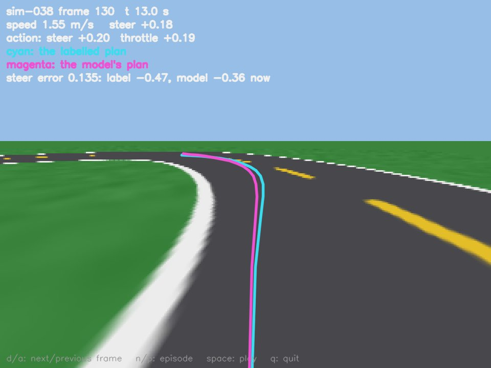
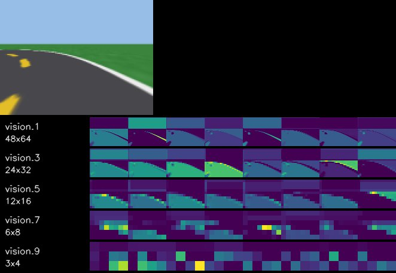
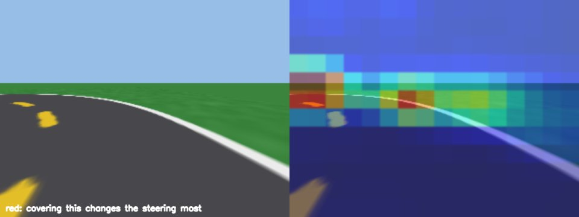

# Bài 4 · Phân tích output của model

**Mục tiêu.** Học xong bài này, bạn sẽ:

- đo sai số của model **so với nhãn và so với hai baseline**, theo từng bước kế hoạch,
  từng loại đường, từng mức tốc độ;
- tìm ra những frame model sai nhiều nhất và **nhìn** chúng;
- xem bên trong model: unit nào hoạt động, unit nào "chết", model **nhìn vào đâu** trong
  ảnh;
- kiểm tra **hành vi** của model: lật ảnh, đổi độ sáng, ảnh trống, đổi tốc độ;
- cho model lái thật, ghi từng tick ra CSV, và **lần ra nguyên nhân** một hành vi lạ;
- dùng một bảng ngưỡng để kết luận model **tốt hay xấu, xấu ở đâu**.

**Cần có:** model `v1` từ [bài 3](03-train-va-doc-log.md), train trên `runs/hoc`.
**Code:** [`drive/learn/probe.py`](../../drive/learn/probe.py),
[`drive/learn/evaluate.py`](../../drive/learn/evaluate.py),
[`drive/recorder.py`](../../drive/recorder.py) (`ActionLog`).

---

## 4.0 Hai cấp độ phân tích

| | Offline | Vòng kín (closed loop) |
|---|---|---|
| Làm gì | Đưa frame **đã ghi sẵn** vào model, so output với nhãn | Cho model **tự lái** trong mô phỏng |
| Lệnh | `./drive.sh probe …` | `./drive.sh evaluate`, `./drive.sh sim --log` |
| Nhanh hay chậm | vài giây | vài chục giây |
| Trả lời câu hỏi | Model sai **ở đâu**, sai **kiểu gì**? | Model có **lái được** không? |
| Điểm mù | Không thấy được hậu quả dây chuyền: sai một chút → xe lệch → gặp cảnh lạ → sai nhiều hơn | Biết model hỏng, nhưng không chỉ ra hỏng ở đâu |

Bạn cần cả hai. Bài 5 sẽ có một model **tốt nhất về offline nhưng hỏng nặng nhất khi
lái thật**.

## 4.1 `probe errors`: sai số trên các episode model chưa từng thấy

```bash
./drive.sh probe v1 errors --project runs/hoc
```

```
held out: 4 episodes (sim-036, sim-037, sim-038, sim-039), 1200 frames that training never used
mean |error| per step of the plan; steer and throttle are in [-1, 1]
  step  ahead   steer: model  average   keep   throttle: model  average
     0   0.0s         0.0214   0.3053 0.2120            0.0339   0.0477
     3   0.3s         0.0134   0.2456 0.1718            0.0258   0.0347
     6   0.6s         0.0184   0.2391 0.1991            0.0191   0.0278
     9   0.9s         0.0239   0.2372 0.2239            0.0180   0.0266
    12   1.2s         0.0315   0.2349 0.2431            0.0182   0.0265
    15   1.5s         0.0494   0.2334 0.2636            0.0183   0.0266
   all                0.0246   0.2458 0.2157            0.0216   0.0308
  the model's steering error is 89 % below 'keep' (the better baseline)
by the road the frame is on (the label's first steering command)
  road         frames steer error    bias
  straight        206      0.0221  -0.001
  gentle bend     445      0.0227  +0.004
  sharp bend      549      0.0271  +0.009
  bias: + steers harder into the bend than the teacher, - less (cuts it short, drifts wide)
by speed
  0.0-1.2 m/s     28 frames   steer error 0.0453   throttle error 0.2441
  1.2-1.5 m/s    453 frames   steer error 0.0199   throttle error 0.0181
  1.5-3.0 m/s    719 frames   steer error 0.0268   throttle error 0.0152
the 5 worst frames (mean steer error over the plan), drawn to runs/hoc/probe/v1/
  1. sim-038 frame 130: steer label -0.47 model -0.36, mean error 0.135   worst-1-sim-038-0130.png
  2. sim-036 frame 169: steer label -0.48 model -0.38, mean error 0.129   worst-2-sim-036-0169.png
  3. sim-036 frame 170: steer label -0.44 model -0.34, mean error 0.127   worst-3-sim-036-0170.png
  4. sim-037 frame 276: steer label -0.89 model -0.83, mean error 0.126   worst-4-sim-037-0276.png
  5. sim-038 frame 131: steer label -0.45 model -0.30, mean error 0.126   worst-5-sim-038-0131.png
  see them in context: ./drive.sh browse --project runs/hoc --match sim-038
```

### Đọc khối thứ nhất: so với baseline

Một con số sai số đứng một mình thì vô nghĩa. 0,0246 là tốt hay xấu? Phải đem nó **so
với một thứ ngu ngốc hơn**. `probe` dùng hai baseline, cả hai đều **không nhìn ảnh**:

- **average**: luôn đưa ra kế hoạch trung bình của cả bộ dữ liệu, bất kể ảnh là gì.
- **keep**: giữ nguyên góc lái hiện tại của bánh xe cho cả 16 bước ("cứ làm như đang làm").

Model có sai số 0,0246, còn `keep` là 0,2157. Model **tốt hơn 89 %**, tức là nó thực sự
đọc được con đường từ ảnh.

> **Quy tắc:** nếu model không tốt hơn `keep` một cách rõ rệt (dưới 50 %), nó chưa học
> được cách nhìn. Có thể nó chỉ học được "mức trung bình", như model `lr 0.01` ở bài 3.

### Sai số theo từng bước kế hoạch

Sai số tăng từ 0,013 ở bước 3 (0,3 s tới) lên 0,049 ở bước 15 (1,5 s tới), gấp 4 lần.
Đây là điều **bình thường**: tương lai càng xa càng khó đoán. Có một điểm lạ là bước 0
(0,021) khó hơn bước 3. Lý do: bước 0 là phản ứng *tức thời* của teacher với độ lệch
hiện tại của xe, mà độ lệch này khó đọc chính xác từ ảnh. Các bước sau là teacher "tưởng
tượng" xe đã được kéo về gần tâm đường, nên chúng mượt hơn và dễ đoán hơn.

Điều này giải thích vì sao **thực thi theo chunk** hoạt động được. Vòng điều khiển chỉ
dùng vài bước đầu của mỗi chunk, vì sau 0,1 s đã có chunk mới, mà các bước đầu lại là
phần chính xác nhất.

### Theo loại đường và độ lệch có hệ thống (bias)

- Ở khúc cua gắt, model sai nhiều hơn một chút (0,027 so với 0,022 ở đường thẳng).
  Chênh lệch này nhỏ.
- **Bias** là sai số *có dấu*. Dương nghĩa là model bẻ lái mạnh hơn teacher vào phía
  trong cua; âm nghĩa là bẻ yếu hơn (xe sẽ bị văng ra phía ngoài cua). Ở đây bias là
  `+0.009`, nhỏ không đáng kể.

> **Quy tắc:** \|bias\| trên 0,05 là một lỗi có hệ thống. Model sẽ luôn ôm cua hụt (hoặc
> lố), kể cả khi sai số trung bình trông ổn.

### Theo tốc độ: một tín hiệu đỏ

Chỉ có 28 frame ở tốc độ dưới 1,2 m/s, và **sai số throttle ở đó là 0,244, gấp 13 lần
các mức tốc độ khác**. Đây là lúc xe đang xuất phát. Ở bài 1 ta đã thấy chỉ 1 % frame
thuộc tình huống này. Hãy nhớ tín hiệu này; mục 4.6 sẽ cho thấy hậu quả của nó khi lái thật.

### Các frame tệ nhất



Mở file `runs/hoc/probe/v1/worst-1-sim-038-0130.png`. **Cyan** là nhãn, **magenta** là
model. Xe đang lệch về phía trái làn sau một cú đẩy của nhiễu, và đường cong sang phải.
Teacher muốn bẻ phải `-0.47`, model chỉ bẻ `-0.36`. Hai đường vẫn đi gần như cùng một
hướng: đây là một lỗi "chậm phản ứng" chứ không phải "nhìn sai đường".

**Cách đọc các frame tệ nhất:** chúng có điểm gì chung? Ở đây cả 5 frame đều là cua phải
(nhãn âm), và ở cả 5 frame model đều bẻ lái yếu hơn teacher. Nếu frame tệ nhất toàn là cảnh lạ (cỏ, ảnh tối, một chỗ
cố định trên track), đó là dấu hiệu dữ liệu thiếu tình huống đó.

## 4.2 `probe activations`: bên trong các layer

```bash
./drive.sh probe v1 activations --project runs/hoc
```

```
frame sim-036:254 (for the picture), and 512 held-out frames (for 'never active')
  layer     what it is                 shape (one frame)    mean  zero %   never active on 512 frames
  vision.1  ReLU after Conv2d 3->24    (24, 48, 64)        0.070     45%   0 of 24 channels
  vision.3  ReLU after Conv2d 24->36   (36, 24, 32)        0.054     61%   7 of 36 channels
  vision.5  ReLU after Conv2d 36->48   (48, 12, 16)        0.030     75%   17 of 48 channels
  vision.7  ReLU after Conv2d 48->64   (64, 6, 8)          0.026     72%   28 of 64 channels
  vision.9  ReLU after Conv2d 64->64   (64, 3, 4)          0.027     76%   20 of 64 channels
  head.1    ReLU after Linear 770->256 (256)               0.073     66%   140 of 256 units
  head.3    ReLU after Linear 256->128 (128)               0.135     55%   57 of 128 units
  head.5    Tanh: the plan             (32)                0.316           range -0.83..+0.84, saturated (|x|>0.99) 0.0 %
  feature maps (top: the input; then per layer the 8 most active channels, bright = strong): runs/hoc/probe/v1/activations-sim-036-0254.png
```

**Đọc output:**

- **`zero %`**: tỷ lệ đầu ra bằng 0 trên một frame. Với ReLU, con số 45–75 % là bình
  thường: mỗi kênh chỉ "bật" ở nơi có mẫu mà nó tìm.
- **`never active`**: kênh (hoặc unit) bằng 0 ở **mọi** vị trí trên **cả 512** frame.
  Đó là một **dead ReLU** (unit chết): đầu vào của nó luôn âm, nên đầu ra luôn bằng 0,
  gradient cũng bằng 0, và nó không bao giờ học lại được.
- **140 trên 256 unit của `head.1` đã chết.** Layer to nhất (61 % tham số, xem bài 2)
  chỉ dùng chưa tới một nửa sức chứa. Model vẫn lái tốt, nên đây là **lãng phí** chứ
  chưa phải lỗi. Nhưng nếu một layer chết *toàn bộ* thì không còn thông tin nào đi qua
  được, và model sẽ ra cùng một output cho mọi ảnh. Nguyên nhân thường gặp: learning
  rate cao ở đầu quá trình train làm một số unit bị đẩy hẳn sang vùng âm.
- **Tanh saturated 0 %**: không đầu ra nào bị ép sát ±1. Nếu nhiều đầu ra dính ở ±1,
  gradient qua Tanh gần như bằng 0 và model không học thêm được ở những đầu ra đó.



**Ảnh feature map:** hàng trên cùng là ảnh model thấy (96x128). Mỗi hàng tiếp theo là 8
kênh hoạt động mạnh nhất của một layer (càng sáng càng mạnh). Ở `vision.1` và
`vision.3`, các kênh "bắt" được vạch trắng mép đường và ranh giới đường/cỏ: đó là những
bộ phát hiện cạnh. Càng vào sâu, bản đồ càng nhỏ và càng trừu tượng. Tới `vision.9` thì
chỉ còn 3x4 ô, mỗi ô nhìn một vùng 63x63 pixel (bài 2).

## 4.3 `probe saliency`: model nhìn vào đâu?

Ý tưởng rất đơn giản: lần lượt **che** từng ô 16x16 pixel của ảnh bằng màu xám, rồi xem
steer thay đổi bao nhiêu. Che chỗ nào làm steer thay đổi nhiều nhất thì chỗ đó là nơi
model đang dựa vào. Phương pháp này gọi là **occlusion sensitivity**.

```bash
./drive.sh probe v1 saliency --project runs/hoc
```

```
frame sim-036:254: model steers +0.841 now, the label +0.845; covering one 16x16 px patch moves the steering by up to 0.135 (mean over the plan)
  where the effect is: top third 20 %, middle 77 %, bottom 3 %; left half 62 %, right half 38 %
  heat map: runs/hoc/probe/v1/saliency-sim-036-0254.png
```



**Đọc output:** 77 % ảnh hưởng nằm ở **một phần ba giữa** của ảnh, đúng chỗ đường cong
gặp đường chân trời, và lệch về bên trái (62 %), là phía trong khúc cua trái. Model nhìn
vào **vạch trắng mép đường và vạch vàng ở đoạn đang cong phía trước**, giống hệt cách
một người lái nhìn. Một phần ba dưới (mặt đường ngay trước mũi xe) gần như không quan
trọng (3 %), vì đoạn đó không cho biết đường sắp rẽ đi đâu.

> **Dấu hiệu xấu:** saliency dồn lên **bầu trời**, vào **một góc cố định** của ảnh, hoặc
> rải đều khắp nơi. Khi đó model đã học một **lối tắt** (shortcut): một đặc điểm tình cờ
> trùng với nhãn trong dữ liệu train, nhưng không có ý nghĩa với việc lái xe.

Muốn xem frame khác thì dùng `--frame TÊN_EPISODE:SỐ_FRAME`, ví dụ:
`./drive.sh probe v1 saliency --project runs/hoc --frame sim-038:130`.

## 4.4 `probe behaviour`: những bài kiểm tra một tài xế phải qua

```bash
./drive.sh probe v1 behaviour --project runs/hoc
```

```
mirror: the image flipped left-right and the steering state negated should negate the steering
  mean |steer + mirrored steer| = 0.0114, 5 % of the mean |steer| (0.242)   ok
brightness: the same frames darker and lighter (training saw 0.8x to 1.2x)
  x0.5  steering moves by 0.0657 ( 27 % of its size)
  x0.8  steering moves by 0.0049 (  2 % of its size)
  x1.2  steering moves by 0.0036 (  1 % of its size)
  x1.5  steering moves by 0.0279 ( 12 % of its size)
blank: nothing to see, at 1.5 m/s going straight. A cautious driver would slow down; this one:
  black steer +0.04, throttle +0.22 (mean over the plan)
  grey  steer +0.05, throttle +0.22 (mean over the plan)
  white steer +0.06, throttle +0.23 (mean over the plan)
speed: frame sim-036:254 (the car went 1.44 m/s), told other speeds. Holding the speed it is told takes +0.12 throttle per m/s, to cancel the drag; driving towards one target speed takes less throttle the faster it goes
  throttle now: 0.0 m/s +0.04   0.5 m/s +0.07   1.0 m/s +0.11   1.5 m/s +0.17   2.0 m/s +0.23   2.5 m/s +0.29
  +0.100 per m/s: HOLDS the speed it is told, whatever it is: what a teacher with another target speed every drive teaches. From a standstill it will barely move
steering state: the same frame, told the wheels are at other angles. A model that copies the state instead of reading the road follows it
  state -0.5: steers +0.83   state +0.0: steers +0.84   state +0.5: steers +0.84   (moves 0.01 per 1.0 of state)
  mostly the road
```

| Kiểm tra | Câu hỏi | Kết quả của `v1` | Đọc |
|---|---|---|---|
| **mirror** | Lật ảnh trái–phải và đảo dấu góc lái hiện tại: steer có đảo dấu không? | lệch 5 % | Model đối xứng, nhờ dữ liệu luân phiên chiều chạy và augmentation lật ảnh. (Bài 5, E8: tắt augmentation thì kết quả này gần như không đổi, vì dữ liệu đã cân bằng sẵn.) |
| **brightness** | Ảnh tối hơn hoặc sáng hơn thì steer có đổi không? | ±20 %: 1–2 %; ×0,5: **27 %** | Model vững trong khoảng độ sáng đã thấy lúc train (0,8–1,2), nhờ augmentation; không có nó, ×0,8 đã làm lệch 31 % (bài 5, E8). Ra ngoài khoảng đó thì vẫn **nhạy**: một đường hầm hay một buổi chiều tối sẽ là cảnh lạ. |
| **blank** | Ảnh trống trơn thì làm gì? | vẫn giữ ga +0,22, steer ≈ 0 | Model **không có khái niệm "tôi không thấy gì"**. Nó cứ lái tiếp. Đây là lý do dự án có bộ giám sát an toàn với cảm biến khoảng cách riêng, không tin vào camera. |
| **speed** | Cùng ảnh, khác tốc độ: throttle thay đổi thế nào? | 0,100 ga mỗi m/s: `HOLDS` | Model đã học cách *giữ nguyên* tốc độ mà nó được báo, bất kể tốc độ đó là bao nhiêu (giữ tốc độ cần khoảng 0,12 ga mỗi m/s để bù lực cản). Điều này khớp với dữ liệu, nhưng cũng có nghĩa là khi xe đứng yên, nó sẽ "giữ" tốc độ 0. Mục 4.6 cho thấy hậu quả. |
| **steering state** | Model nhìn đường hay chỉ chép lại góc lái hiện tại? | 0,01 mỗi 1,0 | Nhìn đường. Nếu con số này gần 1, model chỉ "chép" góc lái hiện tại. Đây là kiểu học lối tắt gọi là **copycat**, thường gặp khi đầu vào có cả hành động trước đó. |

> **Bài học về chính các bài kiểm tra.** Phiên bản đầu của bài kiểm tra `speed` đặt
> giả thuyết sai: "tốc độ càng cao thì ga càng phải giảm". Model ra ga *tăng* theo tốc
> độ, và điều đó đúng với dữ liệu của nó: xe nhanh hơn cần nhiều ga hơn để thắng lực
> cản. Một bài kiểm tra viết sai sẽ "bắt lỗi" một model đúng. Hãy kiểm tra cả công cụ
> kiểm tra bằng vật lý của bài toán. (Phiên bản hiện tại mô tả cả hai kiểu hành vi:
> `HOLDS`, giữ tốc độ, và `DRIVES TOWARDS`, đuổi theo một tốc độ, mà không phán xét.)

## 4.5 `evaluate`: cho model lái thật

```bash
./drive.sh evaluate v1 pure-pursuit --project runs/hoc
```

```
v1, 100 ms per inference, 40 s per drive
track               laps   m/s  rms cm  max cm  off road  result
peanut              1.55  0.85     1.2     3.3     0.0 %  pass
peanut reversed     1.59  0.87     1.3     3.1     0.0 %  pass
oval                1.70  0.87     1.0     1.9     0.0 %  pass
oval reversed       1.67  0.85     1.0     2.3     0.0 %  pass
trefoil             1.48  0.89     0.6     1.9     0.0 %  pass
trefoil reversed    1.43  0.85     0.7     2.2     0.0 %  pass
6/6 drives passed
  report: runs/hoc/reports/v1.json

pure-pursuit, 100 ms per inference, 40 s per drive
track               laps   m/s  rms cm  max cm  off road  result
peanut              2.67  1.46     1.8     3.4     0.0 %  pass
...
trefoil reversed    2.46  1.47     1.7     2.8     0.0 %  pass
6/6 drives passed
  report: runs/hoc/reports/pure-pursuit.json

model           passed   m/s  rms cm  worst cm
v1               6/6    0.86     1.0       3.3
pure-pursuit     6/6    1.47     1.5       3.4
```

**Các cột:**

| Cột | Nghĩa | Tốt |
|---|---|---|
| `laps` | số vòng chạy được trong 40 s | gần bằng teacher |
| `m/s` | tốc độ trung bình | gần bằng teacher |
| `rms cm` | độ lệch tâm đường, trung bình bình phương (RMS) | < 2 cm |
| `max cm` | độ lệch lớn nhất | < 10 cm (mép đường ở 45 cm) |
| `off road` | % thời gian tâm xe nằm ngoài đường | 0 % |
| `result` | `pass` khi: không ra khỏi đường, không đâm vào vật cản, tốc độ trung bình > 0,3 m/s | 6/6 |

Mỗi model chạy trên 3 track, mỗi track 2 chiều, mỗi lượt 40 s, với độ trễ suy luận mô
phỏng là 100 ms. Model `v1` chỉ được train trên track `peanut`, nhưng vẫn qua được cả
`oval` và `trefoil`.

**Đừng vội mừng.** `v1` bám đường *tốt hơn* teacher (1,0 cm so với 1,5 cm), nhưng chỉ
chạy với tốc độ **0,86 m/s**, trong khi teacher chạy 1,47 m/s và dữ liệu train có tốc độ
trung bình 1,27 m/s. Chạy chậm thì bám đường dễ hơn. Hai con số `rms` vì vậy không so
sánh được với nhau. Vậy vì sao model chậm? Mục tiếp theo sẽ trả lời.

## 4.6 `sim --log`: lần ra nguyên nhân từ log

`sim --log` ghi **mỗi tick** (50 lần/giây) ra CSV: model muốn gì (`cmd_*`), cái gì
thật sự xuống động cơ (`steer`, `throttle`), bộ giám sát can thiệp vì lý do gì
(`overrides`), và trạng thái xe.

```bash
./drive.sh sim --policy cnn --checkpoint v1 --project runs/hoc --duration-s 40 --log runs/hoc/logs/v1-peanut.csv
```

```
cnn on peanut, 100.0 ms per inference (400 inferences), latency compensation on, safety on
  1.55 laps in 40.0 s at 0.85 m/s
  off the centerline: rms 1.2 cm, max 3.3 cm, off the road 0.0 % of the time
  safety overrode the policy: stale 0.1 s, steer_rate 0.06 s
  action log: runs/hoc/logs/v1-peanut.csv
```

Đọc log, xem tốc độ thay đổi theo thời gian:

```bash
python3 - <<'EOF'
import csv
rows = list(csv.DictReader(open("runs/hoc/logs/v1-peanut.csv")))
print(len(rows), "rows; columns:", ", ".join(rows[0].keys()))
for t in (0.0, 0.5, 1.0, 2.0, 3.0, 5.0, 8.0, 12.0, 20.0, 30.0, 39.98):
    r = min(rows, key=lambda r: abs(float(r["t"]) - t))
    print(f"t {float(r['t']):5.2f}  speed {float(r['speed_mps']):.2f}  cmd_throttle {r['cmd_throttle']:>7}  throttle {r['throttle']:>7}  overrides {r['overrides'] or '-'}")
EOF
```

```
2000 rows; columns: t, new_chunk, chunk_t_obs, plan_age_ms, cmd_steer, cmd_throttle, steer, throttle, overrides, speed_mps, wheel_steer, lateral_m
t  0.00  speed 0.00  cmd_throttle          throttle    -1.0  overrides stale
t  0.50  speed 0.06  cmd_throttle  0.0654  throttle  0.0654  overrides -
t  1.00  speed 0.13  cmd_throttle  0.0695  throttle  0.0695  overrides -
t  2.00  speed 0.26  cmd_throttle  0.0785  throttle  0.0785  overrides -
t  3.00  speed 0.38  cmd_throttle  0.0869  throttle  0.0869  overrides -
t  5.00  speed 0.56  cmd_throttle  0.1019  throttle  0.1019  overrides -
t  8.00  speed 0.73  cmd_throttle  0.1004  throttle  0.1004  overrides -
t 12.00  speed 0.82  cmd_throttle  0.1068  throttle  0.1068  overrides -
t 20.00  speed 0.97  cmd_throttle  0.1198  throttle  0.1198  overrides -
t 30.00  speed 1.03  cmd_throttle  0.1312  throttle  0.1312  overrides -
t 39.98  speed 1.06  cmd_throttle  0.1345  throttle  0.1345  overrides -
```

**Lần ra nguyên nhân:**

1. Ở `t = 0` chưa có kế hoạch nào (chunk đầu tiên chưa tính xong), nên bộ giám sát phanh
   với lý do `stale`. Đây là hành vi đúng. Tổng thời gian phanh vì `stale` là 0,1 s,
   đúng bằng thời gian tính chunk đầu tiên.
2. Từ `t = 0,5 s`, **model chỉ ra ga 0,065** lúc xe gần như đứng yên. Teacher ở tình
   huống này sẽ đạp ga hết cỡ: công thức của nó là `2 × (tốc độ mục tiêu − tốc độ) + …`,
   nên với xe đứng yên giá trị này vượt 1 và bị cắt về 1,0.
3. Xe bò lên rất chậm: 0,56 m/s sau 5 s, 1,0 m/s sau 20 s. Vì vậy tốc độ trung bình
   chỉ còn 0,85 m/s.
4. Cột `cmd_throttle` (model muốn) **trùng khớp** với `throttle` (xuống động cơ), nghĩa
   là bộ giám sát không can thiệp. Lỗi nằm ở **model**, không phải ở vòng điều khiển.
5. Vì sao model kém ở đây? Có hai manh mối đã có sẵn. `probe errors` báo rằng ở dưới
   1,2 m/s, sai số throttle gấp 13 lần, và bài 1 cho thấy **chỉ 1 % frame** là lúc xuất
   phát. `probe behaviour` thì nói thẳng: `HOLDS the speed it is told ... From a standstill
   it will barely move`.

**Kết luận:** lỗi nằm ở **dữ liệu**, không phải ở kiến trúc hay quá trình train. Giả
thuyết đầu tiên là "quá ít cảnh xuất phát". Bài 5 kiểm tra giả thuyết này (E10), và tìm
ra một nguyên nhân sâu hơn (E12).

> **Mẹo:** muốn xem trực quan thay vì đọc số, chạy
> `./drive.sh sim --policy cnn --checkpoint v1 --project runs/hoc --show`. Bảng debug ở
> dưới cửa sổ vẽ chunk đang dùng (cyan là steer, cam là throttle), phần bị bỏ qua do độ
> trễ (xám), và 5 giây gần nhất của "model muốn" (nét đậm) so với "động cơ nhận" (nét
> mảnh). Vạch đỏ đánh dấu những lúc bộ giám sát can thiệp.

## 4.7 Tốt hay xấu? Bảng ngưỡng

Các ngưỡng dưới đây là **quy tắc kinh nghiệm cho dự án này** (xe 1:10, đường rộng 90 cm,
action trong [−1, 1]), chứ không phải chân lý. Dùng chúng để biết nên nhìn vào đâu,
không phải để chấm điểm.

| Chỉ số | Lệnh | Tốt | Đáng lo | `v1` |
|---|---|---|---|---|
| Lái thật: số lượt đạt | `evaluate` | 6/6 | < 6/6 là **hỏng** | 6/6 |
| Lái thật: RMS lệch tâm | `evaluate` | < 2 cm | > 5 cm | 1,0 cm |
| Lái thật: lệch tối đa | `evaluate` | < 10 cm | > 25 cm | 3,3 cm |
| Lái thật: tốc độ so với teacher | `evaluate` | > 80 % | < 60 % | **59 %** |
| Steer error validation | `train`, `probe history` | < 0,03 | > 0,1 | 0,0246 |
| Tốt hơn baseline `keep` | `probe errors` | > 80 % | < 50 % | 89 % |
| \|bias\| theo loại đường | `probe errors` | < 0,02 | > 0,05 | ≤ 0,009 |
| Sai số theo tốc độ | `probe errors` | đều nhau | một mức gấp > 3 lần | throttle gấp **13 lần** ở < 1,2 m/s |
| Đối xứng (mirror) | `probe behaviour` | < 10 % | > 25 % | 5 % |
| Độ sáng ×0,8 / ×1,2 | `probe behaviour` | < 5 % | > 20 % | 1–2 % |
| Unit chết | `probe activations` | < 50 % mỗi layer | 100 % một layer | 55 % ở `head.1` |
| Tanh bão hòa | `probe activations` | < 1 % | > 10 % | 0 % |
| Saliency | `probe saliency` | trên đường, phía trước | trời, góc cố định | giữa ảnh, vạch đường |
| Can thiệp an toàn | `sim` | `stale` ≈ thời gian chunk đầu | `stale` nhiều giây | 0,1 s |

**Kết luận về `v1`:** lái **đúng** (6/6, bám đường tốt, đối xứng, nhìn đúng chỗ), nhưng
**chậm**, do thiếu dữ liệu xuất phát. Có một chút lãng phí sức chứa ở `head.1`. Và nó
không biết dừng khi không thấy gì, vì vậy cần bộ giám sát an toàn.

## 4.8 Bài tập

1. Chạy `probe saliency` cho frame tệ nhất (`--frame sim-038:130`). Model nhìn vào đâu?
   Có khác frame `sim-036:254` không?
2. Trong bảng `by the road`, vì sao cột `bias` ở dòng `straight` gần như vô nghĩa?
3. Viết một đoạn Python đọc `runs/hoc/logs/v1-peanut.csv` và đếm số tick mà
   \|`cmd_steer` − `steer`\| > 0,01, tức là những tick bộ giám sát đã sửa lệnh lái.
   Đối chiếu với dòng `steer_rate 0.06 s` (0,06 s = 3 tick).
4. Model `v1` "không biết dừng" khi ảnh trống. Hãy đề xuất **một cách bằng dữ liệu** và
   **một cách bằng hệ thống** để xe an toàn hơn trong tình huống đó.

<details><summary>Đáp án</summary>

1. Chạy lệnh rồi mở ảnh `runs/hoc/probe/v1/saliency-sim-038-0130.png`. Khúc cua lần này
   rẽ phải, nên ảnh hưởng dồn sang **nửa phải**, vào phần đường cong phía trước. Model
   vẫn nhìn đúng chỗ; nó chỉ phản ứng yếu hơn teacher.
2. Bias được tính là `(model − nhãn) × dấu(nhãn)`. Trên đường thẳng, nhãn gần bằng 0 và
   dấu của nó gần như ngẫu nhiên, nên "phía trong cua" không có nghĩa.
3. ```python
   import csv
   rows = list(csv.DictReader(open("runs/hoc/logs/v1-peanut.csv")))
   fixed = [r for r in rows if r["cmd_steer"] and abs(float(r["cmd_steer"]) - float(r["steer"])) > 0.01]
   print(len(fixed), "ticks;", sorted({r["overrides"] for r in fixed}))
   ```
   Kết quả: `3 ticks; ['steer_rate']`, ở t = 0,10; 0,12; 0,14 s. Đó là lúc chunk đầu
   tiên tới và model muốn bẻ lái từ 0 lên +0,52 ngay lập tức. Bộ giám sát chỉ cho vô lăng
   quay 0,16 mỗi tick (8 mỗi giây × 0,02 s), nên phải mất 3 tick mới đuổi kịp.
4. **Dữ liệu:** thêm các episode có ảnh nhiễu, tối hoặc bị che, với nhãn là "giảm ga,
   phanh". **Hệ thống:** một bộ kiểm tra độc lập cho chất lượng ảnh (ảnh đen, ảnh đứng
   yên) để kích hoạt phanh, giống cách bộ giám sát đang dùng cảm biến khoảng cách thay
   vì tin model.
</details>

**Tiếp theo:** [Bài 5 · Tối ưu model bằng thí nghiệm](05-toi-uu-model.md)
