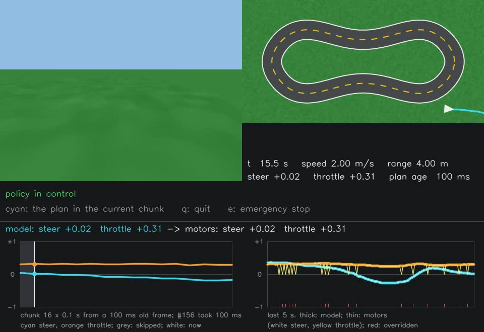

# Bài 5 · Tối ưu model bằng thí nghiệm

**Mục tiêu.** Học xong bài này, bạn sẽ:

- làm thí nghiệm **đúng cách**: mỗi lần một biến, đo cả offline lẫn lái thật, và biết
  độ dao động tự nhiên của kết quả;
- đọc được một bảng 12 thí nghiệm thật và rút ra kết luận;
- hiểu **bốn bài học lớn**, mà bài học nào cũng có số liệu chứng minh:
  1. sai số validation thấp **không** có nghĩa là lái tốt;
  2. dữ liệu thường quan trọng hơn siêu tham số;
  3. model chỉ học được những gì nó **quan sát** được;
  4. đừng tin một chênh lệch nhỏ hơn độ dao động giữa các seed.

**Thời gian:** đọc khoảng 30 phút. Chạy lại toàn bộ thí nghiệm mất khoảng 40 phút trên
Mac M3, phần lớn là thời gian train.

**Lý thuyết sâu hơn:** [chương 16 · Experiments](../study/16-experiments.md).

---

## 5.1 Sáu quy tắc làm thí nghiệm

1. **Có một baseline** và giữ nó cố định. Ở đây baseline là `v1`: 40 episode × 30 s,
   nhiễu 0,25, 15 epoch, lr 0,001, có augmentation.
2. **Mỗi lần chỉ đổi một biến.** Đổi hai thứ cùng lúc thì không biết thứ nào gây ra kết
   quả.
3. **Viết dự đoán ra trước khi chạy.** Giá trị của một thí nghiệm nằm ở khoảng cách giữa
   điều bạn nghĩ và điều xảy ra.
4. **Đo cả hai cấp**: offline (steer error validation) và lái thật (`evaluate`: số lượt
   đạt, tốc độ, RMS, lệch tối đa).
5. **Đo độ dao động** bằng cách train lại cùng cấu hình với seed khác (E9). Chênh lệch
   nhỏ hơn mức dao động đó thì coi như bằng nhau.
6. **Ghi lại** lệnh, kết quả và kết luận. Một bảng như ở mục 5.2 là đủ.

## 5.2 Bảng kết quả

Mọi số liệu đều đo trên Mac M3, ngày 2026-11-17. Mỗi model đều được đánh giá bằng
`evaluate`: 3 track × 2 chiều, 40 s mỗi lượt, độ trễ suy luận 100 ms. Teacher
`pure-pursuit` cũng lái trong cùng điều kiện: 6/6, 1,47 m/s, RMS 1,5 cm, lệch tối đa 3,4 cm.

| # | Đổi gì so với `v1` | Steer error (val) | Lái thật | m/s | RMS cm | Max cm |
|---|---|---|---|---|---|---|
| E1 | **baseline `v1`** | 0,0246 | **6/6** | 0,86 | 1,0 | 3,3 |
| E2 | dữ liệu **không nhiễu** (`--steer-noise 0`) | **0,0136** | **0/6** | 1,71 | 1 912 | 4 330 |
| E3 | **ít dữ liệu**: 10 episode | 0,0742 | 6/6 | 1,08 | 2,6 | 8,1 |
| E3b | 10 episode, **80 epoch** | 0,0282 | 6/6 | 0,82 | 1,0 | 4,1 |
| E4 | **nhiễu mạnh** (`--steer-noise 0.5`) | 0,0623 | 6/6 | 0,93 | 1,1 | 3,4 |
| E5 | `--lr 0.01` | 0,1803 | **0/6** | 1,00 | 409 | 940 |
| E6 | `--lr 0.0001` | 0,0818 | 6/6 | 1,13 | 2,9 | 7,8 |
| E7 | `--epochs 5` | 0,0519 | 6/6 | 1,08 | 2,0 | 5,5 |
| E8 | `--no-augmentation` | 0,0307 | 6/6 | 0,87 | 1,5 | 4,1 |
| E9a | `--seed 1` | 0,0212 | 6/6 | 0,88 | 1,2 | 4,1 |
| E9b | `--seed 2` | 0,0226 | 6/6 | 0,87 | 1,3 | 5,3 |
| E10 | **nhiều lần xuất phát**: 120 × 10 s (cùng 12 000 frame) | 0,0239 | 6/6 | **1,08** | 1,3 | 4,0 |
| E11 | **nhãn lấy từ action** (có nhiễu) thay vì từ teacher | 0,1438 \* | 6/6 | 0,90 | **2,7** | 6,6 |
| E12 | **tốc độ mục tiêu cố định** (`--speeds 1.5`) | 0,0162 \* | 6/6 | **1,38** | 2,0 | 6,8 |

**Lệnh để chạy lại** (mỗi khối là một thí nghiệm; `evaluate` in ra bảng như ở bài 4):

```bash
# E1: baseline (bài 3)
./drive.sh collect --project runs/hoc
./drive.sh train v1 --project runs/hoc
./drive.sh evaluate v1 --project runs/hoc

# E2, E3, E4: đổi dữ liệu
./drive.sh collect --project runs/hoc-perfect --steer-noise 0
./drive.sh train p1 --project runs/hoc-perfect && ./drive.sh evaluate p1 --project runs/hoc-perfect
./drive.sh collect --project runs/hoc-small --episodes 10
./drive.sh train s1 --project runs/hoc-small && ./drive.sh evaluate s1 --project runs/hoc-small
./drive.sh train s1-e80 --project runs/hoc-small --epochs 80 && ./drive.sh evaluate s1-e80 --project runs/hoc-small
./drive.sh collect --project runs/hoc-noise05 --steer-noise 0.5
./drive.sh train n1 --project runs/hoc-noise05 && ./drive.sh evaluate n1 --project runs/hoc-noise05

# E5–E9: cùng dữ liệu runs/hoc, đổi một tham số của train
./drive.sh train v1-lr1e-2 --project runs/hoc --lr 0.01
./drive.sh train v1-lr1e-4 --project runs/hoc --lr 0.0001
./drive.sh train v1-e5 --project runs/hoc --epochs 5
./drive.sh train v1-noaug --project runs/hoc --no-augmentation
./drive.sh train v1-s1 --project runs/hoc --seed 1
./drive.sh train v1-s2 --project runs/hoc --seed 2
./drive.sh evaluate v1-lr1e-2 v1-lr1e-4 v1-e5 v1-noaug v1-s1 v1-s2 --project runs/hoc

# E10: nhiều lần xuất phát
./drive.sh collect --project runs/hoc-starts --episodes 120 --duration-s 10
./drive.sh train st1 --project runs/hoc-starts && ./drive.sh evaluate st1 --project runs/hoc-starts

# E11: nhãn từ action. Chép dữ liệu rồi gán nhãn lại, để không đụng vào runs/hoc
mkdir -p runs/hoc-actions && cp -R runs/hoc/episodes runs/hoc-actions/
./drive.sh label --project runs/hoc-actions --relabel
./drive.sh train a1 --project runs/hoc-actions && ./drive.sh evaluate a1 --project runs/hoc-actions

# E12: tốc độ mục tiêu cố định
./drive.sh collect --project runs/hoc-speed15 --speeds 1.5
./drive.sh train sp1 --project runs/hoc-speed15 && ./drive.sh evaluate sp1 --project runs/hoc-speed15
```

\* E11 và E12 có nhãn khác các dòng còn lại, nên steer error của chúng không so được với
các dòng khác (bài học 1 ở mục 5.3). E11 được đo trên chính các nhãn có nhiễu của nó;
chấm trên nhãn của teacher thì ra 0,0775 (xem mục E11).

> Muốn có một bảng so sánh gọn: `./drive.sh evaluate v1 v1-s1 v1-s2 --project runs/hoc`
> in thêm một bảng tóm tắt ở cuối (`model  passed  m/s  rms cm  worst cm`).

## 5.3 Đọc bảng: nhóm dữ liệu

### E2 · Không nhiễu: tốt nhất offline, tệ nhất khi lái

Đây là kết quả quan trọng nhất của cả bộ bài. **Steer error 0,0136 là tốt nhất bảng**,
tốt gần gấp đôi `v1`, vậy mà **cả 6 lượt đều văng khỏi đường**: xe ở ngoài đường 55–75 %
thời gian, có lúc cách đường 43 m.

```
p1, 100 ms per inference, 40 s per drive
track               laps   m/s  rms cm  max cm  off road  result
peanut              0.92  1.77  2070.9  4282.0    63.8 %  FAIL
peanut reversed     1.08  1.77  2073.7  4239.8    71.2 %  FAIL
oval                1.26  1.67  1604.4  3772.6    55.4 %  FAIL
...
0/6 drives passed
```



Ảnh trên là một khung hình của
`./drive.sh sim --policy cnn --checkpoint p1 --project runs/hoc-perfect --video runs/hoc-perfect/p1.mp4`
ở giây thứ 15,5. Camera chỉ còn thấy cỏ; trên bản đồ, xe đã ở ngoài đường và đang chạy xa
dần. Vậy mà HUD vẫn ghi `policy in control`, với ga +0,31: model không biết là nó đã lạc
(đúng như kiểm tra `blank` ở bài 4). Log CSV của lượt này cho thấy xe trôi dần ra mép:
lệch 2 cm ở giây thứ 2, 26 cm ở giây thứ 8, rồi ra khỏi đường ở giây 14,5. Các vạch đỏ ở
biểu đồ bên phải là lúc bộ giám sát phải hãm tốc độ (`speed`), vì model còn tăng tốc lên
quá 2 m/s.

**Vì sao?** Validation của `p1` cũng là lái hoàn hảo: xe luôn ở giữa làn, nên dự đoán
rất dễ. Nhưng khi tự lái, `p1` sai một chút, xe lệch một chút, và nó gặp ảnh "xe ở gần
mép đường" mà nó **chưa từng thấy**. Nó không biết cách quay về, nên lệch thêm, rồi văng
ra ngoài. Đây chính là **covariate shift** đã nói ở bài 1. Tập validation lấy từ cùng
một phân bố với tập train, nên nó **không thể** phát hiện ra lỗi này. Chỉ có lái thật
mới phát hiện được.

### E3, E4 · Sai số cao gấp 3 lần mà vẫn lái tốt

- **E3 (10 episode)**: steer error gấp 3 lần `v1`, nhưng vẫn 6/6. Cái giá là lái kém
  chính xác hơn: RMS 2,6 cm, lệch tối đa 8,1 cm, so với 1,0 và 3,3 của `v1`. Kết luận
  hiển nhiên sẽ là "3 000 frame là không đủ". **Nhưng kết luận đó sai.** Đổi số episode
  thì cũng âm thầm đổi luôn số **bước train**: 15 epoch × 22 batch chỉ là 330 bước, so
  với 1 275 bước của `v1`. **E3b** train cùng 3 000 frame đó trong 80 epoch (1 760 bước):
  steer error 0,0282, RMS 1,0 cm, gần như ngang `v1`. Với bài toán này, E3 bị **train
  thiếu** chứ không phải **thiếu dữ liệu**. Một thí nghiệm "chỉ đổi một biến" vẫn có thể
  đổi hai thứ cùng lúc. Hãy luôn tự hỏi: *thay đổi này còn kéo theo cái gì nữa?*
- **E4 (nhiễu 0,5)**: `collect` báo 14 % frame ở ngoài đường, kèm `WARN`. Steer error
  validation gấp 2,5 lần, vì các frame trên cỏ có nhãn mà ảnh không giải thích được.
  Tuy vậy, khi lái thật model vẫn bám đường tốt ngang `v1` (1,1 cm). Nhiễu mạnh làm hỏng
  **con số offline** chứ chưa làm hỏng **khả năng lái**. Dù vậy, 14 % dữ liệu bị lãng
  phí, và với một bài toán khó hơn thì cái giá sẽ lớn hơn.

**Bài học 1:** steer error validation chỉ dùng để so sánh các model **train trên cùng một
loại dữ liệu**. Đem nó so giữa các bộ dữ liệu khác nhau (E1 với E2, E3, E4) thì kết luận
sẽ sai, và có khi sai ngược hoàn toàn.

### E10, E12 · Vì sao xe xuất phát chậm, và cách sửa từ gốc

Bài 4 đã chỉ ra `v1` chạy chậm (0,86 m/s) vì xuất phát quá rụt rè: ga chỉ 0,06 khi xe
đứng yên. Ở đây có hai giả thuyết, và hai thí nghiệm để kiểm tra chúng.

**Giả thuyết 1: thiếu dữ liệu xuất phát (E10).** Chia 12 000 frame thành 120 episode
× 10 s thay vì 40 × 30 s, nghĩa là số lần xuất phát gấp 3. Kết quả: tốc độ trung bình
tăng từ 0,86 lên **1,08 m/s**, và sai số throttle ở tốc độ thấp (`probe errors`, dòng
`by speed`) giảm từ 0,244 xuống 0,052. Có cải thiện. Nhưng đã hết bệnh chưa?

Để trả lời, hãy so pha xuất phát của các model bằng log. Mỗi lệnh `sim --log` ghi một
lượt 40 s trên `peanut` (`v1` đã có log từ bài 4):

```bash
./drive.sh sim --policy cnn --checkpoint st1 --project runs/hoc-starts --duration-s 40 --log runs/hoc-starts/logs/st1-peanut.csv
./drive.sh sim --policy cnn --checkpoint sp1 --project runs/hoc-speed15 --duration-s 40 --log runs/hoc-speed15/logs/sp1-peanut.csv
./drive.sh sim --policy cnn --checkpoint v1-e5 --project runs/hoc --duration-s 40 --log runs/hoc/logs/v1-e5-peanut.csv
./drive.sh sim --policy cnn --checkpoint v1-lr1e-4 --project runs/hoc --duration-s 40 --log runs/hoc/logs/v1-lr1e-4-peanut.csv
./drive.sh sim --policy cnn --checkpoint s1 --project runs/hoc-small --duration-s 40 --log runs/hoc-small/logs/s1-peanut.csv
```

Rồi tóm tắt: ga đầu tiên model ra, và tốc độ ở giây thứ 2, 10, 40:

```bash
python3 - <<'EOF'
import csv
logs = {"v1": "runs/hoc/logs/v1-peanut.csv",
        "st1 (E10)": "runs/hoc-starts/logs/st1-peanut.csv",
        "sp1 (E12)": "runs/hoc-speed15/logs/sp1-peanut.csv",
        "v1-e5 (E7)": "runs/hoc/logs/v1-e5-peanut.csv",
        "s1 (E3)": "runs/hoc-small/logs/s1-peanut.csv",
        "v1-lr1e-4 (E6)": "runs/hoc/logs/v1-lr1e-4-peanut.csv"}
print(f"{'model':16s} {'first throttle':>14s} {'speed at 2 s':>13s} {'10 s':>5s} {'40 s':>5s}")
for name, path in logs.items():
    rows = list(csv.DictReader(open(path)))
    first = next(float(r["cmd_throttle"]) for r in rows if r["cmd_throttle"])
    def speed(t):
        return float(min(rows, key=lambda r: abs(float(r["t"]) - t))["speed_mps"])
    print(f"{name:16s} {first:+14.2f} {speed(2):13.2f} {speed(10):5.2f} {speed(40):5.2f}")
EOF
```

```
model            first throttle  speed at 2 s  10 s  40 s
v1                        +0.06          0.26  0.77  1.06
st1 (E10)                 +0.11          0.43  1.03  1.28
sp1 (E12)                 +0.18          0.66  1.41  1.48
v1-e5 (E7)                +0.11          0.42  1.09  1.21
s1 (E3)                   +0.13          0.52  1.11  1.18
v1-lr1e-4 (E6)            +0.14          0.54  1.18  1.24
```

Teacher thì đạp ga 1,0 khi xe đứng yên. `st1` (E10) nhanh gấp đôi `v1` lúc xuất phát,
nhưng vẫn chỉ ra ga 0,11: **có cải thiện, nhưng chưa hết bệnh**.

**Một manh mối lạ.** Ba dòng cuối là các model *kém hơn* `v1` (E3, E6, E7, xem bảng ở
mục 5.2). Vậy mà chúng lại xuất phát *nhanh hơn* `v1`, và có tốc độ trung bình
1,08–1,13 m/s. Model **train càng kỹ** thì xuất phát **càng rụt rè**. Vì sao?

**Giả thuyết 2: nhãn phụ thuộc vào một thứ model không nhìn thấy (E12).** Mỗi episode,
teacher chọn ngẫu nhiên một tốc độ mục tiêu trong khoảng 0,9–1,8 m/s, rồi giữ nguyên
tốc độ đó. Model chỉ thấy ảnh và tốc độ **hiện tại**; nó không biết tốc độ mục tiêu. Nhìn
từ phía model, ở *bất kỳ* tốc độ nào, câu trả lời phổ biến nhất trong dữ liệu là "giữ
nguyên tốc độ này" (bài 4, kiểm tra `speed`: 0,10 ga mỗi m/s). Áp dụng đúng quy luật đó
khi xe đứng yên thì ra ga gần bằng 0. Model học càng giỏi, càng tuân theo quy luật ấy
chặt hơn. Các model kém hơn chưa học được hết quy luật, nên ga của chúng bị kéo về mức
trung bình (khoảng 0,15–0,2), và tình cờ lại xuất phát nhanh hơn.

Để kiểm tra, E12 cố định tốc độ mục tiêu ở 1,5 m/s cho mọi episode. Khi đó câu trả lời
"đúng" chỉ phụ thuộc vào những gì model thấy được: chậm hơn 1,5 thì tăng ga, nhanh hơn
thì giảm ga.

**Kết quả E12:** tốc độ trung bình **1,38 m/s**, bằng 94 % teacher (`v1` chỉ được
0,86), vẫn 6/6. Trong bảng xuất phát ở trên, dòng `sp1 (E12)` nhanh nhất: 0,66 m/s sau
2 s, 1,41 m/s sau 10 s. Giả thuyết 2 có vẻ đúng: bỏ sự mơ hồ đi thì model không còn
"giữ tốc độ 0" nữa.

**Nhưng đừng chỉ nhìn kết quả. Hãy kiểm tra cơ chế:**

```bash
./drive.sh probe sp1 behaviour --project runs/hoc-speed15
```

```
...
speed: frame sim-036:130 (the car went 1.44 m/s), told other speeds. Holding the speed it is told takes +0.12 throttle per m/s, to cancel the drag; driving towards one target speed takes less throttle the faster it goes
  throttle now: 0.0 m/s +0.19   0.5 m/s +0.19   1.0 m/s +0.19   1.5 m/s +0.19   2.0 m/s +0.19   2.5 m/s +0.18
  -0.001 per m/s: IGNORES THE SPEED: the same throttle whatever it is told
...
```

Ta mong model học được cách của teacher: ga `2 × (1,5 − v) + 0,15`, tức 1,0 khi đứng yên
và 0,15 ở 1,5 m/s. Nhưng model **không học cách đó**. Nó ra ga 0,19 ở **mọi** tốc độ, và
vật lý làm nốt phần còn lại: với ga 0,19, lực kéo (0,19 × 2,5 = 0,475 m/s²) cân bằng với
lực cản (0,3 × v) ở v ≈ 1,58 m/s, rất gần mục tiêu. Vì sao lại là một hằng số? Trong dữ
liệu, gần như mọi frame là lúc xe đã chạy đều ở khoảng 1,5 m/s với ga khoảng 0,18. Một
hằng số là lối tắt rẻ nhất để có loss thấp.

Hệ quả: xe xuất phát vẫn rụt rè hơn teacher nhiều (ga 0,18 so với 1,0), và nếu bị chậm
lại giữa chừng (sau khi phanh vì vật cản, hoặc khi lên dốc trên một chiếc xe thật), model
sẽ **không** tăng ga để bù. Muốn model thật sự học được cách điều khiển tốc độ, dữ liệu
phải có nhiều cảnh tốc độ *khác* với mục tiêu: xuất phát ở tốc độ ngẫu nhiên, phanh rồi
tăng tốc lại (thí nghiệm mở rộng 3 ở mục 5.7).


**Bài học 3:** model chỉ học được những gì **suy ra được từ đầu vào của nó**. Khi nhãn
phụ thuộc vào một biến ẩn (ở đây là tốc độ mục tiêu), model sẽ học **mức trung bình**
theo biến đó. Mức trung bình ấy có thể ổn ở hầu hết tình huống mà vẫn sai hoàn toàn ở
một tình huống cụ thể. Có hai cách sửa: **cho model thấy biến đó** (đưa tốc độ mục tiêu
vào làm đầu vào, giống như một VLA nhận câu lệnh "drive at 1.5 m/s"), hoặc **loại bỏ sự
mơ hồ ngay trong dữ liệu**, như E12. Và kể cả khi đã hết mơ hồ, model cũng chỉ học được
những gì dữ liệu **đủ đa dạng** để dạy: E12 học một hằng số vì dữ liệu gần như chỉ có
một tốc độ. Một con số đẹp chưa phải bằng chứng. **Hãy kiểm tra cơ chế** bằng
`probe behaviour`.

### E11 · Nhãn từ action: `validate` không bắt được

```bash
./drive.sh validate --project runs/hoc-actions
```

```
40 episodes, 12000 frames, 19.9 min, images 240x320
  speed      0.0 to 1.74 m/s, mean 1.27
  steering   left 40 %, straight 21 %, right 39 %
  labels     11400 usable frames, from actions
dataset: ok
```

`validate` báo `ok`: nó không thể biết các action có chứa nhiễu. Dấu hiệu duy nhất là
dòng `from actions` thay vì `from teacher`. (11 400 thay vì 12 000 frame, vì 15 frame
cuối mỗi episode không còn đủ 1,5 s "tương lai" để làm nhãn.)

**Đo thế nào cho công bằng?** Steer error 0,144 của `a1` được đo trên chính các nhãn
có nhiễu của nó, nên không thể đem so với `v1`. Hãy chấm `a1` bằng nhãn **của teacher**,
trên đúng 4 episode giữ riêng của `runs/hoc`. Lệnh `probe` nhận cả đường dẫn tới file
checkpoint:

```bash
./drive.sh probe runs/hoc-actions/models/a1.pt errors --project runs/hoc
```

```
held out: 4 episodes (sim-036, sim-037, sim-038, sim-039), 1200 frames that training never used
mean |error| per step of the plan; steer and throttle are in [-1, 1]
  step  ahead   steer: model  average   keep   throttle: model  average
     0   0.0s         0.1896   0.3053 0.2120            0.0346   0.0477
     3   0.3s         0.0373   0.2456 0.1718            0.0261   0.0347
     6   0.6s         0.0900   0.2391 0.1991            0.0188   0.0278
     9   0.9s         0.0692   0.2372 0.2239            0.0183   0.0266
    12   1.2s         0.0552   0.2349 0.2431            0.0177   0.0265
    15   1.5s         0.0747   0.2334 0.2636            0.0175   0.0266
   all                0.0775   0.2458 0.2157            0.0215   0.0308
  the model's steering error is 64 % below 'keep' (the better baseline)
...
```

Ở bước 0, `a1` sai 0,19, **gấp 9 lần** `v1` (0,021), trong khi bước 3 chỉ sai 0,037. Vì
sao bước "dễ nhất" lại sai nhiều nhất? Chạy `probe behaviour`:

```bash
./drive.sh probe runs/hoc-actions/models/a1.pt behaviour --project runs/hoc
```

```
...
steering state: the same frame, told the wheels are at other angles. A model that copies the state instead of reading the road follows it
  state -0.5: steers -0.21   state +0.0: steers +0.15   state +0.5: steers +0.57   (moves 0.77 per 1.0 of state)
  COPIES THE STATE: it leans on the steering it has, not the picture
```

`a1` **chép góc lái hiện tại**: tăng `state` thêm 1,0 thì steer của nó tăng 0,77. Con số
của `v1` chỉ là 0,01. Lý do: nhãn ở bước 0 là action vừa được áp lên bánh xe, mà bánh xe
lúc đó gần như đang ở đúng góc ấy, và góc này là một đầu vào của model. Chép lại là cách
dễ nhất để có loss thấp. Đây là **copycat problem**, một kiểu học lối tắt rất hay gặp khi
học bắt chước. Hậu quả khi lái thật: vẫn qua được 6/6, nhưng lệch tâm **gấp 2,7 lần**
`v1` (2,7 cm so với 1,0 cm).

Tóm lại: `validate` không thấy vấn đề, sai số validation không so sánh được, và chỉ có
**kiểm tra hành vi** cùng **lái thật** mới lộ ra lỗi.

## 5.4 Đọc bảng: nhóm siêu tham số

| # | Thay đổi | `probe history` | Lái thật | Kết luận |
|---|---|---|---|---|
| E5 | lr 0,01 | `NOT LEARNING` (70 % mốc) | **0/6**, lệch tới 9 m | lr quá lớn làm hỏng tất cả |
| E6 | lr 0,0001 | `UNDERFITTING` (34 % mốc) | 6/6, RMS 2,9 cm | lái được, nhưng kém chính xác gấp 3 |
| E7 | 5 epoch | `STILL LEARNING` | 6/6, RMS 2,0 cm | dừng quá sớm |
| E8 | tắt augmentation | `HEALTHY` | 6/6, RMS 1,5 cm | kém `v1` một chút, xem bên dưới |
| E1 | lr 0,001, 15 epoch | `HEALTHY` (10 % mốc) | 6/6, RMS 1,0 cm | |

**E8 (tắt augmentation)** cho steer error 0,0307 so với 0,0246, và RMS 1,5 cm so với
1,0 cm. Có phải augmentation giúp ích? Trước khi kết luận, hãy so với độ dao động ở mục
5.5: ba seed của `v1` cho steer error trong khoảng 0,0212–0,0246, RMS 1,0–1,3 cm. E8
nằm **ngoài** khoảng đó ở cả hai chỉ số, nên có thể tin rằng tắt augmentation làm model
kém đi, dù chỉ một chút. Nhưng augmentation thật sự làm gì? Hãy so `probe behaviour`:

```bash
./drive.sh probe v1-noaug behaviour --project runs/hoc
```

```
mirror: the image flipped left-right and the steering state negated should negate the steering
  mean |steer + mirrored steer| = 0.0166, 7 % of the mean |steer| (0.242)   ok
brightness: the same frames darker and lighter (training saw 0.8x to 1.2x)
  x0.5  steering moves by 0.2123 ( 88 % of its size)
  x0.8  steering moves by 0.0746 ( 31 % of its size)
  x1.2  steering moves by 0.0817 ( 34 % of its size)
  x1.5  steering moves by 0.2315 ( 95 % of its size)
...
```

| | `v1` (có augmentation) | `v1-noaug` |
|---|---|---|
| mirror | 5 % | 7 % |
| độ sáng ×0,8 | **2 %** | **31 %** |
| độ sáng ×0,5 | 27 % | 88 % |

- **Mirror gần như không đổi.** `collect` đã luân phiên chiều chạy, nên dữ liệu vốn đã cân
  bằng trái/phải, và việc lật ảnh không đem lại thêm gì đáng kể. Nhưng khi dữ liệu
  **lệch** thì khác: ở bài 3 (mục d, lần thử 3), một model chỉ thấy cua theo chiều thuận,
  không augmentation, lái chiều ngược tệ hơn 2,5–6 lần.
- **Độ sáng thì khác hẳn.** Không có augmentation, chỉ cần ảnh tối đi 20 % là steer đã
  lệch 31 %. Mô phỏng có ánh sáng **không bao giờ đổi**, nên `evaluate` không thể thấy
  điểm yếu này (vẫn 6/6). Trên đường thật, một đám mây che nắng là đủ.

**Bài học phụ:** "lái được trong mô phỏng" chỉ chứng minh được về những điều kiện mà mô
phỏng **có**. Các kiểm tra hành vi giúp hỏi những câu mà mô phỏng không hỏi.

**Bài học 2:** trong bảng này, những thay đổi về **dữ liệu** (E2, E10, E11, E12) tạo ra
khác biệt lớn nhất về hành vi. Siêu tham số chỉ gây hỏng nặng khi đi tới mức cực đoan
(E5). Còn trong khoảng hợp lý, chúng chỉ tinh chỉnh độ chính xác.

## 5.5 E9 · Độ dao động: chênh lệch bao nhiêu thì mới là thật?

Ba lần train **cùng dữ liệu, cùng cấu hình**, chỉ khác seed:

| | seed 0 (`v1`) | seed 1 | seed 2 | khoảng dao động |
|---|---|---|---|---|
| steer error (val) | 0,0246 | 0,0212 | 0,0226 | 0,0212–0,0246 (±7 %) |
| RMS cm | 1,0 | 1,2 | 1,3 | 1,0–1,3 |
| max cm | 3,3 | 4,1 | 5,3 | 3,3–5,3 |
| m/s | 0,86 | 0,88 | 0,87 | 0,86–0,88 |

**Bài học 4:** chỉ riêng việc đổi seed đã làm steer error dao động khoảng ±7 % và lệch
tối đa dao động tới 60 %. Vì vậy:

- Một model mới tốt hơn 0,002 thì **chưa** chắc đã tốt hơn.
- "Lệch tối đa" là chỉ số **nhiễu nhất**, vì nó chỉ phụ thuộc vào một khoảnh khắc. Đừng
  dùng nó để chọn model.
- Muốn chắc chắn, hãy train mỗi cấu hình với 2–3 seed rồi so khoảng dao động, chứ đừng
  so từng con số đơn lẻ.

## 5.6 Quy trình tối ưu đề xuất

```
1. validate + browse          dữ liệu sạch chưa?                       (bài 1)
2. train + probe history      model có học không, có học thuộc không?  (bài 3)
3. probe errors / behaviour   sai ở đâu? theo bước, đường, tốc độ?      (bài 4)
4. evaluate + sim --log       lái thật ra sao? chậm, giật, văng?        (bài 4)
5. đặt MỘT giả thuyết         "model chậm vì thiếu dữ liệu xuất phát"
6. MỘT thí nghiệm để kiểm tra đổi đúng một biến; 2 seed nếu chênh lệch nhỏ
7. ghi vào bảng, quay lại bước 3
```

Hãy để ý thứ tự: ta **phân tích trước, đổi sau**. Đổi learning rate khi vấn đề nằm ở
dữ liệu (E10–E12) thì chỉ tốn thời gian.

## 5.7 Thí nghiệm mở rộng (tự làm)

1. **Đa dạng track.** Thu dữ liệu chỉ trên `oval` (`--tracks oval`), train, rồi
   `evaluate`. Track `oval` có nhiều đoạn thẳng; liệu model có còn qua được `trefoil`?
2. **Độ trễ.** `./drive.sh evaluate v1 --project runs/hoc --latency-ms 300`. Ở độ trễ nào
   thì `v1` bắt đầu trượt? (Xem chương 05 của giáo trình về bù độ trễ.)
3. **Xuất phát ở tốc độ ngẫu nhiên.** Sửa `collect.py` để `world.place(...)` nhận thêm
   một tốc độ ban đầu ngẫu nhiên, nhờ đó dữ liệu có nhiều ví dụ "đang chậm hơn mục tiêu".
   So với E10.
4. **Unit chết.** Ở bài 4, 55 % unit của `head.1` không bao giờ hoạt động. Thay `nn.ReLU()`
   trong `model.py` bằng `nn.LeakyReLU(0.01)`, train lại, rồi chạy `probe activations`.
   Số unit chết có giảm không? Steer error có tốt lên không? (Nhớ là phải so với độ dao
   động seed.)

**Tiếp theo:** [Bài 6 · Debug model](06-debug-model.md)
