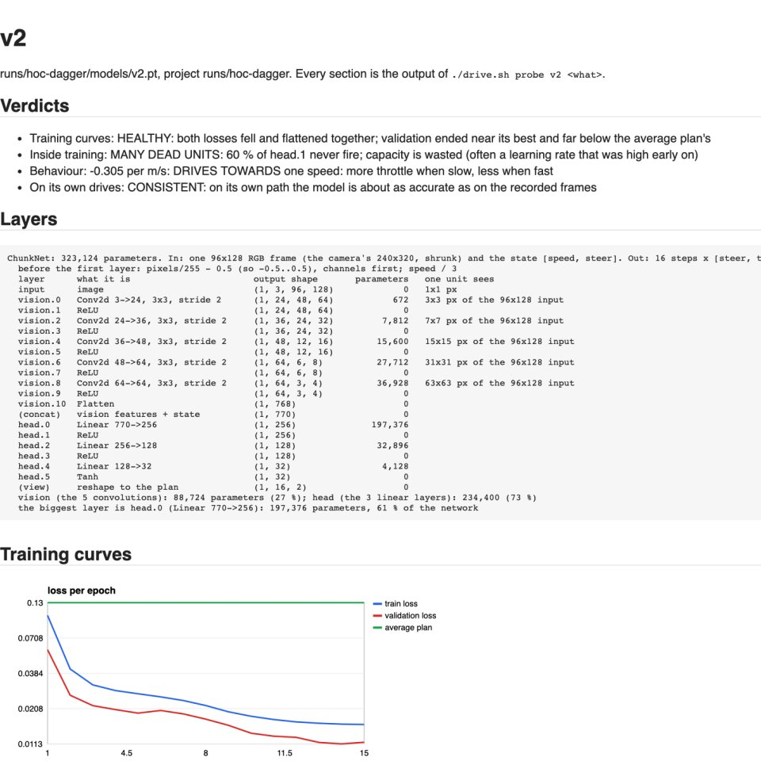

# Bài 7 · Debug và tối ưu như dân chuyên nghiệp

Bài 1–6 trả lời câu hỏi "model **sai ở đâu**?". Bài này thêm những công cụ trả lời
"**vì sao** nó sai, và **sửa bằng gì** thì chắc ăn nhất". Đó là các kỹ thuật mà các nhóm
làm ML chuyên nghiệp dùng hằng ngày, và đều có sẵn trong dự án dưới dạng một lệnh.

**Mục tiêu.** Học xong bài này, bạn sẽ:

- biết **bản đồ** các phương pháp debug model: phương pháp nào trả lời câu hỏi nào, dự án
  đã có gì, còn thiếu gì;
- chọn learning rate bằng **LR range test** thay vì đoán;
- nhìn **vào bên trong quá trình train** (gradient, độ lớn mỗi bước cập nhật, unit chết)
  để hiểu *vì sao* một lần train thất bại;
- đo **mỗi đầu vào đáng giá bao nhiêu** (ablation);
- đo sai số **trên chính quỹ đạo model tự lái** (on-policy), và sửa lỗi dây chuyền bằng
  **DAgger**, phương pháp chuẩn của học bắt chước;
- gom mọi thứ vào **một báo cáo HTML** để đọc và chia sẻ.

**Cần có:** bài 1–5 (dữ liệu `runs/hoc`, `runs/hoc-perfect`, các model `v1`, `p1`). Các
phần so sánh còn dùng `a1` (bài 5, E11, trong `runs/hoc-actions`) và `sp1` (E12, trong
`runs/hoc-speed15`). Không có chúng thì bỏ qua các khối lệnh đó, phần còn lại vẫn chạy được.

**Thời gian chạy lại toàn bộ:** khoảng 40 phút trên Mac M3. Phần lớn là train (thêm 8 lần)
và hai vòng DAgger.

**Thí nghiệm của bài này** tiếp nối bài 5: **E13** (DAgger cho `v1`), **E14** (DAgger cho
`p1`), **E15** (kiểm chứng `lrfind`).

---

## 7.0 Bản đồ: phương pháp nào trả lời câu hỏi nào

| Phương pháp | Trả lời câu hỏi | Trong dự án | Ở đâu |
|---|---|---|---|
| Kiểm tra dữ liệu: đủ, sạch, cân bằng | Dữ liệu có dùng được không? | `validate`, `browse`, thống kê | bài 1 |
| Học thuộc một batch nhỏ | Đường ống train có chảy không? | đoạn Python | bài 6.2 |
| Mốc so sánh (baseline) | Con số này là tốt hay xấu? | mốc "kế hoạch trung bình", `average`, `keep` | bài 3, 4 |
| Đường cong train/validation | Có học không? Học thuộc không? | `probe history` | bài 3 |
| **LR range test** | Learning rate nào thì học được? | **`lrfind`** (mới) | 7.1 |
| **Chẩn đoán bên trong train** | *Vì sao* lần train này hỏng? | **`probe training`** (mới) | 7.2 |
| Cắt lát sai số (error slicing) | Sai ở loại đường nào, tốc độ nào? | `probe errors` | bài 4 |
| **Ablation đầu vào** | Model dựa vào đầu vào nào? | **`probe ablation`** (mới) | 7.3 |
| Saliency, activation | Model nhìn vào đâu? Layer nào làm gì? | `probe saliency`, `activations` | bài 4 |
| Kiểm tra hành vi | Model có phản ứng hợp lý không? | `probe behaviour` | bài 4 |
| **Sai số on-policy** | Khi tự lái, model sai bao nhiêu, ở đâu? | **`probe onpolicy`** (mới) | 7.4 |
| **DAgger** | Sửa lỗi dây chuyền thế nào cho tận gốc? | **`collect --driver cnn`** (mới) | 7.5 |
| Độ dao động giữa các seed | Chênh lệch này là thật hay nhiễu? | train lại với `--seed` | bài 5 |
| **Báo cáo một trang** | Tóm lại model này thế nào? | **`probe report`** (mới) | 7.6 |
| Debugger | Tensor này đang chứa gì? | `breakpoint()` | bài 6.5 |

**Những phương pháp dự án chưa có, và vì sao:**

| Phương pháp | Dùng để | Vì sao chưa cần ở đây | Khi nào nên thêm |
|---|---|---|---|
| Experiment tracking (TensorBoard, Weights & Biases, MLflow) | lưu và so sánh hàng trăm lần train | report JSON cạnh mỗi model, cùng `status` và `evaluate`, đã đủ cho vài chục model | khi số lần train vượt quá sức một bảng tay |
| Tìm siêu tham số tự động (grid, random, Optuna) | quét nhiều tham số cùng lúc | mỗi lần train mất 2 phút; bài 5 cho thấy dữ liệu quan trọng hơn | khi dữ liệu đã ổn và cần vắt thêm vài phần trăm |
| Trực quan hóa embedding (PCA, t-SNE) | xem các frame giống nhau có nằm gần nhau không | đầu ra chỉ có 2 chiều, đọc trực tiếp dễ hơn | với model lớn, đầu ra phức tạp (một VLA) |
| Ước lượng độ bất định (ensemble, MC dropout) | model biết khi nào nó không chắc | cần train nhiều model hoặc thêm dropout | trước khi lên xe thật: để phanh khi model "không chắc" (bài 4, kiểm tra `blank`) |
| Profiling | tìm chỗ chậm | model 0,3 triệu tham số, chạy vài ms | với VLA trên Jetson (chương 14 của giáo trình) |

## 7.1 `lrfind`: chọn learning rate trong 30 giây

Bài 5 đã cho thấy `lr 0.01` thì hỏng, `lr 0.0001` thì học chậm. Nhưng phải train hết
từng giá trị (mỗi lần 2 phút) mới biết. **LR range test** (Leslie Smith, 2015) trả lời
nhanh hơn nhiều: train một model mới trong 150 bước, và **tăng learning rate theo cấp
số nhân** từ 1e-6 lên 1 sau mỗi bước, rồi xem loss phản ứng ra sao.

```bash
./drive.sh lrfind --project runs/hoc
```

```
10800 training frames, on mps: 150 steps of 128, the learning rate x1.097 each
  learning rate     loss vision.9 silent
        1.0e-06   0.1714             39%  ##################
        1.4e-06   0.1692             39%  #################
        ...
        4.1e-05   0.1681             39%  #################
        5.9e-05   0.1684             38%  #################
        8.6e-05   0.1662             33%  #################
        1.2e-04   0.1653             30%  #################
        1.8e-04   0.1625             28%  #################
        2.6e-04   0.1552             28%  ################
        3.8e-04   0.1465             33%  ###############
        5.5e-04   0.1383             33%  ##############
        7.9e-04   0.1326             34%  ##############
        1.1e-03   0.1261             38%  #############
        1.7e-03   0.1237             41%  #############
        2.4e-03   0.1193             47%  ############
        3.5e-03   0.1167             48%  ############
        5.1e-03   0.1150             48%  ############
        7.3e-03   0.1065             48%  ###########
        1.1e-02   0.0994             84%  ##########
        1.5e-02   0.0940            100%  ##########
        2.2e-02   0.0905            100%  #########
        3.2e-02   0.0895            100%  #########
        4.7e-02   0.0877             98%  #########
        6.8e-02   0.2040             92%  #####################
        9.0e-02   0.3877             88%  ########################################
  the loss falls fastest at 2.6e-04 and is lowest at 4.3e-02; it blew up after that
  from 1.8e-03 more and more of the last convolution's channels go silent: the loss still falls there, but the network is going blind
  worth trying: --lr between 3e-04 and 9e-04 (from the steepest fall, below where it goes blind and a decade below the lowest); a sweep of 150 steps is a hint, so confirm with short trainings
```

Mất khoảng 25 giây (lệnh `train` mất 2 phút). Cột `vision.9 silent` là tỷ lệ kênh của layer
ảnh cuối cùng **không bật** trên batch hiện tại. Mục 7.2 sẽ cho thấy vì sao cột này quan trọng.

**Đọc ba vùng của đường cong:**

| Vùng | Learning rate | Loss | Nghĩa |
|---|---|---|---|
| Đứng yên | dưới 1e-4 | 0,17, không đổi | bước quá nhỏ, model không học được gì trong 150 bước |
| Học | 2,6e-4 đến 4,7e-2 | giảm từ 0,155 xuống 0,088 | dốc nhất ở 2,6e-4 |
| Bùng nổ | từ 6,8e-2 | vọt lên 0,20 rồi 0,39 | bước quá lớn, mỗi bước làm tình hình tệ hơn |

**Bẫy: loss vẫn giảm trong khi model đang mù dần.** Ở 1,5e-2 đến 4,7e-2, loss **thấp
nhất** của cả quá trình quét, nhưng cột bên cạnh cho thấy 98–100 % kênh của `vision.9` đã
im lặng: phần nhìn của model đã chết. Loss vẫn giảm được vì phần head học "kế hoạch trung
bình" từ tốc độ và góc lái, không cần ảnh. Một LR range test chỉ nhìn loss sẽ gợi ý một
learning rate quanh 4e-3 (bằng 1/10 chỗ thấp nhất, quy tắc hay được dùng). Vì vậy `lrfind`
dừng khoảng gợi ý ở chỗ tỷ lệ im lặng bắt đầu tăng (1,8e-3), và gợi ý **3e-4 đến 9e-4**.

### E15 · Kiểm chứng bằng hai lần train

Một sweep 150 bước chỉ là gợi ý. Hãy kiểm chứng bằng cách train thật ở hai đầu, rồi cho lái:

```bash
./drive.sh train v1-lr3e-4 --project runs/hoc --lr 0.0003
./drive.sh train v1-lr3e-3 --project runs/hoc --lr 0.003
./drive.sh evaluate v1-lr3e-4 v1 v1-lr3e-3 --project runs/hoc
```

```
model           passed   m/s  rms cm  worst cm
v1-lr3e-4        6/6    1.12     1.4       5.2
v1               6/6    0.86     1.0       3.3
v1-lr3e-3        0/6    1.10  2307.0    4247.0
```

- **3e-4** (đầu dưới của khoảng): lái tốt, nhưng steer error validation là 0,0435, kém
  `v1` gần gấp đôi. Đây vẫn là một learning rate an toàn, chỉ cần thêm epoch.
- **1e-3** (`v1`): tốt nhất, nằm ngay ở giới hạn trên của khoảng gợi ý.
- **3e-3**: **0/6**, steer error 0,181, giống hệt `lr 0.01`. `probe training` cho thấy
  `vision.9` chết 100 % ngay trong epoch 1 (`A DEAD LAYER`).

**Chuyện thật phía sau:** phiên bản đầu của `lrfind` chỉ nhìn loss, và nó gợi ý "3e-4 đến
4e-3", tức là có cả 3e-3. Chính E15 đã lộ ra lỗi đó. Sau đó cột `vision.9 silent` được
thêm vào, và giới hạn trên được đặt ở chỗ tỷ lệ im lặng tăng 15 điểm so với mức thấp nhất
của nó. Lưu ý: con số 15 điểm này được chọn **sau khi** thấy kết quả E15, nên hãy kiểm tra
lại nó trên dữ liệu khác (bài tập 2) trước khi tin hẳn. Đây là cách một công cụ chẩn đoán
được làm tốt lên: thử nó, tìm trường hợp nó sai, sửa nó, rồi lại thử.

## 7.2 `probe training`: nhìn vào bên trong quá trình train

Đường cong loss chỉ cho biết *kết quả*. Muốn biết *nguyên nhân*, ta cần nhìn những gì
xảy ra bên trong mỗi bước train. Từ phiên bản này, `train` ghi lại cho mỗi epoch:

| Chỉ số | Nghĩa | Bình thường |
|---|---|---|
| **gradient norm** | Loss "kéo" trọng số của mỗi layer mạnh cỡ nào | không bùng nổ, cũng không teo về 0 |
| **update / weight** | Mỗi bước di chuyển ma trận trọng số bao nhiêu, so với độ lớn của chính nó | khoảng **1e-3** (quy tắc kinh nghiệm của Andrej Karpathy) |
| **dead units** | Tỷ lệ unit ReLU không bao giờ bật trên tập validation | thấp, và không tăng vọt |

Những model đã train ở các bài trước chưa có các chỉ số này, nên ta train lại `v1` dưới
tên `v1d`. Cùng seed, cùng dữ liệu, nên phải ra **cùng trọng số**: việc ghi lại chẩn đoán
không được làm thay đổi kết quả train.

```bash
./drive.sh train v1d --project runs/hoc
python3 -c "
import torch
a = torch.load('runs/hoc/models/v1.pt', weights_only=True)['weights']
b = torch.load('runs/hoc/models/v1d.pt', weights_only=True)['weights']
print('v1d has the same weights as v1:', all(torch.equal(a[k], b[k]) for k in a))"
```

```
v1d has the same weights as v1: True
```

Đúng như mong đợi: ghi lại chẩn đoán không thay đổi gì trong quá trình học. Cái giá là
thời gian, 132 s thay vì 117 s, vì mỗi bước phải chép trọng số và tính thêm vài chuẩn
(norm).

```bash
./drive.sh probe v1d training --project runs/hoc
```

```
gradient norm, the mean per step: how hard the loss pulls on each layer's weights
  epoch        lr    vision.0   vision.6     head.0     head.4
      1  1.00e-03    0.000925    0.00774      0.022     0.0378
      2  9.89e-04      0.0112     0.0149     0.0268     0.0266
      3  9.57e-04      0.0189     0.0238     0.0369     0.0366
      4  9.05e-04       0.021     0.0274     0.0381     0.0363
      5  8.35e-04        0.02     0.0276     0.0344     0.0318
    ...
     15  1.09e-05     0.00869     0.0124     0.0153     0.0115
update / weight: how far one step moves each weight matrix, against its size (healthy: about 1e-3)
  epoch    vision.0   vision.6     head.0     head.4
      1     2.3e-03    3.0e-03    6.4e-03    6.6e-03
      2     4.0e-03    7.2e-03    8.4e-03    4.3e-03
      3     1.9e-03    6.5e-03    5.1e-03    3.4e-03
      4     1.3e-03    4.0e-03    3.9e-03    2.8e-03
      5     1.0e-03    3.0e-03    3.5e-03    1.9e-03
    ...
     10     3.4e-04    8.5e-04    1.1e-03    8.3e-04
    ...
     15     1.2e-05    3.4e-05    3.5e-05    2.2e-05
units that never fire on the validation frames (dead ReLU), per layer
  epoch    vision.1   vision.3   vision.5   vision.7   vision.9     head.1     head.3
      1          0%        14%        42%        52%        42%        58%        59%
      2          0%        17%        38%        45%        39%        54%        44%
      3          0%        19%        35%        42%        34%        54%        45%
    ...
     15          0%        17%        35%        44%        31%        55%        44%
  MANY DEAD UNITS: 55 % of head.1 never fire; capacity is wasted (often a learning rate that was high early on)
```

(Bảng đầy đủ có cả 15 epoch; ở đây lược bớt các dòng giữa.)

**Đọc từng bảng:**

- **Gradient norm.** Ở epoch 1, gradient tới `vision.0` (layer đầu tiên) chỉ là 0,0009,
  nhỏ hơn 40 lần so với `head.4` (layer cuối). Lúc mới khởi tạo, tín hiệu học yếu dần khi
  truyền ngược qua nhiều layer, nên các layer đầu học chậm nhất. Tới epoch 3–4 nó mới
  tăng lên khoảng 0,02, ngang các layer khác: các bộ lọc ảnh bắt đầu "bắt được" vạch kẻ
  đường. Gradient không bùng nổ (không có giá trị nào vọt lên hàng trăm) và cũng không
  teo về 0.
- **Update / weight.** Ở các epoch đầu, mỗi bước di chuyển trọng số khoảng 2e-3 đến 8e-3
  độ lớn của nó, nghĩa là nhanh hơn quy tắc 1e-3 một chút nhưng vẫn cùng bậc. Sau đó con
  số này giảm đều tới 1e-5, đúng theo learning rate đang giảm dần theo hình cosin (cột
  `lr` của bảng đầu). Đây là hình ảnh của một lần train khỏe.
- **Unit chết.** 55 % unit của `head.1` đã chết **ngay sau epoch 1**, và tỷ lệ này giữ
  nguyên tới cuối. Đây chính là con số bài 4 đã thấy (140/256). Giờ ta biết thêm *khi nào*
  chúng chết: trong epoch đầu tiên, lúc bước cập nhật lớn nhất. Model vẫn lái tốt, nên
  đây là chỗ để tối ưu (bài tập 3), không phải một lỗi.

### Vì sao `lr 0.01` không học được?

```bash
./drive.sh train v1-lr1e-2d --project runs/hoc --lr 0.01
./drive.sh probe v1-lr1e-2d training --project runs/hoc
```

```
gradient norm, the mean per step: how hard the loss pulls on each layer's weights
  epoch        lr    vision.0   vision.6     head.0     head.4
      1  1.00e-02     0.00194    0.00748      0.019     0.0287
      2  9.89e-03           0          0      0.014      0.011
      3  9.57e-03           0          0     0.0152     0.0107
    ...
update / weight: how far one step moves each weight matrix, against its size (healthy: about 1e-3)
  epoch    vision.0   vision.6     head.0     head.4
      1     7.4e-03    1.7e-02    2.0e-02    2.2e-02
      2     1.7e-06    2.5e-06    7.6e-04    7.2e-03
      3     5.3e-11    7.3e-11    7.6e-04    6.5e-03
      4     0.0e+00    0.0e+00    6.0e-04    5.6e-03
    ...
units that never fire on the validation frames (dead ReLU), per layer
  epoch    vision.1   vision.3   vision.5   vision.7   vision.9     head.1     head.3
      1          8%        97%        98%       100%       100%        79%        68%
      2          8%        97%        98%       100%       100%        79%        68%
    ...
     15          8%        97%        98%       100%       100%        80%        69%
  STEPS TOO BIG: in the first epoch a step moved a layer by 2e-02 of its size, 22x the healthy 1e-3. Lower the learning rate
  A DEAD LAYER: every unit of vision.7 is silent, so nothing reaches the layers after it
  VANISHING: the gradient reaching vision.0 fell a thousandfold; the first layers stopped learning
```

**Đây là lời giải thích cho E5 ở bài 5.** Đọc theo thứ tự thời gian:

1. **Epoch 1:** mỗi bước di chuyển trọng số tới 2 % độ lớn của chúng, gấp 22 lần mức khỏe.
   Những bước nhảy lớn đó đẩy toàn bộ unit của `vision.7` và `vision.9` vào vùng âm.
2. **Từ cuối epoch 1:** `vision.7` chết 100 %. Mọi ảnh đều cho ra cùng một vector toàn số
   0 sau `Flatten`. Phần "nhìn" của model đã bị **cắt đứt**.
3. **Từ epoch 2:** gradient tới `vision.0` và `vision.6` bằng **0**, nên update/weight của
   chúng rơi về 0. Các bộ lọc ảnh không bao giờ được học thêm nữa.
4. Phần head vẫn học tiếp (update/weight khoảng 1e-3), nhưng nó chỉ còn nhận được **tốc độ
   và góc lái**. Nó học được kế hoạch trung bình, cộng chút ít từ trạng thái, đúng như
   `probe history` báo `NOT LEARNING` (70 % mốc). Và bài 4 đã nói: model không nhìn ảnh
   thì không lái được.

`probe history` cho biết "không học". `probe training` cho biết **vì sao**, **từ lúc
nào**, **ở layer nào**. Và vì sao 15 epoch với learning rate giảm dần không cứu được: một
khi layer đã chết hẳn thì không còn gradient để nó sống lại.

### Và `lr 0.0001`?

```bash
./drive.sh train v1-lr1e-4d --project runs/hoc --lr 0.0001
./drive.sh probe v1-lr1e-4d training --project runs/hoc
```

```
gradient norm, the mean per step: how hard the loss pulls on each layer's weights
  epoch        lr    vision.0   vision.6     head.0     head.4
      1  1.00e-04     0.00186     0.0109     0.0183     0.0594
      2  9.89e-05     0.00151    0.00667     0.0108     0.0235
      3  9.57e-05     0.00245    0.00773     0.0158     0.0253
      4  9.05e-05      0.0315     0.0184     0.0442      0.062
      5  8.35e-05      0.0384     0.0245     0.0664     0.0627
    ...
update / weight: how far one step moves each weight matrix, against its size (healthy: about 1e-3)
  epoch    vision.0   vision.6     head.0     head.4
      1     5.2e-04    1.4e-03    1.9e-03    1.1e-03
      2     2.2e-04    4.9e-04    4.4e-04    4.8e-04
      3     5.5e-04    1.4e-03    6.4e-04    6.0e-04
      4     1.1e-03    3.3e-03    2.1e-03    1.3e-03
    ...
units that never fire on the validation frames (dead ReLU), per layer
  epoch    vision.1   vision.3   vision.5   vision.7   vision.9     head.1     head.3
      1          0%         3%        15%        36%        30%        58%        52%
      2          0%         3%        12%        36%        30%        58%        52%
      3          0%         3%        12%        23%        27%        57%        51%
      4          0%         3%         6%        20%        17%        50%        46%
    ...
     15          0%         3%         6%        17%        14%        43%        37%
  HEALTHY: steps of 2e-03 at the start, shrinking as the learning rate decays; 43 % of head.1 dead at most
```

**Đọc, và một điểm mù:**

- **Quy tắc 1e-3 không bắt được trường hợp này.** Learning rate nhỏ hơn 10 lần, nhưng ở
  epoch 1 mỗi bước chỉ nhỏ hơn của `v1` 3–4 lần, vẫn quanh 1e-3, tức vẫn "khỏe" theo quy
  tắc. Với Adam, mỗi bước bằng lr nhân với một hệ số từ 0 đến 1. Hệ số này lớn khi
  gradient chỉ cùng một hướng qua nhiều bước, và nhỏ khi gradient đổi hướng liên tục.
  Model học chậm thì gradient còn cùng hướng (hệ số lớn); `v1` học nhanh nên sớm tới
  vùng gradient nhiễu (hệ số nhỏ). Kết quả: công cụ báo `HEALTHY`, trong khi
  `probe history` báo `UNDERFITTING` (bài 3). **Mỗi công cụ có điểm mù; hãy dùng chúng
  cùng nhau.**
- **Nhưng bảng gradient chỉ ra chỗ kẹt.** Suốt 3 epoch đầu, gradient tới `vision.0` nằm
  yên ở khoảng 0,002. Tới epoch 4, nó **tăng vọt 13 lần** (0,0315). Đó đúng là lúc
  validation loss ở bài 3 thoát khỏi vùng đứng yên (0,116 → 0,064). Các bộ lọc ảnh mất 3
  epoch mới "tìm thấy" vạch kẻ đường. Tới lúc đó learning rate đã bắt đầu giảm dần, nên
  model không còn đủ thời gian để học xong.
- **Bước nhỏ làm chết ít unit hơn:** 43 % `head.1` so với 55 % ở `v1`, và tỷ lệ này còn
  giảm dần trong quá trình train. Bước nhảy lớn ở epoch đầu đúng là thủ phạm làm unit chết.
  Điều này gợi ý một cách tối ưu: **warmup**, tức bắt đầu với lr nhỏ rồi tăng dần
  (bài tập 3).

## 7.3 `probe ablation`: mỗi đầu vào đáng giá bao nhiêu

Model có ba đầu vào: ảnh, tốc độ và góc lái hiện tại. Ablation thay **từng đầu vào một**
bằng giá trị trung bình của nó (ảnh trung bình, tốc độ trung bình…), rồi đo xem kế hoạch
tệ đi bao nhiêu. Đầu vào nào bị thay mà làm sai số tăng vọt, thì model dựa vào đầu vào đó.

```bash
./drive.sh probe v1 ablation --project runs/hoc
```

```
each input in turn replaced by its average over the 1200 held-out frames; the worse the plan gets, the more the model relies on that input
  replaced                       steer error        throttle error
  nothing (the model as it is)        0.0246   1.0x         0.0216   1.0x
  the picture                         0.2547  10.3x         0.0241   1.1x
  the speed                           0.0297   1.2x         0.0314   1.5x
  the steering state                  0.0294   1.2x         0.0221   1.0x
  the steering comes from the picture: without it the error is 10x
```

**Đọc:**

- **Steer đến từ ảnh.** Bỏ ảnh đi thì sai số lái tăng 10 lần, lên 0,25, tức ngang baseline
  `average` ở bài 4: không có ảnh, model chẳng hơn gì việc đoán bừa. Tốc độ và góc lái
  hiện tại chỉ đóng góp chút ít (1,2 lần).
- **Throttle đến từ tốc độ.** Bỏ tốc độ đi thì sai số ga tăng 1,5 lần, còn bỏ ảnh đi thì
  gần như không đổi (1,1 lần). Khớp với bài 4: model học "giữ tốc độ hiện tại", nên ga
  phụ thuộc vào tốc độ chứ không phụ thuộc vào ảnh.

So với model "copycat" `a1` của bài 5 (E11), chấm trên cùng các frame và cùng nhãn của
teacher:

```bash
./drive.sh probe runs/hoc-actions/models/a1.pt ablation --project runs/hoc
```

```
  replaced                       steer error        throttle error
  nothing (the model as it is)        0.0775   1.0x         0.0215   1.0x
  the picture                         0.2558   3.3x         0.0261   1.2x
  the speed                           0.0778   1.0x         0.0319   1.5x
  the steering state                  0.0990   1.3x         0.0221   1.0x
  the steering comes from the picture: without it the error is 3x
```

`a1` dựa vào ảnh ít hơn hẳn: bỏ ảnh thì chỉ tệ đi 3,3 lần, so với 10,3 lần của `v1`. Phần
còn lại nó lấy từ góc lái hiện tại. Ablation và kiểm tra `steering state` ở bài 4 nhìn
cùng một hiện tượng từ hai phía.

> **Ablation khác saliency thế nào?** Saliency (bài 4) trả lời "*trong ảnh*, model nhìn vào
> đâu". Ablation trả lời "*giữa các đầu vào*, model dựa vào cái nào". Một model có thể
> nhìn đúng chỗ trong ảnh mà vẫn chủ yếu dựa vào trạng thái.

## 7.4 `probe onpolicy`: sai số trên quỹ đạo model tự lái

Mọi sai số ở bài 3–4 đều được đo trên frame **teacher đã lái**. Nhưng khi model tự lái,
nó đi tới những chỗ teacher không bao giờ đến, và đó là nơi lỗi dây chuyền bắt đầu (bài 1:
covariate shift). `probe onpolicy` để **model cầm lái** trên cả 3 track, hai chiều, và
ở **mỗi tick** (50 lần/giây) hỏi teacher, người biết bản đồ, xem nó sẽ lái thế nào từ vị
trí hiện tại của xe. Sai số được chia theo khoảng cách tới tâm đường.

```bash
./drive.sh probe v1 onpolicy --project runs/hoc
```

```
6 drives of 40 s with the model at the wheel; at every tick (50 a second) the teacher, who knows the map, says what it would steer from where the car is
  peanut 0.023   peanut reversed 0.025   oval 0.023   oval reversed 0.021   trefoil 0.017   trefoil reversed 0.011
  mean |model steer - teacher steer| on its own drives: 0.0199; on the recorded held-out frames (step 0): 0.0214, so 0.9x
by distance from the centerline (the road's edge is at 45 cm)
  off-centre     time steer error
  0-2 cm        96.4%      0.0190
  2-5 cm         3.6%      0.0439
  5-10 cm        0.0%           -
  10-20 cm       0.0%           -
  20-45 cm       0.0%           -
  off the road   0.0%           -
  CONSISTENT: on its own path the model is about as accurate as on the recorded frames
```

```bash
./drive.sh probe p1 onpolicy --project runs/hoc-perfect
```

```
6 drives of 40 s with the model at the wheel; at every tick (50 a second) the teacher, who knows the map, says what it would steer from where the car is
  peanut 0.133   peanut reversed 0.147   oval 0.152   oval reversed 0.101   trefoil 0.105   trefoil reversed 0.144
  mean |model steer - teacher steer| on its own drives: 0.1303; on the recorded held-out frames (step 0): 0.0100, so 13.1x
by distance from the centerline (the road's edge is at 45 cm)
  off-centre     time steer error
  0-2 cm         8.5%      0.1024
  2-5 cm         3.2%      0.1884
  5-10 cm        4.7%      0.2320
  10-20 cm      12.4%      0.2356
  20-45 cm       6.3%      0.3458
  off the road  64.8%      0.0824
  COMPOUNDING: on its own path the model is 13.1x worse than on recorded frames. Its mistakes take it where the data never went (covariate shift). Record where it goes and let the teacher label it: ./drive.sh collect --driver cnn --checkpoint …  (DAgger)
  LOST WHEN OFF-CENTRE: the error grows with the distance from the centerline, so it does not know how to come back
```

**Đọc:**

- **`v1` nhất quán.** Trên quỹ đạo của chính nó, `v1` sai 0,020, gần bằng (thậm chí thấp
  hơn) sai số offline 0,021. 96 % thời gian xe nằm trong khoảng 2 cm quanh tâm đường. Lỗi
  dây chuyền không xảy ra.
- **`p1` sai gấp 13 lần khi tự lái.** Offline nó là model chính xác nhất (0,010), nhưng
  trên quỹ đạo của chính nó thì sai 0,130. Đây là **covariate shift được đo thành một con
  số**.
- **Sai số tăng theo khoảng cách tới tâm đường:** 0,10 khi lệch dưới 2 cm, 0,19 khi lệch
  2–5 cm, rồi 0,35 khi lệch 20–45 cm. Xe càng lệch, `p1` càng lái sai, nên xe lại càng lệch
  thêm. Đây chính là vòng lặp ở bài 1. Ngoài đường (65 % thời gian!), sai số lại giảm xuống
  0,08, vì khi đã ở xa trên cỏ, cả hai đều chỉ lái nhẹ.
- So với `evaluate`, lệnh này cho biết **ở đâu** và **bao nhiêu**, chứ không chỉ "FAIL".
  Và dòng cuối gợi ý luôn cách sửa: DAgger.

## 7.5 DAgger: để model lái, để teacher sửa

**Ý tưởng** (Ross, Gordon & Bagnell, 2011). Nhiễu DART (bài 1) đoán trước những chỗ model
*có thể* đi tới. DAgger không cần đoán: nó **để chính model lái**, ghi lại những chỗ model
*thật sự* đi tới, rồi nhờ teacher gán nhãn cho từng frame. Sau đó gộp dữ liệu mới vào dữ
liệu cũ và train lại.

```
vòng 1:  teacher lái (có nhiễu)          → dữ liệu D1           → train v1
vòng 2:  v1 lái, teacher gán nhãn         → D2;  D1 + D2         → train v2
vòng 3:  v2 lái, teacher gán nhãn         → D3;  D1 + D2 + D3    → train v3 ...
```

Trong dự án, đó là `collect --driver cnn --checkpoint …`. Xe được lái qua đúng vòng điều
khiển và bộ giám sát như lệnh `sim`, với độ trễ 100 ms. Teacher không chạm vào bánh xe; nó
chỉ nói ra kế hoạch của nó cho từng frame. Nếu model quá yếu, văng khỏi đường và chỉ ghi
toàn cỏ, thì `--beta 0.5` sẽ cho teacher cầm lái ở một nửa số tick để giữ xe gần đường.

### E13 · DAgger cho `v1`: xe xuất phát chậm

Bài 5 đã chỉ ra `v1` xuất phát rụt rè vì nhãn phụ thuộc vào tốc độ mục tiêu mà model
không thấy được. DAgger tấn công vấn đề này từ một phía khác: khi `v1` lái, xe bò rất lâu
ở tốc độ thấp, nên dữ liệu mới có **rất nhiều** frame tốc độ thấp. Và teacher gán nhãn
"tăng ga" cho tất cả chúng, vì tốc độ mục tiêu nào (0,9–1,8 m/s) cũng cao hơn tốc độ đó.

Để không đụng vào `runs/hoc`, ta chép dữ liệu sang một project mới rồi thêm 20 episode DAgger:

```bash
mkdir -p runs/hoc-dagger && cp -R runs/hoc/episodes runs/hoc-dagger/
./drive.sh collect --project runs/hoc-dagger --driver cnn --checkpoint runs/hoc/models/v1.pt --episodes 20 --name dag1
```

```
recording 20 drives of 30 s to runs/hoc-dagger/episodes, driven by runs/hoc/models/v1.pt; the teacher labels every frame (DAgger)
  episode 1/20: peanut, 0.9 m/s
  episode 2/20: peanut reversed, 1.8 m/s
  episode 3/20: peanut, 1.0 m/s
  ...
  episode 19/20: peanut, 1.1 m/s
  episode 20/20: peanut reversed, 1.2 m/s
6000 frames in 20 episodes; the car strayed up to 14 cm from the centerline
  0 frames (0.0 %) were recorded with the car off the road
```

Con số `0.9 m/s` trong dòng episode là tốc độ mục tiêu mà **teacher dùng để gán nhãn**,
không phải tốc độ xe đang chạy: xe do `v1` lái. Con số "lệch tối đa 14 cm" thật ra là độ
lệch **lúc xuất phát** (mỗi episode, xe được đặt lệch tâm ngẫu nhiên tới 15 cm). Sau đó `v1`
không lệch xa hơn, trong khi teacher lái có nhiễu thì lệch tới 59 cm.

```bash
./drive.sh validate --project runs/hoc-dagger
```

```
60 episodes, 18000 frames, 29.9 min, images 240x320
  speed      0.0 to 1.74 m/s, mean 1.11
  steering   left 40 %, straight 20 %, right 40 %
  labels     18000 usable frames, from teacher
dataset: ok
```

Tốc độ trung bình của cả bộ dữ liệu giảm từ 1,27 xuống 1,11 m/s: 20 episode mới chứa rất
nhiều cảnh `v1` bò chậm lúc xuất phát. Đây chính là thứ ta cần, vì teacher gán nhãn
"tăng ga" cho tất cả những cảnh đó.

```bash
./drive.sh train v2 --project runs/hoc-dagger
./drive.sh evaluate v2 --project runs/hoc-dagger
```

```
16200 training frames, 1800 validation frames, on mps
  the average plan, the same for every frame, scores validation 0.13048: the bar to clear
  ...
  epoch 15/15: train 0.01582   validation 0.01162   steer error 0.0242
323,124 parameters trained in 175.4 s; validation steer error 0.0242
  model: runs/hoc-dagger/models/v2.pt
```

```
v2, 100 ms per inference, 40 s per drive
track               laps   m/s  rms cm  max cm  off road  result
peanut              2.07  1.14     1.8     3.4     0.0 %  pass
peanut reversed     2.09  1.15     1.9     3.4     0.0 %  pass
oval                2.21  1.13     1.0     2.7     0.0 %  pass
oval reversed       2.19  1.12     1.4     2.4     0.0 %  pass
trefoil             1.87  1.12     1.5     2.9     0.0 %  pass
trefoil reversed    1.89  1.13     2.0     4.6     0.0 %  pass
6/6 drives passed
  report: runs/hoc-dagger/reports/v2.json

```

**Kết quả:** tốc độ trung bình **1,13 m/s**, so với 0,86 của `v1` (nhanh hơn 31 %), vẫn
6/6, RMS 1,6 cm, lệch tối đa 4,6 cm. Nhưng con số đó chưa nói hết. So pha xuất phát bằng
log, giống như ở bài 5:

```bash
./drive.sh sim --policy cnn --checkpoint v2 --project runs/hoc-dagger --duration-s 40 --log runs/hoc-dagger/logs/v2-peanut.csv
```

```
model            first throttle  speed at 2 s  10 s  40 s
v1                        +0.06          0.26  0.77  1.06
v2 (DAgger)               +0.91          1.12  1.17  1.17
st1 (E10)                 +0.11          0.43  1.03  1.28
sp1 (E12)                 +0.18          0.66  1.41  1.48
```

`v2` ra ga **+0,91** ngay khi xuất phát (teacher là 1,0) và đạt 1,12 m/s chỉ sau 2 giây.
`v1` sau 40 giây vẫn chưa đạt tới tốc độ đó (1,06 m/s). Vì sao? Kiểm tra cơ chế:

```bash
./drive.sh probe v2 behaviour --project runs/hoc-dagger
```

```
...
speed: frame sim-034:86 (the car went 0.94 m/s), told other speeds. Holding the speed it is told takes +0.12 throttle per m/s, to cancel the drag; driving towards one target speed takes less throttle the faster it goes
  throttle now: 0.0 m/s +0.87   0.5 m/s +0.50   1.0 m/s +0.16   1.5 m/s +0.13   2.0 m/s +0.10   2.5 m/s +0.05
  -0.305 per m/s: DRIVES TOWARDS one speed: more throttle when slow, less when fast
...
```

`v2` đã học được **cách điều khiển tốc độ thật sự**: ga 0,87 khi đứng yên, giảm dần còn
0,05 ở 2,5 m/s. So lại cả ba cách sửa đã thử:

| Cách sửa | Model | Ga lúc xuất phát | Hành vi theo tốc độ |
|---|---|---|---|
| (chưa sửa) | `v1` | 0,06 | `HOLDS`: giữ nguyên tốc độ đang có, kể cả 0 |
| nhiều lần xuất phát hơn (E10) | `st1` | 0,11 | vẫn gần như `HOLDS` |
| tốc độ mục tiêu cố định (E12) | `sp1` | 0,18 | `IGNORES`: một hằng số ga |
| **DAgger (E13)** | **`v2`** | **0,91** | **`DRIVES TOWARDS`**: chậm thì tăng ga, nhanh thì giảm |

**Vì sao DAgger thành công ở chỗ hai cách kia thất bại?** E10 và E12 đều thay đổi *cách
teacher lái*, nên dữ liệu vẫn toàn là cảnh teacher đã chạy đều ở tốc độ mục tiêu, và các
cảnh "chậm hơn mục tiêu" vẫn hiếm. DAgger để *model* lái. `v1` bò chậm suốt 20 giây đầu
mỗi lượt, nên dữ liệu mới có **hàng nghìn** cảnh "đang chậm", và teacher gán nhãn "tăng
ga" cho tất cả. Dữ liệu tự lấp đúng chỗ model yếu. Đó là sức mạnh của DAgger: không
cần đoán trước model sẽ sai ở đâu.

(Tốc độ ổn định 1,17 m/s chứ không phải 1,5 m/s, vì tốc độ mục tiêu vẫn là thứ model không
nhìn thấy, như ở bài 5. Model đuổi theo một tốc độ "trung bình" hợp lý. Muốn chọn tốc độ
thì phải đưa nó vào làm đầu vào.)

Trên quỹ đạo của chính nó, `v2` cũng chính xác hơn:

```bash
./drive.sh probe v2 onpolicy --project runs/hoc-dagger
```

```
6 drives of 40 s with the model at the wheel; at every tick (50 a second) the teacher, who knows the map, says what it would steer from where the car is
  peanut 0.013   peanut reversed 0.013   oval 0.013   oval reversed 0.019   trefoil 0.009   trefoil reversed 0.015
  mean |model steer - teacher steer| on its own drives: 0.0138; on the recorded held-out frames (step 0): 0.0189, so 0.7x
by distance from the centerline (the road's edge is at 45 cm)
  off-centre     time steer error
  0-2 cm        73.9%      0.0128
  2-5 cm        26.1%      0.0166
  5-10 cm        0.0%           -
  10-20 cm       0.0%           -
  20-45 cm       0.0%           -
  off the road   0.0%           -
  CONSISTENT: on its own path the model is about as accurate as on the recorded frames
```

Sai số on-policy 0,0138, so với 0,0199 của `v1`. Lần này xe lệch 2–5 cm nhiều hơn (26 %
thời gian so với 4 %), vì nó chạy nhanh hơn 31 %, nhưng sai số ở những chỗ đó vẫn thấp
(0,017).

### E14 · DAgger cho `p1`: model văng khỏi đường

`p1` (bài 5, E2) là ví dụ kinh điển của covariate shift: chính xác nhất khi đo offline,
văng khỏi đường cả 6/6 lượt. Đây đúng là bệnh mà DAgger sinh ra để chữa. Vì `p1` sẽ lao ra
cỏ, ta cho teacher cầm lái 50 % số tick (`--beta 0.5`) để giữ xe gần đường:

```bash
mkdir -p runs/hoc-perfect-dagger && cp -R runs/hoc-perfect/episodes runs/hoc-perfect-dagger/
./drive.sh collect --project runs/hoc-perfect-dagger --driver cnn --checkpoint runs/hoc-perfect/models/p1.pt --beta 0.5 --episodes 20 --name dag1
./drive.sh train p2 --project runs/hoc-perfect-dagger
./drive.sh evaluate p2 --project runs/hoc-perfect-dagger
```

Vòng 1 kéo được từ 0/6 lên 4/6. `probe p2 onpolicy` vẫn báo `COMPOUNDING` (gấp 8,8 lần) và
`LOST WHEN OFF-CENTRE`. Lý thuyết DAgger nói phải **lặp lại**: cho model mới lái, và giảm
dần phần của teacher.

```bash
./drive.sh collect --project runs/hoc-perfect-dagger --driver cnn --checkpoint p2 --beta 0.25 --episodes 20 --name dag2
./drive.sh train p3 --project runs/hoc-perfect-dagger
./drive.sh evaluate runs/hoc-perfect/models/p1.pt p2 p3 --project runs/hoc-perfect-dagger
```

```

model           passed   m/s  rms cm  worst cm
p1               0/6    1.71  1911.6    4329.7
p2               4/6    1.46   398.7    4971.3
p3               6/6    1.26     3.0      21.0
```

```bash
./drive.sh probe p3 onpolicy --project runs/hoc-perfect-dagger
```

```
6 drives of 40 s with the model at the wheel; at every tick (50 a second) the teacher, who knows the map, says what it would steer from where the car is
  peanut 0.019   peanut reversed 0.021   oval 0.060   oval reversed 0.028   trefoil 0.032   trefoil reversed 0.052
  mean |model steer - teacher steer| on its own drives: 0.0352; on the recorded held-out frames (step 0): 0.0068, so 5.2x
by distance from the centerline (the road's edge is at 45 cm)
  off-centre     time steer error
  0-2 cm        69.7%      0.0286
  2-5 cm        19.5%      0.0334
  5-10 cm        7.3%      0.0794
  10-20 cm       3.2%      0.0844
  20-45 cm       0.2%      0.1124
  off the road   0.0%           -
  COMPOUNDING: on its own path the model is 5.2x worse than on recorded frames. Its mistakes take it where the data never went (covariate shift). Record where it goes and let the teacher label it: ./drive.sh collect --driver cnn --checkpoint …  (DAgger)
```

| Vòng | Dữ liệu train | Ai lái lúc thu | Lái thật | Sai số on-policy | gấp offline |
|---|---|---|---|---|---|
| `p1` | 40 episode teacher, không nhiễu | teacher | **0/6** | 0,130 | 13,1 lần |
| `p2` | + 20 episode DAgger | `p1`, teacher 50 % số tick | **4/6** | 0,077 | 8,8 lần |
| `p3` | + 20 episode DAgger nữa | `p2`, teacher 25 % số tick | **6/6** | 0,035 | 5,2 lần |

**Đọc:**

- Mỗi vòng, model lái tới những chỗ mới, teacher sửa những chỗ đó, và model mới sai ít đi.
  Sau hai vòng, **một model hoàn toàn không lái được đã qua cả 6/6**. Đây đúng là bức
  tranh trong bài báo DAgger.
- Phần `LOST WHEN OFF-CENTRE` đã biến mất: ở `p3`, sai số khi lệch 5–20 cm là 0,08, so với
  0,23 ở `p1`. Model đã học được cách quay về.
- **Nhưng chưa xong.** `p3` vẫn `COMPOUNDING` (gấp 5,2 lần), và bám đường kém hơn `v1` (RMS
  3,0 so với 1,0 cm; trên `oval` có lúc lệch 21 cm). Hai lý do: dữ liệu teacher ban đầu
  không có nhiễu, và teacher vẫn cầm lái một phần nên xe ít khi lệch xa. Một vòng 3 với
  `--beta 0` nhiều khả năng sẽ còn cải thiện tiếp; hãy thử (bài tập 4).
- **So với cách sửa của bài 1** (nhiễu DART ngay từ đầu, `v1`): DART rẻ hơn (chỉ cần một
  lần thu dữ liệu) nhưng phải **đoán** kiểu lỗi; DAgger tốn nhiều vòng hơn nhưng **tự tìm
  ra** lỗi thật của model. Trong thực tế, người ta thường dùng cả hai: DART để có một
  model đầu tiên lái được, rồi DAgger để sửa những gì nó còn sai.

## 7.6 `probe report`: tất cả trong một trang

```bash
./drive.sh probe v2 report --project runs/hoc-dagger
open runs/hoc-dagger/probe/v2/report.html        # Linux: xdg-open
```

```
report: runs/hoc-dagger/probe/v2/report.html
```

Lệnh này chạy tất cả các phần `probe` (mất khoảng 1–2 phút, phần lâu nhất là `onpolicy`) và
ghi ra **một file HTML** cạnh các ảnh mà nó vẽ. Mở bằng trình duyệt nào cũng được, không
cần mạng hay thư viện gì thêm.



**Trang báo cáo gồm:**

- **Verdicts** ở đầu trang: mọi dòng nhận định bằng chữ in hoa (`HEALTHY`, `MANY DEAD
  UNITS`, `DRIVES TOWARDS`, `CONSISTENT`, …) của tất cả các phần, gom lại một chỗ. Đọc phần
  này trong 10 giây là biết nên nhìn vào đâu tiếp.
- Mỗi phần tiếp theo là **output đúng như trên terminal**, kèm biểu đồ khi có ích:
  - loss theo epoch, có cả đường mốc "kế hoạch trung bình";
  - update/weight theo epoch, có cả đường 1e-3;
  - sai số theo từng bước kế hoạch, so với hai baseline;
  - sai số on-policy theo khoảng cách tới tâm đường.
- Các ảnh: 3 frame tệ nhất, feature map, saliency.

**Dùng để làm gì?** Để **so sánh** hai model (mở hai trang cạnh nhau), để **lưu lại** kết
quả một thí nghiệm, và để **chia sẻ**: người xem không cần cài gì cũng đọc được. Báo cáo
giống một "model card" thu nhỏ: model này là gì, được train ra sao, giỏi ở đâu, yếu ở
đâu.

## 7.7 Quy trình debug chuyên nghiệp, tóm tắt

```
                     model lái tồi (evaluate < 6/6, chậm, giật, lệch)
                                     │
   1. DỮ LIỆU     validate · browse · thống kê (bài 1)        ── lỗi? → sửa dữ liệu, thu lại
                                     │ sạch
   2. TRAIN       history · training · học thuộc 1 batch      ── NOT LEARNING / STEPS TOO BIG?
                  (bài 3, 6.2, 7.2)                               → lrfind (7.1), sửa lr
                                     │ HEALTHY
   3. OFFLINE     errors · ablation · behaviour · saliency    ── bias? copycat? nhạy độ sáng?
                  (bài 4, 7.3)                                    → sửa nhãn, augmentation, dữ liệu
                                     │ tốt hơn baseline, hành vi hợp lý
   4. VÒNG KÍN    evaluate · onpolicy · sim --log (bài 4, 7.4)── COMPOUNDING / LOST OFF-CENTRE?
                                     │                            → DAgger (7.5)
                                     ▼
   5. KẾT LUẬN    so với độ dao động seed (bài 5) · probe report (7.6)
```

Mỗi tầng đều có một lệnh, một con số và một ngưỡng. Debug chuyên nghiệp không phải là
đoán giỏi hơn, mà là **đặt đúng câu hỏi theo đúng thứ tự**, và để con số trả lời.

## 7.8 Bài tập

1. **Ablation cho `sp1`** (E12, bài 5). Trước khi chạy, hãy dự đoán: bỏ tốc độ đi thì sai số
   throttle tăng bao nhiêu lần? Rồi kiểm tra:
   `./drive.sh probe sp1 ablation --project runs/hoc-speed15`.
2. **Kiểm tra lại `lrfind` trên dữ liệu khác.** Chạy `./drive.sh lrfind --project runs/hoc-small`
   và `--project runs/hoc-speed15`. Khoảng gợi ý có khác `runs/hoc` không? Hãy train ở giới
   hạn trên của mỗi khoảng, rồi chạy `probe … training`: quy tắc "tăng 15 điểm" có giữ được
   phần nhìn sống sót không?
3. **Warmup chống unit chết.** Trong `train.py`, thay `CosineAnnealingLR` bằng một schedule
   tăng lr tuyến tính trong epoch đầu rồi mới giảm theo cosin (`torch.optim.lr_scheduler.
   SequentialLR` ghép `LinearLR` với `CosineAnnealingLR`). Train lại và chạy
   `probe … training`: tỷ lệ unit chết ở `head.1` có giảm không? Steer error có tốt lên một
   cách đáng tin không, tức là vượt ra ngoài độ dao động seed ở bài 5?
4. **DAgger vòng 2.** Cho `v2` lái, thu thêm `dag2`, rồi train `v3` trên cả ba phần dữ liệu.
   Tốc độ trung bình còn tăng không? Hãy dùng `probe onpolicy` để xem sai số trên quỹ đạo
   có còn giảm không.
5. **Báo cáo cho hai model.** Tạo `probe report` cho `v1` và `p1`, mở cạnh nhau. Phần
   "Verdicts" ở đầu mỗi trang có đủ để một người chưa đọc bộ bài này nói được model nào
   dùng được không?

<details><summary>Đáp án</summary>

1. Output đo được:
   ```
     nothing (the model as it is)        0.0162   1.0x         0.0120   1.0x
     the picture                         0.2473  15.3x         0.0165   1.4x
     the speed                           0.0162   1.0x         0.0120   1.0x
     the steering state                  0.0213   1.3x         0.0119   1.0x
   ```
   Bỏ tốc độ đi thì throttle **không tệ đi chút nào** (1,0 lần), so với 1,5 lần ở `v1`.
   `sp1` không dùng tốc độ để ra ga, đúng như kiểm tra `speed` ở bài 5 (`IGNORES THE
   SPEED`). Hai công cụ khác nhau cho cùng một kết luận: đó là lúc bạn có thể tin nó.
2. Tự chạy rồi so sánh. Nếu một lần train ở giới hạn trên mà vẫn báo `A DEAD LAYER`, thì
   quy tắc 15 điểm quá lỏng với dữ liệu đó. Hãy ghi lại, vì đó chính là cách công cụ được
   sửa ở E15. Cũng cần nhớ: ít dữ liệu hơn thì mỗi epoch có ít bước hơn (bài 5, E3b).
3. Tự làm. Gợi ý: so tỷ lệ unit chết sau epoch 1 với 58 % của `v1d`.
4. Tự làm. DAgger thường cải thiện nhanh ở vòng đầu, rồi chậm dần khi quỹ đạo của model đã
   giống quỹ đạo của teacher.
5. Không có đáp án duy nhất. Nếu câu trả lời là "chưa", hãy nghĩ xem nên thêm dòng nhận
   định nào vào `probe`.
</details>

**Hết.** Quay lại [mục lục](README.md).
