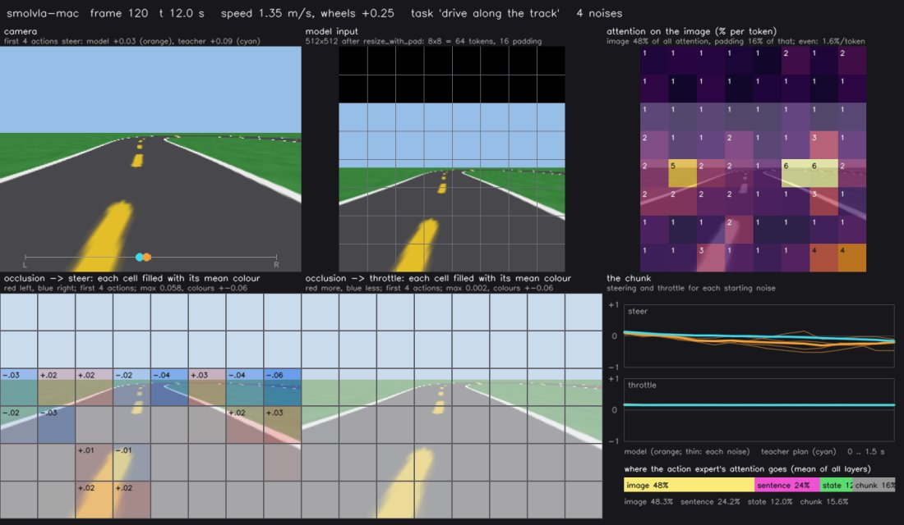
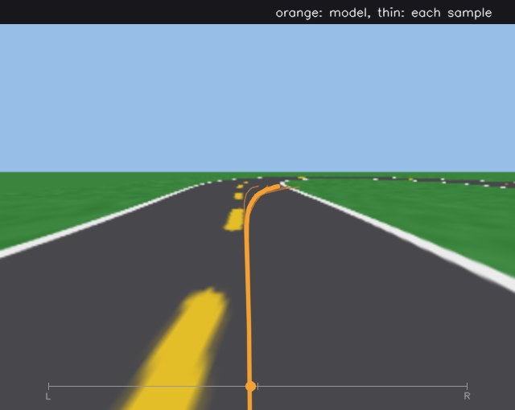

# Bài 8 · Chạy và debug VLA (SmolVLA) trên MacBook

Bài 1–7 làm việc với CNN 0,3 triệu tham số. Bài này chuyển sang **SmolVLA**: một
vision-language-action model khoảng 450 triệu tham số, được fine-tune trên chính các
episode của dự án. Bạn sẽ dựng toàn bộ quy trình trên một chiếc MacBook, từ một thư mục
`runs/` trống đến một model đã fine-tune, rồi dùng ba công cụ debug VLA của dự án.

**Mục tiêu.** Học xong bài này, bạn sẽ:

- dựng môi trường LeRobot trên Mac và hiểu vì sao nó tách khỏi môi trường của CNN;
- export dữ liệu, fine-tune SmolVLA trên **GPU của Mac (MPS)**, và biết mất bao lâu;
- chạy `probe_vla.py`, `see_vla.py`, `vla_app.py` trên Mac và đọc được output;
- **so sánh MPS với CPU** để kiểm tra GPU tính đúng (cách đã bắt được bug MPS ở bài 6);
- tránh các lỗi riêng của Mac: OpenCV không mở được cửa sổ, độ trễ suy luận, máy đi ngủ.

**Máy đo:** MacBook Apple M3 (GPU 10 nhân, RAM 16 GB), macOS 14.7, LeRobot 0.5.1,
PyTorch 2.10. **Lý thuyết:** [chương 13 · VLA và SmolVLA](../study/13-vla-and-smolvla.md),
[chương 17 · Debugging](../study/17-debugging-the-model.md),
[Lab 15](../study/15-hands-on-labs.md#lab-15-fine-tune-smolvla-on-the-driving-data-on-this-laptop)
(bản gốc trên laptop Linux có RTX 4060).

---

## 8.0 Hai môi trường, vì sao?

| | `.venv` (bài 1–7) | `.venv-vla` (bài này) |
|---|---|---|
| Dùng cho | `drive/`, CNN, `./drive.sh` | SmolVLA, LeRobot, ba công cụ VLA |
| Python | 3.10 (giống container ROS 2) | **3.12** (LeRobot bắt buộc) |
| PyTorch | 2.5.1 | 2.10 (LeRobot 0.5.1 cần ≥ 2.7) |
| Tạo bằng | `make setup` | `make vla-setup` |
| Chạy bằng | `./drive.sh …` | `./vla.sh …` |

Hai môi trường không gộp được vì chúng cần hai phiên bản Python và PyTorch khác nhau.
`./vla.sh` chạy Python của `.venv-vla`, và đặt sẵn ba thứ: `PYTHONPATH=.` (để
`import drive` chạy được), `PYTORCH_ENABLE_MPS_FALLBACK=1` (vài phép toán chưa có bản cho
GPU Mac sẽ tự chạy trên CPU thay vì báo lỗi), và tắt telemetry của Hugging Face.

## 8.1 Cài đặt (một lần, khoảng 5 phút)

```bash
make vla-setup
./vla.sh -c "import torch, lerobot, cv2; print('torch', torch.__version__, '| mps', torch.backends.mps.is_available(), '| lerobot', lerobot.__version__, '| cv2 windows', 'Cocoa' in cv2.getBuildInformation())"
```

```
torch 2.10.0 | mps True | lerobot 0.5.1 | cv2 windows True
```

`make vla-setup` tạo `.venv-vla` (khoảng 1,6 GB) với các gói trong
[`requirements-vla.txt`](../../requirements-vla.txt). Ngoài ra nó làm một việc không hiển
nhiên: LeRobot kéo theo **OpenCV bản headless**, tức bản không mở được cửa sổ, nên lệnh
`sim --show` sẽ không hiện gì. Make thay nó bằng bản có cửa sổ, **cùng phiên bản**.

**Vì sao LeRobot 0.5.1?** Lab 15 trên Linux dùng một bản LeRobot lấy thẳng từ GitHub, tự
đánh số là 0.5.2. Bản phát hành gần nhất trên PyPI là 0.5.1. Khác biệt duy nhất mà bài
này gặp là ở mục 8.4.

Model tải về được lưu trong `~/.cache/huggingface` (khoảng 2 GB). Muốn để chỗ khác thì đặt
`export HF_HOME=/đường/dẫn/khác` trước mọi lệnh `./vla.sh`.

## 8.2 Dữ liệu

Các công cụ VLA mặc định dùng project `runs/drive`, với các episode `sim2-*` để đo. Tạo lại
đúng như trên Linux: 40 episode `sim` và 40 episode `sim2`. Bước này dùng môi trường CNN:

```bash
./drive.sh collect
./drive.sh collect --name sim2 --seed 100
./drive.sh validate
```

```
recording 40 drives of 30 s to runs/drive/episodes
12000 frames in 40 episodes; the disturbed car strayed up to 59 cm from the centerline
  50 frames (0.4 %) were recorded with the car off the road
recording 40 drives of 30 s to runs/drive/episodes
12000 frames in 40 episodes; the disturbed car strayed up to 63 cm from the centerline
  41 frames (0.3 %) were recorded with the car off the road
80 episodes, 24000 frames, 39.9 min, images 240x320
  speed      0.0 to 1.74 m/s, mean 1.3
  steering   left 40 %, straight 21 %, right 40 %
  labels     24000 usable frames, from teacher
dataset: ok
```

(Đã bỏ bớt các dòng `episode N/40`.)

## 8.3 Export sang LeRobotDataset (khoảng 1 phút)

```bash
./vla.sh -m drive export
```

```
  80/80 sim2-039: 300 frames
24000 frames in 80 episodes at 10 Hz, 58.7 s
  dataset: runs/drive/lerobot
  train with: lerobot-train --policy.path=lerobot/smolvla_base --dataset.repo_id=local/vla-drive --dataset.root=/Users/…/vla-drive/runs/drive/lerobot --rename_map='{"observation.images.front": "observation.images.camera1"}' --policy.chunk_size=16 --policy.n_action_steps=16 --policy.push_to_hub=false ...
```

Ảnh được nén thành video AV1 (các dòng `Svt[info]` trong lúc chạy là của bộ nén). Nhãn
`action` là bước đầu tiên trong kế hoạch của teacher, không phải lệnh đã có nhiễu (xem bài
1, bài tập 3, và bài 5, E11).

## 8.4 Fine-tune trên GPU của Mac

**Đo tốc độ trước** bằng 20 bước, để biết lượt chạy thật sẽ mất bao lâu:

```bash
mkdir -p runs/drive/vla
./vla.sh lerobot-train --policy.path=lerobot/smolvla_base \
  --dataset.repo_id=local/vla-drive --dataset.root=$PWD/runs/drive/lerobot \
  --rename_map='{"observation.images.front": "observation.images.camera1"}' \
  --policy.chunk_size=16 --policy.n_action_steps=16 \
  --batch_size=8 --steps=20 --log_freq=5 --save_freq=1000 \
  --policy.push_to_hub=false --policy.device=mps --wandb.enable=false \
  --output_dir=runs/drive/vla/speedtest --job_name=speedtest
```

```
INFO ... num_learnable_params=99880992 (100M)
INFO ... num_total_params=450046176 (450M)
INFO ... step:5 smpl:40 ep:0 epch:0.00 loss:2.469 grdn:35.945 lr:9.4e-05 updt_s:3.741 data_s:1.571
INFO ... step:10 smpl:80 ep:0 epch:0.00 loss:1.565 grdn:24.871 lr:6.6e-05 updt_s:2.010 data_s:0.007
INFO ... step:15 smpl:120 ep:0 epch:0.01 loss:1.089 grdn:16.937 lr:3.0e-05 updt_s:2.014 data_s:0.006
INFO ... step:20 smpl:160 ep:1 epch:0.01 loss:0.984 grdn:12.215 lr:6.0e-06 updt_s:2.021 data_s:0.007
```

`updt_s:2.0` nghĩa là **khoảng 2 giây cho mỗi bước** batch 8 trên M3. Lần chạy đầu tiên
còn mất thêm vài phút để tải `smolvla_base` và `SmolVLM2-500M`.

| | Laptop RTX 4060 (Lab 15) | MacBook M3 (bài này) |
|---|---|---|
| batch | 16 | **8** (16 GB RAM dùng chung cho cả CPU lẫn GPU) |
| tốc độ | 2,5–2,7 bước/giây | khoảng 0,5 bước/giây |
| 2000 bước × batch 16 (32 000 mẫu) | 13 phút | khoảng **2 giờ 15 phút** (4000 bước × batch 8) |

**Khác biệt của LeRobot 0.5.1.** Các cờ `--dataset.eval_split`, `--eval_steps`,
`--max_eval_samples` của Lab 15 **không có** trong 0.5.1, và lệnh sẽ báo
`lerobot-train: error: unrecognized arguments`. Vì vậy sẽ không có held-out loss trong
lúc train. Thay vào đó, `probe_vla.py` đo sai số trên các episode `sim2-031` … `sim2-039`
sau khi train xong (mục 8.6).

**Lượt chạy thật** (3000 bước × batch 8 = 24 000 mẫu, bằng 75 % của Lab 15):

```bash
caffeinate -i ./vla.sh lerobot-train --policy.path=lerobot/smolvla_base \
  --dataset.repo_id=local/vla-drive --dataset.root=$PWD/runs/drive/lerobot \
  --rename_map='{"observation.images.front": "observation.images.camera1"}' \
  --policy.chunk_size=16 --policy.n_action_steps=16 \
  --batch_size=8 --steps=3000 --log_freq=50 --save_freq=1000 \
  --policy.push_to_hub=false --policy.device=mps --wandb.enable=false \
  --output_dir=runs/drive/vla/smolvla-mac --job_name=smolvla-mac 2>&1 | tee runs/drive/vla/smolvla-mac.log
```

> **`caffeinate -i`** giữ cho Mac không tự ngủ khi để yên trong lúc lệnh đang chạy. Nó
> không ngăn được việc máy ngủ khi bạn **gập máy**, nên đừng gập. Máy ngủ thì việc train
> dừng theo. Chuyện này đã xảy ra thật khi viết bài: lượt train ở trên được chạy *không có*
> `caffeinate`, và đứng yên khoảng 30 phút ở bước 2017. `pmset -g log` cho thấy lý do:
>
> ```
> 2026-11-19 00:40:41 +0700 Sleep   Entering DarkWake state due to 'Idle Sleep':TCPKeepAlive=active Using AC (Charge:91%)
> ```
>
> **Lỡ quên rồi thì sao?** Gắn `caffeinate` vào tiến trình đang chạy: tìm PID bằng
> `pgrep -f lerobot-train`, rồi chạy `caffeinate -i -w <PID>`. Nó giữ máy thức cho tới khi
> tiến trình đó kết thúc. `pmset -g assertions` sẽ hiện
> `caffeinate asserting on behalf of Process ID …` là đã có hiệu lực.

Log (lọc bằng `tr '\r' '\n' < runs/drive/vla/smolvla-mac.log | grep -oE "step:[0-9K]+ .*updt_s:[0-9.]+"`,
mỗi 500 bước một dòng):

```
step:50 smpl:400 ep:1 epch:0.02 loss:1.362 grdn:17.448 lr:2.6e-05 updt_s:1.998
step:500 smpl:4K ep:13 epch:0.17 loss:0.561 grdn:8.318 lr:9.4e-05 updt_s:1.953
step:1K smpl:8K ep:27 epch:0.33 loss:0.409 grdn:5.429 lr:7.7e-05 updt_s:1.979
step:2K smpl:12K ep:40 epch:0.50 loss:0.425 grdn:6.152 lr:5.3e-05 updt_s:1.959
step:2K smpl:16K ep:53 epch:0.67 loss:0.377 grdn:4.652 lr:2.8e-05 updt_s:1.954
step:2K smpl:20K ep:67 epch:0.83 loss:0.377 grdn:4.748 lr:9.7e-06 updt_s:1.970
step:3K smpl:24K ep:80 epch:1.00 loss:0.362 grdn:4.146 lr:2.5e-06 updt_s:1.964
3000/3000 [1:39:28<00:00,  1.99s/step]
End of training
```

**Đọc log của LeRobot:**

| Cột | Nghĩa |
|---|---|
| `step:2K` | số bước. LeRobot làm tròn: mọi bước từ 2000 đến 2999 đều in là `2K` |
| `smpl` | số mẫu đã dùng (bước × batch) |
| `ep`, `epch` | đã đi qua bao nhiêu episode, và bao nhiêu lần toàn bộ dữ liệu (1.00 = đúng một lần) |
| `loss` | loss **flow matching** của action expert. Thang đo khác hẳn SmoothL1 của CNN, đừng so hai con số với nhau |
| `grdn` | chuẩn của gradient. Giảm dần từ 17 xuống 4 là dấu hiệu tốt (bài 7.2) |
| `lr` | learning rate: tăng dần trong giai đoạn warmup, rồi giảm dần |
| `updt_s` | số giây cho mỗi bước cập nhật |

Kết quả: 1 giờ 39 phút tính theo đồng hồ của lượt train, và loss giảm từ 1,36 xuống 0,36.
Checkpoint nằm ở `runs/drive/vla/smolvla-mac/checkpoints/last/pretrained_model` (865 MB),
và các lệnh bên dưới gọi nó là `--checkpoint smolvla-mac`.

**Có sẵn checkpoint train trên máy khác?** Chép cả thư mục
`runs/drive/vla/<tên>/checkpoints/last/pretrained_model` sang
`runs/drive/vla/<tên>/checkpoints/last/` trên Mac, rồi dùng `--checkpoint <tên>`. Thư mục
này chứa trọng số, cấu hình và bộ chuẩn hóa dữ liệu. Lưu ý: checkpoint `smolvla-v1` của
Lab 15 được train bằng bản 0.5.2 lấy từ GitHub; việc nạp nó bằng 0.5.1 **chưa được kiểm
chứng** trong bộ bài này.

## 8.5 Lái thử: độ trễ trên Mac

Có hai cách cho VLA lái, và chúng đo hai thứ khác nhau.

**1. `evaluate`: độ trễ mô phỏng.** Mô phỏng tự quy định mỗi lần suy luận mất bao lâu
(`--latency-ms`), bất kể máy thật nhanh hay chậm. Máy chậm chỉ làm lệnh chạy lâu hơn chứ
không làm kết quả khác đi. Vì vậy đây là cách **so sánh công bằng** với laptop Linux:

```bash
caffeinate -i ./vla.sh -m drive evaluate smolvla-mac --latency-ms 125
```

```
smolvla-mac, 125 ms per inference, 40 s per drive
track               laps   m/s  rms cm  max cm  off road  result
peanut              2.44  1.35     3.6     8.8     0.0 %  pass
peanut reversed     2.55  1.41     6.1    21.4     0.0 %  pass
oval                2.65  1.36     3.4     8.1     0.0 %  pass
oval reversed       2.71  1.38     5.4    13.4     0.0 %  pass
trefoil             2.28  1.37     3.8    13.1     0.0 %  pass
trefoil reversed    2.32  1.39     6.7    17.6     0.0 %  pass
6/6 drives passed
  report: runs/drive/reports/smolvla-mac.json
```

Mất 11 phút (6 lượt × 320 = 1 920 lần suy luận, mỗi lần khoảng 0,35 s). So với Lab 15:

| | `smolvla-mac` (M3, bài này) | `smolvla-v1` (RTX 4060, Lab 15) | teacher |
|---|---|---|---|
| dữ liệu train | 3000 bước × batch 8 = 24 000 mẫu | 2000 × 16 = 32 000 mẫu | |
| lái thật | 6/6 | 6/6 | 6/6 |
| tốc độ | 1,38 m/s | 1,44 m/s | 1,47 m/s |
| RMS lệch tâm | **4,8 cm** | **4,8 cm** | 1,5 cm |
| lệch tối đa | 21,4 cm | 15,0 cm | 3,4 cm |

Model train trên Mac lái gần như y hệt model train trên Linux, kể cả cái tật **lắc lư**
(4,8 cm so với 1,5 cm của teacher). Đây là điểm yếu chung của SmolVLA trên bài toán này,
không phải do Mac.

**2. `sim --realtime` hoặc `--show`: độ trễ thật.** Model suy luận trên một luồng riêng,
theo đồng hồ thật, nên độ trễ là thời gian GPU của Mac thực sự cần:

```bash
./vla.sh -m drive sim --policy vla --checkpoint smolvla-mac --realtime --duration-s 20
```

```
vla on peanut, 483.1 ms per inference (41 inferences), latency compensation on, safety on
  0.01 laps in 20.0 s at 0.01 m/s
  off the centerline: rms 0.4 cm, max 1.0 cm, off the road 0.0 % of the time
  safety overrode the policy: stale 14.9 s, steer_rate 0.36 s
```

**Xe gần như không nhúc nhích.** Mỗi lần suy luận mất 483 ms, nên kế hoạch đang dùng có
lúc đã cũ tới gần 1 giây. Bộ giám sát phanh mỗi khi kế hoạch cũ hơn 600 ms (`stale`),
và điều đó xảy ra 14,9 trên 20 giây. (Quy tắc ở
[chương 07](../study/07-safety-supervisor.md): ngưỡng này phải lớn hơn 2 lần độ trễ.)

```bash
./vla.sh -m drive sim --policy vla --checkpoint smolvla-mac --realtime --duration-s 20 --max-plan-age-ms 1000
```

```
vla on peanut, 481.4 ms per inference (41 inferences), latency compensation on, safety on
  0.75 laps in 20.0 s at 0.85 m/s
  off the centerline: rms 11.2 cm, max 24.0 cm, off the road 0.0 % of the time
  safety overrode the policy: stale 1.08 s, steer_rate 0.04 s
```

Nâng ngưỡng lên 1000 ms thì xe chạy được (0,85 m/s), nhưng lắc mạnh hơn hẳn: RMS 11,2 cm.
[Chương 05](../study/05-action-chunking-and-latency.md) đã đo rằng vòng điều khiển bắt đầu
mất ổn định khi độ trễ vượt khoảng 250 ms ở tốc độ 1,5 m/s, và ở đây là 480 ms. Để xem trực
quan thì thay `--realtime` bằng `--show`.

> **Tóm lại:** trên Mac, dùng `evaluate --latency-ms 125` để **đánh giá** model, và dùng
> `--realtime`/`--show` để **thấy** độ trễ thật làm gì với vòng điều khiển. Muốn giảm độ trễ
> thì bớt số bước khử nhiễu (mục 8.6, phép đo `timing`), hoặc chạy trên Jetson với TensorRT
> ([chương 14](../study/14-jetson-deployment.md)).

## 8.6 `probe_vla.py`: chín phép đo offline

```bash
./vla.sh tools/probe_vla.py --checkpoint smolvla-mac
```

```
loaded runs/drive/vla/smolvla-mac/checkpoints/last/pretrained_model on mps in 17.7 s; chunk 16, 10 denoising steps, camera key 'observation.images.front'

[offline] 261 frames from 9 held-out episodes: mean |steer error| by chunk step
  step:              0     1     2     3     5    10    15
  vs clean plan: 0.088 0.090 0.117 0.145 0.166 0.161 0.176
  vs LeRobot's target: 0.088 0.086 0.101 0.124 0.191 0.252 0.273
  step 0: correlation with the teacher 0.928; mean steer model +0.001, teacher -0.011

[noise] one frame, 10 different noises: std of steering by step 0.165 0.239 0.102 0.117 0.332; std of throttle at step 0 0.117

[repeat] same frame, same noise, twice: max difference 0.00e+00

[mirror] steer step 0: original +0.066, mirrored +0.573 (a symmetric policy gives -0.066); mean |orig + mirrored| over the chunk 0.335
[blank] black image: steer +0.155 … -0.013, throttle +0.940
[blank] grey image: steer +0.188 … -0.067, throttle +0.930

[speed] same frame, steer +0.00: first throttle at speed
  0.0 m/s -> throttle +0.915
  0.5 m/s -> throttle +0.884
  1.0 m/s -> throttle +0.118
  1.4 m/s -> throttle +0.169
  1.8 m/s -> throttle +0.160
  2.5 m/s -> throttle -0.049

[task] same frame, same noise, other sentences: mean |steer change| over the chunk
  'drive slowly'           0.050   throttle +0.866
  'stop'                   0.022   throttle +0.854
  'turn left'              0.050   throttle +0.838
  ''                       0.028   throttle +0.829

[timing] one chunk: 224 ms with 1 step, 345 ms with 10 → about 13.4 ms per denoising step, 211 ms for everything else (pre-processing, image encoder, VLM prefix, post-processing)
...
```

Mất khoảng 2 phút. [Chương 17](../study/17-debugging-the-model.md) giải thích từng phép đo
(tiếng Anh); dưới đây là những gì đáng chú ý khi so với `smolvla-v1` của Lab 15:

| Phép đo | `smolvla-mac` | `smolvla-v1` | Đọc |
|---|---|---|---|
| `offline`: sai số steer bước 0 / 3 / 15 | 0,088 / 0,145 / 0,176 | 0,088 / 0,142 / 0,172 | gần như trùng nhau: train trên Mac cho cùng chất lượng |
| tương quan với teacher (bước 0) | 0,928 | 0,937 | model đã học được cách lái |
| `mirror` | lệch 0,335 | lệch 0,280 | **không đối xứng**: lật ảnh thì steer không đảo dấu. SmolVLA không có augmentation lật ảnh như CNN (bài 3) |
| `blank` | ga 0,94 | ga 0,92 | giống CNN ở bài 4: không thấy gì thì vẫn đạp ga |
| `speed` | 0,9 khi < 0,5 m/s, rồi khoảng 0,15 | 0,91 khi 0 m/s | biết xuất phát mạnh, khác hẳn CNN `v1` (bài 4) |
| `timing`, 10 bước khử nhiễu | **345 ms** (M3, MPS) | 309 ms (RTX 4060) | GPU M3 chỉ chậm hơn khoảng 12 % ở việc suy luận |

**Một điều chỉ phép đo `timing` cho thấy:** 211 trong số 345 ms là phần "cố định" (mã hóa
ảnh, phần tiền tố của VLM), còn mỗi bước khử nhiễu chỉ tốn 13 ms. Giảm từ 10 xuống 1 bước
chỉ tiết kiệm được 120 ms. Muốn nhanh hơn nhiều thì phải tăng tốc phần tiền tố (TensorRT
trên Jetson, chương 14), chứ không phải giảm số bước.

## 8.7 `see_vla.py`: model nhìn vào đâu

```bash
./vla.sh tools/see_vla.py --checkpoint smolvla-mac --frames 120
```

```
loaded runs/drive/vla/smolvla-mac/checkpoints/last/pretrained_model on mps in 17.8 s
runs/drive/reports/see-smolvla-mac/sim2-031-120.png  (49.2 s)  steer model +0.031, teacher +0.087; attention on the image 48%; occlusion moves steering at most 0.058
```



Mỗi frame mất khoảng 50 giây trên M3, vì phép che (occlusion) phải chạy model với từng ô bị
che. Đọc bảng từ trái sang phải, từ trên xuống dưới:

- **camera**: frame gốc, với steer của model (cam) và của teacher (cyan) ở dưới cùng.
- **model input**: thứ SmolVLA thật sự nhận vào: ảnh 512x512 đã được thêm viền đen (padding)
  ở trên, chia thành 8x8 = 64 "token" ảnh, trong đó 16 token là phần viền.
- **attention on the image**: action expert dành bao nhiêu phần trăm sự chú ý cho mỗi token.
  Chỗ sáng nhất (5–6 %) là đoạn đường xa, nơi vạch kẻ đường uốn cong.
- **occlusion → steer**: che từng ô bằng màu trung bình của nó rồi xem steer đổi bao nhiêu.
  Đỏ là lệch trái, xanh là lệch phải. Ảnh hưởng lớn nhất (±0,06) nằm ở dải đường chân trời.
- **thanh dưới cùng**: action expert chia sự chú ý giữa ảnh (48 %), câu lệnh (24 %), trạng
  thái (12 %) và chính chunk của nó (16 %).

Cùng một kết luận với Lab 15: model lái theo đoạn đường **phía xa**, đúng chỗ teacher
nhắm tới. Đây cũng chính là ý tưởng của saliency cho CNN ở bài 4.

## 8.8 `vla_app.py`: thử từng ảnh trong trình duyệt

```bash
./vla.sh tools/vla_app.py --checkpoint smolvla-mac --open
```

```
loaded smolvla-mac on mps in 17.8 s
* Running on local URL:  http://127.0.0.1:7860
```

`--open` mở trình duyệt. Trong app, bạn chọn một frame (hoặc tải ảnh lên, hoặc **vẽ thêm**
lên ảnh: một vật cản, một vạch kẻ đường giả), chỉnh tốc độ, góc lái, câu lệnh, số mẫu nhiễu,
số bước khử nhiễu, lật ảnh, độ sáng, che một dải ảnh… rồi bấm chạy. App trả về kế hoạch vẽ
lên đường, attention, occlusion, và bảng từng bước. Trên M3, mỗi lần chạy mất khoảng 1,7
giây với 4 mẫu nhiễu.



**Gọi app bằng code** (để tự động hóa thí nghiệm). App có API, dùng `gradio_client`, gói
được cài sẵn theo gradio:

```bash
./vla.sh - <<'EOF'
import cv2, numpy as np
from gradio_client import Client, handle_file
image = np.load("runs/drive/episodes/sim2-031/episode.npz")["images"][120]
cv2.imwrite("/tmp/frame.png", cv2.cvtColor(image, cv2.COLOR_RGB2BGR))
app, picture = Client("http://127.0.0.1:7860/", verbose=False), handle_file("/tmp/frame.png")
result = app.predict({"background": picture, "layers": [], "composite": picture, "id": None},
                     1.35, 0.25, "drive along the track", 0, 4, 10, True, False, 1.0, "nothing", "mean colour", False,
                     api_name="/infer")
print(result[1])
EOF
```

```
**Steering** (+ left, − right): first action **+0.102**; first 4 actions (0.4 s, what the car plays) **+0.031**, spread across samples ±0.020

**Throttle**: first action **+0.170**; first 4 **+0.169**

**Time**: 4 samples in one batch, 10 denoising steps: 1674 ms

**Speed** +1.35 m/s → normalised **+0.19** (training data: mean +1.30, std 0.26, range +0.00 … +1.74)

**Wheels** +0.25 → normalised **+0.77** (training data: mean -0.00, std 0.32, range -0.97 … +0.96)

**Attention of the action expert**: image 48 %, sentence 24 %, state 12 %, its own chunk 16 %
```

Dòng `normalised` rất đáng chú ý khi debug. Nó cho biết giá trị bạn nhập nằm ở đâu so với
dữ liệu train. Một tốc độ có `normalised` lớn hơn 3 (ví dụ 2,5 m/s, khi dữ liệu chỉ tới
1,74) là đang hỏi model về một tình huống nó **chưa từng thấy**.

## 8.9 MPS có tính đúng không? So với CPU

Bài 6 đã kể chuyện GPU Mac tính sai validation của CNN (lệch tới 254 đơn vị). Với một model
450 triệu tham số, ta cũng nên kiểm tra như vậy: chạy **cùng frame, cùng nhiễu** trên MPS
và trên CPU, rồi so kết quả.

```bash
./vla.sh - <<'EOF'
import time
import numpy as np
import torch
from drive.learn.project import Project
from drive.policy.lerobot_backend import LeRobotBackend, synchronize
from drive.policy.vla import BackendObservation

checkpoint = Project("runs/drive").checkpoint("smolvla-mac")
data = np.load("runs/drive/episodes/sim2-031/episode.npz")
frames = (60, 120, 180, 240)
noise = np.random.default_rng(0).standard_normal((1, 16, 32)).astype(np.float32)
chunks, times = {}, {}
for device in ("mps", "cpu"):
    backend = LeRobotBackend(checkpoint, device)
    out = []
    for i in frames:
        obs = BackendObservation(index=0, images=[data["images"][i]], state=data["states"][i].astype(np.float32),
                                 task="drive along the track", noise=noise)
        backend.infer(obs)                                   # warm up
        synchronize(torch, device)
        started = time.perf_counter()
        out.append(backend.infer(obs).chunk)
        synchronize(torch, device)
        times.setdefault(device, []).append(time.perf_counter() - started)
    chunks[device] = np.array(out)
    del backend
diff = np.abs(chunks["mps"] - chunks["cpu"])
print(f"{len(frames)} frames of sim2-031, the same noise on both devices")
print(f"  one chunk: mps {1000 * np.mean(times['mps']):.0f} ms, cpu {1000 * np.mean(times['cpu']):.0f} ms")
print(f"  steer step 0, mps: {' '.join(f'{v:+.4f}' for v in chunks['mps'][:, 0, 0])}")
print(f"  steer step 0, cpu: {' '.join(f'{v:+.4f}' for v in chunks['cpu'][:, 0, 0])}")
print(f"  largest difference over every step and both actions: {diff.max():.2e}; mean {diff.mean():.2e}")
EOF
```

```
4 frames of sim2-031, the same noise on both devices
  one chunk: mps 349 ms, cpu 4038 ms
  steer step 0, mps: -0.4450 +0.1360 -0.4661 -0.5710
  steer step 0, cpu: -0.4462 +0.1335 -0.4658 -0.5706
  largest difference over every step and both actions: 4.07e-03; mean 8.19e-04
```

**Đọc:**

- **Chênh lệch lớn nhất là 0,004**, nhỏ hơn sai số của chính model (0,088) hơn 20 lần. Hai
  thiết bị dùng các thuật toán tính số thực khác nhau, nên chênh ở chữ số thứ ba là bình
  thường. Kết luận: **MPS tính đúng**.
- So với bug MPS ở bài 6, nơi kết quả lệch tới 254: một bug thật cho chênh lệch lớn **hàng
  nghìn lần** mức này, nên không thể nhầm.
- **MPS nhanh hơn CPU 11,6 lần.** Chạy VLA trên CPU của Mac là không thực tế: 4 giây cho một
  chunk.

Cả ba công cụ đều nhận `--device cpu` (hoặc `VLA_DEVICE=cpu ./vla.sh …`), nên khi nghi ngờ
một kết quả nào đó, có thể chạy lại đúng lệnh đó trên CPU để đối chiếu.

## 8.10 Lỗi hay gặp trên Mac

| Triệu chứng | Nguyên nhân | Cách sửa |
|---|---|---|
| `vla.sh needs the LeRobot environment` | chưa tạo `.venv-vla` | `make vla-setup` |
| `sim --show` chạy nhưng không hiện cửa sổ | OpenCV headless do LeRobot kéo theo | `make vla-setup` đã thay; nếu cài tay thì làm như mục 8.1 |
| `ModuleNotFoundError: No module named 'cv2'` sau khi gỡ bản headless | hai bản OpenCV dùng chung thư mục `cv2`, gỡ một bản là mất file của bản kia | cài lại: `uv pip install --reinstall --no-deps --python .venv-vla/bin/python "opencv-python==<cùng phiên bản>"` |
| `lerobot requires numpy<2.3.0, but 2.5.5 is installed` | cài thêm một gói làm numpy bị nâng lên | `rm .venv-vla/.installed && make vla-setup` (nhớ dùng `--no-deps` khi cài lẻ) |
| `unrecognized arguments: --dataset.eval_split …` | các cờ này chỉ có trong LeRobot 0.5.2 | bỏ chúng đi (mục 8.4) |
| `objc[…]: Class AVFFrameReceiver is implemented in both …` | hai bản thư viện ffmpeg (của PyAV và của Homebrew) | vô hại, bỏ qua |
| `You are sending unauthenticated requests to the HF Hub` | chưa đăng nhập Hugging Face | vô hại; đặt `HF_TOKEN` nếu bị giới hạn tốc độ tải |
| `NotImplementedError: … not currently implemented for the MPS device` | một phép toán chưa có bản cho GPU Mac | chạy qua `./vla.sh` (nó đặt `PYTORCH_ENABLE_MPS_FALLBACK=1`), hoặc thêm `--device cpu` |
| Lái bằng VLA theo thời gian thực mà xe phanh liên tục (`stale`) | mỗi lần suy luận mất khoảng 480 ms, nên kế hoạch bị coi là quá cũ | `--max-plan-age-ms 1000`; để đánh giá thì dùng `evaluate --latency-ms 125` (mục 8.5) |
| Train hoặc đánh giá chậm bất thường | máy đi ngủ (`pmset -g log` cho thấy `Idle Sleep`) | `caffeinate -i …`, hoặc `caffeinate -i -w <PID>` cho lệnh đang chạy |
| Hết bộ nhớ (`MPS backend out of memory`) | batch quá lớn với 16 GB | `--batch_size=4` |

## 8.11 Bài tập

1. **Giảm độ trễ.** Trong `vla_app`, đổi số bước khử nhiễu (`steps`) từ 10 xuống 2. Kế
   hoạch thay đổi bao nhiêu? Thời gian giảm bao nhiêu? Sau đó tìm trong
   [`drive/policy/lerobot_backend.py`](../../drive/policy/lerobot_backend.py) chỗ có thể đặt
   `policy.config.num_steps`, và thử lái `--realtime` với 2 bước.
2. **Câu lệnh có tác dụng không?** Trong `probe_vla.py`, phép đo `[task]` cho thấy đổi câu
   lệnh thành `'stop'` chỉ làm steer đổi 0,022 và ga vẫn 0,85. Vì sao model lờ đi câu lệnh?
   (Gợi ý: trong dữ liệu, câu lệnh lúc nào cũng là `drive along the track`.)
3. **Lật ảnh.** `mirror` cho thấy SmolVLA không đối xứng. Hãy nghĩ cách thêm augmentation
   lật ảnh khi export, như CNN làm ở bài 3: cần lật những gì (ảnh, góc lái trong trạng thái,
   steer trong nhãn)?
4. **Checkpoint trung gian.** Dùng `--checkpoint runs/drive/vla/smolvla-mac/checkpoints/001000/pretrained_model`
   để chạy `probe_vla.py` trên checkpoint ở bước 1000. Sai số offline ở bước 1000 so với bước
   3000 thế nào? Có đáng chờ thêm 2000 bước không?

<details><summary>Gợi ý đáp án</summary>

2. Model chỉ học được những gì dữ liệu dạy (bài 5, bài học 3). Mọi frame đều đi cùng một
   câu lệnh, nên câu lệnh không mang thông tin gì. Muốn model nghe lệnh thì dữ liệu phải có
   nhiều câu lệnh khác nhau, đi kèm nhiều cách lái khác nhau.
3. Lật ảnh trái–phải, đảo dấu góc lái trong `observation.state`, và đảo dấu steer trong
   `action`. Throttle và tốc độ giữ nguyên. Đúng như hàm `augment` trong `train.py`.
4. Tự chạy. Đây là cách rẻ nhất để biết model đã "bão hòa" chưa: so các checkpoint với nhau
   trước khi quyết định có train thêm không.
</details>

**Hết.** Quay lại [mục lục](README.md).
