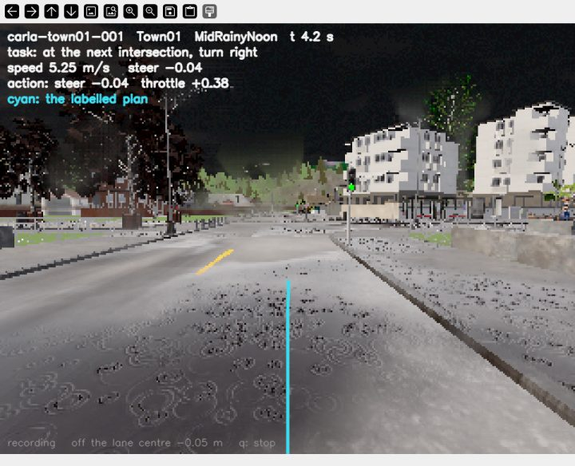
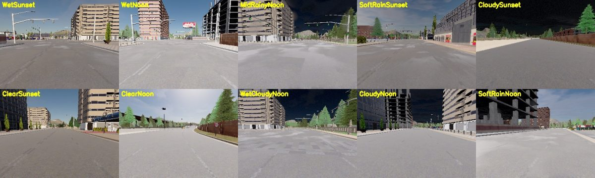
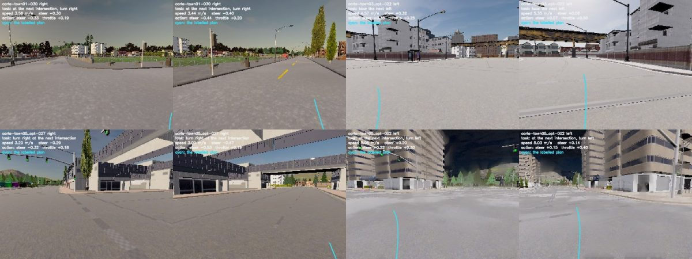

# Bài 9 · Thu dữ liệu cho SmolVLA trong CARLA

**Mục tiêu.** Học xong bài này, bạn sẽ:

- dựng server CARLA trong Docker và biết vì sao phải boot thẳng vào một town;
- hiểu vì sao trong CARLA cần **mô hình xe** riêng, và đo được nhãn chính xác đến đâu;
- thu dữ liệu có **câu lệnh ngôn ngữ** ("take the next left"), xem tận mắt lúc đang thu,
  và thu tiếp được khi server chết giữa chừng;
- validate, xem lại, export sang LeRobot và train thử SmolVLA trên dữ liệu đó;
- chỉ ra được **hai điểm yếu** của bộ dữ liệu bằng số đo, chứ không phải bằng cảm giác.

**Đọc thêm:** [docs/carla.md](../carla.md) (tiếng Anh) có mọi con số và lý do thiết kế.
Bài này dùng lại các khái niệm của [bài 1](01-thu-thap-du-lieu.md) (teacher, DART, nhãn)
và [bài 8](08-vla-tren-mac.md) (export, `lerobot-train`).

**Máy đo.** Laptop i7-13650HX, RTX 4060 Laptop 8 GB, Ubuntu, CARLA 0.9.16 (image
`carlasim/carla:0.9.16`), `-quality-level=Low`. Ngày đo: 2026-11-21.

---

## 9.0 Khác gì so với simulator của bài 1

| | simulator (bài 1–8) | CARLA (bài này) |
|---|---|---|
| xe | xe 1:10, 1–2 m/s, mô hình động học | Tesla Model 3, 4–9 m/s, vật lý của Unreal |
| camera | 320×240, nhìn xuống đường đua | 320×240, 90°, gắn trên nắp capô, cao 1,5 m |
| teacher | pure pursuit trên vòng đua | pure pursuit theo **tuyến ngẫu nhiên** qua phố, có ngã tư |
| nhãn | kế hoạch 16 bước × 0,1 s | như cũ, nhưng tính bằng **mô hình xe đã đo** từ CARLA |
| câu lệnh | một câu cho cả episode | **mỗi frame một câu**: đi theo làn, hoặc rẽ trái/phải/đi thẳng ở ngã tư tới |

Ý tưởng DART vẫn giữ nguyên: nhiễu được cộng vào góc lái **đưa xuống bánh xe**, còn nhãn
luôn là kế hoạch sạch của teacher tính từ chỗ xe đang đứng.

Mới là câu lệnh. Từ 30 m trước ngã tư cho tới khi ra khỏi nó, câu lệnh là hướng đi ở
ngã tư đó. Mỗi hướng có ba cách nói, chọn ngẫu nhiên và giữ nguyên trong suốt ngã tư ấy.
SmolVLA phải học **đọc câu lệnh**, vì nhìn ảnh thôi thì không biết nên rẽ hướng nào.

## 9.1 Dựng server (một lần cho mỗi town)

```bash
make carla-setup                     # một lần: .venv-carla (Python 3.10 + gói carla, không có PyTorch)
make carla-server TOWN=Town01        # server trong Docker, boot thẳng vào Town01
```

Vì sao phải "boot thẳng vào town":

- Mặc định image boot vào Town10HD_Opt và chiếm **5013 MiB** trong 8188 MiB VRAM trước khi
  làm gì cả. Boot vào Town01 chỉ tốn khoảng 1750 MiB.
- Nạp map khác vào server đang chạy **không** giải phóng map cũ, và nạp nhiều lần đã làm
  server sập. Vì vậy muốn đổi town thì `make carla-down` rồi `make carla-server TOWN=...`.
- **Town03 và Town05 làm server sập** (exit 139): Town03 sập ngay lúc boot, Town05 sập
  khi camera nhìn vào đoạn cầu cạn giáp khu phố. Hãy dùng `Town03_Opt` và `Town05_Opt`:
  cùng đường, cảnh được chia thành layer, và không sập. Mục 9.7 kể cách tìm ra điều này.

Lệnh `carla-*` tự chờ server sẵn sàng. Town01 mất vài phút; Town03_Opt có lần mất hơn 10
phút.

## 9.2 Mô hình xe: vì sao cần, và nhãn chính xác đến đâu

Nhãn là 16 hành động trong 1,6 s tới. Hành động đầu tiên là thứ teacher muốn làm ngay
lúc đó. Mười lăm hành động sau phải **đoán** xe sẽ đi đâu, nên teacher cuộn kế hoạch
tới trước bằng một mô hình xe. Mô hình sai thì nhãn sai: kế hoạch nói "lái +0,1 là vào
cua", nhưng xe thật cần +0,2.

Mô hình cho Model 3 đã có sẵn trong repo (`drive/carla/vehicles/vehicle.tesla.model3.json`).
Nó được đo bằng `carla identify`: lái xe trong CARLA với chân ga, phanh và tay lái bị
kích thích, ghi lại, rồi fit mô hình. Muốn fit lại từ log đã lưu thì không cần server:

```bash
PYTHON=.venv-carla/bin/python ./drive.sh carla identify --from-log runs/carla/identify-model3-seed7.npz --out /tmp/model.json
```

Output (rút gọn):

```
{
  "samples": 10710,
  "seconds": 535.5,
  "steer_tau_s": 0.014,
  "steer_gain": 0.934,
  "wheelbase_m": 3.166,
  "pinned_at_zero": ["c0", "c2"],
  "brake_samples": 184,
  "brake_table": [[0.0, 0.0], [0.091, 2.817], [0.179, 2.817], [0.221, 2.817], [0.331, 6.862], [0.515, 6.862]],
  "speed_error_1_5s_mps": {"median": 0.083, "p90": 0.383}
}
```

Cách đọc:

- `steer_tau_s 0.014`: tay lái gần như đáp ứng tức thì (độ trễ 14 ms).
- `pinned_at_zero ["c0", "c2"]`: hai hệ số lực cản bị ghim ở 0. Fit tự do thì chúng ra
  **âm**, tức là xe được "đẩy thêm" khi chạy, điều vô lý về vật lý. Một mô hình có hệ số
  vô lý vẫn có thể khớp dữ liệu, nhưng sẽ dự đoán sai ở chỗ dữ liệu không có.
- `brake_table`: phanh là **bảng tra**, không phải đường thẳng. CARLA phanh giật từng
  nấc, nên trung vị (median) của mỗi nấc bị lệch; bảng dùng giá trị trung bình (mean).

Mô hình fit tốt hay không chưa nói được nhãn có đúng không. Thứ cần đo là: **kế hoạch
dự đoán xe ở đâu sau 1,5 s, và xe thật ở đâu**. Đó là việc của `carla check`, chạy với
cùng nhiễu như lúc thu:

```bash
make carla-check TOWN=Town03_Opt ARGS='--minutes 4 --seed 7'
```

```
checking vehicle.tesla.model3 in Town03_Opt: 4 simulated minutes, steer noise 0.06
  drive 1:  60.0 s at 6.5 m/s
  ...
  "teacher": {"seconds": 240.0, "mean_speed_mps": 6.07, "lateral_rms_m": 0.252, "lateral_p99_m": 0.646},
  "model_prediction_error": {
    "0.5s": {"position_m": {"median": 0.041, "p90": 0.09}, ...},
    "1.0s": {"position_m": {"median": 0.105, "p90": 0.23}, ...},
    "1.5s": {"position_m": {"median": 0.2,   "p90": 0.41},
             "heading_deg": {"median": 0.963, "p90": 2.415},
             "speed_mps":   {"median": 0.196, "p90": 0.432}}
  }
```

Sau 1,5 s, kế hoạch lệch khỏi chỗ xe thật tới **0,20 m** (trung vị), 0,41 m ở phân vị
90, trên đồi dốc của Town03. Trên Town01 (phẳng) là 0,19 m và 0,32 m. Một làn xe rộng
khoảng 3,5 m, nên sai số này nhỏ so với thứ model cần học.

## 9.3 Thu dữ liệu, và xem tận mắt

```bash
make carla-collect TOWN=Town01 ARGS='--episodes 40 --duration-s 60 --seed 0 --show --video runs/carla/videos/collect-town01.mp4'
```

- `--show` mở một cửa sổ, hiện từng frame **đúng lúc nó được ghi**.
- `--video` ghi đúng những gì cửa sổ hiện ra một file .mp4, để xem lại sau.
- Hai cờ này không thay đổi dữ liệu được ghi.



Trong cửa sổ:

- **Đường cyan** là kế hoạch 1,6 s của teacher (chính là nhãn), cuộn tới bằng mô hình xe
  rồi chiếu lên mặt đường. Đường cyan đi đúng làn thì nhãn đúng.
- **`task:`** là câu lệnh của frame này. Ở đây xe đang tới gần một ngã tư sẽ rẽ phải.
- **`action:`** là lệnh **đã đưa xuống bánh xe**, tức đã cộng nhiễu DART.
- Dòng dưới cùng là độ lệch khỏi tim làn. Bấm **q** để dừng.

Output:

```
recording 40 drives of up to 60 s in Town01 to runs/carla/episodes
  carla-town01-000:  60.0 s, WetSunset, 5.1 m/s, junctions LL
  carla-town01-001:  60.0 s, MidRainyNoon, 6.2 m/s, junctions RR
  carla-town01-002:  60.0 s, SoftRainSunset, 5.6 m/s, junctions LSSL
  ...
24000 frames in 40 episodes, 1065 s of wall time
  ended: duration 40
  commands: follow 63 %, left 13 %, right 12 %, straight 11 %
  0 frames (0.0 %) with the car over a lane line
```

Mỗi dòng gồm: độ dài episode, thời tiết, tốc độ mục tiêu (rút ngẫu nhiên từ 4–8 m/s) và
các ngã tư đã đi qua (L trái, R phải, S thẳng). `ended: duration 40` nghĩa là cả 40
episode đều chạy đủ 60 s, không đâm, không lệch làn, không kẹt. Một episode kết thúc sớm
sẽ bị **cắt bỏ 2 s cuối**, vì đó là cảnh xe đang lao vào rắc rối mà nhãn lại vờ như
không có gì.

Ba town dùng ba `--seed` khác nhau:

| town | `--seed` | thời gian | frame chạm vạch làn | follow / left / right / straight |
|---|---|---|---|---|
| Town01 | 0 | 1065 s (có `--show --video`) | 0 | 63 / 13 / 12 / 11 % |
| Town03_Opt | 1 | 1334 s (có `--show --video`) | 62 (0,3 %) | 35 / 12 / 23 / 30 % |
| Town05_Opt | 2 | 636 s (không cửa sổ) | 62 (0,3 %) | 45 / 21 / 12 / 23 % |

Thời tiết được rút từ 10 preset ban ngày và hoàng hôn. Ở chất lượng `Low`, mọi preset có
mây hoặc mưa đều vẽ **bầu trời gần như đen**, còn preset trời quang thì có trời xanh.
Không camera thật nào cho ra hình như vậy. Mặt đường vẫn đủ sáng, nên nhãn không bị ảnh
hưởng; còn với chuyện từ mô phỏng sang thật (sim-to-real) thì đó là một điểm cần nhớ.



Camera được chỉnh **tối đi 1 stop** (`exposure_compensation -1`). Lúc đầu để mặc định
thì buổi trưa mặt đường bị cháy sáng: độ sáng 211/255, độ nét (phương sai Laplacian)
30. Tối đi 1 stop cho 171 và **52**, nghĩa là vạch kẻ đường hiện rõ hơn.

## 9.4 Validate

```bash
PYTHON=.venv-carla/bin/python ./drive.sh validate --project runs/carla
```

```
120 episodes, 72000 frames, 119.8 min, images 240x320
  speed      0.0 to 8.87 m/s, mean 5.24
  steering   left 10 %, straight 81 %, right 10 %
  labels     72000 usable frames, from teacher
  tasks      12 sentences; frames per sentence:
                18.8 %  keep driving in your lane
                14.9 %  follow the road
                14.0 %  follow the lane
                 8.7 %  continue straight through the next intersection
                 7.1 %  drive straight across the next intersection
                 5.9 %  take the next right
                 5.5 %  go straight at the next intersection
                 5.3 %  take the next left
                 5.2 %  turn left at the next intersection
                 5.0 %  at the next intersection, turn right
                 4.9 %  turn right at the next intersection
                 4.7 %  at the next intersection, turn left
dataset: ok
```

Hai con số đáng chú ý:

- **`straight 81 %`**: phần lớn thời gian xe đi thẳng, nên dữ liệu lệch nặng về góc lái
  gần 0. Đó là bản chất của lái xe trong phố. Đánh giá model thì phải **tách theo câu
  lệnh**: một model luôn đi thẳng vẫn đúng 81 % số frame.
- **Mỗi câu chiếm 4,7–18,8 %**: không câu nào hiếm tới mức model không học được.

## 9.5 Xem lại một episode

```bash
PYTHON=.venv-carla/bin/python ./drive.sh browse --project runs/carla --match 'carla-town05_opt-002'
```

Cửa sổ mở ra ở trạng thái dừng: **space** để chạy, **d/a** để sang frame sau/trước,
**n/p** để sang episode sau/trước. Thêm `--video file.mp4` thì ghi ra video thay vì mở
cửa sổ.

Kiểm tra quan trọng nhất là **giữa khúc rẽ**, nơi nhãn dễ sai nhất:



- Rẽ phải thì `steer` âm (−0,30 đến −0,53), rẽ trái thì dương (+0,15 đến +0,32). Quy
  ước của dự án: dương là trái.
- Câu lệnh khớp hướng rẽ.
- Ở các khúc rẽ phải, đường cyan **gần như ra khỏi khung hình**. Mục 9.8 đo hiện tượng này.

## 9.6 Export và train thử

```bash
./vla.sh -m drive export --project runs/carla
```

```
  120/120 carla-town05_opt-039: 600 frames
72000 frames in 120 episodes at 10 Hz, 584.0 s
  dataset: runs/carla/lerobot
```

Mỗi frame mang câu lệnh của chính nó (`task`), nên SmolVLA thấy câu lệnh thay đổi khi
xe tới gần ngã tư. Export từ chối gộp dữ liệu CARLA với dữ liệu simulator vào một dataset
(`robot_type` khác nhau).

> **Máy ngủ giữa chừng.** Export báo 584 s, nhưng lệnh `time` đo được **101 phút**.
> `journalctl` cho thấy laptop suspend lúc 07:12:15, ngay sau khi export bắt đầu. Lý do
> hai con số khác nhau: `perf_counter` (CLOCK_MONOTONIC) không đếm thời gian máy ngủ,
> còn `time` thì đếm. Với lượt train dài, hãy chặn máy ngủ bằng
> `systemd-inhibit --what=sleep:idle ...`, như lệnh dưới đây.

Train thử 60 bước, chỉ để chứng minh `lerobot-train` đọc được dataset:

```bash
HF_HOME=/home/fanning/data1/hf-cache systemd-inhibit --what=sleep:idle --who=vla-drive --why="SmolVLA" \
  ./vla.sh lerobot-train --policy.path=lerobot/smolvla_base \
  --dataset.repo_id=local/vla-drive --dataset.root=$PWD/runs/carla/lerobot \
  --rename_map='{"observation.images.front": "observation.images.camera1"}' \
  --policy.chunk_size=16 --policy.n_action_steps=16 \
  --batch_size=16 --steps=60 --log_freq=10 --save_freq=1000 \
  --policy.push_to_hub=false --policy.device=cuda --wandb.enable=false \
  --output_dir=runs/carla/vla/speedtest --job_name=speedtest
```

```
INFO ... dataset.num_frames=72000 (72K)
INFO ... dataset.num_episodes=120
INFO ... num_learnable_params=99880992 (100M)
INFO ... step:10 smpl:160 ep:0 epch:0.00 loss:1.539 grdn:21.943 lr:9.4e-05 updt_s:0.456 data_s:0.083
INFO ... step:30 smpl:480 ep:1 epch:0.01 loss:1.164 grdn:12.031 lr:6.3e-05 updt_s:0.359 data_s:0.005
INFO ... step:60 smpl:960 ep:2 epch:0.01 loss:0.888 grdn:7.407 lr:4.4e-06 updt_s:0.358 data_s:0.004
INFO ... End of training
```

Tốc độ là **2,75 bước/giây** ở batch 16 trên RTX 4060. Train 2000 bước như Lab 15 thì mất
khoảng 12 phút. Nhớ `make carla-down` trước, vì GPU 8 GB không chứa nổi cả CARLA lẫn
SmolVLA. `HF_HOME` trỏ cache model sang ổ data: model tải về khoảng 2,8 GB, và lần đầu
chạy lệnh này thì phân vùng gốc đã đầy.

## 9.7 Khi server chết: đổi từng biến một

Chuyện thật lúc viết bài. Đang thu Town05 thì server segfault (exit 139). Lúc đó vừa đổi
bù sáng, và một chương trình khác vừa dùng GPU. Đoán đầu tiên là "huỷ camera khi khung
hình còn đang được đọc về từ GPU": đúng chỗ đổi episode, và có tiền lệ trong repo. Đoán
đó **sai**. Cách tìm ra nguyên nhân thật:

1. **Thu tiếp, đừng thu lại từ đầu.** Mỗi episode có bộ sinh số ngẫu nhiên riêng, seed
   theo `[seed, index]`. Vì vậy `--resume` giữ các episode đã ghi xong và thu đúng những
   episode mà một lượt chạy liền mạch đã thu:
   ```bash
   make carla-collect TOWN=Town05 ARGS='--episodes 40 --duration-s 60 --seed 2 --resume'
   ```
2. **Thấy quy luật.** Cả hai lần, server đều chết ở **episode 2**, khoảng t = 55 s. Episode
   2 luôn có cùng thời tiết, cùng điểm xuất phát, cùng tuyến. Nếu nguyên nhân là lúc
   huỷ camera thì nó đã không chết giữa episode.
3. **Mỗi lần đổi một biến**, chạy lại đúng episode đó:

   | lần chạy | bù sáng | thời tiết | xe | kết quả |
   |---|---|---|---|---|
   | gốc | −1 | MidRainyNoon | có | chết giữa episode 2 (hai lần) |
   | A | **0** | MidRainyNoon | có | chết sau t = 55 s |
   | B | −1 | **ClearNoon** | có | chết ở t = 54,55 s, tại (−239,9, −109,6, 10,0) |
   | C | −1 | — | **chỉ một camera**, trượt dọc đường | chết trong 20 tick |
   | D | −1 | — | chỉ camera, trong **Town05_Opt** | đi thêm 130 m, server vẫn sống |

   Lần B cho thấy xe chạy êm tới tick cuối: 7,2 m/s, không va chạm, z = 10 m (trên cầu
   cạn). Lần C loại hẳn chiếc xe. Vậy nguyên nhân là **vẽ cảnh nhìn từ chỗ đó** trong
   Town05.

Một lỗi khác lộ ra cũng nhờ việc này: client khởi chạy **cùng lúc** với server bị treo
**10 phút**, mặc kệ timeout. `ss -tnp` cho thấy socket ở trạng thái `CLOSE-WAIT`.
`docker run -p` nhận kết nối trước khi CARLA bên trong kịp lắng nghe, rồi đóng nó, và
thư viện carla không bao giờ nhận ra. `connect()` giờ chỉ giao cổng cho carla khi đã có
một kết nối được giữ mở (`server.listening`).

## 9.8 Hai điểm yếu của bộ dữ liệu

**Một: ở town nhiều làn, làn đường quyết định hướng rẽ.** Tuyến không bao giờ đổi làn,
và theo OpenDRIVE thì chỉ làn trái rẽ trái được, chỉ làn phải rẽ phải được. Vì vậy xe
bắt đầu ở làn nào thì suốt episode chỉ rẽ được về phía đó. Trong 40 episode Town05_Opt,
**không episode nào vừa rẽ trái vừa rẽ phải**. Đo trên bản đồ:

```bash
mkdir -p runs/carla/xodr
for t in Town01 Town02 Town03 Town05; do
  docker cp vla-carla:/workspace/CarlaUE4/Content/Carla/Maps/OpenDrive/$t.xodr runs/carla/xodr/
done
.venv-carla/bin/python tools/carla_lane_turns.py runs/carla/xodr Town01 Town02 Town03 Town05
```

```
Town01: 36 junction approaches, 0 on multi-lane roads; the lane allows fewer maneuvers than the road at 0 (0 %), only one where the road allows more at 0 (0 %)
Town02: 24 junction approaches, 0 on multi-lane roads; the lane allows fewer maneuvers than the road at 0 (0 %), only one where the road allows more at 0 (0 %)
Town03: 149 junction approaches, 108 on multi-lane roads; the lane allows fewer maneuvers than the road at 36 (24 %), only one where the road allows more at 16 (11 %)
Town05: 154 junction approaches, 148 on multi-lane roads; the lane allows fewer maneuvers than the road at 132 (86 %), only one where the road allows more at 27 (18 %)
```

Ở Town05, 86 % lối vào ngã tư cho ít hướng hơn con đường. Model có thể học đường tắt
"đang ở làn trái thì không rẽ phải" thay vì đọc câu lệnh. Town01 hoàn toàn sạch. Cách
sửa: **đổi làn trước ngã tư**, chọn theo câu lệnh, để câu lệnh có thể trái với làn hiện
tại và xe vẫn làm theo câu lệnh.

**Hai: khúc rẽ phải gắt ra khỏi khung hình.** Trong các frame ở giữa ngã tư, điểm cuối
(1,5 s) của nhãn nằm ngoài khung 90° ở **15 %** số frame rẽ phải, và 0 % số frame rẽ
trái hay đi thẳng. Lý do: rẽ phải trong CARLA (xe chạy bên phải) có bán kính nhỏ hơn rẽ
trái. Camera rộng hơn (110–120°) sẽ giữ được nó trong khung.

## 9.9 Train thật và kiểm model

Kiểm model có ba bước, từ rẻ tới đắt: **offline** trên các episode model chưa thấy, rồi
**cho model tự lái trong CARLA** trên các tuyến mới, và luôn **so với teacher** chạy qua
cùng khung chấm điểm.

**Bước 1: train, chừa ra 15 episode để kiểm.**

```bash
make carla-down
./vla.sh -m drive export --project runs/carla --out runs/carla/lerobot-train --exclude 'carla-*-03[5-9]'
HF_HOME=$HOME/data1/hf-cache systemd-inhibit --what=sleep:idle --who=vla-drive --why=SmolVLA \
  ./vla.sh lerobot-train --policy.path=lerobot/smolvla_base \
  --dataset.repo_id=local/vla-drive --dataset.root=$PWD/runs/carla/lerobot-train \
  --rename_map='{"observation.images.front": "observation.images.camera1"}' \
  --policy.chunk_size=16 --policy.n_action_steps=16 --batch_size=16 --steps=8000 \
  --log_freq=100 --save_freq=2000 --policy.push_to_hub=false --policy.device=cuda --wandb.enable=false \
  --output_dir=runs/carla/vla/smolvla-carla-v1 --job_name=smolvla-carla-v1
```

```
63000 frames in 105 episodes at 10 Hz, 533.5 s
```

`--exclude` giữ 5 episode cuối của mỗi town (035–039) ngoài tập train. 8000 bước ở batch
16 là khoảng hai lượt qua 63 000 frame, mất 76 phút trên RTX 4060 laptop (đo cả lượt: 0,57 giây mỗi bước), cứ 2000 bước
lưu một checkpoint.

**Train trên Google Colab** thay vì trên máy: chạy `make carla-colab-pack`, upload
`runs/carla/carla-lerobot-train.tar` (509 MB) vào `MyDrive/vla-drive/`, mở
`tools/colab_train_carla.ipynb` trên Colab và *Run all*.
- Bị ngắt giữa chừng thì *Run all* lại: notebook chạy tiếp từ checkpoint mới nhất trên Drive.
- Xong thì tải `smolvla-carla-v1-pretrained_model.tar` về, rồi chạy
  `make carla-colab-unpack TAR=~/Downloads/smolvla-carla-v1-pretrained_model.tar`.
- Colab miễn phí (T4) có lẽ chậm hơn RTX 4060 laptop; điều này chưa được đo.

**Bước 2: kiểm offline**, không cần server:

```bash
HF_HOME=$HOME/data1/hf-cache ./vla.sh tools/probe_vla_carla.py --checkpoint smolvla-carla-v1
```

Output dưới đây là của một model chỉ **train 300 bước** (`smolvla-carla-try`). Model đó
chỉ dùng để thử các lệnh, nên bạn đừng dùng số này làm chuẩn:

```
[offline] 885 frames from 15 held-out episodes: mean |steer error| against the teacher's clean plan
  sentence    frames  step  0  step  5  step 10  step 15   |throttle| step 0
  follow        436    0.070    0.045    0.047    0.046     0.044
  left          145    0.078    0.062    0.079    0.085     0.057
  right         106    0.102    0.085    0.112    0.125     0.092
  straight      198    0.062    0.037    0.038    0.037     0.042
  step 0: correlation with the teacher 0.532
[listen] 449 frames near or in a junction, the sentence swapped: mean steer over the chunk
  told left +0.062   straight +0.002   right -0.044
  'left' steers further left than 'right' at 100 % of the frames; left > straight > right at 98 %; mean |left - right| 0.107
[speed] one lane-following frame, the same noise: first throttle at speed
    0 m/s -> throttle +0.345
    9 m/s -> throttle +0.400
[timing] one chunk 164 ms on cuda
```

- **`[offline]`**: rẽ phải sai nhiều nhất, khớp với mục 9.8 (khúc rẽ phải gắt, hay ra
  khỏi khung hình).
- **`[listen]`** là phép thử quan trọng nhất. Cùng một ảnh, cùng nhiễu, chỉ đổi câu lệnh:
  "turn left" làm plan lệch trái hơn "turn right" ở 100 % số frame. Như vậy model **có
  đọc câu lệnh**, nhưng mức chênh còn nhỏ (0,107). Một model bỏ qua câu lệnh sẽ cho
  khoảng 50 % và chênh gần 0.
- **`[speed]`**: chân ga chưa giảm khi xe đã nhanh. Model 300 bước chưa học được điều này.

**Bước 3: cho model tự lái trong CARLA**, trên các tuyến model chưa từng thấy (`--seed 100`;
lúc thu dùng seed 0–2):

```bash
make carla-vla-setup                     # một lần: cài gói carla vào .venv-vla
make carla-server TOWN=Town01
HF_HOME=$HOME/data1/hf-cache make carla-drive TOWN=Town01 \
  ARGS='--checkpoint smolvla-carla-v1 --episodes 10 --show --video runs/carla/videos/drive-v1-town01.mp4'
make carla-drive TOWN=Town01 ARGS='--checkpoint teacher --episodes 10'       # cùng tuyến, teacher lái
```

Trong cửa sổ, **đường cyan** là plan của model, **đường xanh lá** là plan của teacher
(teacher chỉ đi kèm, không lái). Model chạy qua `DriveLoop` 20 Hz, mỗi chunk tới sau
100 ms thời gian mô phỏng, có bộ an toàn chặn giữa model và chân ga. Server chờ model, nên
một tuyến 60 s mất khoảng 2 phút.

Teacher (hai tuyến đầu):

```
  drive-town01-000:  60.0 s,   290 m, CloudySunset, lateral rms 0.10 m, junctions R+ L+ L+
  drive-town01-001:  60.0 s,   274 m, SoftRainNoon, lateral rms 0.00 m, junctions -
  junctions passed: left 2/2, right 1/1, straight 0/0
```

Model 300 bước, cùng hai tuyến:

```
  drive-town01-000:   7.8 s,    22 m, CloudySunset, lateral rms 0.66 m, junctions -, ended: off_route
  drive-town01-001:   4.2 s,    10 m, SoftRainNoon, lateral rms 0.46 m, junctions -, ended: collision
```

Cách đọc:
- **`R+ L+ L+`**: qua được ngã tư rẽ phải, rồi hai ngã tư rẽ trái. `x` là trượt.
- **`ended`**: `off_route` là lệch khỏi tuyến hơn 2,5 m (rẽ sai cũng kết thúc ở đây),
  `collision` là va chạm, `stuck` là đứng yên.
- **Vì sao phải có teacher:** teacher lái tốt qua đúng khung chấm điểm này, nên những lần
  hỏng của model là lỗi của model, không phải của khung (chiều lái, độ trễ, bộ an toàn).
  Trong video, model 300 bước lái **sang phải** ở khúc cua trái.

Điểm được ghi vào `runs/carla/eval/<checkpoint>-<town>-seed<seed>.json`. Muốn thử một town
model chưa từng thấy thì dùng `TOWN=Town02`.

## 9.10 Bài tập

1. Vì sao `carla check` phải chạy **với cùng nhiễu DART** như lúc thu, chứ không chạy
   với xe lái hoàn hảo?

   <details><summary>Đáp án</summary>

   Nhãn được tính ở những trạng thái mà dữ liệu thật sự có: xe đang bị đẩy lệch và đang
   quay về. Ở đó tay lái và chân ga làm việc nhiều hơn hẳn so với lúc chạy thẳng hoàn
   hảo. Đo ở chỗ dễ thì sai số trông nhỏ, nhưng không nói gì về các nhãn ta sẽ dùng.

   </details>

2. Town01 seed 0 cho tỷ lệ câu lệnh 63/13/12/11 % cả ở lần thu này lẫn lần thu trước đó
   (với camera cũ). Vì sao giống hệt nhau?

   <details><summary>Đáp án</summary>

   Thời tiết, tốc độ, điểm xuất phát, tuyến và cách nói đều rút từ bộ sinh số ngẫu nhiên
   `[seed, index]`, nên cùng seed thì cùng tuyến và cùng câu lệnh. Phần khác nhau là ảnh
   (do camera đổi bù sáng) và chi tiết vật lý.

   </details>

3. Một model chỉ học trên Town05_Opt, khi ở làn trái và nghe câu "turn right at the next
   intersection", sẽ làm gì? Bạn kiểm tra điều đó bằng cách nào?

   <details><summary>Đáp án</summary>

   Có thể nó sẽ đi thẳng hoặc rẽ trái, vì trong dữ liệu chưa từng có cảnh câu lệnh trái
   với làn. Cách kiểm tra: giữ nguyên ảnh rồi đổi câu lệnh (rẽ trái / rẽ phải / đi
   thẳng), xem kế hoạch model đưa ra có đổi theo không. Nếu kế hoạch gần như không đổi
   khi câu lệnh đổi, model đã bỏ qua ngôn ngữ.

   </details>

4. `perf_counter` báo 584 s, `time` báo 101 phút. Hãy kể ít nhất hai cách khác để kiểm
   tra máy có ngủ hay không.

   <details><summary>Đáp án</summary>

   `journalctl | grep -i suspend`; so `/proc/uptime` với giờ thực; xem dấu thời gian các
   file output bị hụt một quãng dài (ở đây máy ngủ từ 07:12:15 tới 08:43:41, theo
   `PM: suspend exit` trong journal).

   </details>
